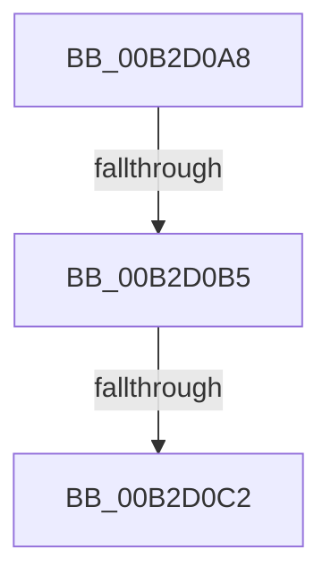

# sub_00B2D0A8

- RVA: `0x00B2D0A8`–`0x00B2D0DC` (길이 `52` bytes)
- VA: `0x0000000140B2D0A8`
- 실행 섹션: `PAGE`
- PDB 이름 있음: `아니요`; PDB Function 태그: `아니요`
- unwind 정보 RVA: `0x0009A3B0`
- 디코드: `13`개 명령, `52/52` bytes 표시
- 미해석 바이트: `0` (있으면 어셈블리에 `.byte`로 보존)

> 이 문서는 커널 이미지의 기계어와 PDB 기호를 분석해 생성했습니다. 4번과 5번은 함수 원형과 자료형을 바이너리 사용 방식에서 추정한 C 해석이며 원본 소스 복구 결과는 아닙니다.

## 1. Dependencies

- 직접 호출 지점: **1**; 고유 호출 대상: **1**
- 직접 호출자로 확인된 함수: **0**
- RIP 상대 이미지 참조: **0**

### Outgoing calls
- `0x00B2D0D1` → [ExFreePoolWithTag](../../poolcode/B8/ExFreePoolWithTag_function_00B82870.md) (function, `0x00B82870`)

### Direct callers
- 이 함수 시작 RVA로 연결되는 직접 call은 확인되지 않았습니다. 간접 호출은 완전히 역산할 수 없습니다.

### Static image references
- 디코드된 RIP-relative 메모리 참조가 없습니다.

## 2. Other-region calls and transfers

- 다른 실행 섹션으로 향하는 call: **1**
  - `0x00B2D0D1` → [ExFreePoolWithTag](../../poolcode/B8/ExFreePoolWithTag_function_00B82870.md) (`PAGE` → `POOLCODE`)
- call이 아닌 외부 분기/꼬리 이동: **3**
  - `0x00B2D0AF` → [PspAddSchedulingGroupToJobChain + 0x201](../99/PspAddSchedulingGroupToJobChain_function_0099DE5C.md) (`tail-transfer`)
  - `0x00B2D0BC` → [PspAddSchedulingGroupToJobChain + 0x201](../99/PspAddSchedulingGroupToJobChain_function_0099DE5C.md) (`tail-transfer`)
  - `0x00B2D0D7` → [PspAddSchedulingGroupToJobChain + 0x292](../99/PspAddSchedulingGroupToJobChain_function_0099DE5C.md) (`tail-transfer`)

## 3. Assembly (complete function range)

```asm
00B2D0A8  48 8B 0B                        mov rcx, qword ptr [rbx]
00B2D0AB  48 39 59 08                     cmp qword ptr [rcx + 8], rbx
00B2D0AF  0F 85 A8 0F E7 FF               jne 0x14099e05d
00B2D0B5  48 8B 43 08                     mov rax, qword ptr [rbx + 8]
00B2D0B9  48 39 18                        cmp qword ptr [rax], rbx
00B2D0BC  0F 85 9B 0F E7 FF               jne 0x14099e05d
00B2D0C2  48 89 08                        mov qword ptr [rax], rcx
00B2D0C5  BA 50 73 4A 62                  mov edx, 0x624a7350
00B2D0CA  48 89 41 08                     mov qword ptr [rcx + 8], rax
00B2D0CE  48 8B CB                        mov rcx, rbx
00B2D0D1  E8 9A 57 05 00                  call 0x140b82870
00B2D0D6  90                              nop
00B2D0D7  E9 12 10 E7 FF                  jmp 0x14099e0ee
```

## 4. C-style interpretation (structured pseudocode)

```c
__int64 __fastcall sub_00B2D0A8(void)
{
    __int64 result;

    *(unsigned __int64 *)(*(unsigned __int64 *)(v_rbx + 8)) = *(unsigned __int64 *)(v_rbx);
    *(unsigned __int64 *)(*(unsigned __int64 *)(v_rbx) + 8) = *(unsigned __int64 *)(v_rbx + 8);
    result = ExFreePoolWithTag(v_rbx, (unsigned int)(0x624A7350ULL), a3, a4);
}
```

## 5. (Beta) C Style

```c
void sub_00B2D0A8(void)
{
    int64_t result;

    *(uint64_t *)(*(uint64_t *)(local_rbx + 0x8)) = *(uint64_t *)(local_rbx);
    *(uint64_t *)(*(uint64_t *)(local_rbx) + 0x8) = *(uint64_t *)(local_rbx + 0x8);
    result = ExFreePoolWithTag(local_rbx, (uint32_t)(0x624A7350ULL), a3, a4);
}
```

## 6. Execution-region graph

[열기: 2D/3D 그래프와 함수 탐색 컨트롤 패널](../../../control-panel.html?section=page&rva=0x00B2D0A8&view=graph)

- 2D 그래프는 위에서 아래로 흐르고, 3D 그래프는 빈 공간을 드래그해 회전합니다. Shift+드래그는 이동, 휠은 확대·축소, 함수 노드 선택은 대상 보고서 이동입니다.

### Static fallback


