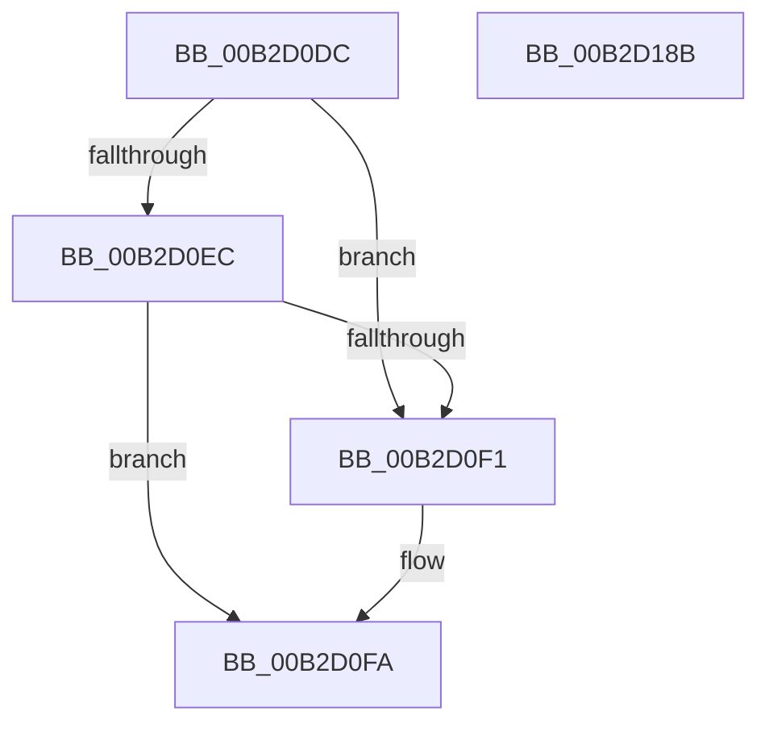

# sub_00B2D0DC

- RVA: `0x00B2D0DC`–`0x00B2D197` (길이 `187` bytes)
- VA: `0x0000000140B2D0DC`
- 실행 섹션: `PAGE`
- PDB 이름 있음: `아니요`; PDB Function 태그: `아니요`
- unwind 정보 RVA: `0x0009B40C`
- 디코드: `48`개 명령, `187/187` bytes 표시
- 미해석 바이트: `0` (있으면 어셈블리에 `.byte`로 보존)

> 이 문서는 커널 이미지의 기계어와 PDB 기호를 분석해 생성했습니다. 4번과 5번은 함수 원형과 자료형을 바이너리 사용 방식에서 추정한 C 해석이며 원본 소스 복구 결과는 아닙니다.

## 1. Dependencies

- 직접 호출 지점: **0**; 고유 호출 대상: **0**
- 직접 호출자로 확인된 함수: **0**
- RIP 상대 이미지 참조: **0**

### Outgoing calls
- 직접 디코드된 call 명령이 없습니다.

### Direct callers
- 이 함수 시작 RVA로 연결되는 직접 call은 확인되지 않았습니다. 간접 호출은 완전히 역산할 수 없습니다.

### Static image references
- 디코드된 RIP-relative 메모리 참조가 없습니다.

## 2. Other-region calls and transfers

- 다른 실행 섹션으로 향하는 call: **0**
- call이 아닌 외부 분기/꼬리 이동: **2**
  - `0x00B2D186` → [WbValidateEncryptionSegmentArguments + 0x15D](../9A/WbValidateEncryptionSegmentArguments_function_009A06CC.md) (`tail-transfer`)
  - `0x00B2D192` → [WbValidateEncryptionSegmentArguments + 0x188](../9A/WbValidateEncryptionSegmentArguments_function_009A06CC.md) (`tail-transfer`)

## 3. Assembly (complete function range)

```asm
00B2D0DC  49 8B 47 08                     mov rax, qword ptr [r15 + 8]
00B2D0E0  48 8D 88 F8 00 00 00            lea rcx, [rax + 0xf8]
00B2D0E7  49 3B CD                        cmp rcx, r13
00B2D0EA  77 05                           ja 0x140b2d0f1
00B2D0EC  48 3B C8                        cmp rcx, rax
00B2D0EF  73 09                           jae 0x140b2d0fa
00B2D0F1  41 8A 45 00                     mov al, byte ptr [r13]
00B2D0F5  48 8B 7C 24 40                  mov rdi, qword ptr [rsp + 0x40]
00B2D0FA  49 8B 47 08                     mov rax, qword ptr [r15 + 8]
00B2D0FE  0F 10 00                        movups xmm0, xmmword ptr [rax]
00B2D101  0F 11 07                        movups xmmword ptr [rdi], xmm0
00B2D104  0F 10 48 10                     movups xmm1, xmmword ptr [rax + 0x10]
00B2D108  0F 11 4F 10                     movups xmmword ptr [rdi + 0x10], xmm1
00B2D10C  0F 10 40 20                     movups xmm0, xmmword ptr [rax + 0x20]
00B2D110  0F 11 47 20                     movups xmmword ptr [rdi + 0x20], xmm0
00B2D114  0F 10 48 30                     movups xmm1, xmmword ptr [rax + 0x30]
00B2D118  0F 11 4F 30                     movups xmmword ptr [rdi + 0x30], xmm1
00B2D11C  0F 10 40 40                     movups xmm0, xmmword ptr [rax + 0x40]
00B2D120  0F 11 47 40                     movups xmmword ptr [rdi + 0x40], xmm0
00B2D124  0F 10 48 50                     movups xmm1, xmmword ptr [rax + 0x50]
00B2D128  0F 11 4F 50                     movups xmmword ptr [rdi + 0x50], xmm1
00B2D12C  0F 10 40 60                     movups xmm0, xmmword ptr [rax + 0x60]
00B2D130  0F 11 47 60                     movups xmmword ptr [rdi + 0x60], xmm0
00B2D134  BA 80 00 00 00                  mov edx, 0x80
00B2D139  48 8D 0C 3A                     lea rcx, [rdx + rdi]
00B2D13D  0F 10 48 70                     movups xmm1, xmmword ptr [rax + 0x70]
00B2D141  0F 11 49 F0                     movups xmmword ptr [rcx - 0x10], xmm1
00B2D145  48 03 C2                        add rax, rdx
00B2D148  0F 10 00                        movups xmm0, xmmword ptr [rax]
00B2D14B  0F 11 01                        movups xmmword ptr [rcx], xmm0
00B2D14E  0F 10 48 10                     movups xmm1, xmmword ptr [rax + 0x10]
00B2D152  0F 11 49 10                     movups xmmword ptr [rcx + 0x10], xmm1
00B2D156  0F 10 40 20                     movups xmm0, xmmword ptr [rax + 0x20]
00B2D15A  0F 11 41 20                     movups xmmword ptr [rcx + 0x20], xmm0
00B2D15E  0F 10 48 30                     movups xmm1, xmmword ptr [rax + 0x30]
00B2D162  0F 11 49 30                     movups xmmword ptr [rcx + 0x30], xmm1
00B2D166  0F 10 40 40                     movups xmm0, xmmword ptr [rax + 0x40]
00B2D16A  0F 11 41 40                     movups xmmword ptr [rcx + 0x40], xmm0
00B2D16E  0F 10 48 50                     movups xmm1, xmmword ptr [rax + 0x50]
00B2D172  0F 11 49 50                     movups xmmword ptr [rcx + 0x50], xmm1
00B2D176  0F 10 40 60                     movups xmm0, xmmword ptr [rax + 0x60]
00B2D17A  0F 11 41 60                     movups xmmword ptr [rcx + 0x60], xmm0
00B2D17E  48 8B 40 70                     mov rax, qword ptr [rax + 0x70]
00B2D182  48 89 41 70                     mov qword ptr [rcx + 0x70], rax
00B2D186  E9 9E 36 E7 FF                  jmp 0x1409a0829
00B2D18B  8B F0                           mov esi, eax
00B2D18D  48 8B 7C 24 40                  mov rdi, qword ptr [rsp + 0x40]
00B2D192  E9 BD 36 E7 FF                  jmp 0x1409a0854
```

## 4. C-style interpretation (structured pseudocode)

```c
__int64 __fastcall sub_00B2D0DC(__int64 a1, __int64 a2, __int64 a3, __int64 a4, __int64 a5, __int64 a6, __int64 a7, __int64 a8)
{
    __int64 result;
    __int64 v_rdi;
    unsigned __int64 v_stack_p40;

    if ((*(unsigned __int64 *)(v_r15 + 8) + 248) > v_r13) goto loc_00B2D0F1;
    result = *(unsigned __int64 *)(v_r15 + 8);
    if ((*(unsigned __int64 *)(v_r15 + 8) + 248) < (*(unsigned __int64 *)(v_r15 + 8))) {
        result = *(unsigned __int8 *)(v_r13);
        v_rdi = a8;
    }
    *(unsigned __int64 *)(v_rdi) = v_xmm0;
    *(unsigned __int64 *)(v_rdi + 16) = v_xmm1;
    *(unsigned __int64 *)(v_rdi + 32) = v_xmm0;
    *(unsigned __int64 *)(v_rdi + 48) = v_xmm1;
    *(unsigned __int64 *)(v_rdi + 64) = v_xmm0;
    *(unsigned __int64 *)(v_rdi + 80) = v_xmm1;
    *(unsigned __int64 *)(v_rdi + 96) = v_xmm0;
    *(unsigned __int64 *)(128 + v_rdi * 1 - 16) = v_xmm1;
    result = (*(unsigned __int64 *)(v_r15 + 8)) + (128);
    *(unsigned __int64 *)(128 + v_rdi * 1) = v_xmm0;
    *(unsigned __int64 *)(128 + v_rdi * 1 + 16) = v_xmm1;
    *(unsigned __int64 *)(128 + v_rdi * 1 + 32) = v_xmm0;
    *(unsigned __int64 *)(128 + v_rdi * 1 + 48) = v_xmm1;
    *(unsigned __int64 *)(128 + v_rdi * 1 + 64) = v_xmm0;
    *(unsigned __int64 *)(128 + v_rdi * 1 + 80) = v_xmm1;
    *(unsigned __int64 *)(128 + v_rdi * 1 + 96) = v_xmm0;
    *(unsigned __int64 *)(128 + v_rdi * 1 + 112) = *(unsigned __int64 *)(result + 112);
}
```

## 5. (Beta) C Style

```c
int64_t sub_00B2D0DC(int64_t Arg1, int64_t Arg2, int64_t Arg3, int64_t Arg4, uint64_t Arg5, uint64_t Arg6, uint64_t Arg7, int64_t Arg8)
{
    int64_t result;
    int64_t local_rdi;
    uint64_t v_stack_p40;

    if ((*(uint64_t *)(local_r15 + 0x8) + 248) > local_r13) goto loc_00B2D0F1;
    result = *(uint64_t *)(local_r15 + 0x8);
    if ((*(uint64_t *)(local_r15 + 0x8) + 248) < (*(uint64_t *)(local_r15 + 0x8))) {
        result = *(uint8_t *)(local_r13);
        local_rdi = Arg8;
    }
    *(uint64_t *)(local_rdi) = v_xmm0;
    *(uint64_t *)(local_rdi + 0x10) = v_xmm1;
    *(uint64_t *)(local_rdi + 0x20) = v_xmm0;
    *(uint64_t *)(local_rdi + 0x30) = v_xmm1;
    *(uint64_t *)(local_rdi + 0x40) = v_xmm0;
    *(uint64_t *)(local_rdi + 0x50) = v_xmm1;
    *(uint64_t *)(local_rdi + 0x60) = v_xmm0;
    *(uint64_t *)(128 + local_rdi * 1 - 0x10) = v_xmm1;
    result = (*(uint64_t *)(local_r15 + 0x8)) + (128);
    *(uint64_t *)(128 + local_rdi * 1) = v_xmm0;
    *(uint64_t *)(128 + local_rdi * 1 + 0x10) = v_xmm1;
    *(uint64_t *)(128 + local_rdi * 1 + 0x20) = v_xmm0;
    *(uint64_t *)(128 + local_rdi * 1 + 0x30) = v_xmm1;
    *(uint64_t *)(128 + local_rdi * 1 + 0x40) = v_xmm0;
    *(uint64_t *)(128 + local_rdi * 1 + 0x50) = v_xmm1;
    *(uint64_t *)(128 + local_rdi * 1 + 0x60) = v_xmm0;
    *(uint64_t *)(128 + local_rdi * 1 + 0x70) = *(uint64_t *)(result + 0x70);
}
```

## 6. Execution-region graph

[열기: 2D/3D 그래프와 함수 탐색 컨트롤 패널](../../../control-panel.html?section=page&rva=0x00B2D0DC&view=graph)

- 2D 그래프는 위에서 아래로 흐르고, 3D 그래프는 빈 공간을 드래그해 회전합니다. Shift+드래그는 이동, 휠은 확대·축소, 함수 노드 선택은 대상 보고서 이동입니다.

### Static fallback


