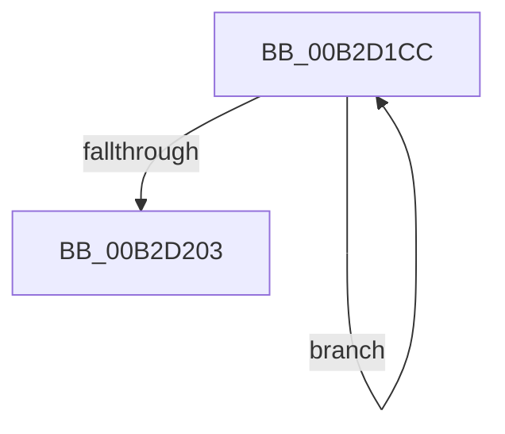

# sub_00B2D1CC

- RVA: `0x00B2D1CC`–`0x00B2D22A` (길이 `94` bytes)
- VA: `0x0000000140B2D1CC`
- 실행 섹션: `PAGE`
- PDB 이름 있음: `아니요`; PDB Function 태그: `아니요`
- unwind 정보 RVA: `0x0009B84C`
- 디코드: `21`개 명령, `94/94` bytes 표시
- 미해석 바이트: `0` (있으면 어셈블리에 `.byte`로 보존)

> 이 문서는 커널 이미지의 기계어와 PDB 기호를 분석해 생성했습니다. 4번과 5번은 함수 원형과 자료형을 바이너리 사용 방식에서 추정한 C 해석이며 원본 소스 복구 결과는 아닙니다.

## 1. Dependencies

- 직접 호출 지점: **0**; 고유 호출 대상: **0**
- 직접 호출자로 확인된 함수: **0**
- RIP 상대 이미지 참조: **0**

### Outgoing calls
- 직접 디코드된 call 명령이 없습니다.

### Direct callers
- 이 함수 시작 RVA로 연결되는 직접 call은 확인되지 않았습니다. 간접 호출은 완전히 역산할 수 없습니다.

### Static image references
- 디코드된 RIP-relative 메모리 참조가 없습니다.

## 2. Other-region calls and transfers

- 다른 실행 섹션으로 향하는 call: **0**
- call이 아닌 외부 분기/꼬리 이동: **1**
  - `0x00B2D225` → [sub_009A29C5 + 0x18](../9A/Unknown_function_009A29C5.md) (`tail-transfer`)

## 3. Assembly (complete function range)

```asm
00B2D1CC  41 8B C1                        mov eax, r9d
00B2D1CF  0F 57 C0                        xorps xmm0, xmm0
00B2D1D2  F3 41 0F 7E 8C 45 60 81 FD 00   movq xmm1, qword ptr [r13 + rax*2 + 0xfd8160]
00B2D1DC  41 8D 41 04                     lea eax, [r9 + 4]
00B2D1E0  66 0F 61 C8                     punpcklwd xmm1, xmm0
00B2D1E4  41 83 C1 08                     add r9d, 8
00B2D1E8  66 0F FE D9                     paddd xmm3, xmm1
00B2D1EC  F3 41 0F 7E 8C 45 60 81 FD 00   movq xmm1, qword ptr [r13 + rax*2 + 0xfd8160]
00B2D1F6  66 0F 61 C8                     punpcklwd xmm1, xmm0
00B2D1FA  66 0F FE D1                     paddd xmm2, xmm1
00B2D1FE  44 3B CA                        cmp r9d, edx
00B2D201  72 C9                           jb 0x140b2d1cc
00B2D203  66 0F FE D3                     paddd xmm2, xmm3
00B2D207  66 0F 6F C2                     movdqa xmm0, xmm2
00B2D20B  66 0F 73 D8 08                  psrldq xmm0, 8
00B2D210  66 0F FE D0                     paddd xmm2, xmm0
00B2D214  66 0F 6F C2                     movdqa xmm0, xmm2
00B2D218  66 0F 73 D8 04                  psrldq xmm0, 4
00B2D21D  66 0F FE D0                     paddd xmm2, xmm0
00B2D221  66 0F 7E D2                     movd edx, xmm2
00B2D225  E9 B3 57 E7 FF                  jmp 0x1409a29dd
```

## 4. C-style interpretation (structured pseudocode)

```c
__int64 __fastcall sub_00B2D1CC(__int64 a1, int a2, __int64 a3, __int64 a4)
{
    a4 = (unsigned int)((a4) + (8));
    if (((unsigned int)(a4)) < a2) goto loc_00B2D1CC;
}
```

## 5. (Beta) C Style

```c
int64_t sub_00B2D1CC(int64_t Arg1, int32_t Arg2, int64_t Arg3, int64_t Arg4)
{
    Arg4 = (uint32_t)((Arg4) + (8));
    if (((uint32_t)(Arg4)) < Arg2) goto loc_00B2D1CC;
}
```

## 6. Execution-region graph

[열기: 2D/3D 그래프와 함수 탐색 컨트롤 패널](../../../control-panel.html?section=page&rva=0x00B2D1CC&view=graph)

- 2D 그래프는 위에서 아래로 흐르고, 3D 그래프는 빈 공간을 드래그해 회전합니다. Shift+드래그는 이동, 휠은 확대·축소, 함수 노드 선택은 대상 보고서 이동입니다.

### Static fallback


