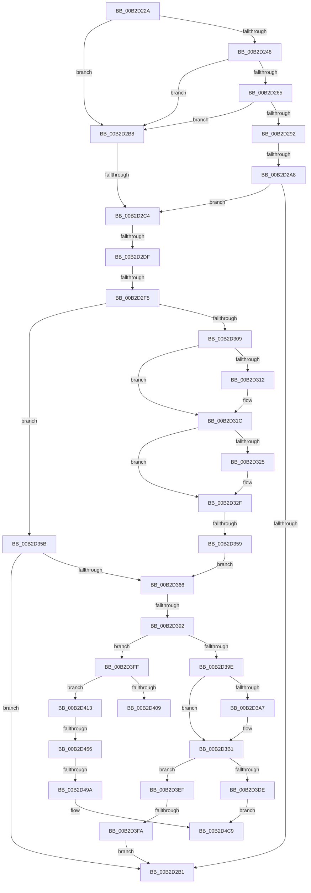

# sub_00B2D22A

- RVA: `0x00B2D22A`–`0x00B2D4D0` (길이 `678` bytes)
- VA: `0x0000000140B2D22A`
- 실행 섹션: `PAGE`
- PDB 이름 있음: `아니요`; PDB Function 태그: `아니요`
- unwind 정보 RVA: `0x0009C330`
- 디코드: `170`개 명령, `678/678` bytes 표시
- 미해석 바이트: `0` (있으면 어셈블리에 `.byte`로 보존)

> 이 문서는 커널 이미지의 기계어와 PDB 기호를 분석해 생성했습니다. 4번과 5번은 함수 원형과 자료형을 바이너리 사용 방식에서 추정한 C 해석이며 원본 소스 복구 결과는 아닙니다.

## 1. Dependencies

- 직접 호출 지점: **22**; 고유 호출 대상: **9**
- 직접 호출자로 확인된 함수: **0**
- RIP 상대 이미지 참조: **5**

### Outgoing calls
- `0x00B2D23D` → [IopOpenRegistryKeyEx](../A5/IopOpenRegistryKeyEx_function_00A51B44.md) (function, `0x00A51B44`)
- `0x00B2D25A` → [IopOpenRegistryKeyEx](../A5/IopOpenRegistryKeyEx_function_00A51B44.md) (function, `0x00A51B44`)
- `0x00B2D270` → [RtlInitUnicodeString](../../text/42/RtlInitUnicodeString_function_0042A780.md) (function, `0x0042A780`)
- `0x00B2D287` → [IopOpenRegistryKeyEx](../A5/IopOpenRegistryKeyEx_function_00A51B44.md) (function, `0x00A51B44`)
- `0x00B2D299` → [IopQuerySecureDeviceClassState](../AB/IopQuerySecureDeviceClassState_function_00ABC9A4.md) (function, `0x00ABC9A4`)
- `0x00B2D2CC` → [IopGetPersistedStateLocation](../AD/IopGetPersistedStateLocation_function_00AD2EE4.md) (function, `0x00AD2EE4`)
- `0x00B2D2E6` → [RtlInitUnicodeStringEx](../../text/46/RtlInitUnicodeStringEx_function_00463960.md) (function, `0x00463960`)
- `0x00B2D300` → [RtlEqualUnicodeString](../93/RtlEqualUnicodeString_function_00932A20.md) (function, `0x00932A20`)
- `0x00B2D312` → [ZwClose](../../text/6A/ZwClose_function_006AD2B0.md) (function, `0x006AD2B0`)
- `0x00B2D325` → [ZwClose](../../text/6A/ZwClose_function_006AD2B0.md) (function, `0x006AD2B0`)
- `0x00B2D34A` → [IopCreateRegistryKeyEx](../A8/IopCreateRegistryKeyEx_function_00A89038.md) (function, `0x00A89038`)
- `0x00B2D383` → [IopCreateRegistryKeyEx](../A8/IopCreateRegistryKeyEx_function_00A89038.md) (function, `0x00A89038`)
- `0x00B2D3A7` → [ZwClose](../../text/6A/ZwClose_function_006AD2B0.md) (function, `0x006AD2B0`)
- `0x00B2D3BC` → [RtlInitUnicodeString](../../text/42/RtlInitUnicodeString_function_0042A780.md) (function, `0x0042A780`)
- `0x00B2D3D3` → [IopOpenRegistryKeyEx](../A5/IopOpenRegistryKeyEx_function_00A51B44.md) (function, `0x00A51B44`)
- `0x00B2D3E5` → [IopQuerySecureDeviceClassState](../AB/IopQuerySecureDeviceClassState_function_00ABC9A4.md) (function, `0x00ABC9A4`)
- `0x00B2D41E` → [RtlInitUnicodeString](../../text/42/RtlInitUnicodeString_function_0042A780.md) (function, `0x0042A780`)
- `0x00B2D447` → [ZwSetValueKey](../../text/6A/ZwSetValueKey_function_006ADCD0.md) (function, `0x006ADCD0`)
- `0x00B2D461` → [RtlInitUnicodeString](../../text/42/RtlInitUnicodeString_function_0042A780.md) (function, `0x0042A780`)
- `0x00B2D48B` → [ZwSetValueKey](../../text/6A/ZwSetValueKey_function_006ADCD0.md) (function, `0x006ADCD0`)
- `0x00B2D4A5` → [RtlInitUnicodeString](../../text/42/RtlInitUnicodeString_function_0042A780.md) (function, `0x0042A780`)
- `0x00B2D4C4` → [ZwSetValueKey](../../text/6A/ZwSetValueKey_function_006ADCD0.md) (function, `0x006ADCD0`)

### Direct callers
- 이 함수 시작 RVA로 연결되는 직접 call은 확인되지 않았습니다. 간접 호출은 완전히 역산할 수 없습니다.

### Static image references
- `0x00B2D265` → RVA `0x00AFCD40` (` ?? ::NNGAKEGL::`string'`; read)
- `0x00B2D413` → RVA `0x00AFCD80` (` ?? ::NNGAKEGL::`string'`; read)
- `0x00B2D456` → RVA `0x00AFCD90` (` ?? ::NNGAKEGL::`string'`; read)
- `0x00B2D46E` → RVA `0x00AFCCD0` (` ?? ::NNGAKEGL::`string'`; read)
- `0x00B2D49A` → RVA `0x00AFCDB0` (` ?? ::NNGAKEGL::`string'`; read)

## 2. Other-region calls and transfers

- 다른 실행 섹션으로 향하는 call: **12**
  - `0x00B2D270` → [RtlInitUnicodeString](../../text/42/RtlInitUnicodeString_function_0042A780.md) (`PAGE` → `.text`)
  - `0x00B2D2E6` → [RtlInitUnicodeStringEx](../../text/46/RtlInitUnicodeStringEx_function_00463960.md) (`PAGE` → `.text`)
  - `0x00B2D312` → [ZwClose](../../text/6A/ZwClose_function_006AD2B0.md) (`PAGE` → `.text`)
  - `0x00B2D325` → [ZwClose](../../text/6A/ZwClose_function_006AD2B0.md) (`PAGE` → `.text`)
  - `0x00B2D3A7` → [ZwClose](../../text/6A/ZwClose_function_006AD2B0.md) (`PAGE` → `.text`)
  - `0x00B2D3BC` → [RtlInitUnicodeString](../../text/42/RtlInitUnicodeString_function_0042A780.md) (`PAGE` → `.text`)
  - `0x00B2D41E` → [RtlInitUnicodeString](../../text/42/RtlInitUnicodeString_function_0042A780.md) (`PAGE` → `.text`)
  - `0x00B2D447` → [ZwSetValueKey](../../text/6A/ZwSetValueKey_function_006ADCD0.md) (`PAGE` → `.text`)
  - `0x00B2D461` → [RtlInitUnicodeString](../../text/42/RtlInitUnicodeString_function_0042A780.md) (`PAGE` → `.text`)
  - `0x00B2D48B` → [ZwSetValueKey](../../text/6A/ZwSetValueKey_function_006ADCD0.md) (`PAGE` → `.text`)
  - `0x00B2D4A5` → [RtlInitUnicodeString](../../text/42/RtlInitUnicodeString_function_0042A780.md) (`PAGE` → `.text`)
  - `0x00B2D4C4` → [ZwSetValueKey](../../text/6A/ZwSetValueKey_function_006ADCD0.md) (`PAGE` → `.text`)
- call이 아닌 외부 분기/꼬리 이동: **12**
  - `0x00B2D2A2` → [IopCreateSecureDeviceClassSettings + 0x88](../9A/IopCreateSecureDeviceClassSettings_function_009A30D8.md) (`tail-transfer`)
  - `0x00B2D2B3` → [IopCreateSecureDeviceClassSettings + 0x88](../9A/IopCreateSecureDeviceClassSettings_function_009A30D8.md) (`tail-transfer`)
  - `0x00B2D2BE` → [IopCreateSecureDeviceClassSettings + 0x88](../9A/IopCreateSecureDeviceClassSettings_function_009A30D8.md) (`tail-transfer`)
  - `0x00B2D2D9` → [IopCreateSecureDeviceClassSettings + 0x88](../9A/IopCreateSecureDeviceClassSettings_function_009A30D8.md) (`tail-transfer`)
  - `0x00B2D2EF` → [IopCreateSecureDeviceClassSettings + 0x88](../9A/IopCreateSecureDeviceClassSettings_function_009A30D8.md) (`tail-transfer`)
  - `0x00B2D353` → [IopCreateSecureDeviceClassSettings + 0x88](../9A/IopCreateSecureDeviceClassSettings_function_009A30D8.md) (`tail-transfer`)
  - `0x00B2D38C` → [IopCreateSecureDeviceClassSettings + 0x88](../9A/IopCreateSecureDeviceClassSettings_function_009A30D8.md) (`tail-transfer`)
  - `0x00B2D3F4` → [IopCreateSecureDeviceClassSettings + 0x88](../9A/IopCreateSecureDeviceClassSettings_function_009A30D8.md) (`tail-transfer`)
  - `0x00B2D40E` → [IopCreateSecureDeviceClassSettings + 0x88](../9A/IopCreateSecureDeviceClassSettings_function_009A30D8.md) (`tail-transfer`)
  - `0x00B2D450` → [IopCreateSecureDeviceClassSettings + 0x88](../9A/IopCreateSecureDeviceClassSettings_function_009A30D8.md) (`tail-transfer`)
  - `0x00B2D494` → [IopCreateSecureDeviceClassSettings + 0x88](../9A/IopCreateSecureDeviceClassSettings_function_009A30D8.md) (`tail-transfer`)
  - `0x00B2D4CB` → [IopCreateSecureDeviceClassSettings + 0x88](../9A/IopCreateSecureDeviceClassSettings_function_009A30D8.md) (`tail-transfer`)

## 3. Assembly (complete function range)

```asm
00B2D22A  41 BD 3F 00 0F 00               mov r13d, 0xf003f
00B2D230  4C 8D 45 1F                     lea r8, [rbp + 0x1f]
00B2D234  45 8B CD                        mov r9d, r13d
00B2D237  48 8D 4D EF                     lea rcx, [rbp - 0x11]
00B2D23B  33 D2                           xor edx, edx
00B2D23D  E8 02 49 F2 FF                  call 0x140a51b44
00B2D242  8B D8                           mov ebx, eax
00B2D244  85 C0                           test eax, eax
00B2D246  78 70                           js 0x140b2d2b8
00B2D248  48 8B 55 EF                     mov rdx, qword ptr [rbp - 0x11]
00B2D24C  4C 8D 45 2F                     lea r8, [rbp + 0x2f]
00B2D250  41 B9 19 00 02 00               mov r9d, 0x20019
00B2D256  48 8D 4D E7                     lea rcx, [rbp - 0x19]
00B2D25A  E8 E5 48 F2 FF                  call 0x140a51b44
00B2D25F  8B D8                           mov ebx, eax
00B2D261  85 C0                           test eax, eax
00B2D263  78 53                           js 0x140b2d2b8
00B2D265  48 8D 15 D4 FA FC FF            lea rdx, [rip - 0x3052c]
00B2D26C  48 8D 4D 0F                     lea rcx, [rbp + 0xf]
00B2D270  E8 0B D5 8F FF                  call 0x14042a780
00B2D275  48 8B 55 E7                     mov rdx, qword ptr [rbp - 0x19]
00B2D279  4C 8D 45 0F                     lea r8, [rbp + 0xf]
00B2D27D  41 B9 19 00 02 00               mov r9d, 0x20019
00B2D283  48 8D 4D F7                     lea rcx, [rbp - 9]
00B2D287  E8 B8 48 F2 FF                  call 0x140a51b44
00B2D28C  8B D8                           mov ebx, eax
00B2D28E  85 C0                           test eax, eax
00B2D290  78 26                           js 0x140b2d2b8
00B2D292  48 8B 4D F7                     mov rcx, qword ptr [rbp - 9]
00B2D296  48 8B D6                        mov rdx, rsi
00B2D299  E8 06 F7 F8 FF                  call 0x140abc9a4
00B2D29E  8B D8                           mov ebx, eax
00B2D2A0  85 C0                           test eax, eax
00B2D2A2  0F 88 B8 5E E7 FF               js 0x1409a3160
00B2D2A8  8B 06                           mov eax, dword ptr [rsi]
00B2D2AA  83 E0 0F                        and eax, 0xf
00B2D2AD  3C 0F                           cmp al, 0xf
00B2D2AF  75 13                           jne 0x140b2d2c4
00B2D2B1  33 DB                           xor ebx, ebx
00B2D2B3  E9 A8 5E E7 FF                  jmp 0x1409a3160
00B2D2B8  81 FB 34 00 00 C0               cmp ebx, 0xc0000034
00B2D2BE  0F 85 9C 5E E7 FF               jne 0x1409a3160
00B2D2C4  48 8B 55 27                     mov rdx, qword ptr [rbp + 0x27]
00B2D2C8  4C 8D 4D FF                     lea r9, [rbp - 1]
00B2D2CC  E8 13 5C FA FF                  call 0x140ad2ee4
00B2D2D1  48 8B 7D FF                     mov rdi, qword ptr [rbp - 1]
00B2D2D5  8B D8                           mov ebx, eax
00B2D2D7  85 C0                           test eax, eax
00B2D2D9  0F 88 81 5E E7 FF               js 0x1409a3160
00B2D2DF  48 8B D7                        mov rdx, rdi
00B2D2E2  48 8D 4D 0F                     lea rcx, [rbp + 0xf]
00B2D2E6  E8 75 66 93 FF                  call 0x140463960
00B2D2EB  8B D8                           mov ebx, eax
00B2D2ED  85 C0                           test eax, eax
00B2D2EF  0F 88 6B 5E E7 FF               js 0x1409a3160
00B2D2F5  41 B0 01                        mov r8b, 1
00B2D2F8  48 8D 55 1F                     lea rdx, [rbp + 0x1f]
00B2D2FC  48 8D 4D 0F                     lea rcx, [rbp + 0xf]
00B2D300  E8 1B 57 E0 FF                  call 0x140932a20
00B2D305  84 C0                           test al, al
00B2D307  75 52                           jne 0x140b2d35b
00B2D309  48 8B 4D EF                     mov rcx, qword ptr [rbp - 0x11]
00B2D30D  48 85 C9                        test rcx, rcx
00B2D310  74 0A                           je 0x140b2d31c
00B2D312  E8 99 FF B7 FF                  call 0x1406ad2b0
00B2D317  48 83 65 EF 00                  and qword ptr [rbp - 0x11], 0
00B2D31C  48 8B 4D E7                     mov rcx, qword ptr [rbp - 0x19]
00B2D320  48 85 C9                        test rcx, rcx
00B2D323  74 0A                           je 0x140b2d32f
00B2D325  E8 86 FF B7 FF                  call 0x1406ad2b0
00B2D32A  48 83 65 E7 00                  and qword ptr [rbp - 0x19], 0
00B2D32F  48 8D 45 7F                     lea rax, [rbp + 0x7f]
00B2D333  45 8B CD                        mov r9d, r13d
00B2D336  48 89 44 24 28                  mov qword ptr [rsp + 0x28], rax
00B2D33B  4C 8D 45 0F                     lea r8, [rbp + 0xf]
00B2D33F  83 64 24 20 00                  and dword ptr [rsp + 0x20], 0
00B2D344  48 8D 4D EF                     lea rcx, [rbp - 0x11]
00B2D348  33 D2                           xor edx, edx
00B2D34A  E8 E9 BC F5 FF                  call 0x140a89038
00B2D34F  8B D8                           mov ebx, eax
00B2D351  85 C0                           test eax, eax
00B2D353  0F 88 07 5E E7 FF               js 0x1409a3160
00B2D359  EB 0B                           jmp 0x140b2d366
00B2D35B  48 83 7D E7 00                  cmp qword ptr [rbp - 0x19], 0
00B2D360  0F 85 4B FF FF FF               jne 0x140b2d2b1
00B2D366  48 8B 55 EF                     mov rdx, qword ptr [rbp - 0x11]
00B2D36A  48 8D 45 7F                     lea rax, [rbp + 0x7f]
00B2D36E  48 89 44 24 28                  mov qword ptr [rsp + 0x28], rax
00B2D373  4C 8D 45 2F                     lea r8, [rbp + 0x2f]
00B2D377  83 64 24 20 00                  and dword ptr [rsp + 0x20], 0
00B2D37C  48 8D 4D E7                     lea rcx, [rbp - 0x19]
00B2D380  45 8B CD                        mov r9d, r13d
00B2D383  E8 B0 BC F5 FF                  call 0x140a89038
00B2D388  8B D8                           mov ebx, eax
00B2D38A  85 C0                           test eax, eax
00B2D38C  0F 88 CE 5D E7 FF               js 0x1409a3160
00B2D392  41 BD 02 00 00 00               mov r13d, 2
00B2D398  44 39 6D 7F                     cmp dword ptr [rbp + 0x7f], r13d
00B2D39C  75 61                           jne 0x140b2d3ff
00B2D39E  48 8B 4D F7                     mov rcx, qword ptr [rbp - 9]
00B2D3A2  48 85 C9                        test rcx, rcx
00B2D3A5  74 0A                           je 0x140b2d3b1
00B2D3A7  E8 04 FF B7 FF                  call 0x1406ad2b0
00B2D3AC  48 83 65 F7 00                  and qword ptr [rbp - 9], 0
00B2D3B1  48 8D 15 88 F9 FC FF            lea rdx, [rip - 0x30678]
00B2D3B8  48 8D 4D 0F                     lea rcx, [rbp + 0xf]
00B2D3BC  E8 BF D3 8F FF                  call 0x14042a780
00B2D3C1  48 8B 55 E7                     mov rdx, qword ptr [rbp - 0x19]
00B2D3C5  4C 8D 45 0F                     lea r8, [rbp + 0xf]
00B2D3C9  41 B9 19 00 02 00               mov r9d, 0x20019
00B2D3CF  48 8D 4D F7                     lea rcx, [rbp - 9]
00B2D3D3  E8 6C 47 F2 FF                  call 0x140a51b44
00B2D3D8  8B D8                           mov ebx, eax
00B2D3DA  85 C0                           test eax, eax
00B2D3DC  78 11                           js 0x140b2d3ef
00B2D3DE  48 8B 4D F7                     mov rcx, qword ptr [rbp - 9]
00B2D3E2  48 8B D6                        mov rdx, rsi
00B2D3E5  E8 BA F5 F8 FF                  call 0x140abc9a4
00B2D3EA  E9 DA 00 00 00                  jmp 0x140b2d4c9
00B2D3EF  3D 34 00 00 C0                  cmp eax, 0xc0000034
00B2D3F4  0F 85 66 5D E7 FF               jne 0x1409a3160
00B2D3FA  E9 B2 FE FF FF                  jmp 0x140b2d2b1
00B2D3FF  49 8B 5E 30                     mov rbx, qword ptr [r14 + 0x30]
00B2D403  48 83 C3 18                     add rbx, 0x18
00B2D407  75 0A                           jne 0x140b2d413
00B2D409  BB 9A 00 00 C0                  mov ebx, 0xc000009a
00B2D40E  E9 4D 5D E7 FF                  jmp 0x1409a3160
00B2D413  48 8D 15 66 F9 FC FF            lea rdx, [rip - 0x3069a]
00B2D41A  48 8D 4D 0F                     lea rcx, [rbp + 0xf]
00B2D41E  E8 5D D3 8F FF                  call 0x14042a780
00B2D423  0F B7 03                        movzx eax, word ptr [rbx]
00B2D426  48 8D 55 0F                     lea rdx, [rbp + 0xf]
00B2D42A  48 8B 4D E7                     mov rcx, qword ptr [rbp - 0x19]
00B2D42E  41 03 C5                        add eax, r13d
00B2D431  89 44 24 28                     mov dword ptr [rsp + 0x28], eax
00B2D435  41 B9 01 00 00 00               mov r9d, 1
00B2D43B  48 8B 43 08                     mov rax, qword ptr [rbx + 8]
00B2D43F  45 33 C0                        xor r8d, r8d
00B2D442  48 89 44 24 20                  mov qword ptr [rsp + 0x20], rax
00B2D447  E8 84 08 B8 FF                  call 0x1406adcd0
00B2D44C  8B D8                           mov ebx, eax
00B2D44E  85 C0                           test eax, eax
00B2D450  0F 88 0A 5D E7 FF               js 0x1409a3160
00B2D456  48 8D 15 33 F9 FC FF            lea rdx, [rip - 0x306cd]
00B2D45D  48 8D 4D 0F                     lea rcx, [rbp + 0xf]
00B2D461  E8 1A D3 8F FF                  call 0x14042a780
00B2D466  48 8B 4D E7                     mov rcx, qword ptr [rbp - 0x19]
00B2D46A  41 8D 75 02                     lea esi, [r13 + 2]
00B2D46E  4C 8D 35 5B F8 FC FF            lea r14, [rip - 0x307a5]
00B2D475  89 74 24 28                     mov dword ptr [rsp + 0x28], esi
00B2D479  41 B9 01 00 00 00               mov r9d, 1
00B2D47F  4C 89 74 24 20                  mov qword ptr [rsp + 0x20], r14
00B2D484  45 33 C0                        xor r8d, r8d
00B2D487  48 8D 55 0F                     lea rdx, [rbp + 0xf]
00B2D48B  E8 40 08 B8 FF                  call 0x1406adcd0
00B2D490  8B D8                           mov ebx, eax
00B2D492  85 C0                           test eax, eax
00B2D494  0F 88 C6 5C E7 FF               js 0x1409a3160
00B2D49A  48 8D 15 0F F9 FC FF            lea rdx, [rip - 0x306f1]
00B2D4A1  48 8D 4D 0F                     lea rcx, [rbp + 0xf]
00B2D4A5  E8 D6 D2 8F FF                  call 0x14042a780
00B2D4AA  48 8B 4D E7                     mov rcx, qword ptr [rbp - 0x19]
00B2D4AE  48 8D 55 0F                     lea rdx, [rbp + 0xf]
00B2D4B2  41 B9 01 00 00 00               mov r9d, 1
00B2D4B8  89 74 24 28                     mov dword ptr [rsp + 0x28], esi
00B2D4BC  45 33 C0                        xor r8d, r8d
00B2D4BF  4C 89 74 24 20                  mov qword ptr [rsp + 0x20], r14
00B2D4C4  E8 07 08 B8 FF                  call 0x1406adcd0
00B2D4C9  8B D8                           mov ebx, eax
00B2D4CB  E9 90 5C E7 FF                  jmp 0x1409a3160
```

## 4. C-style interpretation (structured pseudocode)

```c
__int64 __fastcall sub_00B2D22A(__int64 a1, int a2)
{
    __int64 result;
    __int64 v_rbx;
    unsigned int v_stack_p20;
    unsigned __int64 v_stack_p28;

    a2 = 0;
    result = IopOpenRegistryKeyEx(v_rbp - 17, a2, v_rbp + 31, (unsigned int)((unsigned int)((unsigned int)(0xF003FULL))));
    if (sign_flag) goto loc_00B2D2B8;
    result = IopOpenRegistryKeyEx(v_rbp - 25, *(unsigned __int64 *)(v_rbp - 17), v_rbp + 47, (unsigned int)(0x20019ULL));
    if (sign_flag) goto loc_00B2D2B8;
    result = RtlInitUnicodeString(v_rbp + 15, v_rip - 197932, v_rbp + 47, (unsigned int)(0x20019ULL));
    result = IopOpenRegistryKeyEx(v_rbp - 9, *(unsigned __int64 *)(v_rbp - 25), v_rbp + 15, (unsigned int)(0x20019ULL));
    if (sign_flag) goto loc_00B2D2B8;
    result = IopQuerySecureDeviceClassState(*(unsigned __int64 *)(v_rbp - 9), v_rsi, v_rbp + 15, (unsigned int)(0x20019ULL));
    result = (unsigned int)(((unsigned int)(*(unsigned int *)(v_rsi))) & (15));
    if (((unsigned __int8)(result)) != 15) goto loc_00B2D2C4;
loc_00B2D2B1:
    v_rbx = 0;
loc_00B2D2B8:
loc_00B2D2C4:
    result = IopGetPersistedStateLocation(*(unsigned __int64 *)(v_rbp - 9), *(unsigned __int64 *)(v_rbp + 39), v_rbp + 15, v_rbp - 1);
    result = RtlInitUnicodeStringEx(v_rbp + 15, *(unsigned __int64 *)(v_rbp - 1), v_rbp + 15, v_rbp - 1);
    result = RtlEqualUnicodeString(v_rbp + 15, v_rbp + 31, 1, v_rbp - 1);
    if ((unsigned __int8)(result) != 0) goto loc_00B2D35B;
    if (*(unsigned __int64 *)(v_rbp - 17) != 0) {
        result = ZwClose(*(unsigned __int64 *)(v_rbp - 17), v_rbp + 31, 1, v_rbp - 1);
    }
    if (*(unsigned __int64 *)(v_rbp - 25) != 0) {
        result = ZwClose(*(unsigned __int64 *)(v_rbp - 25), v_rbp + 31, 1, v_rbp - 1);
    }
    v_stack_p28 = v_rbp + 127;
    a2 = 0;
    result = IopCreateRegistryKeyEx(v_rbp - 17, a2, v_rbp + 15, (unsigned int)((unsigned int)((unsigned int)(0xF003FULL))));
    goto loc_00B2D366;
loc_00B2D35B:
    if ((*(unsigned __int64 *)(v_rbp - 25)) != 0) goto loc_00B2D2B1;
loc_00B2D366:
    v_stack_p28 = v_rbp + 127;
    result = IopCreateRegistryKeyEx(v_rbp - 25, *(unsigned __int64 *)(v_rbp - 17), v_rbp + 47, (unsigned int)((unsigned int)((unsigned int)(0xF003FULL))));
    if ((*(unsigned int *)(v_rbp + 127)) != 2) goto loc_00B2D3FF;
    if (*(unsigned __int64 *)(v_rbp - 9) != 0) {
        result = ZwClose(*(unsigned __int64 *)(v_rbp - 9), *(unsigned __int64 *)(v_rbp - 17), v_rbp + 47, (unsigned int)((unsigned int)((unsigned int)(0xF003FULL))));
    }
    result = RtlInitUnicodeString(v_rbp + 15, v_rip - 198264, v_rbp + 47, (unsigned int)((unsigned int)((unsigned int)(0xF003FULL))));
    result = IopOpenRegistryKeyEx(v_rbp - 9, *(unsigned __int64 *)(v_rbp - 25), v_rbp + 15, (unsigned int)(0x20019ULL));
    if (sign_flag) goto loc_00B2D3EF;
    result = IopQuerySecureDeviceClassState(*(unsigned __int64 *)(v_rbp - 9), v_rsi, v_rbp + 15, (unsigned int)(0x20019ULL));
    goto loc_00B2D4C9;
loc_00B2D3EF:
    goto loc_00B2D2B1;
loc_00B2D3FF:
    v_rbx = (*(unsigned __int64 *)(v_r14 + 48)) + (24);
    if (condition_is_not_equal) goto loc_00B2D413;
loc_00B2D413:
    result = RtlInitUnicodeString(v_rbp + 15, v_rip - 198298, v_rbp + 15, (unsigned int)(0x20019ULL));
    result = (unsigned int)((*(unsigned __int16 *)((unsigned int)(0xC000009AULL))) + (2));
    v_stack_p28 = (unsigned int)(result);
    a3 = 0;
    v_stack_p20 = *(unsigned __int64 *)((unsigned int)(0xC000009AULL) + 8);
    result = ZwSetValueKey(*(unsigned __int64 *)(v_rbp - 25), v_rbp + 15, a3, 1);
    result = RtlInitUnicodeString(v_rbp + 15, v_rip - 198349, a3, 1);
    v_stack_p28 = (unsigned int)(2 + 2);
    v_stack_p20 = v_rip - 198565;
    a3 = 0;
    result = ZwSetValueKey(*(unsigned __int64 *)(v_rbp - 25), v_rbp + 15, a3, 1);
    result = RtlInitUnicodeString(v_rbp + 15, v_rip - 198385, a3, 1);
    v_stack_p28 = (unsigned int)(2 + 2);
    a3 = 0;
    v_stack_p20 = v_rip - 198565;
    result = ZwSetValueKey(*(unsigned __int64 *)(v_rbp - 25), v_rbp + 15, a3, 1);
loc_00B2D4C9:
}
```

## 5. (Beta) C Style

```c
int64_t sub_00B2D22A(int64_t Arg1, int32_t Arg2)
{
    int64_t result;
    int64_t local_rbx;
    uint32_t v_stack_p20;
    uint64_t v_stack_p28;

    Arg2 = 0;
    result = IopOpenRegistryKeyEx(local_rbp - 17, Arg2, local_rbp + 31, (uint32_t)((uint32_t)((uint32_t)(0xF003FULL))));
    if (sign_flag) goto loc_00B2D2B8;
    result = IopOpenRegistryKeyEx(local_rbp - 25, *(uint64_t *)(local_rbp - 0x11), local_rbp + 47, (uint32_t)(0x20019ULL));
    if (sign_flag) goto loc_00B2D2B8;
    result = RtlInitUnicodeString(local_rbp + 15, v_rip - 197932, local_rbp + 47, (uint32_t)(0x20019ULL));
    result = IopOpenRegistryKeyEx(local_rbp - 9, *(uint64_t *)(local_rbp - 0x19), local_rbp + 15, (uint32_t)(0x20019ULL));
    if (sign_flag) goto loc_00B2D2B8;
    result = IopQuerySecureDeviceClassState(*(uint64_t *)(local_rbp - 0x9), local_rsi, local_rbp + 15, (uint32_t)(0x20019ULL));
    result = (uint32_t)(((uint32_t)(*(uint32_t *)(local_rsi))) & (15));
    if (((uint8_t)(result)) != 15) goto loc_00B2D2C4;
loc_00B2D2B1:
    local_rbx = 0;
loc_00B2D2B8:
loc_00B2D2C4:
    result = IopGetPersistedStateLocation(*(uint64_t *)(local_rbp - 0x9), *(uint64_t *)(local_rbp + 0x27), local_rbp + 15, local_rbp - 1);
    result = RtlInitUnicodeStringEx(local_rbp + 15, *(uint64_t *)(local_rbp - 0x1), local_rbp + 15, local_rbp - 1);
    result = RtlEqualUnicodeString(local_rbp + 15, local_rbp + 31, 1, local_rbp - 1);
    if ((uint8_t)(result) != 0) goto loc_00B2D35B;
    if (*(uint64_t *)(local_rbp - 0x11) != 0) {
        result = ZwClose(*(uint64_t *)(local_rbp - 0x11), local_rbp + 31, 1, local_rbp - 1);
    }
    if (*(uint64_t *)(local_rbp - 0x19) != 0) {
        result = ZwClose(*(uint64_t *)(local_rbp - 0x19), local_rbp + 31, 1, local_rbp - 1);
    }
    v_stack_p28 = local_rbp + 127;
    Arg2 = 0;
    result = IopCreateRegistryKeyEx(local_rbp - 17, Arg2, local_rbp + 15, (uint32_t)((uint32_t)((uint32_t)(0xF003FULL))));
    goto loc_00B2D366;
loc_00B2D35B:
    if ((*(uint64_t *)(local_rbp - 0x19)) != 0) goto loc_00B2D2B1;
loc_00B2D366:
    v_stack_p28 = local_rbp + 127;
    result = IopCreateRegistryKeyEx(local_rbp - 25, *(uint64_t *)(local_rbp - 0x11), local_rbp + 47, (uint32_t)((uint32_t)((uint32_t)(0xF003FULL))));
    if ((*(uint32_t *)(local_rbp + 0x7F)) != 2) goto loc_00B2D3FF;
    if (*(uint64_t *)(local_rbp - 0x9) != 0) {
        result = ZwClose(*(uint64_t *)(local_rbp - 0x9), *(uint64_t *)(local_rbp - 0x11), local_rbp + 47, (uint32_t)((uint32_t)((uint32_t)(0xF003FULL))));
    }
    result = RtlInitUnicodeString(local_rbp + 15, v_rip - 198264, local_rbp + 47, (uint32_t)((uint32_t)((uint32_t)(0xF003FULL))));
    result = IopOpenRegistryKeyEx(local_rbp - 9, *(uint64_t *)(local_rbp - 0x19), local_rbp + 15, (uint32_t)(0x20019ULL));
    if (sign_flag) goto loc_00B2D3EF;
    result = IopQuerySecureDeviceClassState(*(uint64_t *)(local_rbp - 0x9), local_rsi, local_rbp + 15, (uint32_t)(0x20019ULL));
    goto loc_00B2D4C9;
loc_00B2D3EF:
    goto loc_00B2D2B1;
loc_00B2D3FF:
    local_rbx = (*(uint64_t *)(local_r14 + 0x30)) + (24);
    if (condition_is_not_equal) goto loc_00B2D413;
loc_00B2D413:
    result = RtlInitUnicodeString(local_rbp + 15, v_rip - 198298, local_rbp + 15, (uint32_t)(0x20019ULL));
    result = (uint32_t)((*(uint16_t *)((uint32_t)(0xC000009AULL))) + (2));
    v_stack_p28 = (uint32_t)(result);
    a3 = 0;
    v_stack_p20 = *(uint64_t *)((uint32_t)(0xC000009AULL) + 0x8);
    result = ZwSetValueKey(*(uint64_t *)(local_rbp - 0x19), local_rbp + 15, a3, 1);
    result = RtlInitUnicodeString(local_rbp + 15, v_rip - 198349, a3, 1);
    v_stack_p28 = (uint32_t)(2 + 2);
    v_stack_p20 = v_rip - 198565;
    a3 = 0;
    result = ZwSetValueKey(*(uint64_t *)(local_rbp - 0x19), local_rbp + 15, a3, 1);
    result = RtlInitUnicodeString(local_rbp + 15, v_rip - 198385, a3, 1);
    v_stack_p28 = (uint32_t)(2 + 2);
    a3 = 0;
    v_stack_p20 = v_rip - 198565;
    result = ZwSetValueKey(*(uint64_t *)(local_rbp - 0x19), local_rbp + 15, a3, 1);
loc_00B2D4C9:
}
```

## 6. Execution-region graph

[열기: 2D/3D 그래프와 함수 탐색 컨트롤 패널](../../../control-panel.html?section=page&rva=0x00B2D22A&view=graph)

- 2D 그래프는 위에서 아래로 흐르고, 3D 그래프는 빈 공간을 드래그해 회전합니다. Shift+드래그는 이동, 휠은 확대·축소, 함수 노드 선택은 대상 보고서 이동입니다.

### Static fallback


