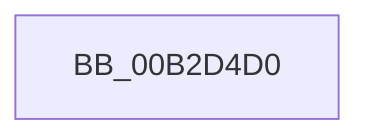

# sub_00B2D4D0

- RVA: `0x00B2D4D0`–`0x00B2D4F6` (길이 `38` bytes)
- VA: `0x0000000140B2D4D0`
- 실행 섹션: `PAGE`
- PDB 이름 있음: `아니요`; PDB Function 태그: `아니요`
- unwind 정보 RVA: `0x0009C358`
- 디코드: `10`개 명령, `38/38` bytes 표시
- 미해석 바이트: `0` (있으면 어셈블리에 `.byte`로 보존)

> 이 문서는 커널 이미지의 기계어와 PDB 기호를 분석해 생성했습니다. 4번과 5번은 함수 원형과 자료형을 바이너리 사용 방식에서 추정한 C 해석이며 원본 소스 복구 결과는 아닙니다.

## 1. Dependencies

- 직접 호출 지점: **1**; 고유 호출 대상: **1**
- 직접 호출자로 확인된 함수: **0**
- RIP 상대 이미지 참조: **0**

### Outgoing calls
- `0x00B2D4DB` → [memcpy](../../text/6C/memcpy_function_006C6840.md) (function, `0x006C6840`)

### Direct callers
- 이 함수 시작 RVA로 연결되는 직접 call은 확인되지 않았습니다. 간접 호출은 완전히 역산할 수 없습니다.

### Static image references
- 디코드된 RIP-relative 메모리 참조가 없습니다.

## 2. Other-region calls and transfers

- 다른 실행 섹션으로 향하는 call: **1**
  - `0x00B2D4DB` → [memcpy](../../text/6C/memcpy_function_006C6840.md) (`PAGE` → `.text`)
- call이 아닌 외부 분기/꼬리 이동: **1**
  - `0x00B2D4F1` → [IoCreateDeviceSecure + 0xA5](../9A/IoCreateDeviceSecure_function_009A31E0.md) (`tail-transfer`)

## 3. Assembly (complete function range)

```asm
00B2D4D0  45 0F B7 07                     movzx r8d, word ptr [r15]
00B2D4D4  49 8B CE                        mov rcx, r14
00B2D4D7  49 8B 57 08                     mov rdx, qword ptr [r15 + 8]
00B2D4DB  E8 60 93 B9 FF                  call 0x1406c6840
00B2D4E0  41 0F B7 07                     movzx eax, word ptr [r15]
00B2D4E4  48 D1 E8                        shr rax, 1
00B2D4E7  33 C9                           xor ecx, ecx
00B2D4E9  66 41 89 0C 46                  mov word ptr [r14 + rax*2], cx
00B2D4EE  49 8B CE                        mov rcx, r14
00B2D4F1  E9 8F 5D E7 FF                  jmp 0x1409a3285
```

## 4. C-style interpretation (structured pseudocode)

```c
__int64 __fastcall sub_00B2D4D0(void)
{
    __int64 result;

    result = memcpy(v_r14, *(unsigned __int64 *)(v_r15 + 8), *(unsigned __int16 *)(v_r15), a4);
    result = (*(unsigned __int16 *)(v_r15)) >> (1);
    a1 = 0;
    *(unsigned __int16 *)(v_r14 + result * 2) = 0;
}
```

## 5. (Beta) C Style

```c
void sub_00B2D4D0(void)
{
    int64_t result;

    result = memcpy(local_r14, *(uint64_t *)(local_r15 + 0x8), *(uint16_t *)(local_r15), a4);
    result = (*(uint16_t *)(local_r15)) >> (1);
    a1 = 0;
    *(uint16_t *)(local_r14 + result * 2) = 0;
}
```

## 6. Execution-region graph

[열기: 2D/3D 그래프와 함수 탐색 컨트롤 패널](../../../control-panel.html?section=page&rva=0x00B2D4D0&view=graph)

- 2D 그래프는 위에서 아래로 흐르고, 3D 그래프는 빈 공간을 드래그해 회전합니다. Shift+드래그는 이동, 휠은 확대·축소, 함수 노드 선택은 대상 보고서 이동입니다.

### Static fallback


