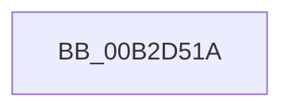

# sub_00B2D51A

- RVA: `0x00B2D51A`–`0x00B2D53B` (길이 `33` bytes)
- VA: `0x0000000140B2D51A`
- 실행 섹션: `PAGE`
- PDB 이름 있음: `아니요`; PDB Function 태그: `아니요`
- unwind 정보 RVA: `0x0009C42C`
- 디코드: `9`개 명령, `33/33` bytes 표시
- 미해석 바이트: `0` (있으면 어셈블리에 `.byte`로 보존)

> 이 문서는 커널 이미지의 기계어와 PDB 기호를 분석해 생성했습니다. 4번과 5번은 함수 원형과 자료형을 바이너리 사용 방식에서 추정한 C 해석이며 원본 소스 복구 결과는 아닙니다.

## 1. Dependencies

- 직접 호출 지점: **2**; 고유 호출 대상: **2**
- 직접 호출자로 확인된 함수: **0**
- RIP 상대 이미지 참조: **0**

### Outgoing calls
- `0x00B2D51D` → [ExReleaseFastMutex](../../text/25/ExReleaseFastMutex_function_002519C0.md) (function, `0x002519C0`)
- `0x00B2D52F` → [IofCompleteRequest](../../text/29/IofCompleteRequest_function_0029B5C0.md) (function, `0x0029B5C0`)

### Direct callers
- 이 함수 시작 RVA로 연결되는 직접 call은 확인되지 않았습니다. 간접 호출은 완전히 역산할 수 없습니다.

### Static image references
- 디코드된 RIP-relative 메모리 참조가 없습니다.

## 2. Other-region calls and transfers

- 다른 실행 섹션으로 향하는 call: **2**
  - `0x00B2D51D` → [ExReleaseFastMutex](../../text/25/ExReleaseFastMutex_function_002519C0.md) (`PAGE` → `.text`)
  - `0x00B2D52F` → [IofCompleteRequest](../../text/29/IofCompleteRequest_function_0029B5C0.md) (`PAGE` → `.text`)
- call이 아닌 외부 분기/꼬리 이동: **1**
  - `0x00B2D536` → [RawReadWriteDeviceControl + 0x97](../9A/RawReadWriteDeviceControl_function_009A3D50.md) (`tail-transfer`)

## 3. Assembly (complete function range)

```asm
00B2D51A  48 8B CE                        mov rcx, rsi
00B2D51D  E8 9E 44 72 FF                  call 0x1402519c0
00B2D522  BB 6E 02 00 C0                  mov ebx, 0xc000026e
00B2D527  B2 01                           mov dl, 1
00B2D529  89 5D 30                        mov dword ptr [rbp + 0x30], ebx
00B2D52C  48 8B CD                        mov rcx, rbp
00B2D52F  E8 8C E0 76 FF                  call 0x14029b5c0
00B2D534  8B C3                           mov eax, ebx
00B2D536  E9 AC 68 E7 FF                  jmp 0x1409a3de7
```

## 4. C-style interpretation (structured pseudocode)

```c
__int64 __fastcall sub_00B2D51A(void)
{
    __int64 result;

    result = ExReleaseFastMutex(v_rsi, a2, a3, a4);
    *(unsigned int *)(v_rbp + 48) = (unsigned int)((unsigned int)(0xC000026EULL));
    result = IofCompleteRequest(v_rbp, 1, a3, a4);
}
```

## 5. (Beta) C Style

```c
void sub_00B2D51A(void)
{
    int64_t result;

    result = ExReleaseFastMutex(local_rsi, a2, a3, a4);
    *(uint32_t *)(local_rbp + 0x30) = (uint32_t)((uint32_t)(0xC000026EULL));
    result = IofCompleteRequest(local_rbp, 1, a3, a4);
}
```

## 6. Execution-region graph

[열기: 2D/3D 그래프와 함수 탐색 컨트롤 패널](../../../control-panel.html?section=page&rva=0x00B2D51A&view=graph)

- 2D 그래프는 위에서 아래로 흐르고, 3D 그래프는 빈 공간을 드래그해 회전합니다. Shift+드래그는 이동, 휠은 확대·축소, 함수 노드 선택은 대상 보고서 이동입니다.

### Static fallback


