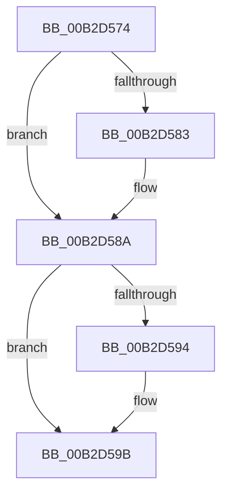

# sub_00B2D574

- RVA: `0x00B2D574`–`0x00B2D5A5` (길이 `49` bytes)
- VA: `0x0000000140B2D574`
- 실행 섹션: `PAGE`
- PDB 이름 있음: `아니요`; PDB Function 태그: `아니요`
- unwind 정보 RVA: `0x0009C5A8`
- 디코드: `13`개 명령, `49/49` bytes 표시
- 미해석 바이트: `0` (있으면 어셈블리에 `.byte`로 보존)

> 이 문서는 커널 이미지의 기계어와 PDB 기호를 분석해 생성했습니다. 4번과 5번은 함수 원형과 자료형을 바이너리 사용 방식에서 추정한 C 해석이며 원본 소스 복구 결과는 아닙니다.

## 1. Dependencies

- 직접 호출 지점: **3**; 고유 호출 대상: **2**
- 직접 호출자로 확인된 함수: **0**
- RIP 상대 이미지 참조: **0**

### Outgoing calls
- `0x00B2D574` → [ObfDereferenceObject](../../text/2F/ObfDereferenceObject_function_002F9350.md) (function, `0x002F9350`)
- `0x00B2D585` → [ExFreePoolWithTag](../../poolcode/B8/ExFreePoolWithTag_function_00B82870.md) (function, `0x00B82870`)
- `0x00B2D596` → [ExFreePoolWithTag](../../poolcode/B8/ExFreePoolWithTag_function_00B82870.md) (function, `0x00B82870`)

### Direct callers
- 이 함수 시작 RVA로 연결되는 직접 call은 확인되지 않았습니다. 간접 호출은 완전히 역산할 수 없습니다.

### Static image references
- 디코드된 RIP-relative 메모리 참조가 없습니다.

## 2. Other-region calls and transfers

- 다른 실행 섹션으로 향하는 call: **3**
  - `0x00B2D574` → [ObfDereferenceObject](../../text/2F/ObfDereferenceObject_function_002F9350.md) (`PAGE` → `.text`)
  - `0x00B2D585` → [ExFreePoolWithTag](../../poolcode/B8/ExFreePoolWithTag_function_00B82870.md) (`PAGE` → `POOLCODE`)
  - `0x00B2D596` → [ExFreePoolWithTag](../../poolcode/B8/ExFreePoolWithTag_function_00B82870.md) (`PAGE` → `POOLCODE`)
- call이 아닌 외부 분기/꼬리 이동: **1**
  - `0x00B2D5A0` → [IoCreateDevice + 0x3C4](../9A/IoCreateDevice_function_009A4B00.md) (`tail-transfer`)

## 3. Assembly (complete function range)

```asm
00B2D574  E8 D7 BD 7C FF                  call 0x1402f9350
00B2D579  48 8B 4C 24 60                  mov rcx, qword ptr [rsp + 0x60]
00B2D57E  48 85 C9                        test rcx, rcx
00B2D581  74 07                           je 0x140b2d58a
00B2D583  33 D2                           xor edx, edx
00B2D585  E8 E6 52 05 00                  call 0x140b82870
00B2D58A  48 8B 4C 24 68                  mov rcx, qword ptr [rsp + 0x68]
00B2D58F  48 85 C9                        test rcx, rcx
00B2D592  74 07                           je 0x140b2d59b
00B2D594  33 D2                           xor edx, edx
00B2D596  E8 D5 52 05 00                  call 0x140b82870
00B2D59B  49 83 24 24 00                  and qword ptr [r12], 0
00B2D5A0  E9 1F 79 E7 FF                  jmp 0x1409a4ec4
```

## 4. C-style interpretation (structured pseudocode)

```c
__int64 __fastcall sub_00B2D574(__int64 a1, int a2, __int64 a3, __int64 a4, __int64 a5, __int64 a6, __int64 a7, __int64 a8, __int64 a9, __int64 a10, __int64 a11, __int64 a12, __int64 a13)
{
    __int64 result;

    result = ObfDereferenceObject(a1, a2, a3, a4);
    if (a12 != 0) {
        a2 = 0;
        result = ExFreePoolWithTag(a12, a2, a3, a4);
    }
    if (a13 != 0) {
        a2 = 0;
        result = ExFreePoolWithTag(a13, a2, a3, a4);
    }
}
```

## 5. (Beta) C Style

```c
int64_t sub_00B2D574(int64_t Arg1, int32_t Arg2, int64_t Arg3, int64_t Arg4, uint64_t Arg5, uint64_t Arg6, uint64_t Arg7, uint64_t Arg8, uint64_t Arg9, uint64_t Arg10, uint64_t Arg11, int64_t Arg12, int64_t Arg13)
{
    int64_t result;

    result = ObfDereferenceObject(Arg1, Arg2, Arg3, Arg4);
    if (Arg12 != 0) {
        Arg2 = 0;
        result = ExFreePoolWithTag(Arg12, Arg2, Arg3, Arg4);
    }
    if (Arg13 != 0) {
        Arg2 = 0;
        result = ExFreePoolWithTag(Arg13, Arg2, Arg3, Arg4);
    }
}
```

## 6. Execution-region graph

[열기: 2D/3D 그래프와 함수 탐색 컨트롤 패널](../../../control-panel.html?section=page&rva=0x00B2D574&view=graph)

- 2D 그래프는 위에서 아래로 흐르고, 3D 그래프는 빈 공간을 드래그해 회전합니다. Shift+드래그는 이동, 휠은 확대·축소, 함수 노드 선택은 대상 보고서 이동입니다.

### Static fallback


