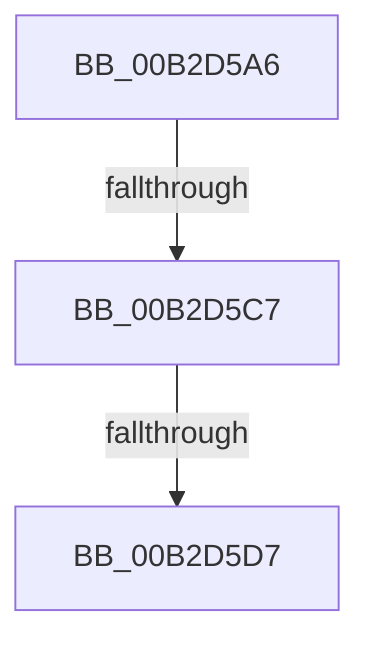

# sub_00B2D5A6

- RVA: `0x00B2D5A6`–`0x00B2D5E5` (길이 `63` bytes)
- VA: `0x0000000140B2D5A6`
- 실행 섹션: `PAGE`
- PDB 이름 있음: `아니요`; PDB Function 태그: `아니요`
- unwind 정보 RVA: `0x0009C628`
- 디코드: `15`개 명령, `63/63` bytes 표시
- 미해석 바이트: `0` (있으면 어셈블리에 `.byte`로 보존)

> 이 문서는 커널 이미지의 기계어와 PDB 기호를 분석해 생성했습니다. 4번과 5번은 함수 원형과 자료형을 바이너리 사용 방식에서 추정한 C 해석이며 원본 소스 복구 결과는 아닙니다.

## 1. Dependencies

- 직접 호출 지점: **3**; 고유 호출 대상: **3**
- 직접 호출자로 확인된 함수: **0**
- RIP 상대 이미지 참조: **0**

### Outgoing calls
- `0x00B2D5BA` → [ExTryToAcquireFastMutex](../../text/44/ExTryToAcquireFastMutex_function_0044C2E0.md) (function, `0x0044C2E0`)
- `0x00B2D5CA` → [RawCheckForDeleteVolume](../../text/4C/RawCheckForDeleteVolume_function_004C6FF4.md) (function, `0x004C6FF4`)
- `0x00B2D5DA` → [ExReleaseFastMutex](../../text/25/ExReleaseFastMutex_function_002519C0.md) (function, `0x002519C0`)

### Direct callers
- 이 함수 시작 RVA로 연결되는 직접 call은 확인되지 않았습니다. 간접 호출은 완전히 역산할 수 없습니다.

### Static image references
- 디코드된 RIP-relative 메모리 참조가 없습니다.

## 2. Other-region calls and transfers

- 다른 실행 섹션으로 향하는 call: **3**
  - `0x00B2D5BA` → [ExTryToAcquireFastMutex](../../text/44/ExTryToAcquireFastMutex_function_0044C2E0.md) (`PAGE` → `.text`)
  - `0x00B2D5CA` → [RawCheckForDeleteVolume](../../text/4C/RawCheckForDeleteVolume_function_004C6FF4.md) (`PAGE` → `.text`)
  - `0x00B2D5DA` → [ExReleaseFastMutex](../../text/25/ExReleaseFastMutex_function_002519C0.md) (`PAGE` → `.text`)
- call이 아닌 외부 분기/꼬리 이동: **3**
  - `0x00B2D5C1` → [RawScanDeletedList + 0x37](../9A/RawScanDeletedList_function_009A55F0.md) (`tail-transfer`)
  - `0x00B2D5D1` → [RawScanDeletedList + 0x37](../9A/RawScanDeletedList_function_009A55F0.md) (`tail-transfer`)
  - `0x00B2D5E0` → [RawScanDeletedList + 0x37](../9A/RawScanDeletedList_function_009A55F0.md) (`tail-transfer`)

## 3. Assembly (complete function range)

```asm
00B2D5A6  48 8D B3 50 FF FF FF            lea rsi, [rbx - 0xb0]
00B2D5AD  48 8B 1B                        mov rbx, qword ptr [rbx]
00B2D5B0  48 8D BE F0 00 00 00            lea rdi, [rsi + 0xf0]
00B2D5B7  48 8B CF                        mov rcx, rdi
00B2D5BA  E8 21 ED 91 FF                  call 0x14044c2e0
00B2D5BF  84 C0                           test al, al
00B2D5C1  0F 84 60 80 E7 FF               je 0x1409a5627
00B2D5C7  48 8B CE                        mov rcx, rsi
00B2D5CA  E8 25 9A 99 FF                  call 0x1404c6ff4
00B2D5CF  84 C0                           test al, al
00B2D5D1  0F 85 50 80 E7 FF               jne 0x1409a5627
00B2D5D7  48 8B CF                        mov rcx, rdi
00B2D5DA  E8 E1 43 72 FF                  call 0x1402519c0
00B2D5DF  90                              nop
00B2D5E0  E9 42 80 E7 FF                  jmp 0x1409a5627
```

## 4. C-style interpretation (structured pseudocode)

```c
__int64 __fastcall sub_00B2D5A6(void)
{
    __int64 result;

    result = ExTryToAcquireFastMutex(v_rbx - 176 + 240, a2, a3, a4);
    result = RawCheckForDeleteVolume(v_rbx - 176, a2, a3, a4);
    result = ExReleaseFastMutex(v_rbx - 176 + 240, a2, a3, a4);
}
```

## 5. (Beta) C Style

```c
void sub_00B2D5A6(void)
{
    int64_t result;

    result = ExTryToAcquireFastMutex(local_rbx - 176 + 240, a2, a3, a4);
    result = RawCheckForDeleteVolume(local_rbx - 176, a2, a3, a4);
    result = ExReleaseFastMutex(local_rbx - 176 + 240, a2, a3, a4);
}
```

## 6. Execution-region graph

[열기: 2D/3D 그래프와 함수 탐색 컨트롤 패널](../../../control-panel.html?section=page&rva=0x00B2D5A6&view=graph)

- 2D 그래프는 위에서 아래로 흐르고, 3D 그래프는 빈 공간을 드래그해 회전합니다. Shift+드래그는 이동, 휠은 확대·축소, 함수 노드 선택은 대상 보고서 이동입니다.

### Static fallback


