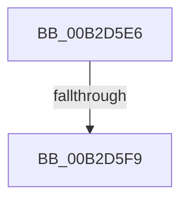

# sub_00B2D5E6

- RVA: `0x00B2D5E6`–`0x00B2D612` (길이 `44` bytes)
- VA: `0x0000000140B2D5E6`
- 실행 섹션: `PAGE`
- PDB 이름 있음: `아니요`; PDB Function 태그: `아니요`
- unwind 정보 RVA: `0x0009C6EC`
- 디코드: `11`개 명령, `44/44` bytes 표시
- 미해석 바이트: `0` (있으면 어셈블리에 `.byte`로 보존)

> 이 문서는 커널 이미지의 기계어와 PDB 기호를 분석해 생성했습니다. 4번과 5번은 함수 원형과 자료형을 바이너리 사용 방식에서 추정한 C 해석이며 원본 소스 복구 결과는 아닙니다.

## 1. Dependencies

- 직접 호출 지점: **2**; 고유 호출 대상: **2**
- 직접 호출자로 확인된 함수: **0**
- RIP 상대 이미지 참조: **0**

### Outgoing calls
- `0x00B2D5EA` → [ObfDereferenceObject](../../text/2F/ObfDereferenceObject_function_002F9350.md) (function, `0x002F9350`)
- `0x00B2D5FC` → [RtlRaiseStatus](../../text/2F/RtlRaiseStatus_function_002F6A50.md) (function, `0x002F6A50`)

### Direct callers
- 이 함수 시작 RVA로 연결되는 직접 call은 확인되지 않았습니다. 간접 호출은 완전히 역산할 수 없습니다.

### Static image references
- 디코드된 RIP-relative 메모리 참조가 없습니다.

## 2. Other-region calls and transfers

- 다른 실행 섹션으로 향하는 call: **2**
  - `0x00B2D5EA` → [ObfDereferenceObject](../../text/2F/ObfDereferenceObject_function_002F9350.md) (`PAGE` → `.text`)
  - `0x00B2D5FC` → [RtlRaiseStatus](../../text/2F/RtlRaiseStatus_function_002F6A50.md) (`PAGE` → `.text`)
- call이 아닌 외부 분기/꼬리 이동: **2**
  - `0x00B2D5F3` → [sub_009A5974 + 0x191](../9A/Unknown_function_009A5974.md) (`tail-transfer`)
  - `0x00B2D60D` → [sub_009A5974 + 0x189](../9A/Unknown_function_009A5974.md) (`tail-transfer`)

## 3. Assembly (complete function range)

```asm
00B2D5E6  48 8B 4D 40                     mov rcx, qword ptr [rbp + 0x40]
00B2D5EA  E8 61 BD 7C FF                  call 0x1402f9350
00B2D5EF  F6 47 02 01                     test byte ptr [rdi + 2], 1
00B2D5F3  0F 84 0C 85 E7 FF               je 0x1409a5b05
00B2D5F9  41 8B CF                        mov ecx, r15d
00B2D5FC  E8 4F 94 7C FF                  call 0x1402f6a50
00B2D601  CC                              int3
00B2D602  48 8B 45 60                     mov rax, qword ptr [rbp + 0x60]
00B2D606  48 8B 4F 08                     mov rcx, qword ptr [rdi + 8]
00B2D60A  48 89 08                        mov qword ptr [rax], rcx
00B2D60D  E9 EB 84 E7 FF                  jmp 0x1409a5afd
```

## 4. C-style interpretation (structured pseudocode)

```c
__int64 __fastcall sub_00B2D5E6(void)
{
    __int64 result;

    result = ObfDereferenceObject(*(unsigned __int64 *)(v_rbp + 64), a2, a3, a4);
    result = RtlRaiseStatus((unsigned int)((unsigned int)(v_r15)), a2, a3, a4);
    *(unsigned __int64 *)(*(unsigned __int64 *)(v_rbp + 96)) = *(unsigned __int64 *)(v_rdi + 8);
}
```

## 5. (Beta) C Style

```c
void sub_00B2D5E6(void)
{
    int64_t result;

    result = ObfDereferenceObject(*(uint64_t *)(local_rbp + 0x40), a2, a3, a4);
    result = RtlRaiseStatus((uint32_t)((uint32_t)(local_r15)), a2, a3, a4);
    *(uint64_t *)(*(uint64_t *)(local_rbp + 0x60)) = *(uint64_t *)(local_rdi + 0x8);
}
```

## 6. Execution-region graph

[열기: 2D/3D 그래프와 함수 탐색 컨트롤 패널](../../../control-panel.html?section=page&rva=0x00B2D5E6&view=graph)

- 2D 그래프는 위에서 아래로 흐르고, 3D 그래프는 빈 공간을 드래그해 회전합니다. Shift+드래그는 이동, 휠은 확대·축소, 함수 노드 선택은 대상 보고서 이동입니다.

### Static fallback


