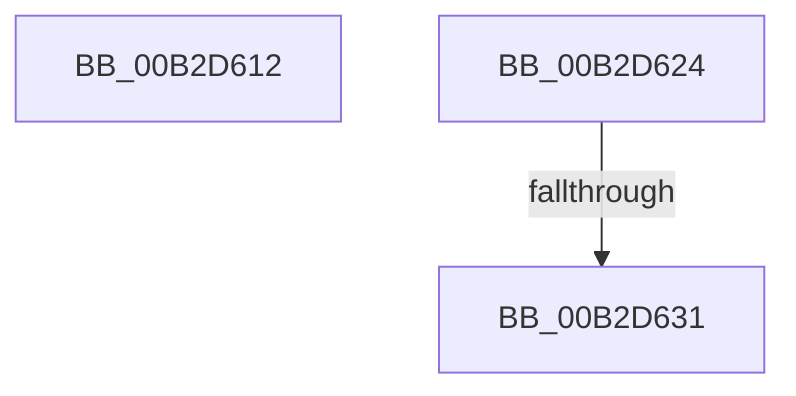

# sub_00B2D612

- RVA: `0x00B2D612`–`0x00B2D638` (길이 `38` bytes)
- VA: `0x0000000140B2D612`
- 실행 섹션: `PAGE`
- PDB 이름 있음: `아니요`; PDB Function 태그: `아니요`
- unwind 정보 RVA: `0x0009C834`
- 디코드: `9`개 명령, `38/38` bytes 표시
- 미해석 바이트: `0` (있으면 어셈블리에 `.byte`로 보존)

> 이 문서는 커널 이미지의 기계어와 PDB 기호를 분석해 생성했습니다. 4번과 5번은 함수 원형과 자료형을 바이너리 사용 방식에서 추정한 C 해석이며 원본 소스 복구 결과는 아닙니다.

## 1. Dependencies

- 직접 호출 지점: **1**; 고유 호출 대상: **1**
- 직접 호출자로 확인된 함수: **0**
- RIP 상대 이미지 참조: **1**

### Outgoing calls
- `0x00B2D619` → [PspSetContextState](../78/PspSetContextState_function_00789FBC.md) (function, `0x00789FBC`)

### Direct callers
- 이 함수 시작 RVA로 연결되는 직접 call은 확인되지 않았습니다. 간접 호출은 완전히 역산할 수 없습니다.

### Static image references
- `0x00B2D624` → RVA `0x00FC6DDC` (`ALMOSTRO`; read)

## 2. Other-region calls and transfers

- 다른 실행 섹션으로 향하는 call: **0**
- call이 아닌 외부 분기/꼬리 이동: **3**
  - `0x00B2D61F` → [sub_009A623D + 0x276](../9A/Unknown_function_009A623D.md) (`tail-transfer`)
  - `0x00B2D62B` → [sub_009A6520 + 0x19F](../9A/Unknown_function_009A6520.md) (`tail-transfer`)
  - `0x00B2D633` → [sub_009A6520 + 0x19F](../9A/Unknown_function_009A6520.md) (`tail-transfer`)

## 3. Assembly (complete function range)

```asm
00B2D612  49 8B 56 78                     mov rdx, qword ptr [r14 + 0x78]
00B2D616  49 8B CF                        mov rcx, r15
00B2D619  E8 9E C9 C5 FF                  call 0x140789fbc
00B2D61E  90                              nop
00B2D61F  E9 8F 8E E7 FF                  jmp 0x1409a64b3
00B2D624  44 39 2D B1 97 49 00            cmp dword ptr [rip + 0x4997b1], r13d
00B2D62B  0F 84 8E 90 E7 FF               je 0x1409a66bf
00B2D631  CD 2C                           int 0x2c
00B2D633  E9 87 90 E7 FF                  jmp 0x1409a66bf
```

## 4. C-style interpretation (structured pseudocode)

```c
__int64 __fastcall sub_00B2D612(void)
{
    __int64 result;

    result = PspSetContextState(v_r15, *(unsigned __int64 *)(v_r14 + 120), a3, a4);
}
```

## 5. (Beta) C Style

```c
void sub_00B2D612(void)
{
    int64_t result;

    result = PspSetContextState(local_r15, *(uint64_t *)(local_r14 + 0x78), a3, a4);
}
```

## 6. Execution-region graph

[열기: 2D/3D 그래프와 함수 탐색 컨트롤 패널](../../../control-panel.html?section=page&rva=0x00B2D612&view=graph)

- 2D 그래프는 위에서 아래로 흐르고, 3D 그래프는 빈 공간을 드래그해 회전합니다. Shift+드래그는 이동, 휠은 확대·축소, 함수 노드 선택은 대상 보고서 이동입니다.

### Static fallback


