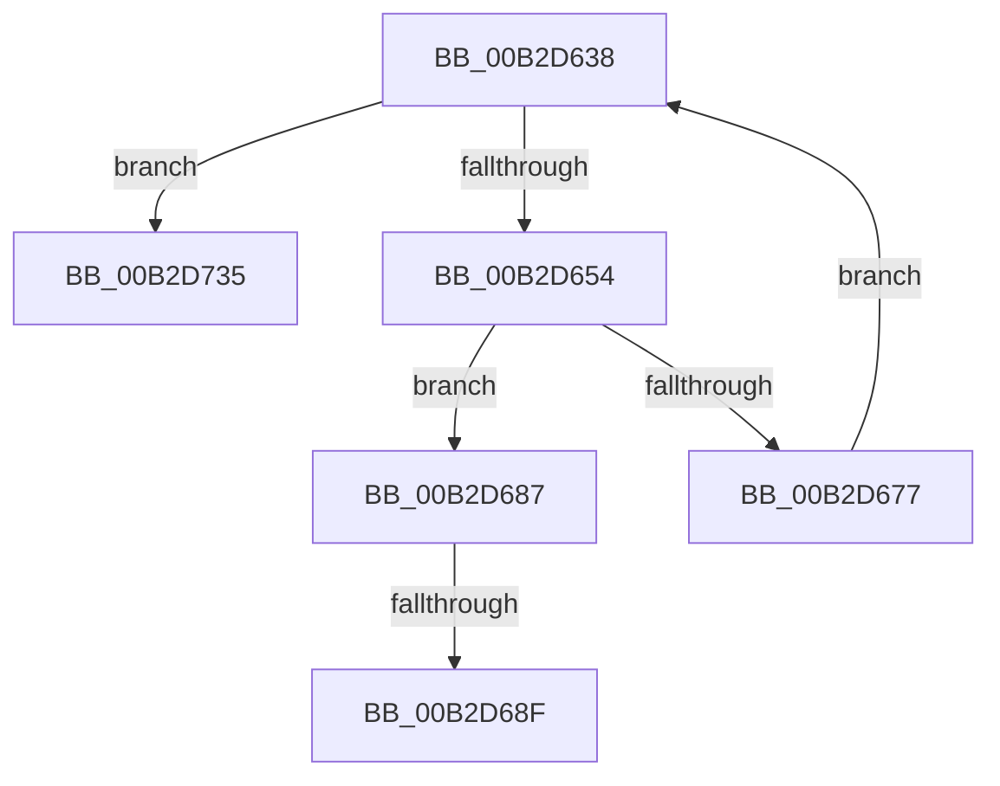

# sub_00B2D638

- RVA: `0x00B2D638`–`0x00B2D73F` (길이 `263` bytes)
- VA: `0x0000000140B2D638`
- 실행 섹션: `PAGE`
- PDB 이름 있음: `아니요`; PDB Function 태그: `아니요`
- unwind 정보 RVA: `0x0009CAAC`
- 디코드: `62`개 명령, `263/263` bytes 표시
- 미해석 바이트: `0` (있으면 어셈블리에 `.byte`로 보존)

> 이 문서는 커널 이미지의 기계어와 PDB 기호를 분석해 생성했습니다. 4번과 5번은 함수 원형과 자료형을 바이너리 사용 방식에서 추정한 C 해석이며 원본 소스 복구 결과는 아닙니다.

## 1. Dependencies

- 직접 호출 지점: **7**; 고유 호출 대상: **6**
- 직접 호출자로 확인된 함수: **0**
- RIP 상대 이미지 참조: **1**

### Outgoing calls
- `0x00B2D643` → [ExAllocatePool2](../../poolcode/B8/ExAllocatePool2_function_00B820F0.md) (function, `0x00B820F0`)
- `0x00B2D669` → [ObQuerySecurityDescriptorInfo](../87/ObQuerySecurityDescriptorInfo_function_00873624.md) (function, `0x00873624`)
- `0x00B2D67C` → [ExFreePoolWithTag](../../poolcode/B8/ExFreePoolWithTag_function_00B82870.md) (function, `0x00B82870`)
- `0x00B2D6FF` → [RtlStringCbPrintfW](../../text/40/RtlStringCbPrintfW_function_0040FB40.md) (function, `0x0040FB40`)
- `0x00B2D711` → [RtlInitUnicodeString](../../text/42/RtlInitUnicodeString_function_0042A780.md) (function, `0x0042A780`)
- `0x00B2D71E` → [WmipSaveGuidSecurityDescriptor](../7B/WmipSaveGuidSecurityDescriptor_function_007B4A38.md) (function, `0x007B4A38`)
- `0x00B2D72A` → [ExFreePoolWithTag](../../poolcode/B8/ExFreePoolWithTag_function_00B82870.md) (function, `0x00B82870`)

### Direct callers
- 이 함수 시작 RVA로 연결되는 직접 call은 확인되지 않았습니다. 간접 호출은 완전히 역산할 수 없습니다.

### Static image references
- `0x00B2D6D9` → RVA `0x00B06E40` (` ?? ::NNGAKEGL::`string'`; read)

## 2. Other-region calls and transfers

- 다른 실행 섹션으로 향하는 call: **5**
  - `0x00B2D643` → [ExAllocatePool2](../../poolcode/B8/ExAllocatePool2_function_00B820F0.md) (`PAGE` → `POOLCODE`)
  - `0x00B2D67C` → [ExFreePoolWithTag](../../poolcode/B8/ExFreePoolWithTag_function_00B82870.md) (`PAGE` → `POOLCODE`)
  - `0x00B2D6FF` → [RtlStringCbPrintfW](../../text/40/RtlStringCbPrintfW_function_0040FB40.md) (`PAGE` → `.text`)
  - `0x00B2D711` → [RtlInitUnicodeString](../../text/42/RtlInitUnicodeString_function_0042A780.md) (`PAGE` → `.text`)
  - `0x00B2D72A` → [ExFreePoolWithTag](../../poolcode/B8/ExFreePoolWithTag_function_00B82870.md) (`PAGE` → `POOLCODE`)
- call이 아닌 외부 분기/꼬리 이동: **3**
  - `0x00B2D689` → [WmipSecurityMethod + 0xDD](../9A/WmipSecurityMethod_function_009A71F0.md) (`tail-transfer`)
  - `0x00B2D730` → [WmipSecurityMethod + 0xDD](../9A/WmipSecurityMethod_function_009A71F0.md) (`tail-transfer`)
  - `0x00B2D73A` → [WmipSecurityMethod + 0xDD](../9A/WmipSecurityMethod_function_009A71F0.md) (`tail-transfer`)

## 3. Assembly (complete function range)

```asm
00B2D638  8B D0                           mov edx, eax
00B2D63A  41 B8 57 6D 69 70               mov r8d, 0x70696d57
00B2D640  48 8B CF                        mov rcx, rdi
00B2D643  E8 A8 4A 05 00                  call 0x140b820f0
00B2D648  4C 8B F0                        mov r14, rax
00B2D64B  48 85 C0                        test rax, rax
00B2D64E  0F 84 E1 00 00 00               je 0x140b2d735
00B2D654  83 4C 24 74 FF                  or dword ptr [rsp + 0x74], 0xffffffff
00B2D659  4C 8D 4C 24 70                  lea r9, [rsp + 0x70]
00B2D65E  4C 8B C0                        mov r8, rax
00B2D661  48 8D 54 24 74                  lea rdx, [rsp + 0x74]
00B2D666  48 8B CD                        mov rcx, rbp
00B2D669  E8 B6 5F D4 FF                  call 0x140873624
00B2D66E  8B D8                           mov ebx, eax
00B2D670  3D 23 00 00 C0                  cmp eax, 0xc0000023
00B2D675  75 10                           jne 0x140b2d687
00B2D677  33 D2                           xor edx, edx
00B2D679  49 8B CE                        mov rcx, r14
00B2D67C  E8 EF 51 05 00                  call 0x140b82870
00B2D681  8B 44 24 70                     mov eax, dword ptr [rsp + 0x70]
00B2D685  EB B1                           jmp 0x140b2d638
00B2D687  85 C0                           test eax, eax
00B2D689  0F 88 3E 9C E7 FF               js 0x1409a72cd
00B2D68F  0F B6 4D 26                     movzx ecx, byte ptr [rbp + 0x26]
00B2D693  0F B6 55 25                     movzx edx, byte ptr [rbp + 0x25]
00B2D697  44 0F B6 45 24                  movzx r8d, byte ptr [rbp + 0x24]
00B2D69C  44 0F B6 4D 23                  movzx r9d, byte ptr [rbp + 0x23]
00B2D6A1  0F B6 45 27                     movzx eax, byte ptr [rbp + 0x27]
00B2D6A5  44 0F B6 55 22                  movzx r10d, byte ptr [rbp + 0x22]
00B2D6AA  44 0F B6 5D 21                  movzx r11d, byte ptr [rbp + 0x21]
00B2D6AF  0F B6 5D 20                     movzx ebx, byte ptr [rbp + 0x20]
00B2D6B3  0F B7 7D 1E                     movzx edi, word ptr [rbp + 0x1e]
00B2D6B7  0F B7 75 1C                     movzx esi, word ptr [rbp + 0x1c]
00B2D6BB  89 44 24 68                     mov dword ptr [rsp + 0x68], eax
00B2D6BF  89 4C 24 60                     mov dword ptr [rsp + 0x60], ecx
00B2D6C3  48 8D 8C 24 90 00 00 00         lea rcx, [rsp + 0x90]
00B2D6CB  89 54 24 58                     mov dword ptr [rsp + 0x58], edx
00B2D6CF  BA 4C 00 00 00                  mov edx, 0x4c
00B2D6D4  44 89 44 24 50                  mov dword ptr [rsp + 0x50], r8d
00B2D6D9  4C 8D 05 60 97 FD FF            lea r8, [rip - 0x268a0]
00B2D6E0  44 89 4C 24 48                  mov dword ptr [rsp + 0x48], r9d
00B2D6E5  44 8B 4D 18                     mov r9d, dword ptr [rbp + 0x18]
00B2D6E9  44 89 54 24 40                  mov dword ptr [rsp + 0x40], r10d
00B2D6EE  44 89 5C 24 38                  mov dword ptr [rsp + 0x38], r11d
00B2D6F3  89 5C 24 30                     mov dword ptr [rsp + 0x30], ebx
00B2D6F7  89 7C 24 28                     mov dword ptr [rsp + 0x28], edi
00B2D6FB  89 74 24 20                     mov dword ptr [rsp + 0x20], esi
00B2D6FF  E8 3C 24 8E FF                  call 0x14040fb40
00B2D704  48 8D 94 24 90 00 00 00         lea rdx, [rsp + 0x90]
00B2D70C  48 8D 4C 24 78                  lea rcx, [rsp + 0x78]
00B2D711  E8 6A D0 8F FF                  call 0x14042a780
00B2D716  49 8B D6                        mov rdx, r14
00B2D719  48 8D 4C 24 78                  lea rcx, [rsp + 0x78]
00B2D71E  E8 15 73 C8 FF                  call 0x1407b4a38
00B2D723  33 D2                           xor edx, edx
00B2D725  49 8B CE                        mov rcx, r14
00B2D728  8B D8                           mov ebx, eax
00B2D72A  E8 41 51 05 00                  call 0x140b82870
00B2D72F  90                              nop
00B2D730  E9 98 9B E7 FF                  jmp 0x1409a72cd
00B2D735  BB 9A 00 00 C0                  mov ebx, 0xc000009a
00B2D73A  E9 8E 9B E7 FF                  jmp 0x1409a72cd
```

## 4. C-style interpretation (structured pseudocode)

```c
__int64 __fastcall sub_00B2D638(__int64 a1, __int64 a2, __int64 a3, __int64 a4, __int64 a5, __int64 a6, __int64 a7, __int64 a8, __int64 a9, __int64 a10, __int64 a11, __int64 a12, __int64 a13, unsigned int a14, __int64 a15, __int64 a16, __int64 a17, __int64 a18)
{
    __int64 result;
    unsigned int v_stack_p20;
    unsigned int v_stack_p28;
    unsigned int v_stack_p30;
    unsigned int v_stack_p38;
    unsigned int v_stack_p40;
    unsigned int v_stack_p48;
    unsigned int v_stack_p50;
    unsigned int v_stack_p58;
    unsigned int v_stack_p60;
    unsigned int v_stack_p68;
    unsigned int v_stack_p74;

    result = ExAllocatePool2(v_rdi, (unsigned int)((unsigned int)(result)), (unsigned int)(0x70696D57ULL), a4);
    if (result == 0) goto loc_00B2D735;
    result = ObQuerySecurityDescriptorInfo(v_rbp, v_stack_p74, result, a14);
    if (((unsigned int)(result)) != 0xC0000023ULL) goto loc_00B2D687;
    a2 = 0;
    result = ExFreePoolWithTag(result, a2, result, a14);
    goto loc_00B2D638;
loc_00B2D687:
    v_stack_p68 = (unsigned int)(*(unsigned __int8 *)(v_rbp + 39));
    v_stack_p60 = (unsigned int)(*(unsigned __int8 *)(v_rbp + 38));
    v_stack_p58 = (unsigned int)(*(unsigned __int8 *)(v_rbp + 37));
    v_stack_p50 = (unsigned int)(*(unsigned __int8 *)(v_rbp + 36));
    v_stack_p48 = (unsigned int)(*(unsigned __int8 *)(v_rbp + 35));
    v_stack_p40 = (unsigned int)(*(unsigned __int8 *)(v_rbp + 34));
    v_stack_p38 = (unsigned int)(*(unsigned __int8 *)(v_rbp + 33));
    v_stack_p30 = (unsigned int)(*(unsigned __int8 *)(v_rbp + 32));
    v_stack_p28 = (unsigned int)(*(unsigned __int16 *)(v_rbp + 30));
    v_stack_p20 = (unsigned int)(*(unsigned __int16 *)(v_rbp + 28));
    result = RtlStringCbPrintfW(a18, 76, v_rip - 157856, (unsigned int)(*(unsigned int *)(v_rbp + 24)));
    result = RtlInitUnicodeString(a15, a18, v_rip - 157856, (unsigned int)(*(unsigned int *)(v_rbp + 24)));
    result = WmipSaveGuidSecurityDescriptor(a15, result, v_rip - 157856, (unsigned int)(*(unsigned int *)(v_rbp + 24)));
    a2 = 0;
    result = ExFreePoolWithTag(result, a2, v_rip - 157856, (unsigned int)(*(unsigned int *)(v_rbp + 24)));
loc_00B2D735:
}
```

## 5. (Beta) C Style

```c
int64_t sub_00B2D638(int64_t Arg1, int64_t Arg2, int64_t Arg3, int64_t Arg4, uint64_t Arg5, uint64_t Arg6, uint64_t Arg7, uint64_t Arg8, uint64_t Arg9, uint64_t Arg10, uint64_t Arg11, uint64_t Arg12, uint64_t Arg13, uint32_t Arg14, int64_t Arg15, uint64_t Arg16, uint64_t Arg17, int64_t Arg18)
{
    int64_t result;
    uint32_t v_stack_p20;
    uint32_t v_stack_p28;
    uint32_t v_stack_p30;
    uint32_t v_stack_p38;
    uint32_t v_stack_p40;
    uint32_t v_stack_p48;
    uint32_t v_stack_p50;
    uint32_t v_stack_p58;
    uint32_t v_stack_p60;
    uint32_t v_stack_p68;
    uint32_t v_stack_p74;

    result = ExAllocatePool2(local_rdi, (uint32_t)((uint32_t)(result)), (uint32_t)(0x70696D57ULL), Arg4);
    if (result == 0) goto loc_00B2D735;
    result = ObQuerySecurityDescriptorInfo(local_rbp, v_stack_p74, result, Arg14);
    if (((uint32_t)(result)) != 0xC0000023ULL) goto loc_00B2D687;
    Arg2 = 0;
    result = ExFreePoolWithTag(result, Arg2, result, Arg14);
    goto loc_00B2D638;
loc_00B2D687:
    v_stack_p68 = (uint32_t)(*(uint8_t *)(local_rbp + 0x27));
    v_stack_p60 = (uint32_t)(*(uint8_t *)(local_rbp + 0x26));
    v_stack_p58 = (uint32_t)(*(uint8_t *)(local_rbp + 0x25));
    v_stack_p50 = (uint32_t)(*(uint8_t *)(local_rbp + 0x24));
    v_stack_p48 = (uint32_t)(*(uint8_t *)(local_rbp + 0x23));
    v_stack_p40 = (uint32_t)(*(uint8_t *)(local_rbp + 0x22));
    v_stack_p38 = (uint32_t)(*(uint8_t *)(local_rbp + 0x21));
    v_stack_p30 = (uint32_t)(*(uint8_t *)(local_rbp + 0x20));
    v_stack_p28 = (uint32_t)(*(uint16_t *)(local_rbp + 0x1E));
    v_stack_p20 = (uint32_t)(*(uint16_t *)(local_rbp + 0x1C));
    result = RtlStringCbPrintfW(Arg18, 76, v_rip - 157856, (uint32_t)(*(uint32_t *)(local_rbp + 0x18)));
    result = RtlInitUnicodeString(Arg15, Arg18, v_rip - 157856, (uint32_t)(*(uint32_t *)(local_rbp + 0x18)));
    result = WmipSaveGuidSecurityDescriptor(Arg15, result, v_rip - 157856, (uint32_t)(*(uint32_t *)(local_rbp + 0x18)));
    Arg2 = 0;
    result = ExFreePoolWithTag(result, Arg2, v_rip - 157856, (uint32_t)(*(uint32_t *)(local_rbp + 0x18)));
loc_00B2D735:
}
```

## 6. Execution-region graph

[열기: 2D/3D 그래프와 함수 탐색 컨트롤 패널](../../../control-panel.html?section=page&rva=0x00B2D638&view=graph)

- 2D 그래프는 위에서 아래로 흐르고, 3D 그래프는 빈 공간을 드래그해 회전합니다. Shift+드래그는 이동, 휠은 확대·축소, 함수 노드 선택은 대상 보고서 이동입니다.

### Static fallback


