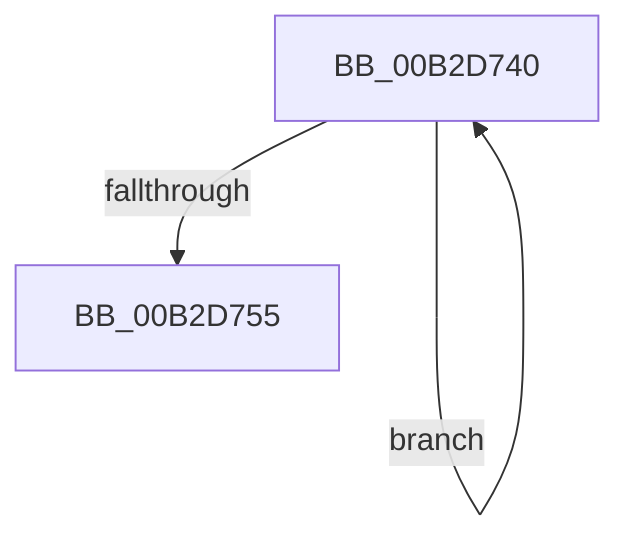

# sub_00B2D740

- RVA: `0x00B2D740`–`0x00B2D769` (길이 `41` bytes)
- VA: `0x0000000140B2D740`
- 실행 섹션: `PAGE`
- PDB 이름 있음: `아니요`; PDB Function 태그: `아니요`
- unwind 정보 RVA: `0x0009CC48`
- 디코드: `11`개 명령, `41/41` bytes 표시
- 미해석 바이트: `0` (있으면 어셈블리에 `.byte`로 보존)

> 이 문서는 커널 이미지의 기계어와 PDB 기호를 분석해 생성했습니다. 4번과 5번은 함수 원형과 자료형을 바이너리 사용 방식에서 추정한 C 해석이며 원본 소스 복구 결과는 아닙니다.

## 1. Dependencies

- 직접 호출 지점: **2**; 고유 호출 대상: **2**
- 직접 호출자로 확인된 함수: **0**
- RIP 상대 이미지 참조: **0**

### Outgoing calls
- `0x00B2D743` → [CcUnpinData](../9A/CcUnpinData_function_009A7A80.md) (function, `0x009A7A80`)
- `0x00B2D75A` → [ExFreePoolWithTag](../../poolcode/B8/ExFreePoolWithTag_function_00B82870.md) (function, `0x00B82870`)

### Direct callers
- 이 함수 시작 RVA로 연결되는 직접 call은 확인되지 않았습니다. 간접 호출은 완전히 역산할 수 없습니다.

### Static image references
- 디코드된 RIP-relative 메모리 참조가 없습니다.

## 2. Other-region calls and transfers

- 다른 실행 섹션으로 향하는 call: **1**
  - `0x00B2D75A` → [ExFreePoolWithTag](../../poolcode/B8/ExFreePoolWithTag_function_00B82870.md) (`PAGE` → `POOLCODE`)
- call이 아닌 외부 분기/꼬리 이동: **1**
  - `0x00B2D764` → [CcUnpinData + 0x1F](../9A/CcUnpinData_function_009A7A80.md) (`tail-transfer`)

## 3. Assembly (complete function range)

```asm
00B2D740  48 8B C8                        mov rcx, rax
00B2D743  E8 38 A3 E7 FF                  call 0x1409a7a80
00B2D748  48 8B 47 08                     mov rax, qword ptr [rdi + 8]
00B2D74C  48 8D 7F 08                     lea rdi, [rdi + 8]
00B2D750  48 85 C0                        test rax, rax
00B2D753  75 EB                           jne 0x140b2d740
00B2D755  33 D2                           xor edx, edx
00B2D757  48 8B CB                        mov rcx, rbx
00B2D75A  E8 11 51 05 00                  call 0x140b82870
00B2D75F  48 8B 7C 24 30                  mov rdi, qword ptr [rsp + 0x30]
00B2D764  E9 36 A3 E7 FF                  jmp 0x1409a7a9f
```

## 4. C-style interpretation (structured pseudocode)

```c
__int64 __fastcall sub_00B2D740(__int64 a1, int a2, __int64 a3, __int64 a4, __int64 a5, __int64 a6)
{
    __int64 result;

    result = CcUnpinData(result, a2, a3, a4);
    if (*(unsigned __int64 *)(v_rdi + 8) != 0) goto loc_00B2D740;
    a2 = 0;
    result = ExFreePoolWithTag(v_rbx, a2, a3, a4);
}
```

## 5. (Beta) C Style

```c
int64_t sub_00B2D740(int64_t Arg1, int32_t Arg2, int64_t Arg3, int64_t Arg4, uint64_t Arg5, int64_t Arg6)
{
    int64_t result;

    result = CcUnpinData(result, Arg2, Arg3, Arg4);
    if (*(uint64_t *)(local_rdi + 0x8) != 0) goto loc_00B2D740;
    Arg2 = 0;
    result = ExFreePoolWithTag(local_rbx, Arg2, Arg3, Arg4);
}
```

## 6. Execution-region graph

[열기: 2D/3D 그래프와 함수 탐색 컨트롤 패널](../../../control-panel.html?section=page&rva=0x00B2D740&view=graph)

- 2D 그래프는 위에서 아래로 흐르고, 3D 그래프는 빈 공간을 드래그해 회전합니다. Shift+드래그는 이동, 휠은 확대·축소, 함수 노드 선택은 대상 보고서 이동입니다.

### Static fallback


