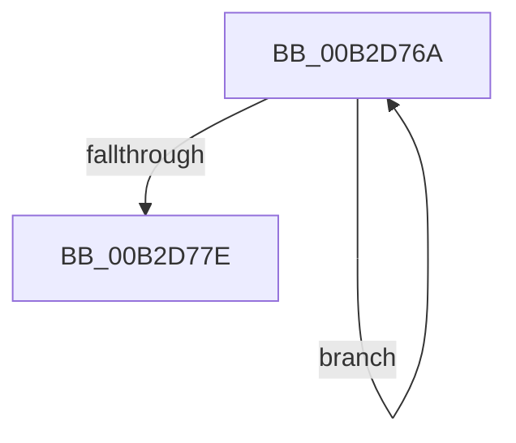

# sub_00B2D76A

- RVA: `0x00B2D76A`–`0x00B2D783` (길이 `25` bytes)
- VA: `0x0000000140B2D76A`
- 실행 섹션: `PAGE`
- PDB 이름 있음: `아니요`; PDB Function 태그: `아니요`
- unwind 정보 RVA: `0x0009D018`
- 디코드: `7`개 명령, `25/25` bytes 표시
- 미해석 바이트: `0` (있으면 어셈블리에 `.byte`로 보존)

> 이 문서는 커널 이미지의 기계어와 PDB 기호를 분석해 생성했습니다. 4번과 5번은 함수 원형과 자료형을 바이너리 사용 방식에서 추정한 C 해석이며 원본 소스 복구 결과는 아닙니다.

## 1. Dependencies

- 직접 호출 지점: **1**; 고유 호출 대상: **1**
- 직접 호출자로 확인된 함수: **0**
- RIP 상대 이미지 참조: **0**

### Outgoing calls
- `0x00B2D76D` → [RtlLengthSid](../../text/45/RtlLengthSid_function_0045D270.md) (function, `0x0045D270`)

### Direct callers
- 이 함수 시작 RVA로 연결되는 직접 call은 확인되지 않았습니다. 간접 호출은 완전히 역산할 수 없습니다.

### Static image references
- 디코드된 RIP-relative 메모리 참조가 없습니다.

## 2. Other-region calls and transfers

- 다른 실행 섹션으로 향하는 call: **1**
  - `0x00B2D76D` → [RtlLengthSid](../../text/45/RtlLengthSid_function_0045D270.md) (`PAGE` → `.text`)
- call이 아닌 외부 분기/꼬리 이동: **1**
  - `0x00B2D77E` → [CmpBuildAdminInformation + 0xE4](../9A/CmpBuildAdminInformation_function_009A8884.md) (`tail-transfer`)

## 3. Assembly (complete function range)

```asm
00B2D76A  49 8B 0E                        mov rcx, qword ptr [r14]
00B2D76D  E8 FE FA 92 FF                  call 0x14045d270
00B2D772  03 F8                           add edi, eax
00B2D774  4D 8D 76 10                     lea r14, [r14 + 0x10]
00B2D778  49 83 EC 01                     sub r12, 1
00B2D77C  75 EC                           jne 0x140b2d76a
00B2D77E  E9 E5 B1 E7 FF                  jmp 0x1409a8968
```

## 4. C-style interpretation (structured pseudocode)

```c
__int64 __fastcall sub_00B2D76A(void)
{
    __int64 result;
    __int64 v_r12;
    __int64 v_rdi;

    result = RtlLengthSid(*(unsigned __int64 *)(v_r14), a2, a3, a4);
    v_rdi = (unsigned int)((v_rdi) + ((unsigned int)(result)));
    v_r12 = (v_r12) - (1);
    if (condition_is_not_equal) goto loc_00B2D76A;
}
```

## 5. (Beta) C Style

```c
void sub_00B2D76A(void)
{
    int64_t result;
    int64_t local_r12;
    int64_t local_rdi;

    result = RtlLengthSid(*(uint64_t *)(local_r14), a2, a3, a4);
    local_rdi = (uint32_t)((local_rdi) + ((uint32_t)(result)));
    local_r12 = (local_r12) - (1);
    if (condition_is_not_equal) goto loc_00B2D76A;
}
```

## 6. Execution-region graph

[열기: 2D/3D 그래프와 함수 탐색 컨트롤 패널](../../../control-panel.html?section=page&rva=0x00B2D76A&view=graph)

- 2D 그래프는 위에서 아래로 흐르고, 3D 그래프는 빈 공간을 드래그해 회전합니다. Shift+드래그는 이동, 휠은 확대·축소, 함수 노드 선택은 대상 보고서 이동입니다.

### Static fallback


