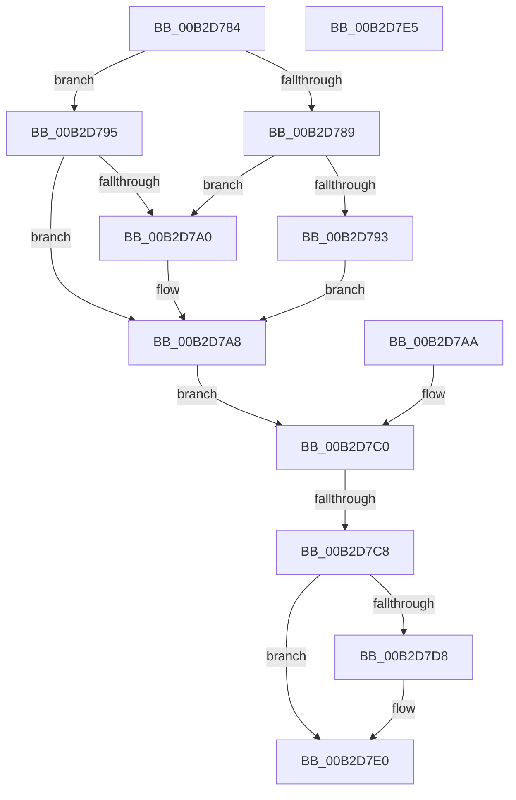

# sub_00B2D784

- RVA: `0x00B2D784`–`0x00B2D7EA` (길이 `102` bytes)
- VA: `0x0000000140B2D784`
- 실행 섹션: `PAGE`
- PDB 이름 있음: `아니요`; PDB Function 태그: `아니요`
- unwind 정보 RVA: `0x0009DFB8`
- 디코드: `24`개 명령, `102/102` bytes 표시
- 미해석 바이트: `0` (있으면 어셈블리에 `.byte`로 보존)

> 이 문서는 커널 이미지의 기계어와 PDB 기호를 분석해 생성했습니다. 4번과 5번은 함수 원형과 자료형을 바이너리 사용 방식에서 추정한 C 해석이며 원본 소스 복구 결과는 아닙니다.

## 1. Dependencies

- 직접 호출 지점: **0**; 고유 호출 대상: **0**
- 직접 호출자로 확인된 함수: **0**
- RIP 상대 이미지 참조: **0**

### Outgoing calls
- 직접 디코드된 call 명령이 없습니다.

### Direct callers
- 이 함수 시작 RVA로 연결되는 직접 call은 확인되지 않았습니다. 간접 호출은 완전히 역산할 수 없습니다.

### Static image references
- 디코드된 RIP-relative 메모리 참조가 없습니다.

## 2. Other-region calls and transfers

- 다른 실행 섹션으로 향하는 call: **0**
- call이 아닌 외부 분기/꼬리 이동: **3**
  - `0x00B2D7C2` → [NtQueryInformationProcess + 0x1AE6](../9A/NtQueryInformationProcess_function_009AA250.md) (`tail-transfer`)
  - `0x00B2D7E0` → [NtQueryInformationProcess + 0x1AE6](../9A/NtQueryInformationProcess_function_009AA250.md) (`tail-transfer`)
  - `0x00B2D7E5` → [NtQueryInformationProcess + 0x44F0](../9A/NtQueryInformationProcess_function_009AA250.md) (`tail-transfer`)

## 3. Assembly (complete function range)

```asm
00B2D784  48 85 C0                        test rax, rax
00B2D787  74 0C                           je 0x140b2d795
00B2D789  8B 80 74 04 00 00               mov eax, dword ptr [rax + 0x474]
00B2D78F  A8 01                           test al, 1
00B2D791  75 0D                           jne 0x140b2d7a0
00B2D793  EB 13                           jmp 0x140b2d7a8
00B2D795  41 8B 80 C0 07 00 00            mov eax, dword ptr [r8 + 0x7c0]
00B2D79C  A8 01                           test al, 1
00B2D79E  74 08                           je 0x140b2d7a8
00B2D7A0  83 8C 24 40 01 00 00 01         or dword ptr [rsp + 0x140], 1
00B2D7A8  EB 16                           jmp 0x140b2d7c0
00B2D7AA  8B D8                           mov ebx, eax
00B2D7AC  89 44 24 48                     mov dword ptr [rsp + 0x48], eax
00B2D7B0  48 8B B4 24 28 01 00 00         mov rsi, qword ptr [rsp + 0x128]
00B2D7B8  4C 8B A4 24 30 01 00 00         mov r12, qword ptr [rsp + 0x130]
00B2D7C0  85 DB                           test ebx, ebx
00B2D7C2  0F 88 6E E5 E7 FF               js 0x1409abd36
00B2D7C8  48 8B 84 24 40 01 00 00         mov rax, qword ptr [rsp + 0x140]
00B2D7D0  48 89 06                        mov qword ptr [rsi], rax
00B2D7D3  4D 85 E4                        test r12, r12
00B2D7D6  74 08                           je 0x140b2d7e0
00B2D7D8  41 C7 04 24 08 00 00 00         mov dword ptr [r12], 8
00B2D7E0  E9 51 E5 E7 FF                  jmp 0x1409abd36
00B2D7E5  E9 56 0F E8 FF                  jmp 0x1409ae740
```

## 4. C-style interpretation (structured pseudocode)

```c
__int64 __fastcall sub_00B2D784(__int64 a1, __int64 a2, __int64 a3, __int64 a4, __int64 a5, __int64 a6, __int64 a7, __int64 a8, __int64 a9, __int64 a10, __int64 a11, __int64 a12, __int64 a13, __int64 a14, __int64 a15, __int64 a16, __int64 a17, __int64 a18, __int64 a19, __int64 a20, __int64 a21, __int64 a22, __int64 a23, __int64 a24, __int64 a25, __int64 a26, __int64 a27, __int64 a28, __int64 a29, __int64 a30, __int64 a31, __int64 a32, __int64 a33, __int64 a34, __int64 a35, __int64 a36, __int64 a37, __int64 a38, __int64 a39, unsigned int a40)
{
    unsigned __int64 v_stack_p128;
    unsigned __int64 v_stack_p130;
    unsigned int v_stack_p48;

    if (result == 0) goto loc_00B2D795;
    if ((((unsigned __int8)((unsigned int)(*(unsigned int *)(result + 1140)))) & (1)) != 0) goto loc_00B2D7A0;
    goto loc_00B2D7A8;
loc_00B2D795:
    if ((((unsigned __int8)((unsigned int)(*(unsigned int *)(a3 + 1984)))) & (1)) != 0) {
    }
    goto loc_00B2D7C0;
loc_00B2D7C0:
    *(unsigned __int64 *)(v_rsi) = a40;
    if (v_r12 != 0) {
        *(unsigned int *)(v_r12) = 8;
    }
}
```

## 5. (Beta) C Style

```c
int64_t sub_00B2D784(int64_t Arg1, int64_t Arg2, void *Arg3, int64_t Arg4, uint64_t Arg5, uint64_t Arg6, uint64_t Arg7, uint64_t Arg8, uint64_t Arg9, uint64_t Arg10, uint64_t Arg11, uint64_t Arg12, uint64_t Arg13, uint64_t Arg14, uint64_t Arg15, uint64_t Arg16, uint64_t Arg17, uint64_t Arg18, uint64_t Arg19, uint64_t Arg20, uint64_t Arg21, uint64_t Arg22, uint64_t Arg23, uint64_t Arg24, uint64_t Arg25, uint64_t Arg26, uint64_t Arg27, uint64_t Arg28, uint64_t Arg29, uint64_t Arg30, uint64_t Arg31, uint64_t Arg32, uint64_t Arg33, uint64_t Arg34, uint64_t Arg35, uint64_t Arg36, uint64_t Arg37, uint64_t Arg38, uint64_t Arg39, uint32_t Arg40)
{
    uint8_t *arg3 = (uint8_t *)Arg3;

    uint64_t v_stack_p128;
    uint64_t v_stack_p130;
    uint32_t v_stack_p48;

    if (result == 0) goto loc_00B2D795;
    if ((((uint8_t)((uint32_t)(*(uint32_t *)(result + 0x474)))) & (1)) != 0) goto loc_00B2D7A0;
    goto loc_00B2D7A8;
loc_00B2D795:
    if ((((uint8_t)((uint32_t)(*(uint32_t *)(arg3 + 0x7C0)))) & (1)) != 0) {
    }
    goto loc_00B2D7C0;
loc_00B2D7C0:
    *(uint64_t *)(local_rsi) = Arg40;
    if (local_r12 != 0) {
        *(uint32_t *)(local_r12) = 8;
    }
}
```

### 관측된 메모리 오프셋

구조체 형식이 확인되지 않은 접근은 인자 기준의 오프셋으로만 기록했습니다.

| 기준 인자 | 오프셋 표현 | 폭 (bit) | 접근 |
|---|---:|---:|---|
| `Arg3` | `+ 0x7C0` | `32` | `R` |

## 6. Execution-region graph

[열기: 2D/3D 그래프와 함수 탐색 컨트롤 패널](../../../control-panel.html?section=page&rva=0x00B2D784&view=graph)

- 2D 그래프는 위에서 아래로 흐르고, 3D 그래프는 빈 공간을 드래그해 회전합니다. Shift+드래그는 이동, 휠은 확대·축소, 함수 노드 선택은 대상 보고서 이동입니다.

### Static fallback


