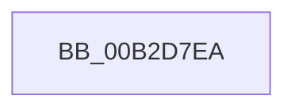

# sub_00B2D7EA

- RVA: `0x00B2D7EA`–`0x00B2D803` (길이 `25` bytes)
- VA: `0x0000000140B2D7EA`
- 실행 섹션: `PAGE`
- PDB 이름 있음: `아니요`; PDB Function 태그: `아니요`
- unwind 정보 RVA: `0x0009E020`
- 디코드: `7`개 명령, `25/25` bytes 표시
- 미해석 바이트: `0` (있으면 어셈블리에 `.byte`로 보존)

> 이 문서는 커널 이미지의 기계어와 PDB 기호를 분석해 생성했습니다. 4번과 5번은 함수 원형과 자료형을 바이너리 사용 방식에서 추정한 C 해석이며 원본 소스 복구 결과는 아닙니다.

## 1. Dependencies

- 직접 호출 지점: **1**; 고유 호출 대상: **1**
- 직접 호출자로 확인된 함수: **0**
- RIP 상대 이미지 참조: **0**

### Outgoing calls
- `0x00B2D7ED` → [CmpSnapshotTxOwnerArrayToRollbackPacket](../7F/CmpSnapshotTxOwnerArrayToRollbackPacket_function_007F0118.md) (function, `0x007F0118`)

### Direct callers
- 이 함수 시작 RVA로 연결되는 직접 call은 확인되지 않았습니다. 간접 호출은 완전히 역산할 수 없습니다.

### Static image references
- 디코드된 RIP-relative 메모리 참조가 없습니다.

## 2. Other-region calls and transfers

- 다른 실행 섹션으로 향하는 call: **0**
- call이 아닌 외부 분기/꼬리 이동: **1**
  - `0x00B2D7FE` → [CmpTryAcquireIXLockWithRollbackPacket + 0x12](../9A/CmpTryAcquireIXLockWithRollbackPacket_function_009AEC14.md) (`tail-transfer`)

## 3. Assembly (complete function range)

```asm
00B2D7EA  49 8B D0                        mov rdx, r8
00B2D7ED  E8 26 29 CC FF                  call 0x1407f0118
00B2D7F2  85 C0                           test eax, eax
00B2D7F4  B9 2D 02 00 C0                  mov ecx, 0xc000022d
00B2D7F9  0F 49 C1                        cmovns eax, ecx
00B2D7FC  8B D8                           mov ebx, eax
00B2D7FE  E9 23 14 E8 FF                  jmp 0x1409aec26
```

## 4. C-style interpretation (structured pseudocode)

```c
__int64 __fastcall sub_00B2D7EA(__int64 a1, __int64 a2, __int64 a3)
{
    __int64 result;

    result = CmpSnapshotTxOwnerArrayToRollbackPacket(a1, a3, a3, a4);
    if (!sign_flag) { result = (unsigned int)((unsigned int)(0xC000022DULL)); }
}
```

## 5. (Beta) C Style

```c
int64_t sub_00B2D7EA(int64_t Arg1, int64_t Arg2, int64_t Arg3)
{
    int64_t result;

    result = CmpSnapshotTxOwnerArrayToRollbackPacket(Arg1, Arg3, Arg3, a4);
    if (!sign_flag) { result = (uint32_t)((uint32_t)(0xC000022DULL)); }
}
```

## 6. Execution-region graph

[열기: 2D/3D 그래프와 함수 탐색 컨트롤 패널](../../../control-panel.html?section=page&rva=0x00B2D7EA&view=graph)

- 2D 그래프는 위에서 아래로 흐르고, 3D 그래프는 빈 공간을 드래그해 회전합니다. Shift+드래그는 이동, 휠은 확대·축소, 함수 노드 선택은 대상 보고서 이동입니다.

### Static fallback


