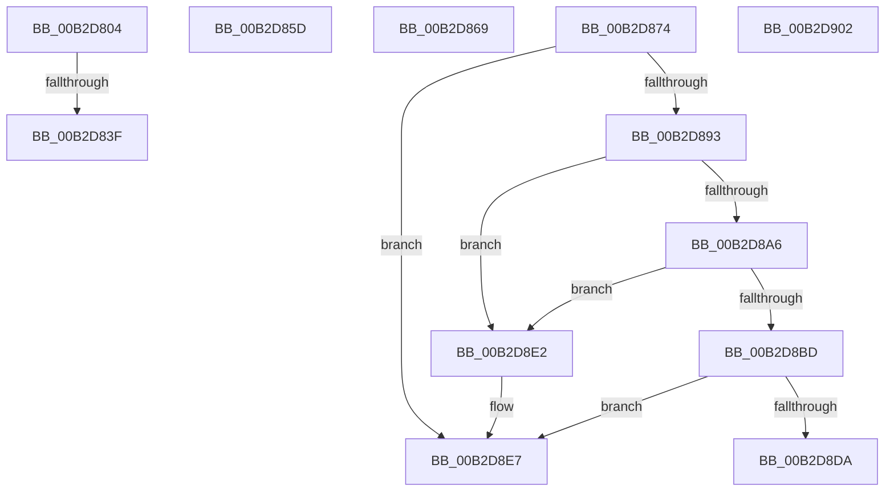

# sub_00B2D804

- RVA: `0x00B2D804`–`0x00B2D90C` (길이 `264` bytes)
- VA: `0x0000000140B2D804`
- 실행 섹션: `PAGE`
- PDB 이름 있음: `아니요`; PDB Function 태그: `아니요`
- unwind 정보 RVA: `0x0009E074`
- 디코드: `69`개 명령, `264/264` bytes 표시
- 미해석 바이트: `0` (있으면 어셈블리에 `.byte`로 보존)

> 이 문서는 커널 이미지의 기계어와 PDB 기호를 분석해 생성했습니다. 4번과 5번은 함수 원형과 자료형을 바이너리 사용 방식에서 추정한 C 해석이며 원본 소스 복구 결과는 아닙니다.

## 1. Dependencies

- 직접 호출 지점: **14**; 고유 호출 대상: **14**
- 직접 호출자로 확인된 함수: **0**
- RIP 상대 이미지 참조: **0**

### Outgoing calls
- `0x00B2D814` → [CmpLogTransactionAbortedWithChildName](../9A/CmpLogTransactionAbortedWithChildName_function_009AED70.md) (function, `0x009AED70`)
- `0x00B2D81D` → [CmpUnlockKcbStack](../84/CmpUnlockKcbStack_function_00848460.md) (function, `0x00848460`)
- `0x00B2D822` → [CmpUnlockRegistry](../../pagecmrc/BC/CmpUnlockRegistry_function_00BC9A84.md) (function, `0x00BC9A84`)
- `0x00B2D82D` → [CmpAbortRollbackPacket](../AB/CmpAbortRollbackPacket_function_00ABEA80.md) (function, `0x00ABEA80`)
- `0x00B2D843` → [CmpRetryBackOff](../94/CmpRetryBackOff_function_0094B474.md) (function, `0x0094B474`)
- `0x00B2D84C` → [CmpCleanupRollbackPacket](../9B/CmpCleanupRollbackPacket_function_009B014C.md) (function, `0x009B014C`)
- `0x00B2D869` → [HvpReleaseCellPaged](../85/HvpReleaseCellPaged_function_00855F40.md) (function, `0x00855F40`)
- `0x00B2D87A` → [CmpTransEnlistUowInKcb](../../text/48/CmpTransEnlistUowInKcb_function_0048F094.md) (function, `0x0048F094`)
- `0x00B2D885` → [CmpTransEnlistUowInCmTrans](../../text/48/CmpTransEnlistUowInCmTrans_function_0048B330.md) (function, `0x0048B330`)
- `0x00B2D89D` → [CmpLockIXLockIntent](../84/CmpLockIXLockIntent_function_00844C08.md) (function, `0x00844C08`)
- `0x00B2D8B4` → [CmpLockIXLockExclusive](../84/CmpLockIXLockExclusive_function_00844CB4.md) (function, `0x00844CB4`)
- `0x00B2D8CF` → [CmAddLogForAction](../84/CmAddLogForAction_function_008445AC.md) (function, `0x008445AC`)
- `0x00B2D8EA` → [CmpRundownUnitOfWork](../87/CmpRundownUnitOfWork_function_0087497C.md) (function, `0x0087497C`)
- `0x00B2D8F7` → [ExFreePoolWithTag](../../poolcode/B8/ExFreePoolWithTag_function_00B82870.md) (function, `0x00B82870`)

### Direct callers
- 이 함수 시작 RVA로 연결되는 직접 call은 확인되지 않았습니다. 간접 호출은 완전히 역산할 수 없습니다.

### Static image references
- 디코드된 RIP-relative 메모리 참조가 없습니다.

## 2. Other-region calls and transfers

- 다른 실행 섹션으로 향하는 call: **4**
  - `0x00B2D822` → [CmpUnlockRegistry](../../pagecmrc/BC/CmpUnlockRegistry_function_00BC9A84.md) (`PAGE` → `PAGECMRC`)
  - `0x00B2D87A` → [CmpTransEnlistUowInKcb](../../text/48/CmpTransEnlistUowInKcb_function_0048F094.md) (`PAGE` → `.text`)
  - `0x00B2D885` → [CmpTransEnlistUowInCmTrans](../../text/48/CmpTransEnlistUowInCmTrans_function_0048B330.md) (`PAGE` → `.text`)
  - `0x00B2D8F7` → [ExFreePoolWithTag](../../poolcode/B8/ExFreePoolWithTag_function_00B82870.md) (`PAGE` → `POOLCODE`)
- call이 아닌 외부 분기/꼬리 이동: **7**
  - `0x00B2D839` → [CmSetKeyFlags + 0xF9](../9A/CmSetKeyFlags_function_009AEEA4.md) (`tail-transfer`)
  - `0x00B2D858` → [CmSetKeyFlags + 0x87](../9A/CmSetKeyFlags_function_009AEEA4.md) (`tail-transfer`)
  - `0x00B2D864` → [CmSetKeyFlags + 0x38B](../9A/CmSetKeyFlags_function_009AEEA4.md) (`tail-transfer`)
  - `0x00B2D86F` → [CmSetKeyFlags + 0x3BA](../9A/CmSetKeyFlags_function_009AEEA4.md) (`tail-transfer`)
  - `0x00B2D8DD` → [CmSetKeyFlags + 0xEB](../9A/CmSetKeyFlags_function_009AEEA4.md) (`tail-transfer`)
  - `0x00B2D8FD` → [CmSetKeyFlags + 0xEB](../9A/CmSetKeyFlags_function_009AEEA4.md) (`tail-transfer`)
  - `0x00B2D907` → [CmSetKeyFlags + 0xEB](../9A/CmSetKeyFlags_function_009AEEA4.md) (`tail-transfer`)

## 3. Assembly (complete function range)

```asm
00B2D804  8B 45 CF                        mov eax, dword ptr [rbp - 0x31]
00B2D807  33 D2                           xor edx, edx
00B2D809  48 8B CE                        mov rcx, rsi
00B2D80C  89 44 24 20                     mov dword ptr [rsp + 0x20], eax
00B2D810  44 8D 42 03                     lea r8d, [rdx + 3]
00B2D814  E8 57 15 E8 FF                  call 0x1409aed70
00B2D819  48 8D 4D DF                     lea rcx, [rbp - 0x21]
00B2D81D  E8 3E AC D1 FF                  call 0x140848460
00B2D822  E8 5D C2 09 00                  call 0x140bc9a84
00B2D827  33 D2                           xor edx, edx
00B2D829  48 8D 4D CF                     lea rcx, [rbp - 0x31]
00B2D82D  E8 4E 12 F9 FF                  call 0x140abea80
00B2D832  45 33 FF                        xor r15d, r15d
00B2D835  8B F8                           mov edi, eax
00B2D837  85 C0                           test eax, eax
00B2D839  0F 88 5E 17 E8 FF               js 0x1409aef9d
00B2D83F  48 8D 4D C7                     lea rcx, [rbp - 0x39]
00B2D843  E8 2C DC E1 FF                  call 0x14094b474
00B2D848  48 8D 4D CF                     lea rcx, [rbp - 0x31]
00B2D84C  E8 FB 28 E8 FF                  call 0x1409b014c
00B2D851  0F 57 C0                        xorps xmm0, xmm0
00B2D854  0F 11 45 CF                     movups xmmword ptr [rbp - 0x31], xmm0
00B2D858  E9 CE 16 E8 FF                  jmp 0x1409aef2b
00B2D85D  66 09 86 BA 00 00 00            or word ptr [rsi + 0xba], ax
00B2D864  E9 C6 19 E8 FF                  jmp 0x1409af22f
00B2D869  E8 D2 86 D2 FF                  call 0x140855f40
00B2D86E  90                              nop
00B2D86F  E9 EA 19 E8 FF                  jmp 0x1409af25e
00B2D874  48 8B D6                        mov rdx, rsi
00B2D877  48 8B CB                        mov rcx, rbx
00B2D87A  E8 15 18 96 FF                  call 0x14048f094
00B2D87F  49 8B D7                        mov rdx, r15
00B2D882  48 8B CB                        mov rcx, rbx
00B2D885  E8 A6 DA 95 FF                  call 0x14048b330
00B2D88A  45 33 FF                        xor r15d, r15d
00B2D88D  8B F8                           mov edi, eax
00B2D88F  85 C0                           test eax, eax
00B2D891  78 54                           js 0x140b2d8e7
00B2D893  48 8D 8E F8 00 00 00            lea rcx, [rsi + 0xf8]
00B2D89A  48 8B D3                        mov rdx, rbx
00B2D89D  E8 66 73 D1 FF                  call 0x140844c08
00B2D8A2  84 C0                           test al, al
00B2D8A4  74 3C                           je 0x140b2d8e2
00B2D8A6  48 8D 8E 08 01 00 00            lea rcx, [rsi + 0x108]
00B2D8AD  48 8B D3                        mov rdx, rbx
00B2D8B0  45 8D 47 01                     lea r8d, [r15 + 1]
00B2D8B4  E8 FB 73 D1 FF                  call 0x140844cb4
00B2D8B9  84 C0                           test al, al
00B2D8BB  74 25                           je 0x140b2d8e2
00B2D8BD  41 8D 57 01                     lea edx, [r15 + 1]
00B2D8C1  C7 43 44 07 00 00 00            mov dword ptr [rbx + 0x44], 7
00B2D8C8  48 8B CB                        mov rcx, rbx
00B2D8CB  44 89 63 58                     mov dword ptr [rbx + 0x58], r12d
00B2D8CF  E8 D8 6C D1 FF                  call 0x1408445ac
00B2D8D4  8B F8                           mov edi, eax
00B2D8D6  85 C0                           test eax, eax
00B2D8D8  78 0D                           js 0x140b2d8e7
00B2D8DA  41 8B FF                        mov edi, r15d
00B2D8DD  E9 AD 16 E8 FF                  jmp 0x1409aef8f
00B2D8E2  BF 01 00 19 C0                  mov edi, 0xc0190001
00B2D8E7  48 8B CB                        mov rcx, rbx
00B2D8EA  E8 8D 70 D4 FF                  call 0x14087497c
00B2D8EF  BA 43 4D 55 77                  mov edx, 0x77554d43
00B2D8F4  48 8B CB                        mov rcx, rbx
00B2D8F7  E8 74 4F 05 00                  call 0x140b82870
00B2D8FC  90                              nop
00B2D8FD  E9 8D 16 E8 FF                  jmp 0x1409aef8f
00B2D902  BF 01 00 19 C0                  mov edi, 0xc0190001
00B2D907  E9 83 16 E8 FF                  jmp 0x1409aef8f
```

## 4. C-style interpretation (structured pseudocode)

```c
__int64 __fastcall sub_00B2D804(__int64 a1, int a2)
{
    __int64 result;
    __int64 v_r15;
    unsigned int v_stack_p20;

    a2 = 0;
    v_stack_p20 = (unsigned int)((unsigned int)(*(unsigned int *)(v_rbp - 49)));
    result = CmpLogTransactionAbortedWithChildName(v_rsi, a2, a2 + 3, a4);
    result = CmpUnlockKcbStack(v_rbp - 33, a2, a2 + 3, a4);
    result = CmpUnlockRegistry(v_rbp - 33, a2, a2 + 3, a4);
    a2 = 0;
    result = CmpAbortRollbackPacket(v_rbp - 49, a2, a2 + 3, a4);
    v_r15 = 0;
    result = CmpRetryBackOff(v_rbp - 57, a2, a2 + 3, a4);
    result = CmpCleanupRollbackPacket(v_rbp - 49, a2, a2 + 3, a4);
    *(unsigned __int64 *)(v_rbp - 49) = v_xmm0;
}
```

## 5. (Beta) C Style

```c
int64_t sub_00B2D804(int64_t Arg1, int32_t Arg2)
{
    int64_t result;
    int64_t local_r15;
    uint32_t v_stack_p20;

    Arg2 = 0;
    v_stack_p20 = (uint32_t)((uint32_t)(*(uint32_t *)(local_rbp - 0x31)));
    result = CmpLogTransactionAbortedWithChildName(local_rsi, Arg2, Arg2 + 3, a4);
    result = CmpUnlockKcbStack(local_rbp - 33, Arg2, Arg2 + 3, a4);
    result = CmpUnlockRegistry(local_rbp - 33, Arg2, Arg2 + 3, a4);
    Arg2 = 0;
    result = CmpAbortRollbackPacket(local_rbp - 49, Arg2, Arg2 + 3, a4);
    local_r15 = 0;
    result = CmpRetryBackOff(local_rbp - 57, Arg2, Arg2 + 3, a4);
    result = CmpCleanupRollbackPacket(local_rbp - 49, Arg2, Arg2 + 3, a4);
    *(uint64_t *)(local_rbp - 0x31) = v_xmm0;
}
```

## 6. Execution-region graph

[열기: 2D/3D 그래프와 함수 탐색 컨트롤 패널](../../../control-panel.html?section=page&rva=0x00B2D804&view=graph)

- 2D 그래프는 위에서 아래로 흐르고, 3D 그래프는 빈 공간을 드래그해 회전합니다. Shift+드래그는 이동, 휠은 확대·축소, 함수 노드 선택은 대상 보고서 이동입니다.

### Static fallback


