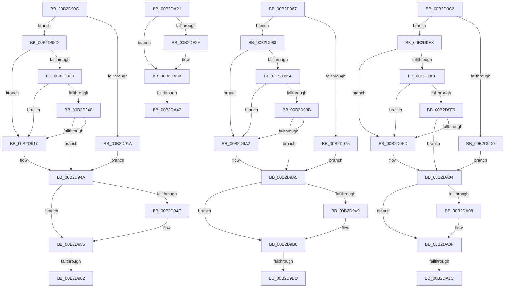

# sub_00B2D90C

- RVA: `0x00B2D90C`–`0x00B2DA55` (길이 `329` bytes)
- VA: `0x0000000140B2D90C`
- 실행 섹션: `PAGE`
- PDB 이름 있음: `아니요`; PDB Function 태그: `아니요`
- unwind 정보 RVA: `0x0009E0FC`
- 디코드: `92`개 명령, `329/329` bytes 표시
- 미해석 바이트: `0` (있으면 어셈블리에 `.byte`로 보존)

> 이 문서는 커널 이미지의 기계어와 PDB 기호를 분석해 생성했습니다. 4번과 5번은 함수 원형과 자료형을 바이너리 사용 방식에서 추정한 C 해석이며 원본 소스 복구 결과는 아닙니다.

## 1. Dependencies

- 직접 호출 지점: **7**; 고유 호출 대상: **3**
- 직접 호출자로 확인된 함수: **0**
- RIP 상대 이미지 참조: **0**

### Outgoing calls
- `0x00B2D90E` → [TmRollbackEnlistment](../../text/4F/TmRollbackEnlistment_function_004FE380.md) (function, `0x004FE380`)
- `0x00B2D91D` → [ObfDereferenceObject](../../text/2F/ObfDereferenceObject_function_002F9350.md) (function, `0x002F9350`)
- `0x00B2D969` → [TmRollbackEnlistment](../../text/4F/TmRollbackEnlistment_function_004FE380.md) (function, `0x004FE380`)
- `0x00B2D978` → [ObfDereferenceObject](../../text/2F/ObfDereferenceObject_function_002F9350.md) (function, `0x002F9350`)
- `0x00B2D9C4` → [TmRollbackEnlistment](../../text/4F/TmRollbackEnlistment_function_004FE380.md) (function, `0x004FE380`)
- `0x00B2D9D3` → [ObfDereferenceObject](../../text/2F/ObfDereferenceObject_function_002F9350.md) (function, `0x002F9350`)
- `0x00B2DA31` → [CmpLockRegistryFreezeAware](../9B/CmpLockRegistryFreezeAware_function_009B4AE4.md) (function, `0x009B4AE4`)

### Direct callers
- 이 함수 시작 RVA로 연결되는 직접 call은 확인되지 않았습니다. 간접 호출은 완전히 역산할 수 없습니다.

### Static image references
- 디코드된 RIP-relative 메모리 참조가 없습니다.

## 2. Other-region calls and transfers

- 다른 실행 섹션으로 향하는 call: **6**
  - `0x00B2D90E` → [TmRollbackEnlistment](../../text/4F/TmRollbackEnlistment_function_004FE380.md) (`PAGE` → `.text`)
  - `0x00B2D91D` → [ObfDereferenceObject](../../text/2F/ObfDereferenceObject_function_002F9350.md) (`PAGE` → `.text`)
  - `0x00B2D969` → [TmRollbackEnlistment](../../text/4F/TmRollbackEnlistment_function_004FE380.md) (`PAGE` → `.text`)
  - `0x00B2D978` → [ObfDereferenceObject](../../text/2F/ObfDereferenceObject_function_002F9350.md) (`PAGE` → `.text`)
  - `0x00B2D9C4` → [TmRollbackEnlistment](../../text/4F/TmRollbackEnlistment_function_004FE380.md) (`PAGE` → `.text`)
  - `0x00B2D9D3` → [ObfDereferenceObject](../../text/2F/ObfDereferenceObject_function_002F9350.md) (`PAGE` → `.text`)
- call이 아닌 외부 분기/꼬리 이동: **8**
  - `0x00B2D95C` → [CmpPerformUnloadKey + 0x5A9](../9A/CmpPerformUnloadKey_function_009AFA28.md) (`tail-transfer`)
  - `0x00B2D962` → [CmpPerformUnloadKey + 0x513](../9A/CmpPerformUnloadKey_function_009AFA28.md) (`tail-transfer`)
  - `0x00B2D9B7` → [CmpPerformUnloadKey + 0x5F0](../9A/CmpPerformUnloadKey_function_009AFA28.md) (`tail-transfer`)
  - `0x00B2D9BD` → [CmpPerformUnloadKey + 0x3E8](../9A/CmpPerformUnloadKey_function_009AFA28.md) (`tail-transfer`)
  - `0x00B2DA16` → [CmpPerformUnloadKey + 0x672](../9A/CmpPerformUnloadKey_function_009AFA28.md) (`tail-transfer`)
  - `0x00B2DA1C` → [CmpPerformUnloadKey + 0x442](../9A/CmpPerformUnloadKey_function_009AFA28.md) (`tail-transfer`)
  - `0x00B2DA3C` → [CmpPerformUnloadKey + 0x2D7](../9A/CmpPerformUnloadKey_function_009AFA28.md) (`tail-transfer`)
  - `0x00B2DA50` → [CmpPerformUnloadKey + 0x2AA](../9A/CmpPerformUnloadKey_function_009AFA28.md) (`tail-transfer`)

## 3. Assembly (complete function range)

```asm
00B2D90C  33 D2                           xor edx, edx
00B2D90E  E8 6D 0A 9D FF                  call 0x1404fe380
00B2D913  44 8B F0                        mov r14d, eax
00B2D916  85 C0                           test eax, eax
00B2D918  78 13                           js 0x140b2d92d
00B2D91A  48 8B CB                        mov rcx, rbx
00B2D91D  E8 2E BA 7C FF                  call 0x1402f9350
00B2D922  48 8B 45 9F                     mov rax, qword ptr [rbp - 0x61]
00B2D926  4A 83 24 F8 00                  and qword ptr [rax + r15*8], 0
00B2D92B  EB 1D                           jmp 0x140b2d94a
00B2D92D  41 8B C6                        mov eax, r14d
00B2D930  41 81 FE 15 00 19 C0            cmp r14d, 0xc0190015
00B2D937  74 0E                           je 0x140b2d947
00B2D939  3D 13 00 19 C0                  cmp eax, 0xc0190013
00B2D93E  74 07                           je 0x140b2d947
00B2D940  3D 16 00 19 C0                  cmp eax, 0xc0190016
00B2D945  75 03                           jne 0x140b2d94a
00B2D947  45 33 F6                        xor r14d, r14d
00B2D94A  85 FF                           test edi, edi
00B2D94C  78 07                           js 0x140b2d955
00B2D94E  45 85 F6                        test r14d, r14d
00B2D951  41 0F 48 FE                     cmovs edi, r14d
00B2D955  41 FF C7                        inc r15d
00B2D958  44 3B 7D 97                     cmp r15d, dword ptr [rbp - 0x69]
00B2D95C  0F 82 6F 26 E8 FF               jb 0x1409affd1
00B2D962  E9 D4 25 E8 FF                  jmp 0x1409aff3b
00B2D967  33 D2                           xor edx, edx
00B2D969  E8 12 0A 9D FF                  call 0x1404fe380
00B2D96E  44 8B F0                        mov r14d, eax
00B2D971  85 C0                           test eax, eax
00B2D973  78 13                           js 0x140b2d988
00B2D975  48 8B CB                        mov rcx, rbx
00B2D978  E8 D3 B9 7C FF                  call 0x1402f9350
00B2D97D  48 8B 45 9F                     mov rax, qword ptr [rbp - 0x61]
00B2D981  4A 83 24 F8 00                  and qword ptr [rax + r15*8], 0
00B2D986  EB 1D                           jmp 0x140b2d9a5
00B2D988  41 8B C6                        mov eax, r14d
00B2D98B  41 81 FE 15 00 19 C0            cmp r14d, 0xc0190015
00B2D992  74 0E                           je 0x140b2d9a2
00B2D994  3D 13 00 19 C0                  cmp eax, 0xc0190013
00B2D999  74 07                           je 0x140b2d9a2
00B2D99B  3D 16 00 19 C0                  cmp eax, 0xc0190016
00B2D9A0  75 03                           jne 0x140b2d9a5
00B2D9A2  45 33 F6                        xor r14d, r14d
00B2D9A5  85 FF                           test edi, edi
00B2D9A7  78 07                           js 0x140b2d9b0
00B2D9A9  45 85 F6                        test r14d, r14d
00B2D9AC  41 0F 48 FE                     cmovs edi, r14d
00B2D9B0  41 FF C7                        inc r15d
00B2D9B3  44 3B 7D 97                     cmp r15d, dword ptr [rbp - 0x69]
00B2D9B7  0F 82 5B 26 E8 FF               jb 0x1409b0018
00B2D9BD  E9 4E 24 E8 FF                  jmp 0x1409afe10
00B2D9C2  33 D2                           xor edx, edx
00B2D9C4  E8 B7 09 9D FF                  call 0x1404fe380
00B2D9C9  44 8B F0                        mov r14d, eax
00B2D9CC  85 C0                           test eax, eax
00B2D9CE  78 13                           js 0x140b2d9e3
00B2D9D0  48 8B CB                        mov rcx, rbx
00B2D9D3  E8 78 B9 7C FF                  call 0x1402f9350
00B2D9D8  48 8B 45 9F                     mov rax, qword ptr [rbp - 0x61]
00B2D9DC  4A 83 24 F8 00                  and qword ptr [rax + r15*8], 0
00B2D9E1  EB 21                           jmp 0x140b2da04
00B2D9E3  41 8B C6                        mov eax, r14d
00B2D9E6  41 81 FE 15 00 19 C0            cmp r14d, 0xc0190015
00B2D9ED  74 0E                           je 0x140b2d9fd
00B2D9EF  3D 13 00 19 C0                  cmp eax, 0xc0190013
00B2D9F4  74 07                           je 0x140b2d9fd
00B2D9F6  3D 16 00 19 C0                  cmp eax, 0xc0190016
00B2D9FB  75 07                           jne 0x140b2da04
00B2D9FD  45 33 F6                        xor r14d, r14d
00B2DA00  C6 45 8F 01                     mov byte ptr [rbp - 0x71], 1
00B2DA04  85 FF                           test edi, edi
00B2DA06  78 07                           js 0x140b2da0f
00B2DA08  45 85 F6                        test r14d, r14d
00B2DA0B  41 0F 48 FE                     cmovs edi, r14d
00B2DA0F  41 FF C7                        inc r15d
00B2DA12  44 3B 7D 97                     cmp r15d, dword ptr [rbp - 0x69]
00B2DA16  0F 82 7E 26 E8 FF               jb 0x1409b009a
00B2DA1C  E9 49 24 E8 FF                  jmp 0x1409afe6a
00B2DA21  8B 45 8B                        mov eax, dword ptr [rbp - 0x75]
00B2DA24  41 BE 02 00 00 00               mov r14d, 2
00B2DA2A  41 84 C6                        test r14b, al
00B2DA2D  75 0B                           jne 0x140b2da3a
00B2DA2F  B1 01                           mov cl, 1
00B2DA31  E8 AE 70 E8 FF                  call 0x1409b4ae4
00B2DA36  44 09 75 8B                     or dword ptr [rbp - 0x75], r14d
00B2DA3A  84 DB                           test bl, bl
00B2DA3C  0F 84 BD 22 E8 FF               je 0x1409afcff
00B2DA42  33 C0                           xor eax, eax
00B2DA44  49 87 85 68 06 00 00            xchg qword ptr [r13 + 0x668], rax
00B2DA4B  0F BA 76 08 12                  btr dword ptr [rsi + 8], 0x12
00B2DA50  E9 7D 22 E8 FF                  jmp 0x1409afcd2
```

## 4. C-style interpretation (structured pseudocode)

```c
__int64 __fastcall sub_00B2D90C(__int64 a1, int a2)
{
    __int64 result;
    __int64 v_r14;
    __int64 v_r15;
    __int64 v_rdi;

    a2 = 0;
    result = TmRollbackEnlistment(a1, a2, a3, a4);
    if (sign_flag) goto loc_00B2D92D;
    result = ObfDereferenceObject(v_rbx, a2, a3, a4);
    goto loc_00B2D94A;
loc_00B2D92D:
    if (((unsigned int)((unsigned int)((unsigned int)(result)))) == 0xC0190015ULL) goto loc_00B2D947;
    if (((unsigned int)((unsigned int)((unsigned int)((unsigned int)((unsigned int)(result)))))) == 0xC0190013ULL) goto loc_00B2D947;
    v_r14 = (unsigned int)((unsigned int)(result));
    if (((unsigned int)((unsigned int)((unsigned int)((unsigned int)((unsigned int)(result)))))) == 0xC0190016ULL) {
        v_r14 = 0;
    }
    if (!(sign_flag)) {
        if (sign_flag) { v_rdi = 0; }
    }
    v_r15 = (unsigned int)((v_r15) + 1);
}
```

## 5. (Beta) C Style

```c
int64_t sub_00B2D90C(int64_t Arg1, int32_t Arg2)
{
    int64_t result;
    int64_t local_r14;
    int64_t local_r15;
    int64_t local_rdi;

    Arg2 = 0;
    result = TmRollbackEnlistment(Arg1, Arg2, a3, a4);
    if (sign_flag) goto loc_00B2D92D;
    result = ObfDereferenceObject(local_rbx, Arg2, a3, a4);
    goto loc_00B2D94A;
loc_00B2D92D:
    if (((uint32_t)((uint32_t)((uint32_t)(result)))) == 0xC0190015ULL) goto loc_00B2D947;
    if (((uint32_t)((uint32_t)((uint32_t)((uint32_t)((uint32_t)(result)))))) == 0xC0190013ULL) goto loc_00B2D947;
    local_r14 = (uint32_t)((uint32_t)(result));
    if (((uint32_t)((uint32_t)((uint32_t)((uint32_t)((uint32_t)(result)))))) == 0xC0190016ULL) {
        local_r14 = 0;
    }
    if (!(sign_flag)) {
        if (sign_flag) { local_rdi = 0; }
    }
    local_r15 = (uint32_t)((local_r15) + 1);
}
```

## 6. Execution-region graph

[열기: 2D/3D 그래프와 함수 탐색 컨트롤 패널](../../../control-panel.html?section=page&rva=0x00B2D90C&view=graph)

- 2D 그래프는 위에서 아래로 흐르고, 3D 그래프는 빈 공간을 드래그해 회전합니다. Shift+드래그는 이동, 휠은 확대·축소, 함수 노드 선택은 대상 보고서 이동입니다.

### Static fallback


