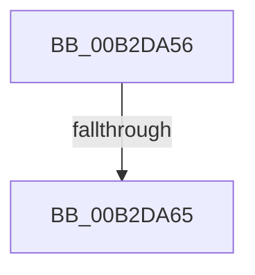

# sub_00B2DA56

- RVA: `0x00B2DA56`–`0x00B2DA6A` (길이 `20` bytes)
- VA: `0x0000000140B2DA56`
- 실행 섹션: `PAGE`
- PDB 이름 있음: `아니요`; PDB Function 태그: `아니요`
- unwind 정보 RVA: `0x0009E10C`
- 디코드: `5`개 명령, `20/20` bytes 표시
- 미해석 바이트: `0` (있으면 어셈블리에 `.byte`로 보존)

> 이 문서는 커널 이미지의 기계어와 PDB 기호를 분석해 생성했습니다. 4번과 5번은 함수 원형과 자료형을 바이너리 사용 방식에서 추정한 C 해석이며 원본 소스 복구 결과는 아닙니다.

## 1. Dependencies

- 직접 호출 지점: **1**; 고유 호출 대상: **1**
- 직접 호출자로 확인된 함수: **0**
- RIP 상대 이미지 참조: **0**

### Outgoing calls
- `0x00B2DA56` → [ObfDereferenceObject](../../text/2F/ObfDereferenceObject_function_002F9350.md) (function, `0x002F9350`)

### Direct callers
- 이 함수 시작 RVA로 연결되는 직접 call은 확인되지 않았습니다. 간접 호출은 완전히 역산할 수 없습니다.

### Static image references
- 디코드된 RIP-relative 메모리 참조가 없습니다.

## 2. Other-region calls and transfers

- 다른 실행 섹션으로 향하는 call: **1**
  - `0x00B2DA56` → [ObfDereferenceObject](../../text/2F/ObfDereferenceObject_function_002F9350.md) (`PAGE` → `.text`)
- call이 아닌 외부 분기/꼬리 이동: **2**
  - `0x00B2DA5F` → [CmpCleanupRollbackPacket + 0x32](../9B/CmpCleanupRollbackPacket_function_009B014C.md) (`tail-transfer`)
  - `0x00B2DA65` → [CmpCleanupRollbackPacket + 0x18](../9B/CmpCleanupRollbackPacket_function_009B014C.md) (`tail-transfer`)

## 3. Assembly (complete function range)

```asm
00B2DA56  E8 F5 B8 7C FF                  call 0x1402f9350
00B2DA5B  FF C7                           inc edi
00B2DA5D  3B 3E                           cmp edi, dword ptr [rsi]
00B2DA5F  0F 82 19 27 E8 FF               jb 0x1409b017e
00B2DA65  E9 FA 26 E8 FF                  jmp 0x1409b0164
```

## 4. C-style interpretation (structured pseudocode)

```c
__int64 __fastcall sub_00B2DA56(void)
{
    __int64 result;
    __int64 v_rdi;

    result = ObfDereferenceObject(a1, a2, a3, a4);
    v_rdi = (unsigned int)((v_rdi) + 1);
}
```

## 5. (Beta) C Style

```c
void sub_00B2DA56(void)
{
    int64_t result;
    int64_t local_rdi;

    result = ObfDereferenceObject(a1, a2, a3, a4);
    local_rdi = (uint32_t)((local_rdi) + 1);
}
```

## 6. Execution-region graph

[열기: 2D/3D 그래프와 함수 탐색 컨트롤 패널](../../../control-panel.html?section=page&rva=0x00B2DA56&view=graph)

- 2D 그래프는 위에서 아래로 흐르고, 3D 그래프는 빈 공간을 드래그해 회전합니다. Shift+드래그는 이동, 휠은 확대·축소, 함수 노드 선택은 대상 보고서 이동입니다.

### Static fallback


