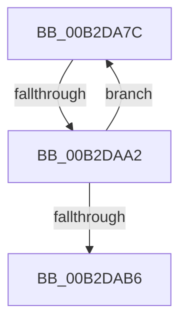

# sub_00B2DA7C

- RVA: `0x00B2DA7C`–`0x00B2DABB` (길이 `63` bytes)
- VA: `0x0000000140B2DA7C`
- 실행 섹션: `PAGE`
- PDB 이름 있음: `아니요`; PDB Function 태그: `아니요`
- unwind 정보 RVA: `0x0009E160`
- 디코드: `16`개 명령, `63/63` bytes 표시
- 미해석 바이트: `0` (있으면 어셈블리에 `.byte`로 보존)

> 이 문서는 커널 이미지의 기계어와 PDB 기호를 분석해 생성했습니다. 4번과 5번은 함수 원형과 자료형을 바이너리 사용 방식에서 추정한 C 해석이며 원본 소스 복구 결과는 아닙니다.

## 1. Dependencies

- 직접 호출 지점: **1**; 고유 호출 대상: **1**
- 직접 호출자로 확인된 함수: **0**
- RIP 상대 이미지 참조: **0**

### Outgoing calls
- `0x00B2DA94` → [CmpEnumerateKcbCacheBucket](../9B/CmpEnumerateKcbCacheBucket_function_009B03E4.md) (function, `0x009B03E4`)

### Direct callers
- 이 함수 시작 RVA로 연결되는 직접 call은 확인되지 않았습니다. 간접 호출은 완전히 역산할 수 없습니다.

### Static image references
- 디코드된 RIP-relative 메모리 참조가 없습니다.

## 2. Other-region calls and transfers

- 다른 실행 섹션으로 향하는 call: **0**
- call이 아닌 외부 분기/꼬리 이동: **2**
  - `0x00B2DA9C` → [CmpEnumerateAllOpenSubKeys + 0x94](../9B/CmpEnumerateAllOpenSubKeys_function_009B031C.md) (`tail-transfer`)
  - `0x00B2DAB6` → [CmpEnumerateAllOpenSubKeys + 0x94](../9B/CmpEnumerateAllOpenSubKeys_function_009B031C.md) (`tail-transfer`)

## 3. Assembly (complete function range)

```asm
00B2DA7C  48 8B 86 80 06 00 00            mov rax, qword ptr [rsi + 0x680]
00B2DA83  48 8D 0C 5B                     lea rcx, [rbx + rbx*2]
00B2DA87  4D 8B CF                        mov r9, r15
00B2DA8A  4D 8B C4                        mov r8, r12
00B2DA8D  48 8D 14 C8                     lea rdx, [rax + rcx*8]
00B2DA91  49 8B CE                        mov rcx, r14
00B2DA94  E8 4B 29 E8 FF                  call 0x1409b03e4
00B2DA99  83 F8 01                        cmp eax, 1
00B2DA9C  0F 84 0E 29 E8 FF               je 0x1409b03b0
00B2DAA2  83 F8 02                        cmp eax, 2
00B2DAA5  8D 4B FF                        lea ecx, [rbx - 1]
00B2DAA8  0F 45 CB                        cmovne ecx, ebx
00B2DAAB  8D 59 01                        lea ebx, [rcx + 1]
00B2DAAE  3B 9E 88 06 00 00               cmp ebx, dword ptr [rsi + 0x688]
00B2DAB4  72 C6                           jb 0x140b2da7c
00B2DAB6  E9 F5 28 E8 FF                  jmp 0x1409b03b0
```

## 4. C-style interpretation (structured pseudocode)

```c
__int64 __fastcall sub_00B2DA7C(void)
{
    __int64 result;

    result = CmpEnumerateKcbCacheBucket(v_r14, *(unsigned __int64 *)(v_rsi + 1664) + v_rbx + v_rbx * 2 * 8, v_r12, v_r15);
    a1 = v_rbx - 1;
    if (((unsigned int)(result)) != 2) { a1 = (unsigned int)(v_rbx); }
    if (((unsigned int)(a1 + 1)) < (*(unsigned int *)(v_rsi + 1672))) goto loc_00B2DA7C;
}
```

## 5. (Beta) C Style

```c
void sub_00B2DA7C(void)
{
    int64_t result;

    result = CmpEnumerateKcbCacheBucket(local_r14, *(uint64_t *)(local_rsi + 0x680) + local_rbx + local_rbx * 2 * 8, local_r12, local_r15);
    a1 = local_rbx - 1;
    if (((uint32_t)(result)) != 2) { a1 = (uint32_t)(local_rbx); }
    if (((uint32_t)(a1 + 1)) < (*(uint32_t *)(local_rsi + 0x688))) goto loc_00B2DA7C;
}
```

## 6. Execution-region graph

[열기: 2D/3D 그래프와 함수 탐색 컨트롤 패널](../../../control-panel.html?section=page&rva=0x00B2DA7C&view=graph)

- 2D 그래프는 위에서 아래로 흐르고, 3D 그래프는 빈 공간을 드래그해 회전합니다. Shift+드래그는 이동, 휠은 확대·축소, 함수 노드 선택은 대상 보고서 이동입니다.

### Static fallback


