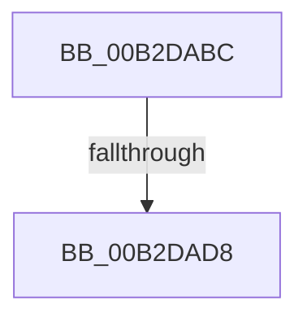

# sub_00B2DABC

- RVA: `0x00B2DABC`–`0x00B2DAE5` (길이 `41` bytes)
- VA: `0x0000000140B2DABC`
- 실행 섹션: `PAGE`
- PDB 이름 있음: `아니요`; PDB Function 태그: `아니요`
- unwind 정보 RVA: `0x0009E1BC`
- 디코드: `10`개 명령, `41/41` bytes 표시
- 미해석 바이트: `0` (있으면 어셈블리에 `.byte`로 보존)

> 이 문서는 커널 이미지의 기계어와 PDB 기호를 분석해 생성했습니다. 4번과 5번은 함수 원형과 자료형을 바이너리 사용 방식에서 추정한 C 해석이며 원본 소스 복구 결과는 아닙니다.

## 1. Dependencies

- 직접 호출 지점: **1**; 고유 호출 대상: **1**
- 직접 호출자로 확인된 함수: **0**
- RIP 상대 이미지 참조: **0**

### Outgoing calls
- `0x00B2DADA` → [ExfUnblockPushLock](../../text/2A/ExfUnblockPushLock_function_002A3FE0.md) (function, `0x002A3FE0`)

### Direct callers
- 이 함수 시작 RVA로 연결되는 직접 call은 확인되지 않았습니다. 간접 호출은 완전히 역산할 수 없습니다.

### Static image references
- 디코드된 RIP-relative 메모리 참조가 없습니다.

## 2. Other-region calls and transfers

- 다른 실행 섹션으로 향하는 call: **1**
  - `0x00B2DADA` → [ExfUnblockPushLock](../../text/2A/ExfUnblockPushLock_function_002A3FE0.md) (`PAGE` → `.text`)
- call이 아닌 외부 분기/꼬리 이동: **2**
  - `0x00B2DAD2` → [CmpCommitLightWeightTransaction + 0xD8](../9B/CmpCommitLightWeightTransaction_function_009B0868.md) (`tail-transfer`)
  - `0x00B2DAE0` → [CmpCommitLightWeightTransaction + 0xD8](../9B/CmpCommitLightWeightTransaction_function_009B0868.md) (`tail-transfer`)

## 3. Assembly (complete function range)

```asm
00B2DABC  B8 04 00 00 00                  mov eax, 4
00B2DAC1  F0 0F B1 0B                     lock cmpxchg dword ptr [rbx], ecx
00B2DAC5  48 8D 4B 08                     lea rcx, [rbx + 8]
00B2DAC9  F0 83 0C 24 00                  lock or dword ptr [rsp], 0
00B2DACE  48 83 39 00                     cmp qword ptr [rcx], 0
00B2DAD2  0F 84 68 2E E8 FF               je 0x1409b0940
00B2DAD8  33 D2                           xor edx, edx
00B2DADA  E8 01 65 77 FF                  call 0x1402a3fe0
00B2DADF  90                              nop
00B2DAE0  E9 5B 2E E8 FF                  jmp 0x1409b0940
```

## 4. C-style interpretation (structured pseudocode)

```c
__int64 __fastcall sub_00B2DABC(int a1, int a2)
{
    __int64 result;
    unsigned int v_stack_p0;

    a2 = 0;
    result = ExfUnblockPushLock(v_rbx + 8, a2, a3, a4);
}
```

## 5. (Beta) C Style

```c
int64_t sub_00B2DABC(int32_t Arg1, int32_t Arg2)
{
    int64_t result;
    uint32_t v_stack_p0;

    Arg2 = 0;
    result = ExfUnblockPushLock(local_rbx + 8, Arg2, a3, a4);
}
```

## 6. Execution-region graph

[열기: 2D/3D 그래프와 함수 탐색 컨트롤 패널](../../../control-panel.html?section=page&rva=0x00B2DABC&view=graph)

- 2D 그래프는 위에서 아래로 흐르고, 3D 그래프는 빈 공간을 드래그해 회전합니다. Shift+드래그는 이동, 휠은 확대·축소, 함수 노드 선택은 대상 보고서 이동입니다.

### Static fallback


