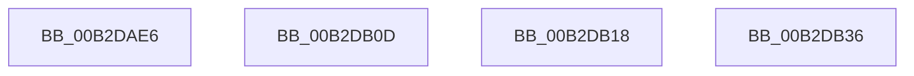

# sub_00B2DAE6

- RVA: `0x00B2DAE6`–`0x00B2DB57` (길이 `113` bytes)
- VA: `0x0000000140B2DAE6`
- 실행 섹션: `PAGE`
- PDB 이름 있음: `아니요`; PDB Function 태그: `아니요`
- unwind 정보 RVA: `0x0009E228`
- 디코드: `28`개 명령, `113/113` bytes 표시
- 미해석 바이트: `0` (있으면 어셈블리에 `.byte`로 보존)

> 이 문서는 커널 이미지의 기계어와 PDB 기호를 분석해 생성했습니다. 4번과 5번은 함수 원형과 자료형을 바이너리 사용 방식에서 추정한 C 해석이며 원본 소스 복구 결과는 아닙니다.

## 1. Dependencies

- 직접 호출 지점: **7**; 고유 호출 대상: **5**
- 직접 호출자로 확인된 함수: **0**
- RIP 상대 이미지 참조: **0**

### Outgoing calls
- `0x00B2DAF4` → [CmpReportNotify](../8C/CmpReportNotify_function_008C8094.md) (function, `0x008C8094`)
- `0x00B2DB02` → [CmpLightWeightCommitDeleteKeyUoW](../A5/CmpLightWeightCommitDeleteKeyUoW_function_00A54610.md) (function, `0x00A54610`)
- `0x00B2DB0D` → [CmpLightWeightCommitAddKeyUoW](../A5/CmpLightWeightCommitAddKeyUoW_function_00A54CA8.md) (function, `0x00A54CA8`)
- `0x00B2DB18` → [CmpLightWeightCommitSetSecDescUoW](../94/CmpLightWeightCommitSetSecDescUoW_function_0094B4AC.md) (function, `0x0094B4AC`)
- `0x00B2DB2B` → [CmpReportNotify](../8C/CmpReportNotify_function_008C8094.md) (function, `0x008C8094`)
- `0x00B2DB39` → [CmpLightWeightCommitDeleteValueKeyUoW](../A3/CmpLightWeightCommitDeleteValueKeyUoW_function_00A39E54.md) (function, `0x00A39E54`)
- `0x00B2DB4C` → [CmpReportNotify](../8C/CmpReportNotify_function_008C8094.md) (function, `0x008C8094`)

### Direct callers
- 이 함수 시작 RVA로 연결되는 직접 call은 확인되지 않았습니다. 간접 호출은 완전히 역산할 수 없습니다.

### Static image references
- 디코드된 RIP-relative 메모리 참조가 없습니다.

## 2. Other-region calls and transfers

- 다른 실행 섹션으로 향하는 call: **0**
- call이 아닌 외부 분기/꼬리 이동: **4**
  - `0x00B2DB08` → [CmpProcessLightWeightUOW + 0x5C](../9B/CmpProcessLightWeightUOW_function_009B0EAC.md) (`tail-transfer`)
  - `0x00B2DB13` → [CmpProcessLightWeightUOW + 0x1F1](../9B/CmpProcessLightWeightUOW_function_009B0EAC.md) (`tail-transfer`)
  - `0x00B2DB31` → [CmpProcessLightWeightUOW + 0x5C](../9B/CmpProcessLightWeightUOW_function_009B0EAC.md) (`tail-transfer`)
  - `0x00B2DB52` → [CmpProcessLightWeightUOW + 0x53](../9B/CmpProcessLightWeightUOW_function_009B0EAC.md) (`tail-transfer`)

## 3. Assembly (complete function range)

```asm
00B2DAE6  48 8B 49 30                     mov rcx, qword ptr [rcx + 0x30]
00B2DAEA  4C 8D 4D D0                     lea r9, [rbp - 0x30]
00B2DAEE  41 B8 01 00 00 00               mov r8d, 1
00B2DAF4  E8 9B A5 D9 FF                  call 0x1408c8094
00B2DAF9  4D 8B C6                        mov r8, r14
00B2DAFC  48 8B D6                        mov rdx, rsi
00B2DAFF  48 8B CF                        mov rcx, rdi
00B2DB02  E8 09 6B F2 FF                  call 0x140a54610
00B2DB07  90                              nop
00B2DB08  E9 FB 33 E8 FF                  jmp 0x1409b0f08
00B2DB0D  E8 96 71 F2 FF                  call 0x140a54ca8
00B2DB12  90                              nop
00B2DB13  E9 85 35 E8 FF                  jmp 0x1409b109d
00B2DB18  E8 8F D9 E1 FF                  call 0x14094b4ac
00B2DB1D  41 B8 0A 00 00 00               mov r8d, 0xa
00B2DB23  48 8B 4F 30                     mov rcx, qword ptr [rdi + 0x30]
00B2DB27  4C 8D 4D D0                     lea r9, [rbp - 0x30]
00B2DB2B  E8 64 A5 D9 FF                  call 0x1408c8094
00B2DB30  90                              nop
00B2DB31  E9 D2 33 E8 FF                  jmp 0x1409b0f08
00B2DB36  4D 8B C6                        mov r8, r14
00B2DB39  E8 16 C3 F0 FF                  call 0x140a39e54
00B2DB3E  48 8B 4F 30                     mov rcx, qword ptr [rdi + 0x30]
00B2DB42  4C 8D 4D D0                     lea r9, [rbp - 0x30]
00B2DB46  41 B8 04 00 00 00               mov r8d, 4
00B2DB4C  E8 43 A5 D9 FF                  call 0x1408c8094
00B2DB51  90                              nop
00B2DB52  E9 A8 33 E8 FF                  jmp 0x1409b0eff
```

## 4. C-style interpretation (structured pseudocode)

```c
__int64 __fastcall sub_00B2DAE6(__int64 a1)
{
    __int64 result;

    result = CmpReportNotify(*(unsigned __int64 *)(a1 + 48), a2, 1, v_rbp - 48);
    result = CmpLightWeightCommitDeleteKeyUoW(v_rdi, v_rsi, v_r14, v_rbp - 48);
}
```

## 5. (Beta) C Style

```c
int64_t sub_00B2DAE6(void *Arg1)
{
    uint8_t *arg1 = (uint8_t *)Arg1;

    int64_t result;

    result = CmpReportNotify(*(uint64_t *)(arg1 + 0x30), a2, 1, local_rbp - 48);
    result = CmpLightWeightCommitDeleteKeyUoW(local_rdi, local_rsi, local_r14, local_rbp - 48);
}
```

### 관측된 메모리 오프셋

구조체 형식이 확인되지 않은 접근은 인자 기준의 오프셋으로만 기록했습니다.

| 기준 인자 | 오프셋 표현 | 폭 (bit) | 접근 |
|---|---:|---:|---|
| `Arg1` | `+ 0x30` | `64` | `R` |

## 6. Execution-region graph

[열기: 2D/3D 그래프와 함수 탐색 컨트롤 패널](../../../control-panel.html?section=page&rva=0x00B2DAE6&view=graph)

- 2D 그래프는 위에서 아래로 흐르고, 3D 그래프는 빈 공간을 드래그해 회전합니다. Shift+드래그는 이동, 휠은 확대·축소, 함수 노드 선택은 대상 보고서 이동입니다.

### Static fallback


