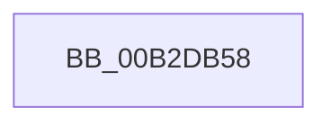

# sub_00B2DB58

- RVA: `0x00B2DB58`–`0x00B2DB7B` (길이 `35` bytes)
- VA: `0x0000000140B2DB58`
- 실행 섹션: `PAGE`
- PDB 이름 있음: `아니요`; PDB Function 태그: `아니요`
- unwind 정보 RVA: `0x0009E254`
- 디코드: `9`개 명령, `35/35` bytes 표시
- 미해석 바이트: `0` (있으면 어셈블리에 `.byte`로 보존)

> 이 문서는 커널 이미지의 기계어와 PDB 기호를 분석해 생성했습니다. 4번과 5번은 함수 원형과 자료형을 바이너리 사용 방식에서 추정한 C 해석이며 원본 소스 복구 결과는 아닙니다.

## 1. Dependencies

- 직접 호출 지점: **1**; 고유 호출 대상: **1**
- 직접 호출자로 확인된 함수: **0**
- RIP 상대 이미지 참조: **0**

### Outgoing calls
- `0x00B2DB70` → [ExBlockOnAddressPushLock](../../text/2A/ExBlockOnAddressPushLock_function_002A43A0.md) (function, `0x002A43A0`)

### Direct callers
- 이 함수 시작 RVA로 연결되는 직접 call은 확인되지 않았습니다. 간접 호출은 완전히 역산할 수 없습니다.

### Static image references
- 디코드된 RIP-relative 메모리 참조가 없습니다.

## 2. Other-region calls and transfers

- 다른 실행 섹션으로 향하는 call: **1**
  - `0x00B2DB70` → [ExBlockOnAddressPushLock](../../text/2A/ExBlockOnAddressPushLock_function_002A43A0.md) (`PAGE` → `.text`)
- call이 아닌 외부 분기/꼬리 이동: **1**
  - `0x00B2DB76` → [CmpRollbackLightWeightTransaction + 0x40](../9B/CmpRollbackLightWeightTransaction_function_009B1158.md) (`tail-transfer`)

## 3. Assembly (complete function range)

```asm
00B2DB58  33 DB                           xor ebx, ebx
00B2DB5A  44 89 4C 24 60                  mov dword ptr [rsp + 0x60], r9d
00B2DB5F  48 8D 4F 08                     lea rcx, [rdi + 8]
00B2DB63  48 89 5C 24 20                  mov qword ptr [rsp + 0x20], rbx
00B2DB68  4C 8D 44 24 60                  lea r8, [rsp + 0x60]
00B2DB6D  48 8B D7                        mov rdx, rdi
00B2DB70  E8 2B 68 77 FF                  call 0x1402a43a0
00B2DB75  90                              nop
00B2DB76  E9 1D 36 E8 FF                  jmp 0x1409b1198
```

## 4. C-style interpretation (structured pseudocode)

```c
__int64 __fastcall sub_00B2DB58(__int64 a1, __int64 a2, __int64 a3, int a4, __int64 a5, __int64 a6, __int64 a7, __int64 a8, __int64 a9, __int64 a10, __int64 a11, __int64 a12)
{
    __int64 result;
    __int64 v_rbx;
    unsigned __int64 v_stack_p20;
    unsigned int v_stack_p60;

    v_rbx = 0;
    v_stack_p60 = a4;
    v_stack_p20 = 0;
    result = ExBlockOnAddressPushLock(v_rdi + 8, v_rdi, a12, a4);
}
```

## 5. (Beta) C Style

```c
int64_t sub_00B2DB58(int64_t Arg1, int64_t Arg2, int64_t Arg3, int32_t Arg4, uint64_t Arg5, uint64_t Arg6, uint64_t Arg7, uint64_t Arg8, uint64_t Arg9, uint64_t Arg10, uint64_t Arg11, int64_t Arg12)
{
    int64_t result;
    int64_t local_rbx;
    uint64_t v_stack_p20;
    uint32_t v_stack_p60;

    local_rbx = 0;
    v_stack_p60 = Arg4;
    v_stack_p20 = 0;
    result = ExBlockOnAddressPushLock(local_rdi + 8, local_rdi, Arg12, Arg4);
}
```

## 6. Execution-region graph

[열기: 2D/3D 그래프와 함수 탐색 컨트롤 패널](../../../control-panel.html?section=page&rva=0x00B2DB58&view=graph)

- 2D 그래프는 위에서 아래로 흐르고, 3D 그래프는 빈 공간을 드래그해 회전합니다. Shift+드래그는 이동, 휠은 확대·축소, 함수 노드 선택은 대상 보고서 이동입니다.

### Static fallback


