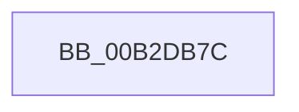

# sub_00B2DB7C

- RVA: `0x00B2DB7C`–`0x00B2DB96` (길이 `26` bytes)
- VA: `0x0000000140B2DB7C`
- 실행 섹션: `PAGE`
- PDB 이름 있음: `아니요`; PDB Function 태그: `아니요`
- unwind 정보 RVA: `0x0009E28C`
- 디코드: `7`개 명령, `26/26` bytes 표시
- 미해석 바이트: `0` (있으면 어셈블리에 `.byte`로 보존)

> 이 문서는 커널 이미지의 기계어와 PDB 기호를 분석해 생성했습니다. 4번과 5번은 함수 원형과 자료형을 바이너리 사용 방식에서 추정한 C 해석이며 원본 소스 복구 결과는 아닙니다.

## 1. Dependencies

- 직접 호출 지점: **0**; 고유 호출 대상: **0**
- 직접 호출자로 확인된 함수: **0**
- RIP 상대 이미지 참조: **0**

### Outgoing calls
- 직접 디코드된 call 명령이 없습니다.

### Direct callers
- 이 함수 시작 RVA로 연결되는 직접 call은 확인되지 않았습니다. 간접 호출은 완전히 역산할 수 없습니다.

### Static image references
- 디코드된 RIP-relative 메모리 참조가 없습니다.

## 2. Other-region calls and transfers

- 다른 실행 섹션으로 향하는 call: **0**
- call이 아닌 외부 분기/꼬리 이동: **1**
  - `0x00B2DB91` → [CmpAdjustRequestedFileSize + 0x36](../9B/CmpAdjustRequestedFileSize_function_009B14C0.md) (`tail-transfer`)

## 3. Assembly (complete function range)

```asm
00B2DB7C  40 B6 01                        mov sil, 1
00B2DB7F  40 8A C6                        mov al, sil
00B2DB82  F6 D8                           neg al
00B2DB84  45 1B DB                        sbb r11d, r11d
00B2DB87  41 81 E3 00 10 FC FF            and r11d, 0xfffc1000
00B2DB8E  45 03 D8                        add r11d, r8d
00B2DB91  E9 60 39 E8 FF                  jmp 0x1409b14f6
```

## 4. C-style interpretation (structured pseudocode)

```c
__int64 __fastcall sub_00B2DB7C(__int64 a1, __int64 a2, int a3)
{
    __int64 result;
    __int64 v_r11;

    result = (unsigned __int8)(-(1));
    v_r11 = (unsigned int)((v_r11) & (0xFFFC1000ULL));
    v_r11 = (unsigned int)((v_r11) + (a3));
}
```

## 5. (Beta) C Style

```c
int64_t sub_00B2DB7C(int64_t Arg1, int64_t Arg2, int32_t Arg3)
{
    int64_t result;
    int64_t local_r11;

    result = (uint8_t)(-(1));
    local_r11 = (uint32_t)((local_r11) & (0xFFFC1000ULL));
    local_r11 = (uint32_t)((local_r11) + (Arg3));
}
```

## 6. Execution-region graph

[열기: 2D/3D 그래프와 함수 탐색 컨트롤 패널](../../../control-panel.html?section=page&rva=0x00B2DB7C&view=graph)

- 2D 그래프는 위에서 아래로 흐르고, 3D 그래프는 빈 공간을 드래그해 회전합니다. Shift+드래그는 이동, 휠은 확대·축소, 함수 노드 선택은 대상 보고서 이동입니다.

### Static fallback


