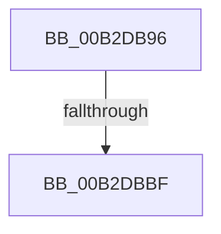

# sub_00B2DB96

- RVA: `0x00B2DB96`–`0x00B2DBC9` (길이 `51` bytes)
- VA: `0x0000000140B2DB96`
- 실행 섹션: `PAGE`
- PDB 이름 있음: `아니요`; PDB Function 태그: `아니요`
- unwind 정보 RVA: `0x0009E2E8`
- 디코드: `12`개 명령, `51/51` bytes 표시
- 미해석 바이트: `0` (있으면 어셈블리에 `.byte`로 보존)

> 이 문서는 커널 이미지의 기계어와 PDB 기호를 분석해 생성했습니다. 4번과 5번은 함수 원형과 자료형을 바이너리 사용 방식에서 추정한 C 해석이며 원본 소스 복구 결과는 아닙니다.

## 1. Dependencies

- 직접 호출 지점: **3**; 고유 호출 대상: **3**
- 직접 호출자로 확인된 함수: **0**
- RIP 상대 이미지 참조: **0**

### Outgoing calls
- `0x00B2DBA0` → [HvUnlockHiveFlusherExclusive](../../pagecmrc/BC/HvUnlockHiveFlusherExclusive_function_00BC9C34.md) (function, `0x00BC9C34`)
- `0x00B2DBA5` → [CmpUnlockRegistry](../../pagecmrc/BC/CmpUnlockRegistry_function_00BC9A84.md) (function, `0x00BC9A84`)
- `0x00B2DBB2` → [CmpFlushHive](../9B/CmpFlushHive_function_009B3DC0.md) (function, `0x009B3DC0`)

### Direct callers
- 이 함수 시작 RVA로 연결되는 직접 call은 확인되지 않았습니다. 간접 호출은 완전히 역산할 수 없습니다.

### Static image references
- 디코드된 RIP-relative 메모리 참조가 없습니다.

## 2. Other-region calls and transfers

- 다른 실행 섹션으로 향하는 call: **2**
  - `0x00B2DBA0` → [HvUnlockHiveFlusherExclusive](../../pagecmrc/BC/HvUnlockHiveFlusherExclusive_function_00BC9C34.md) (`PAGE` → `PAGECMRC`)
  - `0x00B2DBA5` → [CmpUnlockRegistry](../../pagecmrc/BC/CmpUnlockRegistry_function_00BC9A84.md) (`PAGE` → `PAGECMRC`)
- call이 아닌 외부 분기/꼬리 이동: **2**
  - `0x00B2DBB9` → [CmpTransMgrPrepare + 0x12B](../9B/CmpTransMgrPrepare_function_009B175C.md) (`tail-transfer`)
  - `0x00B2DBC4` → [CmpTransMgrPrepare + 0x136](../9B/CmpTransMgrPrepare_function_009B175C.md) (`tail-transfer`)

## 3. Assembly (complete function range)

```asm
00B2DB96  48 8B 47 40                     mov rax, qword ptr [rdi + 0x40]
00B2DB9A  09 B0 90 00 00 00               or dword ptr [rax + 0x90], esi
00B2DBA0  E8 8F C0 09 00                  call 0x140bc9c34
00B2DBA5  E8 DA BE 09 00                  call 0x140bc9a84
00B2DBAA  33 D2                           xor edx, edx
00B2DBAC  48 8B CF                        mov rcx, rdi
00B2DBAF  40 32 F6                        xor sil, sil
00B2DBB2  E8 09 62 E8 FF                  call 0x1409b3dc0
00B2DBB7  85 C0                           test eax, eax
00B2DBB9  0F 89 C8 3C E8 FF               jns 0x1409b1887
00B2DBBF  BB 9A 00 00 C0                  mov ebx, 0xc000009a
00B2DBC4  E9 C9 3C E8 FF                  jmp 0x1409b1892
```

## 4. C-style interpretation (structured pseudocode)

```c
__int64 __fastcall sub_00B2DB96(__int64 a1, int a2)
{
    __int64 result;
    __int64 v_rsi;

    result = HvUnlockHiveFlusherExclusive(a1, a2, a3, a4);
    result = CmpUnlockRegistry(a1, a2, a3, a4);
    a2 = 0;
    v_rsi = 0;
    result = CmpFlushHive(v_rdi, a2, a3, a4);
}
```

## 5. (Beta) C Style

```c
int64_t sub_00B2DB96(int64_t Arg1, int32_t Arg2)
{
    int64_t result;
    int64_t local_rsi;

    result = HvUnlockHiveFlusherExclusive(Arg1, Arg2, a3, a4);
    result = CmpUnlockRegistry(Arg1, Arg2, a3, a4);
    Arg2 = 0;
    local_rsi = 0;
    result = CmpFlushHive(local_rdi, Arg2, a3, a4);
}
```

## 6. Execution-region graph

[열기: 2D/3D 그래프와 함수 탐색 컨트롤 패널](../../../control-panel.html?section=page&rva=0x00B2DB96&view=graph)

- 2D 그래프는 위에서 아래로 흐르고, 3D 그래프는 빈 공간을 드래그해 회전합니다. Shift+드래그는 이동, 휠은 확대·축소, 함수 노드 선택은 대상 보고서 이동입니다.

### Static fallback


