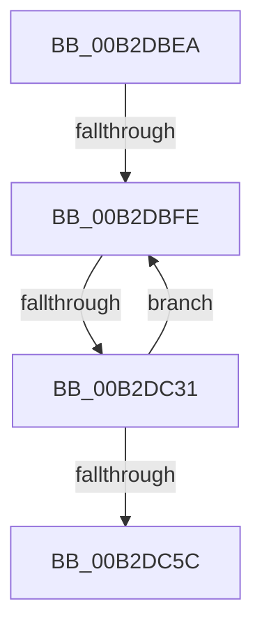

# sub_00B2DBEA

- RVA: `0x00B2DBEA`–`0x00B2DC61` (길이 `119` bytes)
- VA: `0x0000000140B2DBEA`
- 실행 섹션: `PAGE`
- PDB 이름 있음: `아니요`; PDB Function 태그: `아니요`
- unwind 정보 RVA: `0x0009E390`
- 디코드: `30`개 명령, `119/119` bytes 표시
- 미해석 바이트: `0` (있으면 어셈블리에 `.byte`로 보존)

> 이 문서는 커널 이미지의 기계어와 PDB 기호를 분석해 생성했습니다. 4번과 5번은 함수 원형과 자료형을 바이너리 사용 방식에서 추정한 C 해석이며 원본 소스 복구 결과는 아닙니다.

## 1. Dependencies

- 직접 호출 지점: **1**; 고유 호출 대상: **1**
- 직접 호출자로 확인된 함수: **0**
- RIP 상대 이미지 참조: **0**

### Outgoing calls
- `0x00B2DC24` → [HvpFindNextDirtyBlock](../9B/HvpFindNextDirtyBlock_function_009B5540.md) (function, `0x009B5540`)

### Direct callers
- 이 함수 시작 RVA로 연결되는 직접 call은 확인되지 않았습니다. 간접 호출은 완전히 역산할 수 없습니다.

### Static image references
- 디코드된 RIP-relative 메모리 참조가 없습니다.

## 2. Other-region calls and transfers

- 다른 실행 섹션으로 향하는 call: **0**
- call이 아닌 외부 분기/꼬리 이동: **3**
  - `0x00B2DBF8` → [HvWriteHivePrimaryFile + 0x108](../9B/HvWriteHivePrimaryFile_function_009B2374.md) (`tail-transfer`)
  - `0x00B2DC2B` → [HvWriteHivePrimaryFile + 0x108](../9B/HvWriteHivePrimaryFile_function_009B2374.md) (`tail-transfer`)
  - `0x00B2DC5C` → [HvWriteHivePrimaryFile + 0x108](../9B/HvWriteHivePrimaryFile_function_009B2374.md) (`tail-transfer`)

## 3. Assembly (complete function range)

```asm
00B2DBEA  41 8B DC                        mov ebx, r12d
00B2DBED  44 89 65 48                     mov dword ptr [rbp + 0x48], r12d
00B2DBF1  44 39 A7 80 00 00 00            cmp dword ptr [rdi + 0x80], r12d
00B2DBF8  0F 86 7E 48 E8 FF               jbe 0x1409b247c
00B2DBFE  48 8D 45 50                     lea rax, [rbp + 0x50]
00B2DC02  44 88 64 24 30                  mov byte ptr [rsp + 0x30], r12b
00B2DC07  48 89 44 24 28                  mov qword ptr [rsp + 0x28], rax
00B2DC0C  4C 8D 4D 60                     lea r9, [rbp + 0x60]
00B2DC10  48 8D 45 58                     lea rax, [rbp + 0x58]
00B2DC14  48 8B CF                        mov rcx, rdi
00B2DC17  4C 8D 45 48                     lea r8, [rbp + 0x48]
00B2DC1B  48 89 44 24 20                  mov qword ptr [rsp + 0x20], rax
00B2DC20  48 8D 57 70                     lea rdx, [rdi + 0x70]
00B2DC24  E8 17 79 E8 FF                  call 0x1409b5540
00B2DC29  84 C0                           test al, al
00B2DC2B  0F 84 4B 48 E8 FF               je 0x1409b247c
00B2DC31  8B 4D 50                        mov ecx, dword ptr [rbp + 0x50]
00B2DC34  8B C3                           mov eax, ebx
00B2DC36  FF C3                           inc ebx
00B2DC38  48 8D 14 40                     lea rdx, [rax + rax*2]
00B2DC3C  48 8B 45 60                     mov rax, qword ptr [rbp + 0x60]
00B2DC40  48 89 44 D6 08                  mov qword ptr [rsi + rdx*8 + 8], rax
00B2DC45  8B 45 58                        mov eax, dword ptr [rbp + 0x58]
00B2DC48  89 0C D6                        mov dword ptr [rsi + rdx*8], ecx
00B2DC4B  03 C8                           add ecx, eax
00B2DC4D  89 44 D6 10                     mov dword ptr [rsi + rdx*8 + 0x10], eax
00B2DC51  89 4D 50                        mov dword ptr [rbp + 0x50], ecx
00B2DC54  3B 9F 80 00 00 00               cmp ebx, dword ptr [rdi + 0x80]
00B2DC5A  72 A2                           jb 0x140b2dbfe
00B2DC5C  E9 1B 48 E8 FF                  jmp 0x1409b247c
```

## 4. C-style interpretation (structured pseudocode)

```c
__int64 __fastcall sub_00B2DBEA(void)
{
    __int64 result;
    __int64 v_rbx;
    unsigned __int64 v_stack_p20;
    unsigned __int64 v_stack_p28;
    unsigned __int8 v_stack_p30;

    *(unsigned int *)(v_rbp + 72) = (unsigned int)(v_r12);
loc_00B2DBFE:
    v_stack_p30 = (unsigned __int8)(v_r12);
    v_stack_p28 = v_rbp + 80;
    v_stack_p20 = v_rbp + 88;
    result = HvpFindNextDirtyBlock(v_rdi, v_rdi + 112, v_rbp + 72, v_rbp + 96);
    v_rbx = (unsigned int)(((unsigned int)((unsigned int)(v_r12))) + 1);
    *(unsigned __int64 *)(v_rsi + (unsigned int)((unsigned int)((unsigned int)((unsigned int)(v_r12)))) + (unsigned int)((unsigned int)((unsigned int)((unsigned int)(v_r12)))) * 2 * 8 + 8) = *(unsigned __int64 *)(v_rbp + 96);
    *(unsigned int *)(v_rsi + (unsigned int)((unsigned int)((unsigned int)((unsigned int)(v_r12)))) + (unsigned int)((unsigned int)((unsigned int)((unsigned int)(v_r12)))) * 2 * 8) = (unsigned int)((unsigned int)(*(unsigned int *)(v_rbp + 80)));
    a1 = (unsigned int)(((unsigned int)(*(unsigned int *)(v_rbp + 80))) + ((unsigned int)((unsigned int)(*(unsigned int *)(v_rbp + 88)))));
    *(unsigned int *)(v_rsi + (unsigned int)((unsigned int)((unsigned int)((unsigned int)(v_r12)))) + (unsigned int)((unsigned int)((unsigned int)((unsigned int)(v_r12)))) * 2 * 8 + 16) = (unsigned int)((unsigned int)(*(unsigned int *)(v_rbp + 88)));
    *(unsigned int *)(v_rbp + 80) = (unsigned int)(a1);
    if (((unsigned int)(v_rbx)) < (*(unsigned int *)(v_rdi + 128))) goto loc_00B2DBFE;
}
```

## 5. (Beta) C Style

```c
void sub_00B2DBEA(void)
{
    int64_t result;
    int64_t local_rbx;
    uint64_t v_stack_p20;
    uint64_t v_stack_p28;
    uint8_t v_stack_p30;

    *(uint32_t *)(local_rbp + 0x48) = (uint32_t)(local_r12);
loc_00B2DBFE:
    v_stack_p30 = (uint8_t)(local_r12);
    v_stack_p28 = local_rbp + 80;
    v_stack_p20 = local_rbp + 88;
    result = HvpFindNextDirtyBlock(local_rdi, local_rdi + 112, local_rbp + 72, local_rbp + 96);
    local_rbx = (uint32_t)(((uint32_t)((uint32_t)(local_r12))) + 1);
    *(uint64_t *)(local_rsi + (uint32_t)((uint32_t)((uint32_t)((uint32_t)(local_r12)))) + (uint32_t)((uint32_t)((uint32_t)((uint32_t)(local_r12)))) * 2 * 8 + 0x8) = *(uint64_t *)(local_rbp + 0x60);
    *(uint32_t *)(local_rsi + (uint32_t)((uint32_t)((uint32_t)((uint32_t)(local_r12)))) + (uint32_t)((uint32_t)((uint32_t)((uint32_t)(local_r12)))) * 2 * 8) = (uint32_t)((uint32_t)(*(uint32_t *)(local_rbp + 0x50)));
    a1 = (uint32_t)(((uint32_t)(*(uint32_t *)(local_rbp + 0x50))) + ((uint32_t)((uint32_t)(*(uint32_t *)(local_rbp + 0x58)))));
    *(uint32_t *)(local_rsi + (uint32_t)((uint32_t)((uint32_t)((uint32_t)(local_r12)))) + (uint32_t)((uint32_t)((uint32_t)((uint32_t)(local_r12)))) * 2 * 8 + 0x10) = (uint32_t)((uint32_t)(*(uint32_t *)(local_rbp + 0x58)));
    *(uint32_t *)(local_rbp + 0x50) = (uint32_t)(a1);
    if (((uint32_t)(local_rbx)) < (*(uint32_t *)(local_rdi + 0x80))) goto loc_00B2DBFE;
}
```

## 6. Execution-region graph

[열기: 2D/3D 그래프와 함수 탐색 컨트롤 패널](../../../control-panel.html?section=page&rva=0x00B2DBEA&view=graph)

- 2D 그래프는 위에서 아래로 흐르고, 3D 그래프는 빈 공간을 드래그해 회전합니다. Shift+드래그는 이동, 휠은 확대·축소, 함수 노드 선택은 대상 보고서 이동입니다.

### Static fallback


