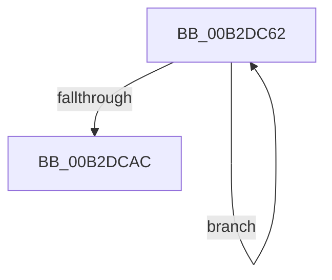

# sub_00B2DC62

- RVA: `0x00B2DC62`–`0x00B2DCB1` (길이 `79` bytes)
- VA: `0x0000000140B2DC62`
- 실행 섹션: `PAGE`
- PDB 이름 있음: `아니요`; PDB Function 태그: `아니요`
- unwind 정보 RVA: `0x0009E3BC`
- 디코드: `21`개 명령, `79/79` bytes 표시
- 미해석 바이트: `0` (있으면 어셈블리에 `.byte`로 보존)

> 이 문서는 커널 이미지의 기계어와 PDB 기호를 분석해 생성했습니다. 4번과 5번은 함수 원형과 자료형을 바이너리 사용 방식에서 추정한 C 해석이며 원본 소스 복구 결과는 아닙니다.

## 1. Dependencies

- 직접 호출 지점: **0**; 고유 호출 대상: **0**
- 직접 호출자로 확인된 함수: **0**
- RIP 상대 이미지 참조: **0**

### Outgoing calls
- 직접 디코드된 call 명령이 없습니다.

### Direct callers
- 이 함수 시작 RVA로 연결되는 직접 call은 확인되지 않았습니다. 간접 호출은 완전히 역산할 수 없습니다.

### Static image references
- 디코드된 RIP-relative 메모리 참조가 없습니다.

## 2. Other-region calls and transfers

- 다른 실행 섹션으로 향하는 call: **0**
- call이 아닌 외부 분기/꼬리 이동: **1**
  - `0x00B2DCAC` → [HvValidateOrInvalidatePrimaryFileHeader + 0x4F](../9B/HvValidateOrInvalidatePrimaryFileHeader_function_009B27A8.md) (`tail-transfer`)

## 3. Assembly (complete function range)

```asm
00B2DC62  0F 10 00                        movups xmm0, xmmword ptr [rax]
00B2DC65  0F 11 01                        movups xmmword ptr [rcx], xmm0
00B2DC68  0F 10 48 10                     movups xmm1, xmmword ptr [rax + 0x10]
00B2DC6C  0F 11 49 10                     movups xmmword ptr [rcx + 0x10], xmm1
00B2DC70  0F 10 40 20                     movups xmm0, xmmword ptr [rax + 0x20]
00B2DC74  0F 11 41 20                     movups xmmword ptr [rcx + 0x20], xmm0
00B2DC78  0F 10 48 30                     movups xmm1, xmmword ptr [rax + 0x30]
00B2DC7C  0F 11 49 30                     movups xmmword ptr [rcx + 0x30], xmm1
00B2DC80  0F 10 40 40                     movups xmm0, xmmword ptr [rax + 0x40]
00B2DC84  0F 11 41 40                     movups xmmword ptr [rcx + 0x40], xmm0
00B2DC88  0F 10 48 50                     movups xmm1, xmmword ptr [rax + 0x50]
00B2DC8C  0F 11 49 50                     movups xmmword ptr [rcx + 0x50], xmm1
00B2DC90  0F 10 40 60                     movups xmm0, xmmword ptr [rax + 0x60]
00B2DC94  0F 11 41 60                     movups xmmword ptr [rcx + 0x60], xmm0
00B2DC98  49 03 C8                        add rcx, r8
00B2DC9B  0F 10 48 70                     movups xmm1, xmmword ptr [rax + 0x70]
00B2DC9F  49 03 C0                        add rax, r8
00B2DCA2  0F 11 49 F0                     movups xmmword ptr [rcx - 0x10], xmm1
00B2DCA6  48 83 EA 01                     sub rdx, 1
00B2DCAA  75 B6                           jne 0x140b2dc62
00B2DCAC  E9 46 4B E8 FF                  jmp 0x1409b27f7
```

## 4. C-style interpretation (structured pseudocode)

```c
__int64 __fastcall sub_00B2DC62(__int64 a1, __int64 a2, __int64 a3)
{
    __int64 result;

    *(unsigned __int64 *)(a1) = v_xmm0;
    *(unsigned __int64 *)(a1 + 16) = v_xmm1;
    *(unsigned __int64 *)(a1 + 32) = v_xmm0;
    *(unsigned __int64 *)(a1 + 48) = v_xmm1;
    *(unsigned __int64 *)(a1 + 64) = v_xmm0;
    *(unsigned __int64 *)(a1 + 80) = v_xmm1;
    *(unsigned __int64 *)(a1 + 96) = v_xmm0;
    a1 = (a1) + (a3);
    result = (result) + (a3);
    *(unsigned __int64 *)(a1 - 16) = v_xmm1;
    a2 = (a2) - (1);
    if (condition_is_not_equal) goto loc_00B2DC62;
}
```

## 5. (Beta) C Style

```c
int64_t sub_00B2DC62(void *Arg1, int64_t Arg2, int64_t Arg3)
{
    uint8_t *arg1 = (uint8_t *)Arg1;

    int64_t result;

    *(uint64_t *)(arg1) = v_xmm0;
    *(uint64_t *)(arg1 + 0x10) = v_xmm1;
    *(uint64_t *)(arg1 + 0x20) = v_xmm0;
    *(uint64_t *)(arg1 + 0x30) = v_xmm1;
    *(uint64_t *)(arg1 + 0x40) = v_xmm0;
    *(uint64_t *)(arg1 + 0x50) = v_xmm1;
    *(uint64_t *)(arg1 + 0x60) = v_xmm0;
    Arg1 = (Arg1) + (Arg3);
    result = (result) + (Arg3);
    *(uint64_t *)(arg1 - 0x10) = v_xmm1;
    Arg2 = (Arg2) - (1);
    if (condition_is_not_equal) goto loc_00B2DC62;
}
```

### 관측된 메모리 오프셋

구조체 형식이 확인되지 않은 접근은 인자 기준의 오프셋으로만 기록했습니다.

| 기준 인자 | 오프셋 표현 | 폭 (bit) | 접근 |
|---|---:|---:|---|
| `Arg1` | `- 0x10` | `128` | `R` |
| `Arg1` | `+ 0x0` | `128` | `R` |
| `Arg1` | `+ 0x10` | `128` | `R` |
| `Arg1` | `+ 0x20` | `128` | `R` |
| `Arg1` | `+ 0x30` | `128` | `R` |
| `Arg1` | `+ 0x40` | `128` | `R` |
| `Arg1` | `+ 0x50` | `128` | `R` |
| `Arg1` | `+ 0x60` | `128` | `R` |

## 6. Execution-region graph

[열기: 2D/3D 그래프와 함수 탐색 컨트롤 패널](../../../control-panel.html?section=page&rva=0x00B2DC62&view=graph)

- 2D 그래프는 위에서 아래로 흐르고, 3D 그래프는 빈 공간을 드래그해 회전합니다. Shift+드래그는 이동, 휠은 확대·축소, 함수 노드 선택은 대상 보고서 이동입니다.

### Static fallback


