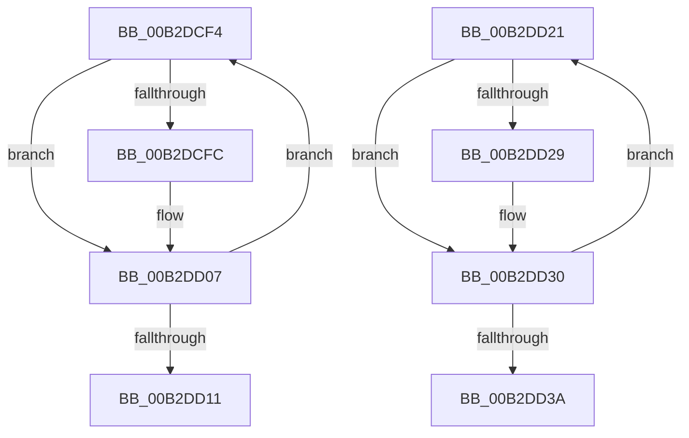

# sub_00B2DCF4

- RVA: `0x00B2DCF4`–`0x00B2DD4A` (길이 `86` bytes)
- VA: `0x0000000140B2DCF4`
- 실행 섹션: `PAGE`
- PDB 이름 있음: `아니요`; PDB Function 태그: `아니요`
- unwind 정보 RVA: `0x0009E5BC`
- 디코드: `27`개 명령, `86/86` bytes 표시
- 미해석 바이트: `0` (있으면 어셈블리에 `.byte`로 보존)

> 이 문서는 커널 이미지의 기계어와 PDB 기호를 분석해 생성했습니다. 4번과 5번은 함수 원형과 자료형을 바이너리 사용 방식에서 추정한 C 해석이며 원본 소스 복구 결과는 아닙니다.

## 1. Dependencies

- 직접 호출 지점: **4**; 고유 호출 대상: **1**
- 직접 호출자로 확인된 함수: **0**
- RIP 상대 이미지 참조: **0**

### Outgoing calls
- `0x00B2DCFE` → [ExFreePoolWithTag](../../poolcode/B8/ExFreePoolWithTag_function_00B82870.md) (function, `0x00B82870`)
- `0x00B2DD16` → [ExFreePoolWithTag](../../poolcode/B8/ExFreePoolWithTag_function_00B82870.md) (function, `0x00B82870`)
- `0x00B2DD2B` → [ExFreePoolWithTag](../../poolcode/B8/ExFreePoolWithTag_function_00B82870.md) (function, `0x00B82870`)
- `0x00B2DD3F` → [ExFreePoolWithTag](../../poolcode/B8/ExFreePoolWithTag_function_00B82870.md) (function, `0x00B82870`)

### Direct callers
- 이 함수 시작 RVA로 연결되는 직접 call은 확인되지 않았습니다. 간접 호출은 완전히 역산할 수 없습니다.

### Static image references
- 디코드된 RIP-relative 메모리 참조가 없습니다.

## 2. Other-region calls and transfers

- 다른 실행 섹션으로 향하는 call: **4**
  - `0x00B2DCFE` → [ExFreePoolWithTag](../../poolcode/B8/ExFreePoolWithTag_function_00B82870.md) (`PAGE` → `POOLCODE`)
  - `0x00B2DD16` → [ExFreePoolWithTag](../../poolcode/B8/ExFreePoolWithTag_function_00B82870.md) (`PAGE` → `POOLCODE`)
  - `0x00B2DD2B` → [ExFreePoolWithTag](../../poolcode/B8/ExFreePoolWithTag_function_00B82870.md) (`PAGE` → `POOLCODE`)
  - `0x00B2DD3F` → [ExFreePoolWithTag](../../poolcode/B8/ExFreePoolWithTag_function_00B82870.md) (`PAGE` → `POOLCODE`)
- call이 아닌 외부 분기/꼬리 이동: **2**
  - `0x00B2DD1C` → [HvStoreModifiedData + 0x19B](../9B/HvStoreModifiedData_function_009B4FB4.md) (`tail-transfer`)
  - `0x00B2DD45` → [HvStoreModifiedData + 0x1AD](../9B/HvStoreModifiedData_function_009B4FB4.md) (`tail-transfer`)

## 3. Assembly (complete function range)

```asm
00B2DCF4  48 8B 0F                        mov rcx, qword ptr [rdi]
00B2DCF7  48 85 C9                        test rcx, rcx
00B2DCFA  74 0B                           je 0x140b2dd07
00B2DCFC  33 D2                           xor edx, edx
00B2DCFE  E8 6D 4B 05 00                  call 0x140b82870
00B2DD03  48 83 27 00                     and qword ptr [rdi], 0
00B2DD07  48 83 C7 18                     add rdi, 0x18
00B2DD0B  49 83 EC 01                     sub r12, 1
00B2DD0F  75 E3                           jne 0x140b2dcf4
00B2DD11  33 D2                           xor edx, edx
00B2DD13  49 8B CE                        mov rcx, r14
00B2DD16  E8 55 4B 05 00                  call 0x140b82870
00B2DD1B  90                              nop
00B2DD1C  E9 2E 74 E8 FF                  jmp 0x1409b514f
00B2DD21  48 8B 0F                        mov rcx, qword ptr [rdi]
00B2DD24  48 85 C9                        test rcx, rcx
00B2DD27  74 07                           je 0x140b2dd30
00B2DD29  33 D2                           xor edx, edx
00B2DD2B  E8 40 4B 05 00                  call 0x140b82870
00B2DD30  48 83 C7 18                     add rdi, 0x18
00B2DD34  49 83 EE 01                     sub r14, 1
00B2DD38  75 E7                           jne 0x140b2dd21
00B2DD3A  33 D2                           xor edx, edx
00B2DD3C  48 8B CE                        mov rcx, rsi
00B2DD3F  E8 2C 4B 05 00                  call 0x140b82870
00B2DD44  90                              nop
00B2DD45  E9 17 74 E8 FF                  jmp 0x1409b5161
```

## 4. C-style interpretation (structured pseudocode)

```c
__int64 __fastcall sub_00B2DCF4(__int64 a1, int a2)
{
    __int64 result;
    __int64 v_r12;
    __int64 v_rdi;

    if (*(unsigned __int64 *)(v_rdi) != 0) {
        a2 = 0;
        result = ExFreePoolWithTag(*(unsigned __int64 *)(v_rdi), a2, a3, a4);
    }
    v_rdi = (v_rdi) + (24);
    v_r12 = (v_r12) - (1);
    if (condition_is_not_equal) goto loc_00B2DCF4;
    a2 = 0;
    result = ExFreePoolWithTag(v_r14, a2, a3, a4);
}
```

## 5. (Beta) C Style

```c
int64_t sub_00B2DCF4(int64_t Arg1, int32_t Arg2)
{
    int64_t result;
    int64_t local_r12;
    int64_t local_rdi;

    if (*(uint64_t *)(local_rdi) != 0) {
        Arg2 = 0;
        result = ExFreePoolWithTag(*(uint64_t *)(local_rdi), Arg2, a3, a4);
    }
    local_rdi = (local_rdi) + (24);
    local_r12 = (local_r12) - (1);
    if (condition_is_not_equal) goto loc_00B2DCF4;
    Arg2 = 0;
    result = ExFreePoolWithTag(local_r14, Arg2, a3, a4);
}
```

## 6. Execution-region graph

[열기: 2D/3D 그래프와 함수 탐색 컨트롤 패널](../../../control-panel.html?section=page&rva=0x00B2DCF4&view=graph)

- 2D 그래프는 위에서 아래로 흐르고, 3D 그래프는 빈 공간을 드래그해 회전합니다. Shift+드래그는 이동, 휠은 확대·축소, 함수 노드 선택은 대상 보고서 이동입니다.

### Static fallback


