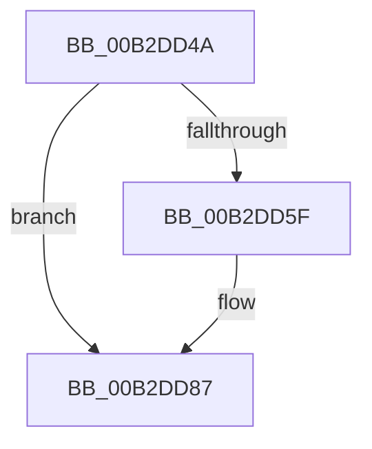

# sub_00B2DD4A

- RVA: `0x00B2DD4A`–`0x00B2DD8F` (길이 `69` bytes)
- VA: `0x0000000140B2DD4A`
- 실행 섹션: `PAGE`
- PDB 이름 있음: `아니요`; PDB Function 태그: `아니요`
- unwind 정보 RVA: `0x0009E64C`
- 디코드: `17`개 명령, `69/69` bytes 표시
- 미해석 바이트: `0` (있으면 어셈블리에 `.byte`로 보존)

> 이 문서는 커널 이미지의 기계어와 PDB 기호를 분석해 생성했습니다. 4번과 5번은 함수 원형과 자료형을 바이너리 사용 방식에서 추정한 C 해석이며 원본 소스 복구 결과는 아닙니다.

## 1. Dependencies

- 직접 호출 지점: **1**; 고유 호출 대상: **1**
- 직접 호출자로 확인된 함수: **0**
- RIP 상대 이미지 참조: **0**

### Outgoing calls
- `0x00B2DD82` → [CmSiProtectViewOfSection](../../text/47/CmSiProtectViewOfSection_function_004746B8.md) (function, `0x004746B8`)

### Direct callers
- 이 함수 시작 RVA로 연결되는 직접 call은 확인되지 않았습니다. 간접 호출은 완전히 역산할 수 없습니다.

### Static image references
- 디코드된 RIP-relative 메모리 참조가 없습니다.

## 2. Other-region calls and transfers

- 다른 실행 섹션으로 향하는 call: **1**
  - `0x00B2DD82` → [CmSiProtectViewOfSection](../../text/47/CmSiProtectViewOfSection_function_004746B8.md) (`PAGE` → `.text`)
- call이 아닌 외부 분기/꼬리 이동: **1**
  - `0x00B2DD8A` → [HvpViewMapMakeViewRangeCOWByCaller + 0x111](../9B/HvpViewMapMakeViewRangeCOWByCaller_function_009B5BB4.md) (`tail-transfer`)

## 3. Assembly (complete function range)

```asm
00B2DD4A  48 8B 4E 18                     mov rcx, qword ptr [rsi + 0x18]
00B2DD4E  48 8B C7                        mov rax, rdi
00B2DD51  48 2B C1                        sub rax, rcx
00B2DD54  48 C1 E8 0C                     shr rax, 0xc
00B2DD58  F6 44 30 48 06                  test byte ptr [rax + rsi + 0x48], 6
00B2DD5D  75 28                           jne 0x140b2dd87
00B2DD5F  49 8B 57 18                     mov rdx, qword ptr [r15 + 0x18]
00B2DD63  48 8D 44 24 60                  lea rax, [rsp + 0x60]
00B2DD68  48 89 44 24 28                  mov qword ptr [rsp + 0x28], rax
00B2DD6D  4C 8B C7                        mov r8, rdi
00B2DD70  4C 2B C1                        sub r8, rcx
00B2DD73  C7 44 24 20 02 00 00 80         mov dword ptr [rsp + 0x20], 0x80000002
00B2DD7B  4C 03 46 38                     add r8, qword ptr [rsi + 0x38]
00B2DD7F  4D 8B CC                        mov r9, r12
00B2DD82  E8 31 69 94 FF                  call 0x1404746b8
00B2DD87  49 03 FC                        add rdi, r12
00B2DD8A  E9 36 7F E8 FF                  jmp 0x1409b5cc5
```

## 4. C-style interpretation (structured pseudocode)

```c
__int64 __fastcall sub_00B2DD4A(__int64 a1, __int64 a2, __int64 a3, __int64 a4, __int64 a5, __int64 a6, __int64 a7, __int64 a8, __int64 a9, __int64 a10, __int64 a11, __int64 a12)
{
    __int64 result;
    __int64 v_rdi;
    unsigned int v_stack_p20;
    unsigned __int64 v_stack_p28;

    result = (v_rdi) - (*(unsigned __int64 *)(v_rsi + 24));
    result = (result) >> (12);
    if (((*(unsigned __int8 *)(result + v_rsi * 1 + 72)) & (6)) == 0) {
        a2 = *(unsigned __int64 *)(v_r15 + 24);
        result = a12;
        v_stack_p28 = result;
        a3 = v_rdi;
        a3 = (a3) - (*(unsigned __int64 *)(v_rsi + 24));
        v_stack_p20 = 0x80000002ULL;
        a3 = (a3) + (*(unsigned __int64 *)(v_rsi + 56));
        a4 = v_r12;
        result = CmSiProtectViewOfSection(*(unsigned __int64 *)(v_rsi + 24), a2, a3, a4);
    }
    v_rdi = (v_rdi) + (v_r12);
}
```

## 5. (Beta) C Style

```c
int64_t sub_00B2DD4A(int64_t Arg1, int64_t Arg2, int64_t Arg3, int64_t Arg4, uint64_t Arg5, uint64_t Arg6, uint64_t Arg7, uint64_t Arg8, uint64_t Arg9, uint64_t Arg10, uint64_t Arg11, int64_t Arg12)
{
    int64_t result;
    int64_t local_rdi;
    uint32_t v_stack_p20;
    uint64_t v_stack_p28;

    result = (local_rdi) - (*(uint64_t *)(local_rsi + 0x18));
    result = (result) >> (12);
    if (((*(uint8_t *)(result + local_rsi * 1 + 0x48)) & (6)) == 0) {
        Arg2 = *(uint64_t *)(local_r15 + 0x18);
        result = Arg12;
        v_stack_p28 = result;
        Arg3 = local_rdi;
        Arg3 = (Arg3) - (*(uint64_t *)(local_rsi + 0x18));
        v_stack_p20 = 0x80000002ULL;
        Arg3 = (Arg3) + (*(uint64_t *)(local_rsi + 0x38));
        Arg4 = local_r12;
        result = CmSiProtectViewOfSection(*(uint64_t *)(local_rsi + 0x18), Arg2, Arg3, Arg4);
    }
    local_rdi = (local_rdi) + (local_r12);
}
```

## 6. Execution-region graph

[열기: 2D/3D 그래프와 함수 탐색 컨트롤 패널](../../../control-panel.html?section=page&rva=0x00B2DD4A&view=graph)

- 2D 그래프는 위에서 아래로 흐르고, 3D 그래프는 빈 공간을 드래그해 회전합니다. Shift+드래그는 이동, 휠은 확대·축소, 함수 노드 선택은 대상 보고서 이동입니다.

### Static fallback


