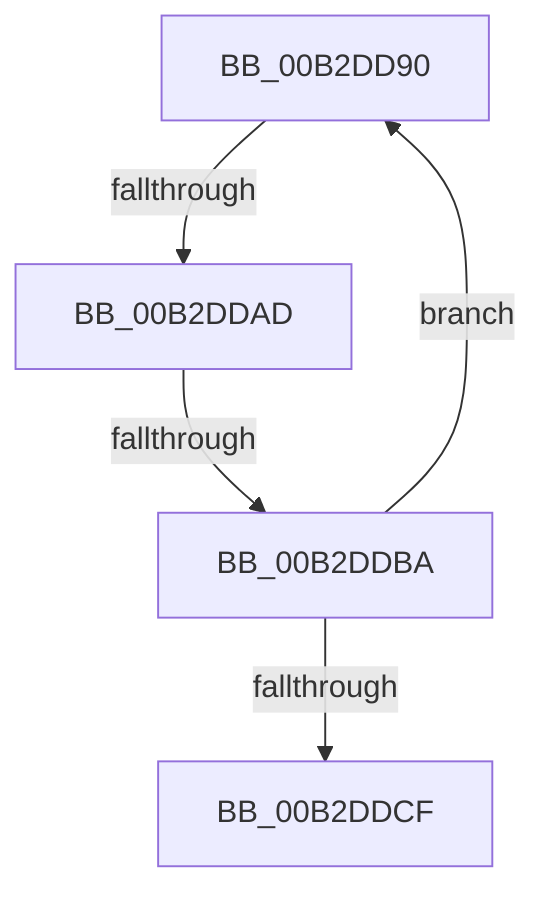

# sub_00B2DD90

- RVA: `0x00B2DD90`–`0x00B2DDD4` (길이 `68` bytes)
- VA: `0x0000000140B2DD90`
- 실행 섹션: `PAGE`
- PDB 이름 있음: `아니요`; PDB Function 태그: `아니요`
- unwind 정보 RVA: `0x0009E6C4`
- 디코드: `17`개 명령, `68/68` bytes 표시
- 미해석 바이트: `0` (있으면 어셈블리에 `.byte`로 보존)

> 이 문서는 커널 이미지의 기계어와 PDB 기호를 분석해 생성했습니다. 4번과 5번은 함수 원형과 자료형을 바이너리 사용 방식에서 추정한 C 해석이며 원본 소스 복구 결과는 아닙니다.

## 1. Dependencies

- 직접 호출 지점: **1**; 고유 호출 대상: **1**
- 직접 호출자로 확인된 함수: **0**
- RIP 상대 이미지 참조: **0**

### Outgoing calls
- `0x00B2DD96` → [HvpViewMapFreeView](../9B/HvpViewMapFreeView_function_009B6F9C.md) (function, `0x009B6F9C`)

### Direct callers
- 이 함수 시작 RVA로 연결되는 직접 call은 확인되지 않았습니다. 간접 호출은 완전히 역산할 수 없습니다.

### Static image references
- 디코드된 RIP-relative 메모리 참조가 없습니다.

## 2. Other-region calls and transfers

- 다른 실행 섹션으로 향하는 call: **0**
- call이 아닌 외부 분기/꼬리 이동: **3**
  - `0x00B2DDA7` → [HvpViewMapCreateViewsForRegion + 0xD3](../9B/HvpViewMapCreateViewsForRegion_function_009B6094.md) (`tail-transfer`)
  - `0x00B2DDB4` → [HvpViewMapCreateViewsForRegion + 0xD3](../9B/HvpViewMapCreateViewsForRegion_function_009B6094.md) (`tail-transfer`)
  - `0x00B2DDCF` → [HvpViewMapCreateViewsForRegion + 0x1B5](../9B/HvpViewMapCreateViewsForRegion_function_009B6094.md) (`tail-transfer`)

## 3. Assembly (complete function range)

```asm
00B2DD90  48 8B D0                        mov rdx, rax
00B2DD93  49 8B CE                        mov rcx, r14
00B2DD96  E8 01 92 E8 FF                  call 0x1409b6f9c
00B2DD9B  48 8B 45 E8                     mov rax, qword ptr [rbp - 0x18]
00B2DD9F  48 8D 4D E8                     lea rcx, [rbp - 0x18]
00B2DDA3  48 39 48 08                     cmp qword ptr [rax + 8], rcx
00B2DDA7  0F 85 BA 83 E8 FF               jne 0x1409b6167
00B2DDAD  48 8B 08                        mov rcx, qword ptr [rax]
00B2DDB0  48 39 41 08                     cmp qword ptr [rcx + 8], rax
00B2DDB4  0F 85 AD 83 E8 FF               jne 0x1409b6167
00B2DDBA  48 89 4D E8                     mov qword ptr [rbp - 0x18], rcx
00B2DDBE  48 8D 55 E8                     lea rdx, [rbp - 0x18]
00B2DDC2  48 89 51 08                     mov qword ptr [rcx + 8], rdx
00B2DDC6  48 8D 4D E8                     lea rcx, [rbp - 0x18]
00B2DDCA  48 3B C1                        cmp rax, rcx
00B2DDCD  75 C1                           jne 0x140b2dd90
00B2DDCF  E9 75 84 E8 FF                  jmp 0x1409b6249
```

## 4. C-style interpretation (structured pseudocode)

```c
__int64 __fastcall sub_00B2DD90(void)
{
    __int64 result;

    result = HvpViewMapFreeView(v_r14, result, a3, a4);
    *(unsigned __int64 *)(v_rbp - 24) = *(unsigned __int64 *)(*(unsigned __int64 *)(v_rbp - 24));
    *(unsigned __int64 *)(*(unsigned __int64 *)(*(unsigned __int64 *)(v_rbp - 24)) + 8) = v_rbp - 24;
    if ((*(unsigned __int64 *)(v_rbp - 24)) != (v_rbp - 24)) goto loc_00B2DD90;
}
```

## 5. (Beta) C Style

```c
void sub_00B2DD90(void)
{
    int64_t result;

    result = HvpViewMapFreeView(local_r14, result, a3, a4);
    *(uint64_t *)(local_rbp - 0x18) = *(uint64_t *)(*(uint64_t *)(local_rbp - 0x18));
    *(uint64_t *)(*(uint64_t *)(*(uint64_t *)(local_rbp - 0x18)) + 0x8) = local_rbp - 24;
    if ((*(uint64_t *)(local_rbp - 0x18)) != (local_rbp - 24)) goto loc_00B2DD90;
}
```

## 6. Execution-region graph

[열기: 2D/3D 그래프와 함수 탐색 컨트롤 패널](../../../control-panel.html?section=page&rva=0x00B2DD90&view=graph)

- 2D 그래프는 위에서 아래로 흐르고, 3D 그래프는 빈 공간을 드래그해 회전합니다. Shift+드래그는 이동, 휠은 확대·축소, 함수 노드 선택은 대상 보고서 이동입니다.

### Static fallback


