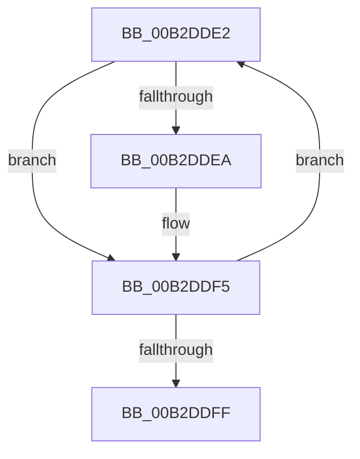

# sub_00B2DDE2

- RVA: `0x00B2DDE2`–`0x00B2DE0F` (길이 `45` bytes)
- VA: `0x0000000140B2DDE2`
- 실행 섹션: `PAGE`
- PDB 이름 있음: `아니요`; PDB Function 태그: `아니요`
- unwind 정보 RVA: `0x0009E734`
- 디코드: `14`개 명령, `45/45` bytes 표시
- 미해석 바이트: `0` (있으면 어셈블리에 `.byte`로 보존)

> 이 문서는 커널 이미지의 기계어와 PDB 기호를 분석해 생성했습니다. 4번과 5번은 함수 원형과 자료형을 바이너리 사용 방식에서 추정한 C 해석이며 원본 소스 복구 결과는 아닙니다.

## 1. Dependencies

- 직접 호출 지점: **2**; 고유 호출 대상: **1**
- 직접 호출자로 확인된 함수: **0**
- RIP 상대 이미지 참조: **0**

### Outgoing calls
- `0x00B2DDEC` → [ExFreePoolWithTag](../../poolcode/B8/ExFreePoolWithTag_function_00B82870.md) (function, `0x00B82870`)
- `0x00B2DE04` → [ExFreePoolWithTag](../../poolcode/B8/ExFreePoolWithTag_function_00B82870.md) (function, `0x00B82870`)

### Direct callers
- 이 함수 시작 RVA로 연결되는 직접 call은 확인되지 않았습니다. 간접 호출은 완전히 역산할 수 없습니다.

### Static image references
- 디코드된 RIP-relative 메모리 참조가 없습니다.

## 2. Other-region calls and transfers

- 다른 실행 섹션으로 향하는 call: **2**
  - `0x00B2DDEC` → [ExFreePoolWithTag](../../poolcode/B8/ExFreePoolWithTag_function_00B82870.md) (`PAGE` → `POOLCODE`)
  - `0x00B2DE04` → [ExFreePoolWithTag](../../poolcode/B8/ExFreePoolWithTag_function_00B82870.md) (`PAGE` → `POOLCODE`)
- call이 아닌 외부 분기/꼬리 이동: **1**
  - `0x00B2DE0A` → [HvpGenerateLogEntry + 0x18C](../9B/HvpGenerateLogEntry_function_009B65F0.md) (`tail-transfer`)

## 3. Assembly (complete function range)

```asm
00B2DDE2  48 8B 0B                        mov rcx, qword ptr [rbx]
00B2DDE5  48 85 C9                        test rcx, rcx
00B2DDE8  74 0B                           je 0x140b2ddf5
00B2DDEA  33 D2                           xor edx, edx
00B2DDEC  E8 7F 4A 05 00                  call 0x140b82870
00B2DDF1  48 83 23 00                     and qword ptr [rbx], 0
00B2DDF5  48 83 C3 18                     add rbx, 0x18
00B2DDF9  49 83 EE 01                     sub r14, 1
00B2DDFD  75 E3                           jne 0x140b2dde2
00B2DDFF  33 D2                           xor edx, edx
00B2DE01  48 8B CF                        mov rcx, rdi
00B2DE04  E8 67 4A 05 00                  call 0x140b82870
00B2DE09  90                              nop
00B2DE0A  E9 6D 89 E8 FF                  jmp 0x1409b677c
```

## 4. C-style interpretation (structured pseudocode)

```c
__int64 __fastcall sub_00B2DDE2(__int64 a1, int a2)
{
    __int64 result;
    __int64 v_r14;
    __int64 v_rbx;

    if (*(unsigned __int64 *)(v_rbx) != 0) {
        a2 = 0;
        result = ExFreePoolWithTag(*(unsigned __int64 *)(v_rbx), a2, a3, a4);
    }
    v_rbx = (v_rbx) + (24);
    v_r14 = (v_r14) - (1);
    if (condition_is_not_equal) goto loc_00B2DDE2;
    a2 = 0;
    result = ExFreePoolWithTag(v_rdi, a2, a3, a4);
}
```

## 5. (Beta) C Style

```c
int64_t sub_00B2DDE2(int64_t Arg1, int32_t Arg2)
{
    int64_t result;
    int64_t local_r14;
    int64_t local_rbx;

    if (*(uint64_t *)(local_rbx) != 0) {
        Arg2 = 0;
        result = ExFreePoolWithTag(*(uint64_t *)(local_rbx), Arg2, a3, a4);
    }
    local_rbx = (local_rbx) + (24);
    local_r14 = (local_r14) - (1);
    if (condition_is_not_equal) goto loc_00B2DDE2;
    Arg2 = 0;
    result = ExFreePoolWithTag(local_rdi, Arg2, a3, a4);
}
```

## 6. Execution-region graph

[열기: 2D/3D 그래프와 함수 탐색 컨트롤 패널](../../../control-panel.html?section=page&rva=0x00B2DDE2&view=graph)

- 2D 그래프는 위에서 아래로 흐르고, 3D 그래프는 빈 공간을 드래그해 회전합니다. Shift+드래그는 이동, 휠은 확대·축소, 함수 노드 선택은 대상 보고서 이동입니다.

### Static fallback


