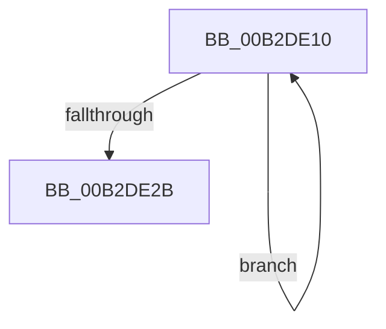

# sub_00B2DE10

- RVA: `0x00B2DE10`–`0x00B2DE30` (길이 `32` bytes)
- VA: `0x0000000140B2DE10`
- 실행 섹션: `PAGE`
- PDB 이름 있음: `아니요`; PDB Function 태그: `아니요`
- unwind 정보 RVA: `0x0009E79C`
- 디코드: `8`개 명령, `32/32` bytes 표시
- 미해석 바이트: `0` (있으면 어셈블리에 `.byte`로 보존)

> 이 문서는 커널 이미지의 기계어와 PDB 기호를 분석해 생성했습니다. 4번과 5번은 함수 원형과 자료형을 바이너리 사용 방식에서 추정한 C 해석이며 원본 소스 복구 결과는 아닙니다.

## 1. Dependencies

- 직접 호출 지점: **1**; 고유 호출 대상: **1**
- 직접 호출자로 확인된 함수: **0**
- RIP 상대 이미지 참조: **0**

### Outgoing calls
- `0x00B2DE1C` → [SymCryptMarvin32Append](../../text/51/SymCryptMarvin32Append_function_0051F4AC.md) (function, `0x0051F4AC`)

### Direct callers
- 이 함수 시작 RVA로 연결되는 직접 call은 확인되지 않았습니다. 간접 호출은 완전히 역산할 수 없습니다.

### Static image references
- 디코드된 RIP-relative 메모리 참조가 없습니다.

## 2. Other-region calls and transfers

- 다른 실행 섹션으로 향하는 call: **1**
  - `0x00B2DE1C` → [SymCryptMarvin32Append](../../text/51/SymCryptMarvin32Append_function_0051F4AC.md) (`PAGE` → `.text`)
- call이 아닌 외부 분기/꼬리 이동: **1**
  - `0x00B2DE2B` → [HvpGenerateLogEntryChecksums + 0x8B](../9B/HvpGenerateLogEntryChecksums_function_009B6A5C.md) (`tail-transfer`)

## 3. Assembly (complete function range)

```asm
00B2DE10  44 8B 43 08                     mov r8d, dword ptr [rbx + 8]
00B2DE14  48 8D 4C 24 20                  lea rcx, [rsp + 0x20]
00B2DE19  48 8B 13                        mov rdx, qword ptr [rbx]
00B2DE1C  E8 8B 16 9F FF                  call 0x14051f4ac
00B2DE21  48 8D 5B 18                     lea rbx, [rbx + 0x18]
00B2DE25  48 83 EE 01                     sub rsi, 1
00B2DE29  75 E5                           jne 0x140b2de10
00B2DE2B  E9 B7 8C E8 FF                  jmp 0x1409b6ae7
```

## 4. C-style interpretation (structured pseudocode)

```c
__int64 __fastcall sub_00B2DE10(void)
{
    __int64 result;
    __int64 v_rsi;
    unsigned __int64 v_stack_p20;

    result = SymCryptMarvin32Append(v_stack_p20, *(unsigned __int64 *)(v_rbx), (unsigned int)(*(unsigned int *)(v_rbx + 8)), a4);
    v_rsi = (v_rsi) - (1);
    if (condition_is_not_equal) goto loc_00B2DE10;
}
```

## 5. (Beta) C Style

```c
void sub_00B2DE10(void)
{
    int64_t result;
    int64_t local_rsi;
    uint64_t v_stack_p20;

    result = SymCryptMarvin32Append(v_stack_p20, *(uint64_t *)(local_rbx), (uint32_t)(*(uint32_t *)(local_rbx + 0x8)), a4);
    local_rsi = (local_rsi) - (1);
    if (condition_is_not_equal) goto loc_00B2DE10;
}
```

## 6. Execution-region graph

[열기: 2D/3D 그래프와 함수 탐색 컨트롤 패널](../../../control-panel.html?section=page&rva=0x00B2DE10&view=graph)

- 2D 그래프는 위에서 아래로 흐르고, 3D 그래프는 빈 공간을 드래그해 회전합니다. Shift+드래그는 이동, 휠은 확대·축소, 함수 노드 선택은 대상 보고서 이동입니다.

### Static fallback


