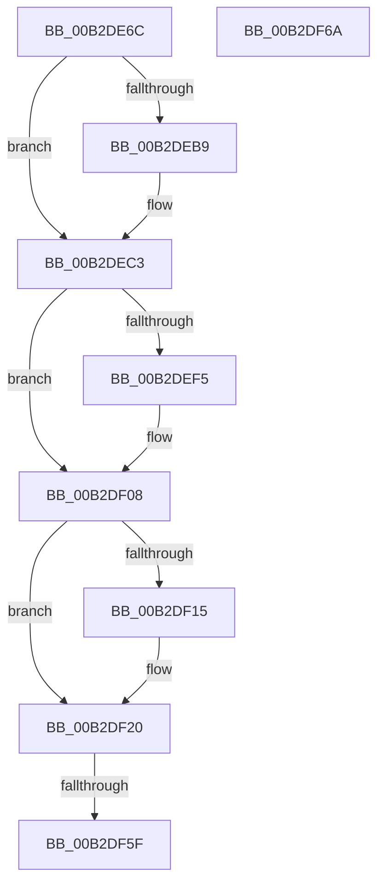

# sub_00B2DE6C

- RVA: `0x00B2DE6C`–`0x00B2DF7A` (길이 `270` bytes)
- VA: `0x0000000140B2DE6C`
- 실행 섹션: `PAGE`
- PDB 이름 있음: `아니요`; PDB Function 태그: `아니요`
- unwind 정보 RVA: `0x0009E900`
- 디코드: `55`개 명령, `270/270` bytes 표시
- 미해석 바이트: `0` (있으면 어셈블리에 `.byte`로 보존)

> 이 문서는 커널 이미지의 기계어와 PDB 기호를 분석해 생성했습니다. 4번과 5번은 함수 원형과 자료형을 바이너리 사용 방식에서 추정한 C 해석이며 원본 소스 복구 결과는 아닙니다.

## 1. Dependencies

- 직접 호출 지점: **3**; 고유 호출 대상: **3**
- 직접 호출자로 확인된 함수: **0**
- RIP 상대 이미지 참조: **0**

### Outgoing calls
- `0x00B2DE76` → [memset](../../text/6C/memset_function_006C6C40.md) (function, `0x006C6C40`)
- `0x00B2DEA5` → [HvpFillFileName](../9B/HvpFillFileName_function_009B9A2C.md) (function, `0x009B9A2C`)
- `0x00B2DF23` → [HvpHeaderCheckSum](../../pagecmrc/BC/HvpHeaderCheckSum_function_00BC97A0.md) (function, `0x00BC97A0`)

### Direct callers
- 이 함수 시작 RVA로 연결되는 직접 call은 확인되지 않았습니다. 간접 호출은 완전히 역산할 수 없습니다.

### Static image references
- 디코드된 RIP-relative 메모리 참조가 없습니다.

## 2. Other-region calls and transfers

- 다른 실행 섹션으로 향하는 call: **2**
  - `0x00B2DE76` → [memset](../../text/6C/memset_function_006C6C40.md) (`PAGE` → `.text`)
  - `0x00B2DF23` → [HvpHeaderCheckSum](../../pagecmrc/BC/HvpHeaderCheckSum_function_00BC97A0.md) (`PAGE` → `PAGECMRC`)
- call이 아닌 외부 분기/꼬리 이동: **3**
  - `0x00B2DF59` → [HvHiveStartFileBacked + 0x165](../9B/HvHiveStartFileBacked_function_009B7E20.md) (`tail-transfer`)
  - `0x00B2DF65` → [HvHiveStartFileBacked + 0x165](../9B/HvHiveStartFileBacked_function_009B7E20.md) (`tail-transfer`)
  - `0x00B2DF75` → [HvHiveStartFileBacked + 0x157](../9B/HvHiveStartFileBacked_function_009B7E20.md) (`tail-transfer`)

## 3. Assembly (complete function range)

```asm
00B2DE6C  44 8B 87 84 00 00 00            mov r8d, dword ptr [rdi + 0x84]
00B2DE73  48 8B CE                        mov rcx, rsi
00B2DE76  E8 C5 8D B9 FF                  call 0x1406c6c40
00B2DE7B  48 8B 54 24 78                  mov rdx, qword ptr [rsp + 0x78]
00B2DE80  48 8B CE                        mov rcx, rsi
00B2DE83  83 66 1C 00                     and dword ptr [rsi + 0x1c], 0
00B2DE87  83 4E 24 FF                     or dword ptr [rsi + 0x24], 0xffffffff
00B2DE8B  83 66 28 00                     and dword ptr [rsi + 0x28], 0
00B2DE8F  C7 06 72 65 67 66               mov dword ptr [rsi], 0x66676572
00B2DE95  44 89 7E 04                     mov dword ptr [rsi + 4], r15d
00B2DE99  44 89 7E 08                     mov dword ptr [rsi + 8], r15d
00B2DE9D  44 89 7E 20                     mov dword ptr [rsi + 0x20], r15d
00B2DEA1  44 89 7E 2C                     mov dword ptr [rsi + 0x2c], r15d
00B2DEA5  E8 82 BB E8 FF                  call 0x1409b9a2c
00B2DEAA  83 A6 90 00 00 00 00            and dword ptr [rsi + 0x90], 0
00B2DEB1  81 E5 00 00 08 00               and ebp, 0x80000
00B2DEB7  74 0A                           je 0x140b2dec3
00B2DEB9  C7 86 90 00 00 00 02 00 00 00   mov dword ptr [rsi + 0x90], 2
00B2DEC3  44 89 7E 14                     mov dword ptr [rsi + 0x14], r15d
00B2DEC7  F7 DD                           neg ebp
00B2DEC9  1B C0                           sbb eax, eax
00B2DECB  83 E0 03                        and eax, 3
00B2DECE  83 C0 03                        add eax, 3
00B2DED1  89 46 18                        mov dword ptr [rsi + 0x18], eax
00B2DED4  89 87 DC 00 00 00               mov dword ptr [rdi + 0xdc], eax
00B2DEDA  48 8B 84 24 88 00 00 00         mov rax, qword ptr [rsp + 0x88]
00B2DEE2  C7 86 A4 00 00 00 72 6D 74 6D   mov dword ptr [rsi + 0xa4], 0x6d746d72
00B2DEEC  48 89 5E 0C                     mov qword ptr [rsi + 0xc], rbx
00B2DEF0  48 85 C0                        test rax, rax
00B2DEF3  74 13                           je 0x140b2df08
00B2DEF5  0F 10 00                        movups xmm0, xmmword ptr [rax]
00B2DEF8  F3 0F 7F 46 70                  movdqu xmmword ptr [rsi + 0x70], xmm0
00B2DEFD  0F 10 08                        movups xmm1, xmmword ptr [rax]
00B2DF00  F3 0F 7F 8E 80 00 00 00         movdqu xmmword ptr [rsi + 0x80], xmm1
00B2DF08  48 8B 84 24 90 00 00 00         mov rax, qword ptr [rsp + 0x90]
00B2DF10  48 85 C0                        test rax, rax
00B2DF13  74 0B                           je 0x140b2df20
00B2DF15  0F 10 00                        movups xmm0, xmmword ptr [rax]
00B2DF18  F3 0F 7F 86 94 00 00 00         movdqu xmmword ptr [rsi + 0x94], xmm0
00B2DF20  48 8B CE                        mov rcx, rsi
00B2DF23  E8 78 B8 09 00                  call 0x140bc97a0
00B2DF28  89 86 FC 01 00 00               mov dword ptr [rsi + 0x1fc], eax
00B2DF2E  48 8B 84 24 A0 00 00 00         mov rax, qword ptr [rsp + 0xa0]
00B2DF36  48 89 77 40                     mov qword ptr [rdi + 0x40], rsi
00B2DF3A  44 89 BF B8 00 00 00            mov dword ptr [rdi + 0xb8], r15d
00B2DF41  44 89 BF AC 00 00 00            mov dword ptr [rdi + 0xac], r15d
00B2DF48  44 89 BF B0 00 00 00            mov dword ptr [rdi + 0xb0], r15d
00B2DF4F  44 88 BF C2 00 00 00            mov byte ptr [rdi + 0xc2], r15b
00B2DF56  48 85 C0                        test rax, rax
00B2DF59  0F 84 26 A0 E8 FF               je 0x1409b7f85
00B2DF5F  C7 00 43 4D 31 31               mov dword ptr [rax], 0x31314d43
00B2DF65  E9 1B A0 E8 FF                  jmp 0x1409b7f85
00B2DF6A  48 8B 47 40                     mov rax, qword ptr [rdi + 0x40]
00B2DF6E  83 A0 90 00 00 00 FE            and dword ptr [rax + 0x90], 0xfffffffe
00B2DF75  E9 FD 9F E8 FF                  jmp 0x1409b7f77
```

## 4. C-style interpretation (structured pseudocode)

```c
__int64 __fastcall sub_00B2DE6C(__int64 a1, __int64 a2, __int64 a3, __int64 a4, __int64 a5, __int64 a6, __int64 a7, __int64 a8, __int64 a9, __int64 a10, __int64 a11, __int64 a12, __int64 a13, __int64 a14, __int64 a15, __int64 a16, __int64 a17, __int64 a18, __int64 a19, __int64 a20)
{
    __int64 result;
    __int64 v_rbp;

    result = memset(v_rsi, a2, (unsigned int)(*(unsigned int *)(v_rdi + 132)), a4);
    *(unsigned int *)(v_rsi) = 0x66676572ULL;
    *(unsigned int *)(v_rsi + 4) = (unsigned int)(v_r15);
    *(unsigned int *)(v_rsi + 8) = (unsigned int)(v_r15);
    *(unsigned int *)(v_rsi + 32) = (unsigned int)(v_r15);
    *(unsigned int *)(v_rsi + 44) = (unsigned int)(v_r15);
    result = HvpFillFileName(v_rsi, a15, (unsigned int)(*(unsigned int *)(v_rdi + 132)), a4);
    v_rbp = (unsigned int)((v_rbp) & (0x80000ULL));
    if (!(condition_is_equal)) {
        *(unsigned int *)(v_rsi + 144) = 2;
    }
    *(unsigned int *)(v_rsi + 20) = (unsigned int)(v_r15);
    v_rbp = (unsigned int)(-(v_rbp));
    result = (unsigned int)((result) & (3));
    result = (unsigned int)((result) + (3));
    *(unsigned int *)(v_rsi + 24) = (unsigned int)(result);
    *(unsigned int *)(v_rdi + 220) = (unsigned int)(result);
    *(unsigned int *)(v_rsi + 164) = 0x6D746D72ULL;
    *(unsigned __int64 *)(v_rsi + 12) = v_rbx;
    if (a17 != 0) {
        *(unsigned __int64 *)(v_rsi + 112) = v_xmm0;
        *(unsigned __int64 *)(v_rsi + 128) = v_xmm1;
    }
    if (a18 != 0) {
        *(unsigned __int64 *)(v_rsi + 148) = v_xmm0;
    }
    result = HvpHeaderCheckSum(v_rsi, a15, (unsigned int)(*(unsigned int *)(v_rdi + 132)), a4);
    *(unsigned int *)(v_rsi + 508) = (unsigned int)(result);
    *(unsigned __int64 *)(v_rdi + 64) = v_rsi;
    *(unsigned int *)(v_rdi + 184) = (unsigned int)(v_r15);
    *(unsigned int *)(v_rdi + 172) = (unsigned int)(v_r15);
    *(unsigned int *)(v_rdi + 176) = (unsigned int)(v_r15);
    *(unsigned __int8 *)(v_rdi + 194) = (unsigned __int8)(v_r15);
    *(unsigned int *)(a20) = 0x31314D43ULL;
}
```

## 5. (Beta) C Style

```c
int64_t sub_00B2DE6C(int64_t Arg1, int64_t Arg2, int64_t Arg3, int64_t Arg4, uint64_t Arg5, uint64_t Arg6, uint64_t Arg7, uint64_t Arg8, uint64_t Arg9, uint64_t Arg10, uint64_t Arg11, uint64_t Arg12, uint64_t Arg13, uint64_t Arg14, int64_t Arg15, uint64_t Arg16, int64_t Arg17, int64_t Arg18, uint64_t Arg19, int64_t Arg20)
{
    int64_t result;
    int64_t local_rbp;

    result = memset(local_rsi, Arg2, (uint32_t)(*(uint32_t *)(local_rdi + 0x84)), Arg4);
    *(uint32_t *)(local_rsi) = 0x66676572ULL;
    *(uint32_t *)(local_rsi + 0x4) = (uint32_t)(local_r15);
    *(uint32_t *)(local_rsi + 0x8) = (uint32_t)(local_r15);
    *(uint32_t *)(local_rsi + 0x20) = (uint32_t)(local_r15);
    *(uint32_t *)(local_rsi + 0x2C) = (uint32_t)(local_r15);
    result = HvpFillFileName(local_rsi, Arg15, (uint32_t)(*(uint32_t *)(local_rdi + 0x84)), Arg4);
    local_rbp = (uint32_t)((local_rbp) & (0x80000ULL));
    if (!(condition_is_equal)) {
        *(uint32_t *)(local_rsi + 0x90) = 2;
    }
    *(uint32_t *)(local_rsi + 0x14) = (uint32_t)(local_r15);
    local_rbp = (uint32_t)(-(local_rbp));
    result = (uint32_t)((result) & (3));
    result = (uint32_t)((result) + (3));
    *(uint32_t *)(local_rsi + 0x18) = (uint32_t)(result);
    *(uint32_t *)(local_rdi + 0xDC) = (uint32_t)(result);
    *(uint32_t *)(local_rsi + 0xA4) = 0x6D746D72ULL;
    *(uint64_t *)(local_rsi + 0xC) = local_rbx;
    if (Arg17 != 0) {
        *(uint64_t *)(local_rsi + 0x70) = v_xmm0;
        *(uint64_t *)(local_rsi + 0x80) = v_xmm1;
    }
    if (Arg18 != 0) {
        *(uint64_t *)(local_rsi + 0x94) = v_xmm0;
    }
    result = HvpHeaderCheckSum(local_rsi, Arg15, (uint32_t)(*(uint32_t *)(local_rdi + 0x84)), Arg4);
    *(uint32_t *)(local_rsi + 0x1FC) = (uint32_t)(result);
    *(uint64_t *)(local_rdi + 0x40) = local_rsi;
    *(uint32_t *)(local_rdi + 0xB8) = (uint32_t)(local_r15);
    *(uint32_t *)(local_rdi + 0xAC) = (uint32_t)(local_r15);
    *(uint32_t *)(local_rdi + 0xB0) = (uint32_t)(local_r15);
    *(uint8_t *)(local_rdi + 0xC2) = (uint8_t)(local_r15);
    *(uint32_t *)(Arg20) = 0x31314D43ULL;
}
```

## 6. Execution-region graph

[열기: 2D/3D 그래프와 함수 탐색 컨트롤 패널](../../../control-panel.html?section=page&rva=0x00B2DE6C&view=graph)

- 2D 그래프는 위에서 아래로 흐르고, 3D 그래프는 빈 공간을 드래그해 회전합니다. Shift+드래그는 이동, 휠은 확대·축소, 함수 노드 선택은 대상 보고서 이동입니다.

### Static fallback


