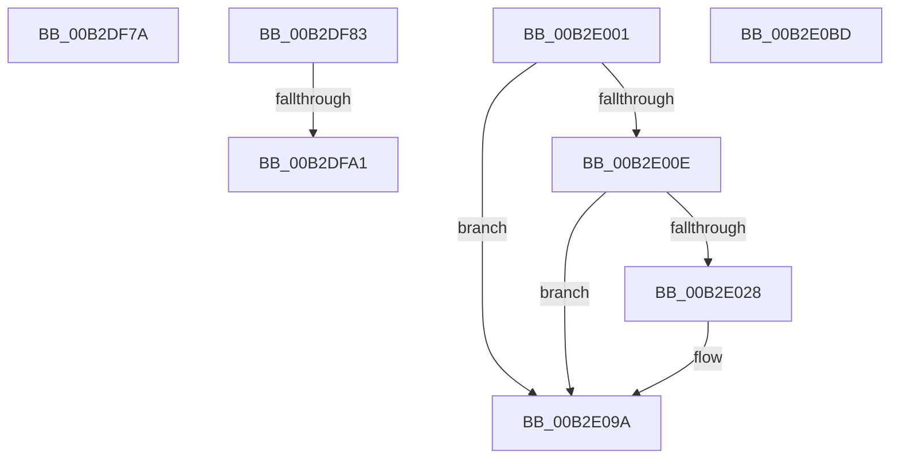

# sub_00B2DF7A

- RVA: `0x00B2DF7A`–`0x00B2E0C5` (길이 `331` bytes)
- VA: `0x0000000140B2DF7A`
- 실행 섹션: `PAGE`
- PDB 이름 있음: `아니요`; PDB Function 태그: `아니요`
- unwind 정보 RVA: `0x0009E94C`
- 디코드: `63`개 명령, `331/331` bytes 표시
- 미해석 바이트: `0` (있으면 어셈블리에 `.byte`로 보존)

> 이 문서는 커널 이미지의 기계어와 PDB 기호를 분석해 생성했습니다. 4번과 5번은 함수 원형과 자료형을 바이너리 사용 방식에서 추정한 C 해석이며 원본 소스 복구 결과는 아닙니다.

## 1. Dependencies

- 직접 호출 지점: **4**; 고유 호출 대상: **2**
- 직접 호출자로 확인된 함수: **0**
- RIP 상대 이미지 참조: **3**

### Outgoing calls
- `0x00B2DF94` → [tlgKeywordOn](../../text/42/tlgKeywordOn_function_0042EAA0.md) (function, `0x0042EAA0`)
- `0x00B2DFF6` → [tlgWriteTransfer_EtwWriteTransfer](../../text/42/tlgWriteTransfer_EtwWriteTransfer_function_004260E0.md) (function, `0x004260E0`)
- `0x00B2E01F` → [tlgKeywordOn](../../text/42/tlgKeywordOn_function_0042EAA0.md) (function, `0x0042EAA0`)
- `0x00B2E095` → [tlgWriteTransfer_EtwWriteTransfer](../../text/42/tlgWriteTransfer_EtwWriteTransfer_function_004260E0.md) (function, `0x004260E0`)

### Direct callers
- 이 함수 시작 RVA로 연결되는 직접 call은 확인되지 않았습니다. 간접 호출은 완전히 역산할 수 없습니다.

### Static image references
- `0x00B2DF8D` → RVA `0x00E09F58` (`.data`; read)
- `0x00B2DFAE` → RVA `0x00057174` (`.rdata`; read)
- `0x00B2E03B` → RVA `0x0005710E` (`.rdata`; read)

## 2. Other-region calls and transfers

- 다른 실행 섹션으로 향하는 call: **4**
  - `0x00B2DF94` → [tlgKeywordOn](../../text/42/tlgKeywordOn_function_0042EAA0.md) (`PAGE` → `.text`)
  - `0x00B2DFF6` → [tlgWriteTransfer_EtwWriteTransfer](../../text/42/tlgWriteTransfer_EtwWriteTransfer_function_004260E0.md) (`PAGE` → `.text`)
  - `0x00B2E01F` → [tlgKeywordOn](../../text/42/tlgKeywordOn_function_0042EAA0.md) (`PAGE` → `.text`)
  - `0x00B2E095` → [tlgWriteTransfer_EtwWriteTransfer](../../text/42/tlgWriteTransfer_EtwWriteTransfer_function_004260E0.md) (`PAGE` → `.text`)
- call이 아닌 외부 분기/꼬리 이동: **5**
  - `0x00B2DF7E` → [HvLoadHive + 0x405](../9B/HvLoadHive_function_009B8138.md) (`tail-transfer`)
  - `0x00B2DF9B` → [HvLoadHive + 0x44F](../9B/HvLoadHive_function_009B8138.md) (`tail-transfer`)
  - `0x00B2DFFC` → [HvLoadHive + 0x44F](../9B/HvLoadHive_function_009B8138.md) (`tail-transfer`)
  - `0x00B2E0B8` → [HvLoadHive + 0x137](../9B/HvLoadHive_function_009B8138.md) (`tail-transfer`)
  - `0x00B2E0C0` → [HvLoadHive + 0x361](../9B/HvLoadHive_function_009B8138.md) (`tail-transfer`)

## 3. Assembly (complete function range)

```asm
00B2DF7A  41 83 FE 04                     cmp r14d, 4
00B2DF7E  E9 BA A5 E8 FF                  jmp 0x1409b853d
00B2DF83  48 BA 00 00 00 00 00 20 00 00   movabs rdx, 0x200000000000
00B2DF8D  48 8D 0D C4 BF 2D 00            lea rcx, [rip + 0x2dbfc4]
00B2DF94  E8 07 0B 90 FF                  call 0x14042eaa0
00B2DF99  84 C0                           test al, al
00B2DF9B  0F 84 E6 A5 E8 FF               je 0x1409b8587
00B2DFA1  83 65 5C 00                     and dword ptr [rbp + 0x5c], 0
00B2DFA5  48 8D 44 24 48                  lea rax, [rsp + 0x48]
00B2DFAA  83 65 6C 00                     and dword ptr [rbp + 0x6c], 0
00B2DFAE  48 8D 15 BF 91 52 FF            lea rdx, [rip - 0xad6e41]
00B2DFB5  48 89 45 50                     mov qword ptr [rbp + 0x50], rax
00B2DFB9  48 8D 0D 98 BF 2D 00            lea rcx, [rip + 0x2dbf98]
00B2DFC0  48 8D 44 24 58                  lea rax, [rsp + 0x58]
00B2DFC5  44 89 45 58                     mov dword ptr [rbp + 0x58], r8d
00B2DFC9  48 89 45 60                     mov qword ptr [rbp + 0x60], rax
00B2DFCD  45 33 C9                        xor r9d, r9d
00B2DFD0  48 8D 45 30                     lea rax, [rbp + 0x30]
00B2DFD4  44 89 74 24 48                  mov dword ptr [rsp + 0x48], r14d
00B2DFD9  48 89 44 24 28                  mov qword ptr [rsp + 0x28], rax
00B2DFDE  44 89 44 24 20                  mov dword ptr [rsp + 0x20], r8d
00B2DFE3  45 33 C0                        xor r8d, r8d
00B2DFE6  48 C7 44 24 58 00 00 00 01      mov qword ptr [rsp + 0x58], 0x1000000
00B2DFEF  C7 45 68 08 00 00 00            mov dword ptr [rbp + 0x68], 8
00B2DFF6  E8 E5 80 8F FF                  call 0x1404260e0
00B2DFFB  90                              nop
00B2DFFC  E9 86 A5 E8 FF                  jmp 0x1409b8587
00B2E001  83 3D 50 BF 2D 00 05            cmp dword ptr [rip + 0x2dbf50], 5
00B2E008  0F 86 8C 00 00 00               jbe 0x140b2e09a
00B2E00E  48 BA 00 00 00 00 00 20 00 00   movabs rdx, 0x200000000000
00B2E018  48 8D 0D 39 BF 2D 00            lea rcx, [rip + 0x2dbf39]
00B2E01F  E8 7C 0A 90 FF                  call 0x14042eaa0
00B2E024  84 C0                           test al, al
00B2E026  74 72                           je 0x140b2e09a
00B2E028  41 8D 80 00 10 00 00            lea eax, [r8 + 0x1000]
00B2E02F  48 C7 45 58 04 00 00 00         mov qword ptr [rbp + 0x58], 4
00B2E037  89 44 24 48                     mov dword ptr [rsp + 0x48], eax
00B2E03B  48 8D 15 CC 90 52 FF            lea rdx, [rip - 0xad6f34]
00B2E042  48 8D 44 24 48                  lea rax, [rsp + 0x48]
00B2E047  89 5C 24 50                     mov dword ptr [rsp + 0x50], ebx
00B2E04B  48 89 45 50                     mov qword ptr [rbp + 0x50], rax
00B2E04F  48 8D 0D 02 BF 2D 00            lea rcx, [rip + 0x2dbf02]
00B2E056  48 8D 44 24 50                  lea rax, [rsp + 0x50]
00B2E05B  48 C7 45 68 04 00 00 00         mov qword ptr [rbp + 0x68], 4
00B2E063  48 89 45 60                     mov qword ptr [rbp + 0x60], rax
00B2E067  45 33 C0                        xor r8d, r8d
00B2E06A  48 8D 44 24 58                  lea rax, [rsp + 0x58]
00B2E06F  48 C7 44 24 58 00 00 00 01      mov qword ptr [rsp + 0x58], 0x1000000
00B2E078  48 89 45 70                     mov qword ptr [rbp + 0x70], rax
00B2E07C  48 8D 45 30                     lea rax, [rbp + 0x30]
00B2E080  48 89 44 24 28                  mov qword ptr [rsp + 0x28], rax
00B2E085  C7 44 24 20 05 00 00 00         mov dword ptr [rsp + 0x20], 5
00B2E08D  48 C7 45 78 08 00 00 00         mov qword ptr [rbp + 0x78], 8
00B2E095  E8 46 80 8F FF                  call 0x1404260e0
00B2E09A  48 8B 47 40                     mov rax, qword ptr [rdi + 0x40]
00B2E09E  8D 8B 00 F0 FF FF               lea ecx, [rbx - 0x1000]
00B2E0A4  83 88 F8 0F 00 00 04            or dword ptr [rax + 0xff8], 4
00B2E0AB  48 8B 47 40                     mov rax, qword ptr [rdi + 0x40]
00B2E0AF  81 E1 00 F0 FF FF               and ecx, 0xfffff000
00B2E0B5  89 48 28                        mov dword ptr [rax + 0x28], ecx
00B2E0B8  E9 B2 A1 E8 FF                  jmp 0x1409b826f
00B2E0BD  41 8B D9                        mov ebx, r9d
00B2E0C0  E9 D4 A3 E8 FF                  jmp 0x1409b8499
```

## 4. C-style interpretation (structured pseudocode)

```c
__int64 __fastcall sub_00B2DF7A(__int64 a1, __int64 a2, int a3, int a4)
{
    unsigned int v_stack_p20;
    unsigned __int64 v_stack_p28;
    unsigned __int64 v_stack_p48;
    unsigned int v_stack_p50;
    unsigned __int64 v_stack_p58;
}
```

## 5. (Beta) C Style

```c
int64_t sub_00B2DF7A(int64_t Arg1, int64_t Arg2, int32_t Arg3, int32_t Arg4)
{
    uint32_t v_stack_p20;
    uint64_t v_stack_p28;
    uint64_t v_stack_p48;
    uint32_t v_stack_p50;
    uint64_t v_stack_p58;
}
```

## 6. Execution-region graph

[열기: 2D/3D 그래프와 함수 탐색 컨트롤 패널](../../../control-panel.html?section=page&rva=0x00B2DF7A&view=graph)

- 2D 그래프는 위에서 아래로 흐르고, 3D 그래프는 빈 공간을 드래그해 회전합니다. Shift+드래그는 이동, 휠은 확대·축소, 함수 노드 선택은 대상 보고서 이동입니다.

### Static fallback


