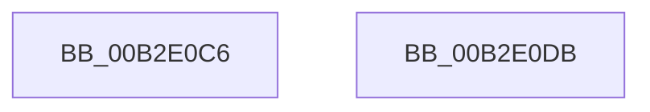

# sub_00B2E0C6

- RVA: `0x00B2E0C6`–`0x00B2E0F0` (길이 `42` bytes)
- VA: `0x0000000140B2E0C6`
- 실행 섹션: `PAGE`
- PDB 이름 있음: `아니요`; PDB Function 태그: `아니요`
- unwind 정보 RVA: `0x0009E9AC`
- 디코드: `12`개 명령, `42/42` bytes 표시
- 미해석 바이트: `0` (있으면 어셈블리에 `.byte`로 보존)

> 이 문서는 커널 이미지의 기계어와 PDB 기호를 분석해 생성했습니다. 4번과 5번은 함수 원형과 자료형을 바이너리 사용 방식에서 추정한 C 해석이며 원본 소스 복구 결과는 아닙니다.

## 1. Dependencies

- 직접 호출 지점: **2**; 고유 호출 대상: **1**
- 직접 호출자로 확인된 함수: **0**
- RIP 상대 이미지 참조: **0**

### Outgoing calls
- `0x00B2E0D0` → [guard_dispatch_icall](../../text/6B/guard_dispatch_icall_function_006BAAD0.md) (function, `0x006BAAD0`)
- `0x00B2E0E5` → [guard_dispatch_icall](../../text/6B/guard_dispatch_icall_function_006BAAD0.md) (function, `0x006BAAD0`)

### Direct callers
- 이 함수 시작 RVA로 연결되는 직접 call은 확인되지 않았습니다. 간접 호출은 완전히 역산할 수 없습니다.

### Static image references
- 디코드된 RIP-relative 메모리 참조가 없습니다.

## 2. Other-region calls and transfers

- 다른 실행 섹션으로 향하는 call: **2**
  - `0x00B2E0D0` → [guard_dispatch_icall](../../text/6B/guard_dispatch_icall_function_006BAAD0.md) (`PAGE` → `.text`)
  - `0x00B2E0E5` → [guard_dispatch_icall](../../text/6B/guard_dispatch_icall_function_006BAAD0.md) (`PAGE` → `.text`)
- call이 아닌 외부 분기/꼬리 이동: **2**
  - `0x00B2E0D6` → [HvpInitMap + 0x20F](../9B/HvpInitMap_function_009B8A68.md) (`tail-transfer`)
  - `0x00B2E0EB` → [HvpInitMap + 0x166](../9B/HvpInitMap_function_009B8A68.md) (`tail-transfer`)

## 3. Assembly (complete function range)

```asm
00B2E0C6  48 8B 47 20                     mov rax, qword ptr [rdi + 0x20]
00B2E0CA  41 8B D7                        mov edx, r15d
00B2E0CD  49 8B CD                        mov rcx, r13
00B2E0D0  E8 FB C9 B8 FF                  call 0x1406baad0
00B2E0D5  90                              nop
00B2E0D6  E9 9C AB E8 FF                  jmp 0x1409b8c77
00B2E0DB  48 8B 47 20                     mov rax, qword ptr [rdi + 0x20]
00B2E0DF  41 8B D7                        mov edx, r15d
00B2E0E2  48 8B CD                        mov rcx, rbp
00B2E0E5  E8 E6 C9 B8 FF                  call 0x1406baad0
00B2E0EA  90                              nop
00B2E0EB  E9 DE AA E8 FF                  jmp 0x1409b8bce
```

## 4. C-style interpretation (structured pseudocode)

```c
__int64 __fastcall sub_00B2E0C6(void)
{
    __int64 result;

    result = guard_dispatch_icall(v_r13, (unsigned int)((unsigned int)(v_r15)), a3, a4);
}
```

## 5. (Beta) C Style

```c
void sub_00B2E0C6(void)
{
    int64_t result;

    result = guard_dispatch_icall(local_r13, (uint32_t)((uint32_t)(local_r15)), a3, a4);
}
```

## 6. Execution-region graph

[열기: 2D/3D 그래프와 함수 탐색 컨트롤 패널](../../../control-panel.html?section=page&rva=0x00B2E0C6&view=graph)

- 2D 그래프는 위에서 아래로 흐르고, 3D 그래프는 빈 공간을 드래그해 회전합니다. Shift+드래그는 이동, 휠은 확대·축소, 함수 노드 선택은 대상 보고서 이동입니다.

### Static fallback


