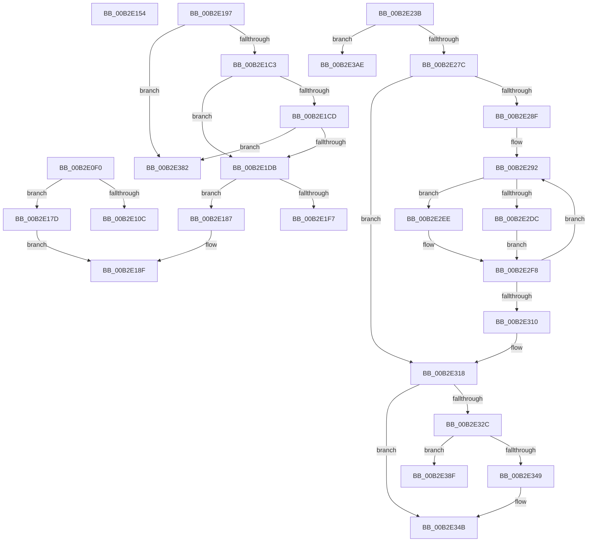

# sub_00B2E0F0

- RVA: `0x00B2E0F0`–`0x00B2E3D0` (길이 `736` bytes)
- VA: `0x0000000140B2E0F0`
- 실행 섹션: `PAGE`
- PDB 이름 있음: `아니요`; PDB Function 태그: `아니요`
- unwind 정보 RVA: `0x0009E9F8`
- 디코드: `184`개 명령, `736/736` bytes 표시
- 미해석 바이트: `0` (있으면 어셈블리에 `.byte`로 보존)

> 이 문서는 커널 이미지의 기계어와 PDB 기호를 분석해 생성했습니다. 4번과 5번은 함수 원형과 자료형을 바이너리 사용 방식에서 추정한 C 해석이며 원본 소스 복구 결과는 아닙니다.

## 1. Dependencies

- 직접 호출 지점: **22**; 고유 호출 대상: **14**
- 직접 호출자로 확인된 함수: **0**
- RIP 상대 이미지 참조: **2**

### Outgoing calls
- `0x00B2E0FF` → [HvpMarkDirty](../85/HvpMarkDirty_function_008593C0.md) (function, `0x008593C0`)
- `0x00B2E115` → [memset](../../text/6C/memset_function_006C6C40.md) (function, `0x006C6C40`)
- `0x00B2E168` → [SetFailureLocation](../../text/46/SetFailureLocation_function_0046EF54.md) (function, `0x0046EF54`)
- `0x00B2E1B1` → [SetFailureLocation](../../text/46/SetFailureLocation_function_0046EF54.md) (function, `0x0046EF54`)
- `0x00B2E1EA` → [HvpMarkDirty](../85/HvpMarkDirty_function_008593C0.md) (function, `0x008593C0`)
- `0x00B2E200` → [memset](../../text/6C/memset_function_006C6C40.md) (function, `0x006C6C40`)
- `0x00B2E245` → [HvpMapEntryReleaseBinAddress](../../pagecmrc/BC/HvpMapEntryReleaseBinAddress_function_00BC9790.md) (function, `0x00BC9790`)
- `0x00B2E24E` → [HvpGetBinContextInitialize](../../pagecmrc/BC/HvpGetBinContextInitialize_function_00BC98D0.md) (function, `0x00BC98D0`)
- `0x00B2E26B` → [HvpAllocateBin](../9B/HvpAllocateBin_function_009B78A4.md) (function, `0x009B78A4`)
- `0x00B2E299` → [HvpGetCellMap](../../pagecmrc/BC/HvpGetCellMap_function_00BC9710.md) (function, `0x00BC9710`)
- `0x00B2E2A8` → [HvpMapEntryGetBinAddress](../../pagecmrc/BC/HvpMapEntryGetBinAddress_function_00BC9770.md) (function, `0x00BC9770`)
- `0x00B2E2BE` → [memcpy](../../text/6C/memcpy_function_006C6840.md) (function, `0x006C6840`)
- `0x00B2E2C7` → [HvpMapEntryReleaseBinAddress](../../pagecmrc/BC/HvpMapEntryReleaseBinAddress_function_00BC9790.md) (function, `0x00BC9790`)
- `0x00B2E2D0` → [HvpGetBinContextInitialize](../../pagecmrc/BC/HvpGetBinContextInitialize_function_00BC98D0.md) (function, `0x00BC98D0`)
- `0x00B2E2E7` → [HvpFreeBin](../A8/HvpFreeBin_function_00A8158C.md) (function, `0x00A8158C`)
- `0x00B2E2F3` → [CmpReleaseGlobalQuota](../84/CmpReleaseGlobalQuota_function_0084DB40.md) (function, `0x0084DB40`)
- `0x00B2E321` → [HvIsRangeDirty](../7F/HvIsRangeDirty_function_007F39BC.md) (function, `0x007F39BC`)
- `0x00B2E33E` → [HvpProtectBinPartial](../9B/HvpProtectBinPartial_function_009B5D84.md) (function, `0x009B5D84`)
- `0x00B2E361` → [HvpPointMapEntriesToBuffer](../9B/HvpPointMapEntriesToBuffer_function_009B7328.md) (function, `0x009B7328`)
- `0x00B2E36D` → [HvpMapEntryGetBinAddress](../../pagecmrc/BC/HvpMapEntryGetBinAddress_function_00BC9770.md) (function, `0x00BC9770`)
- `0x00B2E3A3` → [SetFailureLocation](../../text/46/SetFailureLocation_function_0046EF54.md) (function, `0x0046EF54`)
- `0x00B2E3C2` → [SetFailureLocation](../../text/46/SetFailureLocation_function_0046EF54.md) (function, `0x0046EF54`)

### Direct callers
- 이 함수 시작 RVA로 연결되는 직접 call은 확인되지 않았습니다. 간접 호출은 완전히 역산할 수 없습니다.

### Static image references
- `0x00B2E1C5` → RVA `0x00FD8002` (`PAGEDATA`; read)
- `0x00B2E1CD` → RVA `0x00EF7C60` (`.data`; read)

## 2. Other-region calls and transfers

- 다른 실행 섹션으로 향하는 call: **14**
  - `0x00B2E115` → [memset](../../text/6C/memset_function_006C6C40.md) (`PAGE` → `.text`)
  - `0x00B2E168` → [SetFailureLocation](../../text/46/SetFailureLocation_function_0046EF54.md) (`PAGE` → `.text`)
  - `0x00B2E1B1` → [SetFailureLocation](../../text/46/SetFailureLocation_function_0046EF54.md) (`PAGE` → `.text`)
  - `0x00B2E200` → [memset](../../text/6C/memset_function_006C6C40.md) (`PAGE` → `.text`)
  - `0x00B2E245` → [HvpMapEntryReleaseBinAddress](../../pagecmrc/BC/HvpMapEntryReleaseBinAddress_function_00BC9790.md) (`PAGE` → `PAGECMRC`)
  - `0x00B2E24E` → [HvpGetBinContextInitialize](../../pagecmrc/BC/HvpGetBinContextInitialize_function_00BC98D0.md) (`PAGE` → `PAGECMRC`)
  - `0x00B2E299` → [HvpGetCellMap](../../pagecmrc/BC/HvpGetCellMap_function_00BC9710.md) (`PAGE` → `PAGECMRC`)
  - `0x00B2E2A8` → [HvpMapEntryGetBinAddress](../../pagecmrc/BC/HvpMapEntryGetBinAddress_function_00BC9770.md) (`PAGE` → `PAGECMRC`)
  - `0x00B2E2BE` → [memcpy](../../text/6C/memcpy_function_006C6840.md) (`PAGE` → `.text`)
  - `0x00B2E2C7` → [HvpMapEntryReleaseBinAddress](../../pagecmrc/BC/HvpMapEntryReleaseBinAddress_function_00BC9790.md) (`PAGE` → `PAGECMRC`)
  - `0x00B2E2D0` → [HvpGetBinContextInitialize](../../pagecmrc/BC/HvpGetBinContextInitialize_function_00BC98D0.md) (`PAGE` → `PAGECMRC`)
  - `0x00B2E36D` → [HvpMapEntryGetBinAddress](../../pagecmrc/BC/HvpMapEntryGetBinAddress_function_00BC9770.md) (`PAGE` → `PAGECMRC`)
  - `0x00B2E3A3` → [SetFailureLocation](../../text/46/SetFailureLocation_function_0046EF54.md) (`PAGE` → `.text`)
  - `0x00B2E3C2` → [SetFailureLocation](../../text/46/SetFailureLocation_function_0046EF54.md) (`PAGE` → `.text`)
- call이 아닌 외부 분기/꼬리 이동: **8**
  - `0x00B2E14F` → [HvpRemapAndEnlistHiveBins + 0xFA](../9B/HvpRemapAndEnlistHiveBins_function_009B8E0C.md) (`tail-transfer`)
  - `0x00B2E178` → [HvpRemapAndEnlistHiveBins + 0x51B](../9B/HvpRemapAndEnlistHiveBins_function_009B8E0C.md) (`tail-transfer`)
  - `0x00B2E192` → [HvpRemapAndEnlistHiveBins + 0x51D](../9B/HvpRemapAndEnlistHiveBins_function_009B8E0C.md) (`tail-transfer`)
  - `0x00B2E236` → [HvpRemapAndEnlistHiveBins + 0x582](../9B/HvpRemapAndEnlistHiveBins_function_009B8E0C.md) (`tail-transfer`)
  - `0x00B2E37D` → [HvpRemapAndEnlistHiveBins + 0x590](../9B/HvpRemapAndEnlistHiveBins_function_009B8E0C.md) (`tail-transfer`)
  - `0x00B2E38A` → [HvpRemapAndEnlistHiveBins + 0x370](../9B/HvpRemapAndEnlistHiveBins_function_009B8E0C.md) (`tail-transfer`)
  - `0x00B2E3A9` → [HvpRemapAndEnlistHiveBins + 0x52F](../9B/HvpRemapAndEnlistHiveBins_function_009B8E0C.md) (`tail-transfer`)
  - `0x00B2E3CB` → [HvpRemapAndEnlistHiveBins + 0x52F](../9B/HvpRemapAndEnlistHiveBins_function_009B8E0C.md) (`tail-transfer`)

## 3. Assembly (complete function range)

```asm
00B2E0F0  45 33 C9                        xor r9d, r9d
00B2E0F3  41 B8 00 10 00 00               mov r8d, 0x1000
00B2E0F9  41 8B D6                        mov edx, r14d
00B2E0FC  48 8B CE                        mov rcx, rsi
00B2E0FF  E8 BC B2 D2 FF                  call 0x1408593c0
00B2E104  33 D2                           xor edx, edx
00B2E106  8B D8                           mov ebx, eax
00B2E108  85 C0                           test eax, eax
00B2E10A  78 71                           js 0x140b2e17d
00B2E10C  41 B8 00 10 00 00               mov r8d, 0x1000
00B2E112  48 8B CF                        mov rcx, rdi
00B2E115  E8 26 8B B9 FF                  call 0x1406c6c40
00B2E11A  44 8B 55 DF                     mov r10d, dword ptr [rbp - 0x21]
00B2E11E  41 8B C6                        mov eax, r14d
00B2E121  8B 5D E3                        mov ebx, dword ptr [rbp - 0x1d]
00B2E124  0F BA F0 1F                     btr eax, 0x1f
00B2E128  C7 47 08 00 10 00 00            mov dword ptr [rdi + 8], 0x1000
00B2E12F  89 47 04                        mov dword ptr [rdi + 4], eax
00B2E132  C7 07 68 62 69 6E               mov dword ptr [rdi], 0x6e696268
00B2E138  C7 47 20 E0 0F 00 00            mov dword ptr [rdi + 0x20], 0xfe0
00B2E13F  48 8B 46 40                     mov rax, qword ptr [rsi + 0x40]
00B2E143  83 88 F8 0F 00 00 04            or dword ptr [rax + 0xff8], 4
00B2E14A  B0 01                           mov al, 1
00B2E14C  89 45 C7                        mov dword ptr [rbp - 0x39], eax
00B2E14F  E9 B2 AD E8 FF                  jmp 0x1409b8f06
00B2E154  48 8B 4D EF                     mov rcx, qword ptr [rbp - 0x11]
00B2E158  B8 1A 00 00 00                  mov eax, 0x1a
00B2E15D  44 89 44 24 20                  mov dword ptr [rsp + 0x20], r8d
00B2E162  45 8B CC                        mov r9d, r12d
00B2E165  44 8B C0                        mov r8d, eax
00B2E168  E8 E7 0D 94 FF                  call 0x14046ef54
00B2E16D  45 8B CF                        mov r9d, r15d
00B2E170  C7 44 24 20 50 00 00 00         mov dword ptr [rsp + 0x20], 0x50
00B2E178  E9 AA B1 E8 FF                  jmp 0x1409b9327
00B2E17D  C7 44 24 20 30 00 00 00         mov dword ptr [rsp + 0x20], 0x30
00B2E185  EB 08                           jmp 0x140b2e18f
00B2E187  C7 44 24 20 80 00 00 00         mov dword ptr [rsp + 0x20], 0x80
00B2E18F  44 8B CB                        mov r9d, ebx
00B2E192  E9 92 B1 E8 FF                  jmp 0x1409b9329
00B2E197  BA 01 00 00 00                  mov edx, 1
00B2E19C  C7 44 24 20 60 00 00 00         mov dword ptr [rsp + 0x20], 0x60
00B2E1A4  45 8B CC                        mov r9d, r12d
00B2E1A7  49 8B CD                        mov rcx, r13
00B2E1AA  41 8B DC                        mov ebx, r12d
00B2E1AD  44 8D 42 21                     lea r8d, [rdx + 0x21]
00B2E1B1  E8 9E 0D 94 FF                  call 0x14046ef54
00B2E1B6  F7 45 6F 00 00 02 00            test dword ptr [rbp + 0x6f], 0x20000
00B2E1BD  0F 85 BF 01 00 00               jne 0x140b2e382
00B2E1C3  33 C0                           xor eax, eax
00B2E1C5  38 05 37 9E 4A 00               cmp byte ptr [rip + 0x4a9e37], al
00B2E1CB  75 0E                           jne 0x140b2e1db
00B2E1CD  8B 05 8D 9A 3C 00               mov eax, dword ptr [rip + 0x3c9a8d]
00B2E1D3  A8 06                           test al, 6
00B2E1D5  0F 84 A7 01 00 00               je 0x140b2e382
00B2E1DB  45 33 C9                        xor r9d, r9d
00B2E1DE  41 B8 00 10 00 00               mov r8d, 0x1000
00B2E1E4  41 8B D6                        mov edx, r14d
00B2E1E7  48 8B CE                        mov rcx, rsi
00B2E1EA  E8 D1 B1 D2 FF                  call 0x1408593c0
00B2E1EF  33 D2                           xor edx, edx
00B2E1F1  8B D8                           mov ebx, eax
00B2E1F3  85 C0                           test eax, eax
00B2E1F5  78 90                           js 0x140b2e187
00B2E1F7  41 B8 00 10 00 00               mov r8d, 0x1000
00B2E1FD  48 8B CF                        mov rcx, rdi
00B2E200  E8 3B 8A B9 FF                  call 0x1406c6c40
00B2E205  C7 47 08 00 10 00 00            mov dword ptr [rdi + 8], 0x1000
00B2E20C  41 8B C6                        mov eax, r14d
00B2E20F  0F BA F0 1F                     btr eax, 0x1f
00B2E213  C7 07 68 62 69 6E               mov dword ptr [rdi], 0x6e696268
00B2E219  89 47 04                        mov dword ptr [rdi + 4], eax
00B2E21C  C7 47 20 E0 0F 00 00            mov dword ptr [rdi + 0x20], 0xfe0
00B2E223  48 8B 46 40                     mov rax, qword ptr [rsi + 0x40]
00B2E227  83 88 F8 0F 00 00 04            or dword ptr [rax + 0xff8], 4
00B2E22E  B8 01 00 00 00                  mov eax, 1
00B2E233  89 45 C7                        mov dword ptr [rbp - 0x39], eax
00B2E236  E9 53 B1 E8 FF                  jmp 0x1409b938e
00B2E23B  4C 8D 45 7F                     lea r8, [rbp + 0x7f]
00B2E23F  89 45 E7                        mov dword ptr [rbp - 0x19], eax
00B2E242  44 8B E0                        mov r12d, eax
00B2E245  E8 46 B5 09 00                  call 0x140bc9790
00B2E24A  48 8D 4D 7F                     lea rcx, [rbp + 0x7f]
00B2E24E  E8 7D B6 09 00                  call 0x140bc98d0
00B2E253  48 8D 4D FF                     lea rcx, [rbp - 1]
00B2E257  41 B9 43 4D 33 31               mov r9d, 0x31334d43
00B2E25D  48 89 4C 24 20                  mov qword ptr [rsp + 0x20], rcx
00B2E262  45 33 C0                        xor r8d, r8d
00B2E265  48 8B CE                        mov rcx, rsi
00B2E268  41 8B D4                        mov edx, r12d
00B2E26B  E8 34 96 E8 FF                  call 0x1409b78a4
00B2E270  8B D8                           mov ebx, eax
00B2E272  33 C0                           xor eax, eax
00B2E274  85 DB                           test ebx, ebx
00B2E276  0F 88 32 01 00 00               js 0x140b2e3ae
00B2E27C  48 8B 7D FF                     mov rdi, qword ptr [rbp - 1]
00B2E280  8B D8                           mov ebx, eax
00B2E282  48 89 7D CF                     mov qword ptr [rbp - 0x31], rdi
00B2E286  45 85 E4                        test r12d, r12d
00B2E289  0F 84 89 00 00 00               je 0x140b2e318
00B2E28F  4C 8B EF                        mov r13, rdi
00B2E292  42 8D 14 33                     lea edx, [rbx + r14]
00B2E296  48 8B CE                        mov rcx, rsi
00B2E299  E8 72 B4 09 00                  call 0x140bc9710
00B2E29E  48 8B D0                        mov rdx, rax
00B2E2A1  4C 8D 45 7F                     lea r8, [rbp + 0x7f]
00B2E2A5  4C 8B F8                        mov r15, rax
00B2E2A8  E8 C3 B4 09 00                  call 0x140bc9770
00B2E2AD  8B CB                           mov ecx, ebx
00B2E2AF  41 B8 00 10 00 00               mov r8d, 0x1000
00B2E2B5  49 03 CD                        add rcx, r13
00B2E2B8  48 8B D0                        mov rdx, rax
00B2E2BB  48 8B F8                        mov rdi, rax
00B2E2BE  E8 7D 85 B9 FF                  call 0x1406c6840
00B2E2C3  4C 8D 45 7F                     lea r8, [rbp + 0x7f]
00B2E2C7  E8 C4 B4 09 00                  call 0x140bc9790
00B2E2CC  48 8D 4D 7F                     lea rcx, [rbp + 0x7f]
00B2E2D0  E8 FB B5 09 00                  call 0x140bc98d0
00B2E2D5  41 F6 47 08 08                  test byte ptr [r15 + 8], 8
00B2E2DA  74 12                           je 0x140b2e2ee
00B2E2DC  4C 8B C7                        mov r8, rdi
00B2E2DF  BA 00 10 00 00                  mov edx, 0x1000
00B2E2E4  48 8B CE                        mov rcx, rsi
00B2E2E7  E8 A0 32 F5 FF                  call 0x140a8158c
00B2E2EC  EB 0A                           jmp 0x140b2e2f8
00B2E2EE  B9 00 10 00 00                  mov ecx, 0x1000
00B2E2F3  E8 48 F8 D1 FF                  call 0x14084db40
00B2E2F8  33 C0                           xor eax, eax
00B2E2FA  81 C3 00 10 00 00               add ebx, 0x1000
00B2E300  49 89 07                        mov qword ptr [r15], rax
00B2E303  49 89 47 08                     mov qword ptr [r15 + 8], rax
00B2E307  41 89 47 10                     mov dword ptr [r15 + 0x10], eax
00B2E30B  41 3B DC                        cmp ebx, r12d
00B2E30E  72 82                           jb 0x140b2e292
00B2E310  4C 8B 6D 77                     mov r13, qword ptr [rbp + 0x77]
00B2E314  48 8B 7D CF                     mov rdi, qword ptr [rbp - 0x31]
00B2E318  45 8B C4                        mov r8d, r12d
00B2E31B  41 8B D6                        mov edx, r14d
00B2E31E  48 8B CE                        mov rcx, rsi
00B2E321  E8 96 56 CC FF                  call 0x1407f39bc
00B2E326  33 DB                           xor ebx, ebx
00B2E328  84 C0                           test al, al
00B2E32A  75 1F                           jne 0x140b2e34b
00B2E32C  88 5C 24 28                     mov byte ptr [rsp + 0x28], bl
00B2E330  45 33 C9                        xor r9d, r9d
00B2E333  48 8B D7                        mov rdx, rdi
00B2E336  44 89 64 24 20                  mov dword ptr [rsp + 0x20], r12d
00B2E33B  48 8B CE                        mov rcx, rsi
00B2E33E  E8 41 7A E8 FF                  call 0x1409b5d84
00B2E343  8B D8                           mov ebx, eax
00B2E345  85 C0                           test eax, eax
00B2E347  78 46                           js 0x140b2e38f
00B2E349  33 DB                           xor ebx, ebx
00B2E34B  48 89 5C 24 28                  mov qword ptr [rsp + 0x28], rbx
00B2E350  45 8B CE                        mov r9d, r14d
00B2E353  45 8B C4                        mov r8d, r12d
00B2E356  C6 44 24 20 01                  mov byte ptr [rsp + 0x20], 1
00B2E35B  48 8B D7                        mov rdx, rdi
00B2E35E  48 8B CE                        mov rcx, rsi
00B2E361  E8 C2 8F E8 FF                  call 0x1409b7328
00B2E366  4C 8D 45 7F                     lea r8, [rbp + 0x7f]
00B2E36A  49 8B D7                        mov rdx, r15
00B2E36D  E8 FE B3 09 00                  call 0x140bc9770
00B2E372  48 8B F8                        mov rdi, rax
00B2E375  48 89 5D CF                     mov qword ptr [rbp - 0x31], rbx
00B2E379  48 89 5D FF                     mov qword ptr [rbp - 1], rbx
00B2E37D  E9 1A B0 E8 FF                  jmp 0x1409b939c
00B2E382  C7 44 24 20 70 00 00 00         mov dword ptr [rsp + 0x20], 0x70
00B2E38A  E9 ED AD E8 FF                  jmp 0x1409b917c
00B2E38F  33 D2                           xor edx, edx
00B2E391  C7 44 24 20 A0 00 00 00         mov dword ptr [rsp + 0x20], 0xa0
00B2E399  44 8B CB                        mov r9d, ebx
00B2E39C  49 8B CD                        mov rcx, r13
00B2E39F  44 8D 42 22                     lea r8d, [rdx + 0x22]
00B2E3A3  E8 AC 0B 94 FF                  call 0x14046ef54
00B2E3A8  90                              nop
00B2E3A9  E9 8D AF E8 FF                  jmp 0x1409b933b
00B2E3AE  33 D2                           xor edx, edx
00B2E3B0  C7 44 24 20 90 00 00 00         mov dword ptr [rsp + 0x20], 0x90
00B2E3B8  44 8B CB                        mov r9d, ebx
00B2E3BB  49 8B CD                        mov rcx, r13
00B2E3BE  44 8D 42 22                     lea r8d, [rdx + 0x22]
00B2E3C2  E8 8D 0B 94 FF                  call 0x14046ef54
00B2E3C7  48 8B 7D FF                     mov rdi, qword ptr [rbp - 1]
00B2E3CB  E9 6B AF E8 FF                  jmp 0x1409b933b
```

## 4. C-style interpretation (structured pseudocode)

```c
__int64 __fastcall sub_00B2E0F0(__int64 a1, __int64 a2, __int64 a3, int a4)
{
    __int64 result;
    unsigned int v_stack_p20;
    unsigned __int8 v_stack_p28;

    a4 = 0;
    result = HvpMarkDirty(v_rsi, (unsigned int)((unsigned int)(v_r14)), (unsigned int)(0x1000ULL), a4);
    a2 = 0;
    if (sign_flag) goto loc_00B2E17D;
    result = memset(v_rdi, a2, (unsigned int)(0x1000ULL), a4);
    *(unsigned int *)(v_rdi + 8) = 0x1000ULL;
    *(unsigned int *)(v_rdi + 4) = (unsigned int)((unsigned int)((unsigned int)(v_r14)));
    *(unsigned int *)(v_rdi) = 0x6E696268ULL;
    *(unsigned int *)(v_rdi + 32) = 0xFE0ULL;
    *(unsigned int *)(v_rbp - 57) = 1;
loc_00B2E17D:
    v_stack_p20 = 48;
    goto loc_00B2E18F;
loc_00B2E18F:
}
```

## 5. (Beta) C Style

```c
int64_t sub_00B2E0F0(int64_t Arg1, int64_t Arg2, int64_t Arg3, int32_t Arg4)
{
    int64_t result;
    uint32_t v_stack_p20;
    uint8_t v_stack_p28;

    Arg4 = 0;
    result = HvpMarkDirty(local_rsi, (uint32_t)((uint32_t)(local_r14)), (uint32_t)(0x1000ULL), Arg4);
    Arg2 = 0;
    if (sign_flag) goto loc_00B2E17D;
    result = memset(local_rdi, Arg2, (uint32_t)(0x1000ULL), Arg4);
    *(uint32_t *)(local_rdi + 0x8) = 0x1000ULL;
    *(uint32_t *)(local_rdi + 0x4) = (uint32_t)((uint32_t)((uint32_t)(local_r14)));
    *(uint32_t *)(local_rdi) = 0x6E696268ULL;
    *(uint32_t *)(local_rdi + 0x20) = 0xFE0ULL;
    *(uint32_t *)(local_rbp - 0x39) = 1;
loc_00B2E17D:
    v_stack_p20 = 48;
    goto loc_00B2E18F;
loc_00B2E18F:
}
```

## 6. Execution-region graph

[열기: 2D/3D 그래프와 함수 탐색 컨트롤 패널](../../../control-panel.html?section=page&rva=0x00B2E0F0&view=graph)

- 2D 그래프는 위에서 아래로 흐르고, 3D 그래프는 빈 공간을 드래그해 회전합니다. Shift+드래그는 이동, 휠은 확대·축소, 함수 노드 선택은 대상 보고서 이동입니다.

### Static fallback


