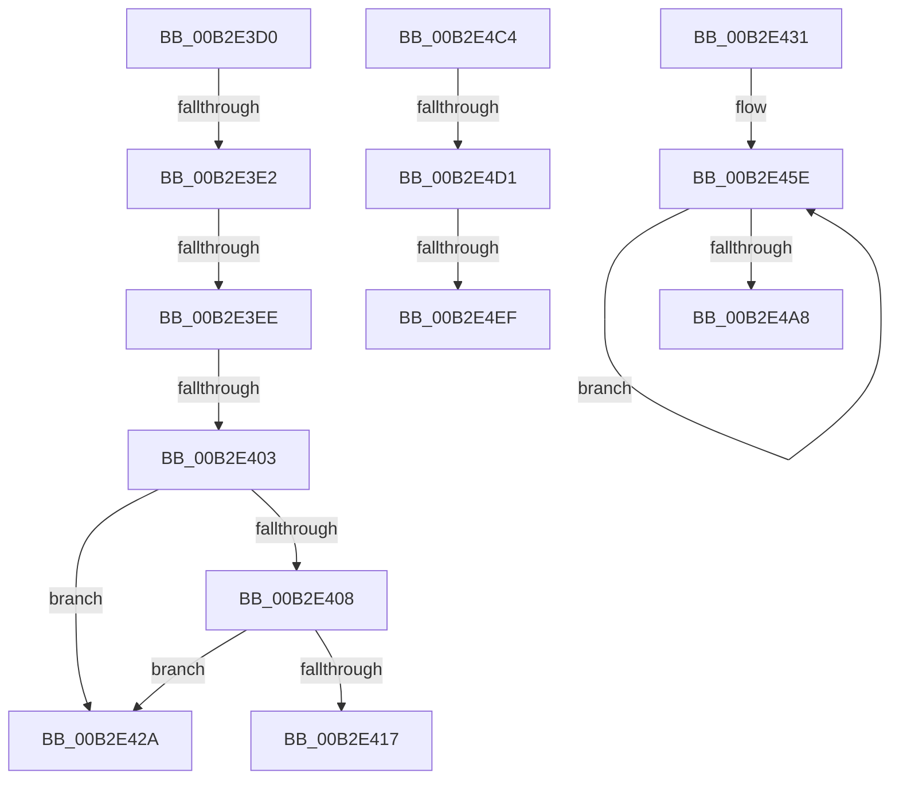

# sub_00B2E3D0

- RVA: `0x00B2E3D0`–`0x00B2E53E` (길이 `366` bytes)
- VA: `0x0000000140B2E3D0`
- 실행 섹션: `PAGE`
- PDB 이름 있음: `아니요`; PDB Function 태그: `아니요`
- unwind 정보 RVA: `0x0009EA8C`
- 디코드: `85`개 명령, `366/366` bytes 표시
- 미해석 바이트: `0` (있으면 어셈블리에 `.byte`로 보존)

> 이 문서는 커널 이미지의 기계어와 PDB 기호를 분석해 생성했습니다. 4번과 5번은 함수 원형과 자료형을 바이너리 사용 방식에서 추정한 C 해석이며 원본 소스 복구 결과는 아닙니다.

## 1. Dependencies

- 직접 호출 지점: **7**; 고유 호출 대상: **6**
- 직접 호출자로 확인된 함수: **0**
- RIP 상대 이미지 참조: **2**

### Outgoing calls
- `0x00B2E3F1` → [HvpHeaderCheckSum](../../pagecmrc/BC/HvpHeaderCheckSum_function_00BC97A0.md) (function, `0x00BC97A0`)
- `0x00B2E40E` → [HvpCompareLogSequenceNumbers](../7F/HvpCompareLogSequenceNumbers_function_007F6904.md) (function, `0x007F6904`)
- `0x00B2E41F` → [HvpLogIneligibleLogHeader](../7F/HvpLogIneligibleLogHeader_function_007F6938.md) (function, `0x007F6938`)
- `0x00B2E441` → [HvpCompareLogSequenceNumbers](../7F/HvpCompareLogSequenceNumbers_function_007F6904.md) (function, `0x007F6904`)
- `0x00B2E4B5` → [memset](../../text/6C/memset_function_006C6C40.md) (function, `0x006C6C40`)
- `0x00B2E4E2` → [tlgKeywordOn](../../text/42/tlgKeywordOn_function_0042EAA0.md) (function, `0x0042EAA0`)
- `0x00B2E533` → [tlgWriteTransfer_EtwWriteTransfer](../../text/42/tlgWriteTransfer_EtwWriteTransfer_function_004260E0.md) (function, `0x004260E0`)

### Direct callers
- 이 함수 시작 RVA로 연결되는 직접 call은 확인되지 않았습니다. 간접 호출은 완전히 역산할 수 없습니다.

### Static image references
- `0x00B2E4C4` → RVA `0x00E09F58` (`.data`; read)
- `0x00B2E4FC` → RVA `0x000578C5` (`.rdata`; read)

## 2. Other-region calls and transfers

- 다른 실행 섹션으로 향하는 call: **4**
  - `0x00B2E3F1` → [HvpHeaderCheckSum](../../pagecmrc/BC/HvpHeaderCheckSum_function_00BC97A0.md) (`PAGE` → `PAGECMRC`)
  - `0x00B2E4B5` → [memset](../../text/6C/memset_function_006C6C40.md) (`PAGE` → `.text`)
  - `0x00B2E4E2` → [tlgKeywordOn](../../text/42/tlgKeywordOn_function_0042EAA0.md) (`PAGE` → `.text`)
  - `0x00B2E533` → [tlgWriteTransfer_EtwWriteTransfer](../../text/42/tlgWriteTransfer_EtwWriteTransfer_function_004260E0.md) (`PAGE` → `.text`)
- call이 아닌 외부 분기/꼬리 이동: **9**
  - `0x00B2E3DC` → [HvAnalyzeLogFiles + 0x292](../9B/HvAnalyzeLogFiles_function_009B9A9C.md) (`tail-transfer`)
  - `0x00B2E3E8` → [HvAnalyzeLogFiles + 0x292](../9B/HvAnalyzeLogFiles_function_009B9A9C.md) (`tail-transfer`)
  - `0x00B2E3FD` → [HvAnalyzeLogFiles + 0x292](../9B/HvAnalyzeLogFiles_function_009B9A9C.md) (`tail-transfer`)
  - `0x00B2E425` → [HvAnalyzeLogFiles + 0x29F](../9B/HvAnalyzeLogFiles_function_009B9A9C.md) (`tail-transfer`)
  - `0x00B2E42C` → [HvAnalyzeLogFiles + 0xF9](../9B/HvAnalyzeLogFiles_function_009B9A9C.md) (`tail-transfer`)
  - `0x00B2E4BF` → [HvAnalyzeLogFiles + 0x2B1](../9B/HvAnalyzeLogFiles_function_009B9A9C.md) (`tail-transfer`)
  - `0x00B2E4CB` → [HvAnalyzeLogFiles + 0x137](../9B/HvAnalyzeLogFiles_function_009B9A9C.md) (`tail-transfer`)
  - `0x00B2E4E9` → [HvAnalyzeLogFiles + 0x137](../9B/HvAnalyzeLogFiles_function_009B9A9C.md) (`tail-transfer`)
  - `0x00B2E539` → [HvAnalyzeLogFiles + 0x137](../9B/HvAnalyzeLogFiles_function_009B9A9C.md) (`tail-transfer`)

## 3. Assembly (complete function range)

```asm
00B2E3D0  41 8B 49 28                     mov ecx, dword ptr [r9 + 0x28]
00B2E3D4  8D 41 FF                        lea eax, [rcx - 1]
00B2E3D7  3D FF DF FF 7F                  cmp eax, 0x7fffdfff
00B2E3DC  0F 87 4C B9 E8 FF               ja 0x1409b9d2e
00B2E3E2  F7 C1 FF 0F 00 00               test ecx, 0xfff
00B2E3E8  0F 85 40 B9 E8 FF               jne 0x1409b9d2e
00B2E3EE  49 8B C9                        mov rcx, r9
00B2E3F1  E8 AA B3 09 00                  call 0x140bc97a0
00B2E3F6  41 39 81 FC 01 00 00            cmp dword ptr [r9 + 0x1fc], eax
00B2E3FD  0F 85 2B B9 E8 FF               jne 0x1409b9d2e
00B2E403  45 84 ED                        test r13b, r13b
00B2E406  75 22                           jne 0x140b2e42a
00B2E408  41 8B D7                        mov edx, r15d
00B2E40B  41 8B CA                        mov ecx, r10d
00B2E40E  E8 F1 84 CC FF                  call 0x1407f6904
00B2E413  85 C0                           test eax, eax
00B2E415  79 13                           jns 0x140b2e42a
00B2E417  8B 0E                           mov ecx, dword ptr [rsi]
00B2E419  45 8B C2                        mov r8d, r10d
00B2E41C  41 8B D7                        mov edx, r15d
00B2E41F  E8 14 85 CC FF                  call 0x1407f6938
00B2E424  90                              nop
00B2E425  E9 11 B9 E8 FF                  jmp 0x1409b9d3b
00B2E42A  FF C7                           inc edi
00B2E42C  E9 64 B7 E8 FF                  jmp 0x1409b9b95
00B2E431  48 8B 54 24 50                  mov rdx, qword ptr [rsp + 0x50]
00B2E436  48 8B 4C 24 48                  mov rcx, qword ptr [rsp + 0x48]
00B2E43B  8B 52 08                        mov edx, dword ptr [rdx + 8]
00B2E43E  8B 49 04                        mov ecx, dword ptr [rcx + 4]
00B2E441  E8 BE 84 CC FF                  call 0x1407f6904
00B2E446  33 C9                           xor ecx, ecx
00B2E448  85 C0                           test eax, eax
00B2E44A  0F 98 C1                        sets cl
00B2E44D  48 8B 44 CC 48                  mov rax, qword ptr [rsp + rcx*8 + 0x48]
00B2E452  BA 04 00 00 00                  mov edx, 4
00B2E457  49 8B CD                        mov rcx, r13
00B2E45A  44 8D 42 7C                     lea r8d, [rdx + 0x7c]
00B2E45E  0F 10 00                        movups xmm0, xmmword ptr [rax]
00B2E461  0F 11 01                        movups xmmword ptr [rcx], xmm0
00B2E464  0F 10 48 10                     movups xmm1, xmmword ptr [rax + 0x10]
00B2E468  0F 11 49 10                     movups xmmword ptr [rcx + 0x10], xmm1
00B2E46C  0F 10 40 20                     movups xmm0, xmmword ptr [rax + 0x20]
00B2E470  0F 11 41 20                     movups xmmword ptr [rcx + 0x20], xmm0
00B2E474  0F 10 48 30                     movups xmm1, xmmword ptr [rax + 0x30]
00B2E478  0F 11 49 30                     movups xmmword ptr [rcx + 0x30], xmm1
00B2E47C  0F 10 40 40                     movups xmm0, xmmword ptr [rax + 0x40]
00B2E480  0F 11 41 40                     movups xmmword ptr [rcx + 0x40], xmm0
00B2E484  0F 10 48 50                     movups xmm1, xmmword ptr [rax + 0x50]
00B2E488  0F 11 49 50                     movups xmmword ptr [rcx + 0x50], xmm1
00B2E48C  0F 10 40 60                     movups xmm0, xmmword ptr [rax + 0x60]
00B2E490  0F 11 41 60                     movups xmmword ptr [rcx + 0x60], xmm0
00B2E494  49 03 C8                        add rcx, r8
00B2E497  0F 10 48 70                     movups xmm1, xmmword ptr [rax + 0x70]
00B2E49B  49 03 C0                        add rax, r8
00B2E49E  0F 11 49 F0                     movups xmmword ptr [rcx - 0x10], xmm1
00B2E4A2  48 83 EA 01                     sub rdx, 1
00B2E4A6  75 B6                           jne 0x140b2e45e
00B2E4A8  49 8D 8D 00 02 00 00            lea rcx, [r13 + 0x200]
00B2E4AF  41 B8 00 0E 00 00               mov r8d, 0xe00
00B2E4B5  E8 86 87 B9 FF                  call 0x1406c6c40
00B2E4BA  41 83 65 1C 00                  and dword ptr [r13 + 0x1c], 0
00B2E4BF  E9 89 B8 E8 FF                  jmp 0x1409b9d4d
00B2E4C4  83 3D 8D BA 2D 00 05            cmp dword ptr [rip + 0x2dba8d], 5
00B2E4CB  0F 86 02 B7 E8 FF               jbe 0x1409b9bd3
00B2E4D1  48 BA 08 00 00 00 00 40 00 00   movabs rdx, 0x400000000008
00B2E4DB  48 8D 0D 76 BA 2D 00            lea rcx, [rip + 0x2dba76]
00B2E4E2  E8 B9 05 90 FF                  call 0x14042eaa0
00B2E4E7  84 C0                           test al, al
00B2E4E9  0F 84 E4 B6 E8 FF               je 0x1409b9bd3
00B2E4EF  83 65 9C 00                     and dword ptr [rbp - 0x64], 0
00B2E4F3  48 8D 44 24 38                  lea rax, [rsp + 0x38]
00B2E4F8  48 89 45 90                     mov qword ptr [rbp - 0x70], rax
00B2E4FC  48 8D 15 C2 93 52 FF            lea rdx, [rip - 0xad6c3e]
00B2E503  48 8D 44 24 70                  lea rax, [rsp + 0x70]
00B2E508  C7 45 98 08 00 00 00            mov dword ptr [rbp - 0x68], 8
00B2E50F  48 89 44 24 28                  mov qword ptr [rsp + 0x28], rax
00B2E514  48 8D 0D 3D BA 2D 00            lea rcx, [rip + 0x2dba3d]
00B2E51B  BB 00 00 00 01                  mov ebx, 0x1000000
00B2E520  C7 44 24 20 03 00 00 00         mov dword ptr [rsp + 0x20], 3
00B2E528  45 33 C9                        xor r9d, r9d
00B2E52B  48 89 5C 24 38                  mov qword ptr [rsp + 0x38], rbx
00B2E530  45 33 C0                        xor r8d, r8d
00B2E533  E8 A8 7B 8F FF                  call 0x1404260e0
00B2E538  90                              nop
00B2E539  E9 95 B6 E8 FF                  jmp 0x1409b9bd3
```

## 4. C-style interpretation (structured pseudocode)

```c
__int64 __fastcall sub_00B2E3D0(__int64 a1, __int64 a2, __int64 a3, __int64 a4)
{
    __int64 result;
    __int64 v_rdi;
    unsigned int v_stack_p20;
    unsigned __int64 v_stack_p28;
    unsigned __int64 v_stack_p38;
    unsigned __int64 v_stack_p48;
    unsigned __int64 v_stack_p50;
    unsigned __int64 v_stack_p70;

    result = HvpHeaderCheckSum(a4, a2, a3, a4);
    if ((unsigned __int8)(v_r13) != 0) goto loc_00B2E42A;
    result = HvpCompareLogSequenceNumbers((unsigned int)((unsigned int)(v_r10)), (unsigned int)((unsigned int)(v_r15)), a3, a4);
    if (!sign_flag) goto loc_00B2E42A;
    result = HvpLogIneligibleLogHeader((unsigned int)(*(unsigned int *)(v_rsi)), (unsigned int)((unsigned int)(v_r15)), (unsigned int)((unsigned int)(v_r10)), a4);
loc_00B2E42A:
    v_rdi = (unsigned int)((v_rdi) + 1);
}
```

## 5. (Beta) C Style

```c
int64_t sub_00B2E3D0(int64_t Arg1, int64_t Arg2, int64_t Arg3, void *Arg4)
{
    uint8_t *arg4 = (uint8_t *)Arg4;

    int64_t result;
    int64_t local_rdi;
    uint32_t v_stack_p20;
    uint64_t v_stack_p28;
    uint64_t v_stack_p38;
    uint64_t v_stack_p48;
    uint64_t v_stack_p50;
    uint64_t v_stack_p70;

    result = HvpHeaderCheckSum(Arg4, Arg2, Arg3, Arg4);
    if ((uint8_t)(local_r13) != 0) goto loc_00B2E42A;
    result = HvpCompareLogSequenceNumbers((uint32_t)((uint32_t)(local_r10)), (uint32_t)((uint32_t)(local_r15)), Arg3, Arg4);
    if (!sign_flag) goto loc_00B2E42A;
    result = HvpLogIneligibleLogHeader((uint32_t)(*(uint32_t *)(local_rsi)), (uint32_t)((uint32_t)(local_r15)), (uint32_t)((uint32_t)(local_r10)), Arg4);
loc_00B2E42A:
    local_rdi = (uint32_t)((local_rdi) + 1);
}
```

### 관측된 메모리 오프셋

구조체 형식이 확인되지 않은 접근은 인자 기준의 오프셋으로만 기록했습니다.

| 기준 인자 | 오프셋 표현 | 폭 (bit) | 접근 |
|---|---:|---:|---|
| `Arg4` | `+ 0x28` | `32` | `R` |

## 6. Execution-region graph

[열기: 2D/3D 그래프와 함수 탐색 컨트롤 패널](../../../control-panel.html?section=page&rva=0x00B2E3D0&view=graph)

- 2D 그래프는 위에서 아래로 흐르고, 3D 그래프는 빈 공간을 드래그해 회전합니다. Shift+드래그는 이동, 휠은 확대·축소, 함수 노드 선택은 대상 보고서 이동입니다.

### Static fallback


