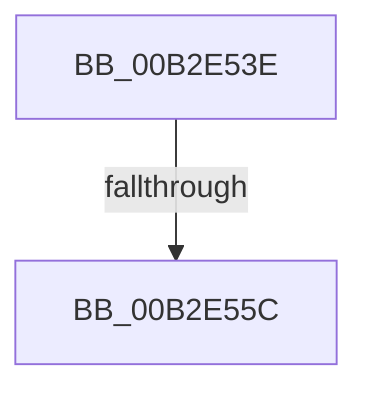

# sub_00B2E53E

- RVA: `0x00B2E53E`–`0x00B2E5C2` (길이 `132` bytes)
- VA: `0x0000000140B2E53E`
- 실행 섹션: `PAGE`
- PDB 이름 있음: `아니요`; PDB Function 태그: `아니요`
- unwind 정보 RVA: `0x0009EADC`
- 디코드: `24`개 명령, `132/132` bytes 표시
- 미해석 바이트: `0` (있으면 어셈블리에 `.byte`로 보존)

> 이 문서는 커널 이미지의 기계어와 PDB 기호를 분석해 생성했습니다. 4번과 5번은 함수 원형과 자료형을 바이너리 사용 방식에서 추정한 C 해석이며 원본 소스 복구 결과는 아닙니다.

## 1. Dependencies

- 직접 호출 지점: **2**; 고유 호출 대상: **2**
- 직접 호출자로 확인된 함수: **0**
- RIP 상대 이미지 참조: **2**

### Outgoing calls
- `0x00B2E54F` → [tlgKeywordOn](../../text/42/tlgKeywordOn_function_0042EAA0.md) (function, `0x0042EAA0`)
- `0x00B2E5B7` → [tlgWriteAgg](../../text/2F/tlgWriteAgg_function_002F0F7C.md) (function, `0x002F0F7C`)

### Direct callers
- 이 함수 시작 RVA로 연결되는 직접 call은 확인되지 않았습니다. 간접 호출은 완전히 역산할 수 없습니다.

### Static image references
- `0x00B2E548` → RVA `0x00E09F58` (`.data`; read)
- `0x00B2E56C` → RVA `0x000576C9` (`.rdata`; read)

## 2. Other-region calls and transfers

- 다른 실행 섹션으로 향하는 call: **2**
  - `0x00B2E54F` → [tlgKeywordOn](../../text/42/tlgKeywordOn_function_0042EAA0.md) (`PAGE` → `.text`)
  - `0x00B2E5B7` → [tlgWriteAgg](../../text/2F/tlgWriteAgg_function_002F0F7C.md) (`PAGE` → `.text`)
- call이 아닌 외부 분기/꼬리 이동: **2**
  - `0x00B2E556` → [HvpIsReadErrorTransient + 0x52](../9B/HvpIsReadErrorTransient_function_009BA0D8.md) (`tail-transfer`)
  - `0x00B2E5BD` → [HvpIsReadErrorTransient + 0x52](../9B/HvpIsReadErrorTransient_function_009BA0D8.md) (`tail-transfer`)

## 3. Assembly (complete function range)

```asm
00B2E53E  48 BA 00 00 00 00 00 40 00 00   movabs rdx, 0x400000000000
00B2E548  48 8D 0D 09 BA 2D 00            lea rcx, [rip + 0x2dba09]
00B2E54F  E8 4C 05 90 FF                  call 0x14042eaa0
00B2E554  84 C0                           test al, al
00B2E556  0F 84 CE BB E8 FF               je 0x1409ba12a
00B2E55C  48 8D 45 DF                     lea rax, [rbp - 0x21]
00B2E560  48 C7 45 DF 01 00 00 00         mov qword ptr [rbp - 0x21], 1
00B2E568  48 89 45 17                     mov qword ptr [rbp + 0x17], rax
00B2E56C  48 8D 15 56 91 52 FF            lea rdx, [rip - 0xad6eaa]
00B2E573  48 8D 45 D7                     lea rax, [rbp - 0x29]
00B2E577  48 C7 45 1F 08 00 00 00         mov qword ptr [rbp + 0x1f], 8
00B2E57F  48 89 45 27                     mov qword ptr [rbp + 0x27], rax
00B2E583  48 8D 0D CE B9 2D 00            lea rcx, [rip + 0x2db9ce]
00B2E58A  48 8D 45 E7                     lea rax, [rbp - 0x19]
00B2E58E  44 89 45 D7                     mov dword ptr [rbp - 0x29], r8d
00B2E592  48 89 45 37                     mov qword ptr [rbp + 0x37], rax
00B2E596  48 8D 45 F7                     lea rax, [rbp - 9]
00B2E59A  48 89 44 24 20                  mov qword ptr [rsp + 0x20], rax
00B2E59F  48 C7 45 2F 04 00 00 00         mov qword ptr [rbp + 0x2f], 4
00B2E5A7  48 C7 45 E7 00 00 00 01         mov qword ptr [rbp - 0x19], 0x1000000
00B2E5AF  48 C7 45 3F 08 00 00 00         mov qword ptr [rbp + 0x3f], 8
00B2E5B7  E8 C0 29 7C FF                  call 0x1402f0f7c
00B2E5BC  90                              nop
00B2E5BD  E9 68 BB E8 FF                  jmp 0x1409ba12a
```

## 4. C-style interpretation (structured pseudocode)

```c
__int64 __fastcall sub_00B2E53E(__int64 a1, __int64 a2, int a3)
{
    __int64 result;
    unsigned __int64 v_stack_p20;

    result = tlgKeywordOn(v_rip + 2996745, a2, a3, a4);
    *(unsigned __int64 *)(v_rbp - 33) = 1;
    *(unsigned __int64 *)(v_rbp + 23) = v_rbp - 33;
    *(unsigned __int64 *)(v_rbp + 31) = 8;
    *(unsigned __int64 *)(v_rbp + 39) = v_rbp - 41;
    *(unsigned int *)(v_rbp - 41) = a3;
    *(unsigned __int64 *)(v_rbp + 55) = v_rbp - 25;
    v_stack_p20 = v_rbp - 9;
    *(unsigned __int64 *)(v_rbp + 47) = 4;
    *(unsigned __int64 *)(v_rbp - 25) = 0x1000000ULL;
    *(unsigned __int64 *)(v_rbp + 63) = 8;
    result = tlgWriteAgg(v_rip + 2996686, v_rip - 11366058, a3, a4);
}
```

## 5. (Beta) C Style

```c
int64_t sub_00B2E53E(int64_t Arg1, int64_t Arg2, int32_t Arg3)
{
    int64_t result;
    uint64_t v_stack_p20;

    result = tlgKeywordOn(v_rip + 2996745, Arg2, Arg3, a4);
    *(uint64_t *)(local_rbp - 0x21) = 1;
    *(uint64_t *)(local_rbp + 0x17) = local_rbp - 33;
    *(uint64_t *)(local_rbp + 0x1F) = 8;
    *(uint64_t *)(local_rbp + 0x27) = local_rbp - 41;
    *(uint32_t *)(local_rbp - 0x29) = Arg3;
    *(uint64_t *)(local_rbp + 0x37) = local_rbp - 25;
    v_stack_p20 = local_rbp - 9;
    *(uint64_t *)(local_rbp + 0x2F) = 4;
    *(uint64_t *)(local_rbp - 0x19) = 0x1000000ULL;
    *(uint64_t *)(local_rbp + 0x3F) = 8;
    result = tlgWriteAgg(v_rip + 2996686, v_rip - 11366058, Arg3, a4);
}
```

## 6. Execution-region graph

[열기: 2D/3D 그래프와 함수 탐색 컨트롤 패널](../../../control-panel.html?section=page&rva=0x00B2E53E&view=graph)

- 2D 그래프는 위에서 아래로 흐르고, 3D 그래프는 빈 공간을 드래그해 회전합니다. Shift+드래그는 이동, 휠은 확대·축소, 함수 노드 선택은 대상 보고서 이동입니다.

### Static fallback


