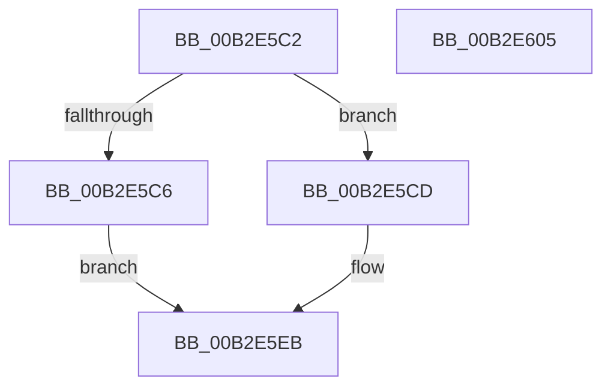

# sub_00B2E5C2

- RVA: `0x00B2E5C2`–`0x00B2E606` (길이 `68` bytes)
- VA: `0x0000000140B2E5C2`
- 실행 섹션: `PAGE`
- PDB 이름 있음: `아니요`; PDB Function 태그: `아니요`
- unwind 정보 RVA: `0x0009EB60`
- 디코드: `22`개 명령, `68/68` bytes 표시
- 미해석 바이트: `0` (있으면 어셈블리에 `.byte`로 보존)

> 이 문서는 커널 이미지의 기계어와 PDB 기호를 분석해 생성했습니다. 4번과 5번은 함수 원형과 자료형을 바이너리 사용 방식에서 추정한 C 해석이며 원본 소스 복구 결과는 아닙니다.

## 1. Dependencies

- 직접 호출 지점: **0**; 고유 호출 대상: **0**
- 직접 호출자로 확인된 함수: **0**
- RIP 상대 이미지 참조: **0**

### Outgoing calls
- 직접 디코드된 call 명령이 없습니다.

### Direct callers
- 이 함수 시작 RVA로 연결되는 직접 call은 확인되지 않았습니다. 간접 호출은 완전히 역산할 수 없습니다.

### Static image references
- 디코드된 RIP-relative 메모리 참조가 없습니다.

## 2. Other-region calls and transfers

- 다른 실행 섹션으로 향하는 call: **0**
- 별도 외부 분기/꼬리 이동을 확인하지 못했습니다.

## 3. Assembly (complete function range)

```asm
00B2E5C2  85 FF                           test edi, edi
00B2E5C4  75 07                           jne 0x140b2e5cd
00B2E5C6  B8 22 00 00 80                  mov eax, 0x80000022
00B2E5CB  EB 1E                           jmp 0x140b2e5eb
00B2E5CD  89 5D E4                        mov dword ptr [rbp - 0x1c], ebx
00B2E5D0  44 89 75 DC                     mov dword ptr [rbp - 0x24], r14d
00B2E5D4  44 89 7D E0                     mov dword ptr [rbp - 0x20], r15d
00B2E5D8  0F 10 45 D0                     movups xmm0, xmmword ptr [rbp - 0x30]
00B2E5DC  33 C0                           xor eax, eax
00B2E5DE  F2 0F 10 4D E0                  movsd xmm1, qword ptr [rbp - 0x20]
00B2E5E3  0F 11 06                        movups xmmword ptr [rsi], xmm0
00B2E5E6  F2 0F 11 4E 10                  movsd qword ptr [rsi + 0x10], xmm1
00B2E5EB  4C 8D 5C 24 50                  lea r11, [rsp + 0x50]
00B2E5F0  49 8B 5B 28                     mov rbx, qword ptr [r11 + 0x28]
00B2E5F4  49 8B 73 30                     mov rsi, qword ptr [r11 + 0x30]
00B2E5F8  49 8B 7B 38                     mov rdi, qword ptr [r11 + 0x38]
00B2E5FC  49 8B E3                        mov rsp, r11
00B2E5FF  41 5F                           pop r15
00B2E601  41 5E                           pop r14
00B2E603  5D                              pop rbp
00B2E604  C3                              ret
00B2E605  CC                              int3
```

## 4. C-style interpretation (structured pseudocode)

```c
__int64 __fastcall sub_00B2E5C2(__int64 a1, __int64 a2, __int64 a3, __int64 a4, __int64 a5, __int64 a6, __int64 a7, __int64 a8, __int64 a9, __int64 a10)
{
    __int64 result;

    if ((unsigned int)(v_rdi) != 0) goto loc_00B2E5CD;
    goto loc_00B2E5EB;
loc_00B2E5CD:
    *(unsigned int *)(v_rbp - 28) = (unsigned int)(v_rbx);
    *(unsigned int *)(v_rbp - 36) = (unsigned int)(v_r14);
    *(unsigned int *)(v_rbp - 32) = (unsigned int)(v_r15);
    result = 0;
    *(unsigned __int64 *)(v_rsi) = v_xmm0;
    *(unsigned __int64 *)(v_rsi + 16) = v_xmm1;
loc_00B2E5EB:
    return result;
}
```

## 5. (Beta) C Style

```c
int64_t sub_00B2E5C2(int64_t Arg1, int64_t Arg2, int64_t Arg3, int64_t Arg4, uint64_t Arg5, uint64_t Arg6, uint64_t Arg7, uint64_t Arg8, uint64_t Arg9, int64_t Arg10)
{
    int64_t result;

    if ((uint32_t)(local_rdi) != 0) goto loc_00B2E5CD;
    goto loc_00B2E5EB;
loc_00B2E5CD:
    *(uint32_t *)(local_rbp - 0x1C) = (uint32_t)(local_rbx);
    *(uint32_t *)(local_rbp - 0x24) = (uint32_t)(local_r14);
    *(uint32_t *)(local_rbp - 0x20) = (uint32_t)(local_r15);
    result = 0;
    *(uint64_t *)(local_rsi) = v_xmm0;
    *(uint64_t *)(local_rsi + 0x10) = v_xmm1;
loc_00B2E5EB:
    return result;
}
```

## 6. Execution-region graph

[열기: 2D/3D 그래프와 함수 탐색 컨트롤 패널](../../../control-panel.html?section=page&rva=0x00B2E5C2&view=graph)

- 2D 그래프는 위에서 아래로 흐르고, 3D 그래프는 빈 공간을 드래그해 회전합니다. Shift+드래그는 이동, 휠은 확대·축소, 함수 노드 선택은 대상 보고서 이동입니다.

### Static fallback


