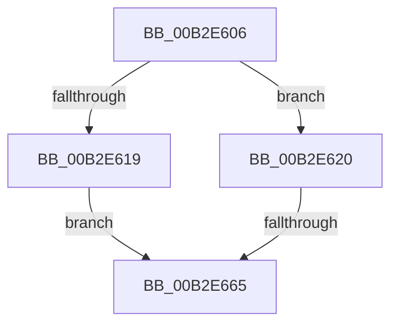

# sub_00B2E606

- RVA: `0x00B2E606`–`0x00B2E67B` (길이 `117` bytes)
- VA: `0x0000000140B2E606`
- 실행 섹션: `PAGE`
- PDB 이름 있음: `아니요`; PDB Function 태그: `아니요`
- unwind 정보 RVA: `0x0009EBC0`
- 디코드: `29`개 명령, `117/117` bytes 표시
- 미해석 바이트: `0` (있으면 어셈블리에 `.byte`로 보존)

> 이 문서는 커널 이미지의 기계어와 PDB 기호를 분석해 생성했습니다. 4번과 5번은 함수 원형과 자료형을 바이너리 사용 방식에서 추정한 C 해석이며 원본 소스 복구 결과는 아닙니다.

## 1. Dependencies

- 직접 호출 지점: **5**; 고유 호출 대상: **5**
- 직접 호출자로 확인된 함수: **0**
- RIP 상대 이미지 참조: **1**

### Outgoing calls
- `0x00B2E610` → [SeSinglePrivilegeCheck](../87/SeSinglePrivilegeCheck_function_00871E20.md) (function, `0x00871E20`)
- `0x00B2E631` → [PsReferencePrimaryTokenWithTag](../../text/20/PsReferencePrimaryTokenWithTag_function_0020FF80.md) (function, `0x0020FF80`)
- `0x00B2E644` → [PspAssignProcessQuotaBlock](../AE/PspAssignProcessQuotaBlock_function_00AE3124.md) (function, `0x00AE3124`)
- `0x00B2E658` → [ObFastDereferenceObject](../../text/3E/ObFastDereferenceObject_function_003ED5F0.md) (function, `0x003ED5F0`)
- `0x00B2E66F` → [ObfDereferenceObjectWithTag](../../text/2F/ObfDereferenceObjectWithTag_function_002F78E0.md) (function, `0x002F78E0`)

### Direct callers
- 이 함수 시작 RVA로 연결되는 직접 call은 확인되지 않았습니다. 간접 호출은 완전히 역산할 수 없습니다.

### Static image references
- `0x00B2E609` → RVA `0x00FD9B70` (`PAGEDATA`; read)

## 2. Other-region calls and transfers

- 다른 실행 섹션으로 향하는 call: **3**
  - `0x00B2E631` → [PsReferencePrimaryTokenWithTag](../../text/20/PsReferencePrimaryTokenWithTag_function_0020FF80.md) (`PAGE` → `.text`)
  - `0x00B2E658` → [ObFastDereferenceObject](../../text/3E/ObFastDereferenceObject_function_003ED5F0.md) (`PAGE` → `.text`)
  - `0x00B2E66F` → [ObfDereferenceObjectWithTag](../../text/2F/ObfDereferenceObjectWithTag_function_002F78E0.md) (`PAGE` → `.text`)
- call이 아닌 외부 분기/꼬리 이동: **2**
  - `0x00B2E65F` → [PspSetQuotaLimits + 0x3DF](../9B/PspSetQuotaLimits_function_009BA8A8.md) (`tail-transfer`)
  - `0x00B2E676` → [PspSetQuotaLimits + 0x3F1](../9B/PspSetQuotaLimits_function_009BA8A8.md) (`tail-transfer`)

## 3. Assembly (complete function range)

```asm
00B2E606  40 8A D6                        mov dl, sil
00B2E609  48 8B 0D 60 B5 4A 00            mov rcx, qword ptr [rip + 0x4ab560]
00B2E610  E8 0B 38 D4 FF                  call 0x140871e20
00B2E615  84 C0                           test al, al
00B2E617  75 07                           jne 0x140b2e620
00B2E619  BE 61 00 00 C0                  mov esi, 0xc0000061
00B2E61E  EB 45                           jmp 0x140b2e665
00B2E620  41 BF 44 66 6C 74               mov r15d, 0x746c6644
00B2E626  41 8B D7                        mov edx, r15d
00B2E629  48 8B 7C 24 48                  mov rdi, qword ptr [rsp + 0x48]
00B2E62E  48 8B CF                        mov rcx, rdi
00B2E631  E8 4A 19 6E FF                  call 0x14020ff80
00B2E636  48 8B D8                        mov rbx, rax
00B2E639  4C 8B C0                        mov r8, rax
00B2E63C  48 8B D7                        mov rdx, rdi
00B2E63F  48 8D 4C 24 60                  lea rcx, [rsp + 0x60]
00B2E644  E8 DB 4A FB FF                  call 0x140ae3124
00B2E649  8B F0                           mov esi, eax
00B2E64B  48 8D 8F 48 02 00 00            lea rcx, [rdi + 0x248]
00B2E652  45 8B C7                        mov r8d, r15d
00B2E655  48 8B D3                        mov rdx, rbx
00B2E658  E8 93 EF 8B FF                  call 0x1403ed5f0
00B2E65D  85 F6                           test esi, esi
00B2E65F  0F 89 22 C6 E8 FF               jns 0x1409bac87
00B2E665  BA 50 73 51 79                  mov edx, 0x79517350
00B2E66A  48 8B 4C 24 48                  mov rcx, qword ptr [rsp + 0x48]
00B2E66F  E8 6C 92 7C FF                  call 0x1402f78e0
00B2E674  8B C6                           mov eax, esi
00B2E676  E9 1E C6 E8 FF                  jmp 0x1409bac99
```

## 4. C-style interpretation (structured pseudocode)

```c
__int64 __fastcall sub_00B2E606(__int64 a1, __int64 a2, __int64 a3, __int64 a4, __int64 a5, __int64 a6, __int64 a7, __int64 a8, __int64 a9, __int64 a10, __int64 a11, __int64 a12)
{
    __int64 result;

    result = SeSinglePrivilegeCheck(*(unsigned __int64 *)(v_rip + 4896096), (unsigned __int8)(v_rsi), a3, a4);
    if ((unsigned __int8)(result) != 0) goto loc_00B2E620;
    goto loc_00B2E665;
loc_00B2E620:
    result = PsReferencePrimaryTokenWithTag(a9, (unsigned int)((unsigned int)((unsigned int)(0x746C6644ULL))), a3, a4);
    result = PspAssignProcessQuotaBlock(a12, a9, result, a4);
    result = ObFastDereferenceObject(a9 + 584, result, (unsigned int)((unsigned int)((unsigned int)(0x746C6644ULL))), a4);
loc_00B2E665:
    result = ObfDereferenceObjectWithTag(a9, (unsigned int)(0x79517350ULL), (unsigned int)((unsigned int)((unsigned int)(0x746C6644ULL))), a4);
}
```

## 5. (Beta) C Style

```c
int64_t sub_00B2E606(int64_t Arg1, int64_t Arg2, int64_t Arg3, int64_t Arg4, uint64_t Arg5, uint64_t Arg6, uint64_t Arg7, uint64_t Arg8, void *Arg9, uint64_t Arg10, uint64_t Arg11, int64_t Arg12)
{
    uint8_t *arg9 = (uint8_t *)Arg9;

    int64_t result;

    result = SeSinglePrivilegeCheck(*(uint64_t *)(v_rip + 0x4AB560), (uint8_t)(local_rsi), Arg3, Arg4);
    if ((uint8_t)(result) != 0) goto loc_00B2E620;
    goto loc_00B2E665;
loc_00B2E620:
    result = PsReferencePrimaryTokenWithTag(Arg9, (uint32_t)((uint32_t)((uint32_t)(0x746C6644ULL))), Arg3, Arg4);
    result = PspAssignProcessQuotaBlock(Arg12, Arg9, result, Arg4);
    result = ObFastDereferenceObject(Arg9 + 584, result, (uint32_t)((uint32_t)((uint32_t)(0x746C6644ULL))), Arg4);
loc_00B2E665:
    result = ObfDereferenceObjectWithTag(Arg9, (uint32_t)(0x79517350ULL), (uint32_t)((uint32_t)((uint32_t)(0x746C6644ULL))), Arg4);
}
```

### 관측된 메모리 오프셋

구조체 형식이 확인되지 않은 접근은 인자 기준의 오프셋으로만 기록했습니다.

| 기준 인자 | 오프셋 표현 | 폭 (bit) | 접근 |
|---|---:|---:|---|
| `Arg9` | `+ 0x248` | `64` | `R` |

## 6. Execution-region graph

[열기: 2D/3D 그래프와 함수 탐색 컨트롤 패널](../../../control-panel.html?section=page&rva=0x00B2E606&view=graph)

- 2D 그래프는 위에서 아래로 흐르고, 3D 그래프는 빈 공간을 드래그해 회전합니다. Shift+드래그는 이동, 휠은 확대·축소, 함수 노드 선택은 대상 보고서 이동입니다.

### Static fallback


