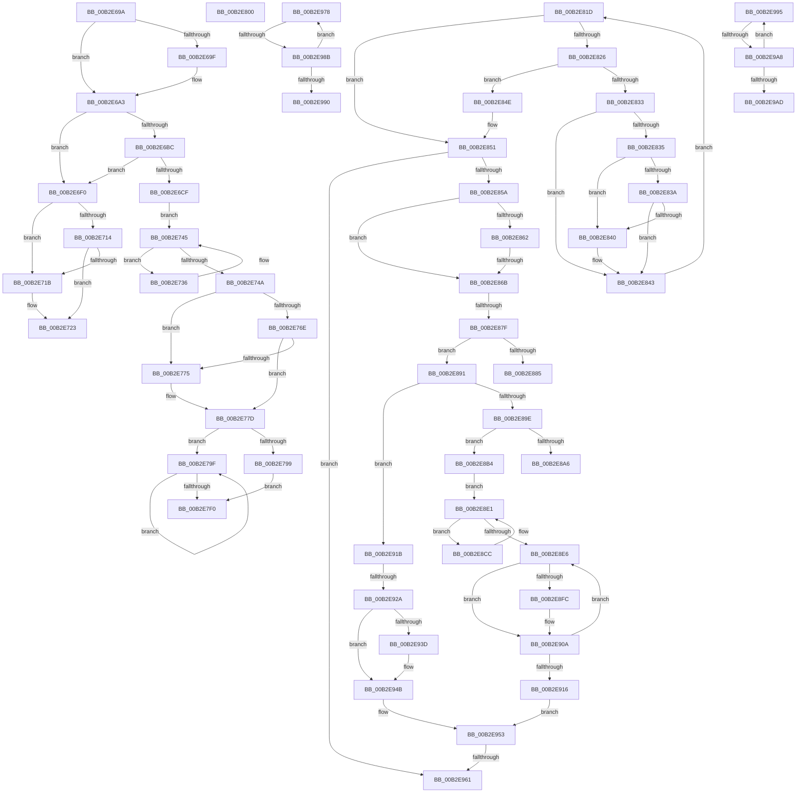

# sub_00B2E69A

- RVA: `0x00B2E69A`–`0x00B2E9B2` (길이 `792` bytes)
- VA: `0x0000000140B2E69A`
- 실행 섹션: `PAGE`
- PDB 이름 있음: `아니요`; PDB Function 태그: `아니요`
- unwind 정보 RVA: `0x0009F2B8`
- 디코드: `217`개 명령, `792/792` bytes 표시
- 미해석 바이트: `0` (있으면 어셈블리에 `.byte`로 보존)

> 이 문서는 커널 이미지의 기계어와 PDB 기호를 분석해 생성했습니다. 4번과 5번은 함수 원형과 자료형을 바이너리 사용 방식에서 추정한 C 해석이며 원본 소스 복구 결과는 아닙니다.

## 1. Dependencies

- 직접 호출 지점: **17**; 고유 호출 대상: **11**
- 직접 호출자로 확인된 함수: **0**
- RIP 상대 이미지 참조: **0**

### Outgoing calls
- `0x00B2E6C6` → [EtwpGetEnableInfoIndex](../../text/45/EtwpGetEnableInfoIndex_function_00452618.md) (function, `0x00452618`)
- `0x00B2E71E` → [ExfReleasePushLock](../../text/26/ExfReleasePushLock_function_002638D0.md) (function, `0x002638D0`)
- `0x00B2E726` → [KeAbPostRelease](../../text/2E/KeAbPostRelease_function_002E1600.md) (function, `0x002E1600`)
- `0x00B2E72B` → [KeLeaveCriticalRegion](../../text/25/KeLeaveCriticalRegion_function_0025D8B0.md) (function, `0x0025D8B0`)
- `0x00B2E73D` → [EtwpSendDataBlock](../8C/EtwpSendDataBlock_function_008C8530.md) (function, `0x008C8530`)
- `0x00B2E778` → [ExfReleasePushLock](../../text/26/ExfReleasePushLock_function_002638D0.md) (function, `0x002638D0`)
- `0x00B2E780` → [KeAbPostRelease](../../text/2E/KeAbPostRelease_function_002E1600.md) (function, `0x002E1600`)
- `0x00B2E785` → [KeLeaveCriticalRegion](../../text/25/KeLeaveCriticalRegion_function_0025D8B0.md) (function, `0x0025D8B0`)
- `0x00B2E7A6` → [EtwpWaitForBufferReferenceCount](../9B/EtwpWaitForBufferReferenceCount_function_009BDEC0.md) (function, `0x009BDEC0`)
- `0x00B2E7CB` → [EtwpFlushBuffer](../9B/EtwpFlushBuffer_function_009BF570.md) (function, `0x009BF570`)
- `0x00B2E7E3` → [guard_dispatch_icall](../../text/6B/guard_dispatch_icall_function_006BAAD0.md) (function, `0x006BAAD0`)
- `0x00B2E7F5` → [EtwpFinalizeHeader](../9C/EtwpFinalizeHeader_function_009C1EF0.md) (function, `0x009C1EF0`)
- `0x00B2E894` → [EtwpWaitForBufferReferenceCount](../9B/EtwpWaitForBufferReferenceCount_function_009BDEC0.md) (function, `0x009BDEC0`)
- `0x00B2E8F2` → [EtwpPrepareHeader](../9B/EtwpPrepareHeader_function_009BDD20.md) (function, `0x009BDD20`)
- `0x00B2E902` → [EtwpFlushBufferToLogfile](../9B/EtwpFlushBufferToLogfile_function_009BFC08.md) (function, `0x009BFC08`)
- `0x00B2E933` → [EtwpPrepareHeader](../9B/EtwpPrepareHeader_function_009BDD20.md) (function, `0x009BDD20`)
- `0x00B2E943` → [EtwpFlushBufferToLogfile](../9B/EtwpFlushBufferToLogfile_function_009BFC08.md) (function, `0x009BFC08`)

### Direct callers
- 이 함수 시작 RVA로 연결되는 직접 call은 확인되지 않았습니다. 간접 호출은 완전히 역산할 수 없습니다.

### Static image references
- 디코드된 RIP-relative 메모리 참조가 없습니다.

## 2. Other-region calls and transfers

- 다른 실행 섹션으로 향하는 call: **8**
  - `0x00B2E6C6` → [EtwpGetEnableInfoIndex](../../text/45/EtwpGetEnableInfoIndex_function_00452618.md) (`PAGE` → `.text`)
  - `0x00B2E71E` → [ExfReleasePushLock](../../text/26/ExfReleasePushLock_function_002638D0.md) (`PAGE` → `.text`)
  - `0x00B2E726` → [KeAbPostRelease](../../text/2E/KeAbPostRelease_function_002E1600.md) (`PAGE` → `.text`)
  - `0x00B2E72B` → [KeLeaveCriticalRegion](../../text/25/KeLeaveCriticalRegion_function_0025D8B0.md) (`PAGE` → `.text`)
  - `0x00B2E778` → [ExfReleasePushLock](../../text/26/ExfReleasePushLock_function_002638D0.md) (`PAGE` → `.text`)
  - `0x00B2E780` → [KeAbPostRelease](../../text/2E/KeAbPostRelease_function_002E1600.md) (`PAGE` → `.text`)
  - `0x00B2E785` → [KeLeaveCriticalRegion](../../text/25/KeLeaveCriticalRegion_function_0025D8B0.md) (`PAGE` → `.text`)
  - `0x00B2E7E3` → [guard_dispatch_icall](../../text/6B/guard_dispatch_icall_function_006BAAD0.md) (`PAGE` → `.text`)
- call이 아닌 외부 분기/꼬리 이동: **14**
  - `0x00B2E731` → [EtwpBufferingModeFlush + 0x2B0](../9B/EtwpBufferingModeFlush_function_009BD8F4.md) (`tail-transfer`)
  - `0x00B2E7FB` → [EtwpBufferingModeFlush + 0x19C](../9B/EtwpBufferingModeFlush_function_009BD8F4.md) (`tail-transfer`)
  - `0x00B2E818` → [EtwpBufferingModeFlush + 0xAB](../9B/EtwpBufferingModeFlush_function_009BD8F4.md) (`tail-transfer`)
  - `0x00B2E865` → [EtwpBufferingModeFlush + 0x205](../9B/EtwpBufferingModeFlush_function_009BD8F4.md) (`tail-transfer`)
  - `0x00B2E879` → [EtwpBufferingModeFlush + 0x205](../9B/EtwpBufferingModeFlush_function_009BD8F4.md) (`tail-transfer`)
  - `0x00B2E88C` → [EtwpBufferingModeFlush + 0x205](../9B/EtwpBufferingModeFlush_function_009BD8F4.md) (`tail-transfer`)
  - `0x00B2E8AF` → [EtwpBufferingModeFlush + 0x205](../9B/EtwpBufferingModeFlush_function_009BD8F4.md) (`tail-transfer`)
  - `0x00B2E924` → [EtwpBufferingModeFlush + 0x205](../9B/EtwpBufferingModeFlush_function_009BD8F4.md) (`tail-transfer`)
  - `0x00B2E95B` → [EtwpBufferingModeFlush + 0x205](../9B/EtwpBufferingModeFlush_function_009BD8F4.md) (`tail-transfer`)
  - `0x00B2E973` → [EtwpBufferingModeFlush + 0x29C](../9B/EtwpBufferingModeFlush_function_009BD8F4.md) (`tail-transfer`)
  - `0x00B2E985` → [EtwpBufferingModeFlush + 0x300](../9B/EtwpBufferingModeFlush_function_009BD8F4.md) (`tail-transfer`)
  - `0x00B2E990` → [EtwpBufferingModeFlush + 0x300](../9B/EtwpBufferingModeFlush_function_009BD8F4.md) (`tail-transfer`)
  - `0x00B2E9A2` → [EtwpBufferingModeFlush + 0x33B](../9B/EtwpBufferingModeFlush_function_009BD8F4.md) (`tail-transfer`)
  - `0x00B2E9AD` → [EtwpBufferingModeFlush + 0x33B](../9B/EtwpBufferingModeFlush_function_009BD8F4.md) (`tail-transfer`)

## 3. Assembly (complete function range)

```asm
00B2E69A  48 85 F6                        test rsi, rsi
00B2E69D  74 04                           je 0x140b2e6a3
00B2E69F  C6 46 0A 01                     mov byte ptr [rsi + 0xa], 1
00B2E6A3  65 48 8B 04 25 88 01 00 00      mov rax, qword ptr gs:[0x188]
00B2E6AC  4C 8D 7F 38                     lea r15, [rdi + 0x38]
00B2E6B0  48 89 87 A0 02 00 00            mov qword ptr [rdi + 0x2a0], rax
00B2E6B7  4D 39 3F                        cmp qword ptr [r15], r15
00B2E6BA  74 34                           je 0x140b2e6f0
00B2E6BC  41 8B 16                        mov edx, dword ptr [r14]
00B2E6BF  4C 8D 45 AB                     lea r8, [rbp - 0x55]
00B2E6C3  48 8B CF                        mov rcx, rdi
00B2E6C6  E8 4D 3F 92 FF                  call 0x140452618
00B2E6CB  84 C0                           test al, al
00B2E6CD  74 21                           je 0x140b2e6f0
00B2E6CF  C7 45 AF 03 00 00 00            mov dword ptr [rbp - 0x51], 3
00B2E6D6  0F B7 C2                        movzx eax, dx
00B2E6D9  C7 45 1F 02 00 00 00            mov dword ptr [rbp + 0x1f], 2
00B2E6E0  C7 45 F7 02 00 00 00            mov dword ptr [rbp - 9], 2
00B2E6E7  66 89 55 FD                     mov word ptr [rbp - 3], dx
00B2E6EB  49 8B 37                        mov rsi, qword ptr [r15]
00B2E6EE  EB 55                           jmp 0x140b2e745
00B2E6F0  4C 89 A7 A0 02 00 00            mov qword ptr [rdi + 0x2a0], r12
00B2E6F7  48 8B 03                        mov rax, qword ptr [rbx]
00B2E6FA  48 8B C8                        mov rcx, rax
00B2E6FD  48 83 E1 F0                     and rcx, 0xfffffffffffffff0
00B2E701  48 83 F9 10                     cmp rcx, 0x10
00B2E705  48 8D 50 F0                     lea rdx, [rax - 0x10]
00B2E709  49 0F 46 D4                     cmovbe rdx, r12
00B2E70D  A8 02                           test al, 2
00B2E70F  0F 0D 0B                        prefetchw byte ptr [rbx]
00B2E712  75 07                           jne 0x140b2e71b
00B2E714  F0 48 0F B1 13                  lock cmpxchg qword ptr [rbx], rdx
00B2E719  74 08                           je 0x140b2e723
00B2E71B  48 8B CB                        mov rcx, rbx
00B2E71E  E8 AD 51 73 FF                  call 0x1402638d0
00B2E723  48 8B CB                        mov rcx, rbx
00B2E726  E8 D5 2E 7B FF                  call 0x1402e1600
00B2E72B  E8 80 F1 72 FF                  call 0x14025d8b0
00B2E730  90                              nop
00B2E731  E9 6E F4 E8 FF                  jmp 0x1409bdba4
00B2E736  48 8D 55 AF                     lea rdx, [rbp - 0x51]
00B2E73A  48 8B CE                        mov rcx, rsi
00B2E73D  E8 EE 9D D9 FF                  call 0x1408c8530
00B2E742  48 8B 36                        mov rsi, qword ptr [rsi]
00B2E745  49 3B F7                        cmp rsi, r15
00B2E748  75 EC                           jne 0x140b2e736
00B2E74A  4C 89 A7 A0 02 00 00            mov qword ptr [rdi + 0x2a0], r12
00B2E751  0F 0D 0B                        prefetchw byte ptr [rbx]
00B2E754  48 8B 03                        mov rax, qword ptr [rbx]
00B2E757  48 8B C8                        mov rcx, rax
00B2E75A  48 83 E1 F0                     and rcx, 0xfffffffffffffff0
00B2E75E  48 83 F9 10                     cmp rcx, 0x10
00B2E762  48 8D 50 F0                     lea rdx, [rax - 0x10]
00B2E766  49 0F 46 D4                     cmovbe rdx, r12
00B2E76A  A8 02                           test al, 2
00B2E76C  75 07                           jne 0x140b2e775
00B2E76E  F0 48 0F B1 13                  lock cmpxchg qword ptr [rbx], rdx
00B2E773  74 08                           je 0x140b2e77d
00B2E775  48 8B CB                        mov rcx, rbx
00B2E778  E8 53 51 73 FF                  call 0x1402638d0
00B2E77D  48 8B CB                        mov rcx, rbx
00B2E780  E8 7B 2E 7B FF                  call 0x1402e1600
00B2E785  E8 26 F1 72 FF                  call 0x14025d8b0
00B2E78A  4D 8B FC                        mov r15, r12
00B2E78D  4D 87 BE 80 00 00 00            xchg qword ptr [r14 + 0x80], r15
00B2E794  4D 85 FF                        test r15, r15
00B2E797  75 06                           jne 0x140b2e79f
00B2E799  44 8B 6D A7                     mov r13d, dword ptr [rbp - 0x59]
00B2E79D  EB 51                           jmp 0x140b2e7f0
00B2E79F  49 8B 77 20                     mov rsi, qword ptr [r15 + 0x20]
00B2E7A3  49 8B CF                        mov rcx, r15
00B2E7A6  E8 15 F7 E8 FF                  call 0x1409bdec0
00B2E7AB  49 8B 7F 38                     mov rdi, qword ptr [r15 + 0x38]
00B2E7AF  45 8B C4                        mov r8d, r12d
00B2E7B2  49 8B 5F 40                     mov rbx, qword ptr [r15 + 0x40]
00B2E7B6  48 85 F6                        test rsi, rsi
00B2E7B9  49 8B D7                        mov rdx, r15
00B2E7BC  4D 89 67 38                     mov qword ptr [r15 + 0x38], r12
00B2E7C0  41 0F 94 C0                     sete r8b
00B2E7C4  4D 89 67 40                     mov qword ptr [r15 + 0x40], r12
00B2E7C8  49 8B CE                        mov rcx, r14
00B2E7CB  E8 A0 0D E9 FF                  call 0x1409bf570
00B2E7D0  44 8B E8                        mov r13d, eax
00B2E7D3  66 45 89 67 34                  mov word ptr [r15 + 0x34], r12w
00B2E7D8  8B C8                           mov ecx, eax
00B2E7DA  4C 8B C3                        mov r8, rbx
00B2E7DD  48 8B C7                        mov rax, rdi
00B2E7E0  49 8B D7                        mov rdx, r15
00B2E7E3  E8 E8 C2 B8 FF                  call 0x1406baad0
00B2E7E8  4C 8B FE                        mov r15, rsi
00B2E7EB  48 85 F6                        test rsi, rsi
00B2E7EE  75 AF                           jne 0x140b2e79f
00B2E7F0  33 D2                           xor edx, edx
00B2E7F2  49 8B CE                        mov rcx, r14
00B2E7F5  E8 F6 36 E9 FF                  call 0x1409c1ef0
00B2E7FA  90                              nop
00B2E7FB  E9 90 F2 E8 FF                  jmp 0x1409bda90
00B2E800  48 8B 80 40 11 00 00            mov rax, qword ptr [rax + 0x1140]
00B2E807  48 8B CB                        mov rcx, rbx
00B2E80A  48 C1 E1 06                     shl rcx, 6
00B2E80E  48 8B 0C 01                     mov rcx, qword ptr [rcx + rax]
00B2E812  4E 8D 04 E1                     lea r8, [rcx + r12*8]
00B2E816  33 FF                           xor edi, edi
00B2E818  E9 82 F1 E8 FF                  jmp 0x1409bd99f
00B2E81D  49 0F 44 C9                     cmove rcx, r9
00B2E821  48 85 C9                        test rcx, rcx
00B2E824  74 2B                           je 0x140b2e851
00B2E826  48 8B 41 10                     mov rax, qword ptr [rcx + 0x10]
00B2E82A  48 8B 50 18                     mov rdx, qword ptr [rax + 0x18]
00B2E82E  49 3B D7                        cmp rdx, r15
00B2E831  74 1B                           je 0x140b2e84e
00B2E833  7D 0E                           jge 0x140b2e843
00B2E835  48 85 DB                        test rbx, rbx
00B2E838  74 06                           je 0x140b2e840
00B2E83A  48 3B 53 18                     cmp rdx, qword ptr [rbx + 0x18]
00B2E83E  7E 03                           jle 0x140b2e843
00B2E840  48 8B D8                        mov rbx, rax
00B2E843  48 8B 01                        mov rax, qword ptr [rcx]
00B2E846  48 8B C8                        mov rcx, rax
00B2E849  49 3B C0                        cmp rax, r8
00B2E84C  EB CF                           jmp 0x140b2e81d
00B2E84E  48 8B D8                        mov rbx, rax
00B2E851  48 85 DB                        test rbx, rbx
00B2E854  0F 84 07 01 00 00               je 0x140b2e961
00B2E85A  8B 73 2C                        mov esi, dword ptr [rbx + 0x2c]
00B2E85D  83 FE 05                        cmp esi, 5
00B2E860  74 09                           je 0x140b2e86b
00B2E862  83 FE 04                        cmp esi, 4
00B2E865  0F 85 8E F2 E8 FF               jne 0x1409bdaf9
00B2E86B  8B C6                           mov eax, esi
00B2E86D  B9 03 00 00 00                  mov ecx, 3
00B2E872  F0 0F B1 4B 2C                  lock cmpxchg dword ptr [rbx + 0x2c], ecx
00B2E877  8B F8                           mov edi, eax
00B2E879  0F 85 7A F2 E8 FF               jne 0x1409bdaf9
00B2E87F  4C 39 7B 18                     cmp qword ptr [rbx + 0x18], r15
00B2E883  74 0C                           je 0x140b2e891
00B2E885  8B C1                           mov eax, ecx
00B2E887  F0 0F B1 73 2C                  lock cmpxchg dword ptr [rbx + 0x2c], esi
00B2E88C  E9 68 F2 E8 FF                  jmp 0x1409bdaf9
00B2E891  48 8B CB                        mov rcx, rbx
00B2E894  E8 27 F6 E8 FF                  call 0x1409bdec0
00B2E899  83 FF 05                        cmp edi, 5
00B2E89C  75 7D                           jne 0x140b2e91b
00B2E89E  8B 43 08                        mov eax, dword ptr [rbx + 8]
00B2E8A1  83 F8 48                        cmp eax, 0x48
00B2E8A4  75 0E                           jne 0x140b2e8b4
00B2E8A6  45 33 C9                        xor r9d, r9d
00B2E8A9  41 8B C1                        mov eax, r9d
00B2E8AC  87 43 2C                        xchg dword ptr [rbx + 0x2c], eax
00B2E8AF  E9 45 F2 E8 FF                  jmp 0x1409bdaf9
00B2E8B4  8B 53 08                        mov edx, dword ptr [rbx + 8]
00B2E8B7  48 8D 7B 48                     lea rdi, [rbx + 0x48]
00B2E8BB  48 03 D3                        add rdx, rbx
00B2E8BE  48 83 67 20 00                  and qword ptr [rdi + 0x20], 0
00B2E8C3  44 8B 07                        mov r8d, dword ptr [rdi]
00B2E8C6  4A 8D 04 07                     lea rax, [rdi + r8]
00B2E8CA  EB 15                           jmp 0x140b2e8e1
00B2E8CC  41 8B C0                        mov eax, r8d
00B2E8CF  48 8B CF                        mov rcx, rdi
00B2E8D2  48 03 F8                        add rdi, rax
00B2E8D5  48 89 4F 20                     mov qword ptr [rdi + 0x20], rcx
00B2E8D9  8B 07                           mov eax, dword ptr [rdi]
00B2E8DB  44 8B C0                        mov r8d, eax
00B2E8DE  48 03 C7                        add rax, rdi
00B2E8E1  48 3B C2                        cmp rax, rdx
00B2E8E4  72 E6                           jb 0x140b2e8cc
00B2E8E6  41 B8 40 00 00 00               mov r8d, 0x40
00B2E8EC  48 8B D7                        mov rdx, rdi
00B2E8EF  49 8B CE                        mov rcx, r14
00B2E8F2  E8 29 F4 E8 FF                  call 0x1409bdd20
00B2E8F7  41 3B C4                        cmp eax, r12d
00B2E8FA  74 0E                           je 0x140b2e90a
00B2E8FC  48 8B D7                        mov rdx, rdi
00B2E8FF  49 8B CE                        mov rcx, r14
00B2E902  E8 01 13 E9 FF                  call 0x1409bfc08
00B2E907  44 8B E8                        mov r13d, eax
00B2E90A  48 8B 7F 20                     mov rdi, qword ptr [rdi + 0x20]
00B2E90E  45 33 C9                        xor r9d, r9d
00B2E911  48 85 FF                        test rdi, rdi
00B2E914  75 D0                           jne 0x140b2e8e6
00B2E916  8D 47 05                        lea eax, [rdi + 5]
00B2E919  EB 38                           jmp 0x140b2e953
00B2E91B  41 B9 00 00 00 00               mov r9d, 0
00B2E921  83 FF 04                        cmp edi, 4
00B2E924  0F 85 CF F1 E8 FF               jne 0x1409bdaf9
00B2E92A  45 33 C0                        xor r8d, r8d
00B2E92D  48 8B D3                        mov rdx, rbx
00B2E930  49 8B CE                        mov rcx, r14
00B2E933  E8 E8 F3 E8 FF                  call 0x1409bdd20
00B2E938  41 3B C4                        cmp eax, r12d
00B2E93B  74 0E                           je 0x140b2e94b
00B2E93D  48 8B D3                        mov rdx, rbx
00B2E940  49 8B CE                        mov rcx, r14
00B2E943  E8 C0 12 E9 FF                  call 0x1409bfc08
00B2E948  44 8B E8                        mov r13d, eax
00B2E94B  B8 04 00 00 00                  mov eax, 4
00B2E950  45 33 C9                        xor r9d, r9d
00B2E953  F0 0F B1 73 2C                  lock cmpxchg dword ptr [rbx + 0x2c], esi
00B2E958  45 85 ED                        test r13d, r13d
00B2E95B  0F 89 98 F1 E8 FF               jns 0x1409bdaf9
00B2E961  44 89 6D A7                     mov dword ptr [rbp - 0x59], r13d
00B2E965  49 8D 9E 38 06 00 00            lea rbx, [r14 + 0x638]
00B2E96C  49 83 CD FF                     or r13, 0xffffffffffffffff
00B2E970  45 33 E4                        xor r12d, r12d
00B2E973  E9 18 F2 E8 FF                  jmp 0x1409bdb90
00B2E978  49 8B 8E 30 06 00 00            mov rcx, qword ptr [r14 + 0x630]
00B2E97F  F0 4E 0F B1 0C D9               lock cmpxchg qword ptr [rcx + r11*8], r9
00B2E985  0F 84 69 F2 E8 FF               je 0x1409bdbf4
00B2E98B  4C 3B C8                        cmp r9, rax
00B2E98E  7F E8                           jg 0x140b2e978
00B2E990  E9 5F F2 E8 FF                  jmp 0x1409bdbf4
00B2E995  49 8B 8E 30 06 00 00            mov rcx, qword ptr [r14 + 0x630]
00B2E99C  F0 4E 0F B1 04 D1               lock cmpxchg qword ptr [rcx + r10*8], r8
00B2E9A2  0F 84 87 F2 E8 FF               je 0x1409bdc2f
00B2E9A8  4C 3B C0                        cmp r8, rax
00B2E9AB  7F E8                           jg 0x140b2e995
00B2E9AD  E9 7D F2 E8 FF                  jmp 0x1409bdc2f
```

## 4. C-style interpretation (structured pseudocode)

```c
__int64 __fastcall sub_00B2E69A(__int64 a1, __int64 a2, __int64 a3, __int64 a4)
{
    __int64 result;

    if (v_rsi != 0) {
        *(unsigned __int8 *)(v_rsi + 10) = 1;
    }
    *(unsigned __int64 *)(v_rdi + 672) = *(unsigned __int64 *)(gs_base + (0 + 392));
    if ((*(unsigned __int64 *)(v_rdi + 56)) == (v_rdi + 56)) goto loc_00B2E6F0;
    result = EtwpGetEnableInfoIndex(v_rdi, (unsigned int)(*(unsigned int *)(v_r14)), v_rbp - 85, a4);
    if ((unsigned __int8)(result) == 0) goto loc_00B2E6F0;
    *(unsigned int *)(v_rbp - 81) = 3;
    *(unsigned int *)(v_rbp + 31) = 2;
    *(unsigned int *)(v_rbp - 9) = 2;
    *(unsigned __int16 *)(v_rbp - 3) = (unsigned __int16)((unsigned int)(*(unsigned int *)(v_r14)));
    goto loc_00B2E745;
loc_00B2E6F0:
    *(unsigned __int64 *)(v_rdi + 672) = v_r12;
    a1 = (*(unsigned __int64 *)(v_rbx)) & (-16);
    a2 = *(unsigned __int64 *)(v_rbx) - 16;
    if (a1 <= 16) { a2 = v_r12; }
    if ((((unsigned __int8)(*(unsigned __int64 *)(v_rbx))) & (2)) != 0) goto loc_00B2E71B;
    result = *(unsigned __int64 *)(v_rbx);
    if ((((unsigned __int8)(*(unsigned __int64 *)(v_rbx))) & (2)) != 0) {
        a1 = v_rbx;
        result = ExfReleasePushLock(a1, a2, v_rbp - 85, a4);
    }
    result = KeAbPostRelease(v_rbx, a2, v_rbp - 85, a4);
    result = KeLeaveCriticalRegion(v_rbx, a2, v_rbp - 85, a4);
loc_00B2E736:
    result = EtwpSendDataBlock(*(unsigned __int64 *)(v_rdi + 56), v_rbp - 81, v_rbp - 85, a4);
loc_00B2E745:
    if ((*(unsigned __int64 *)(*(unsigned __int64 *)(v_rdi + 56))) != (v_rdi + 56)) goto loc_00B2E736;
    *(unsigned __int64 *)(v_rdi + 672) = v_r12;
    a1 = (*(unsigned __int64 *)(v_rbx)) & (-16);
    a2 = *(unsigned __int64 *)(v_rbx) - 16;
    if (a1 <= 16) { a2 = v_r12; }
    if ((((unsigned __int8)(*(unsigned __int64 *)(v_rbx))) & (2)) != 0) goto loc_00B2E775;
    result = *(unsigned __int64 *)(v_rbx);
    if ((((unsigned __int8)(*(unsigned __int64 *)(v_rbx))) & (2)) != 0) {
        a1 = v_rbx;
        result = ExfReleasePushLock(a1, a2, v_rbp - 85, a4);
    }
    result = KeAbPostRelease(v_rbx, a2, v_rbp - 85, a4);
    result = KeLeaveCriticalRegion(v_rbx, a2, v_rbp - 85, a4);
    if (v_r12 != 0) goto loc_00B2E79F;
    goto loc_00B2E7F0;
loc_00B2E79F:
    result = EtwpWaitForBufferReferenceCount(v_r12, a2, v_rbp - 85, a4);
    *(unsigned __int64 *)(v_r12 + 56) = v_r12;
    a3 = (*(unsigned __int64 *)(v_r12 + 32) == 0) ? 1 : 0;
    *(unsigned __int64 *)(v_r12 + 64) = v_r12;
    result = EtwpFlushBuffer(v_r14, v_r12, a3, a4);
    *(unsigned __int16 *)(v_r12 + 52) = (unsigned __int16)(v_r12);
    result = guard_dispatch_icall((unsigned int)((unsigned int)(result)), v_r12, *(unsigned __int64 *)(v_r12 + 64), a4);
    if (*(unsigned __int64 *)(v_r12 + 32) != 0) goto loc_00B2E79F;
loc_00B2E7F0:
    a2 = 0;
    result = EtwpFinalizeHeader(v_r14, a2, *(unsigned __int64 *)(v_r12 + 64), a4);
}
```

## 5. (Beta) C Style

```c
int64_t sub_00B2E69A(int64_t Arg1, int64_t Arg2, int64_t Arg3, int64_t Arg4)
{
    int64_t result;

    if (local_rsi != 0) {
        *(uint8_t *)(local_rsi + 0xA) = 1;
    }
    *(uint64_t *)(local_rdi + 0x2A0) = *(uint64_t *)(gs_base + (0 + 0x188));
    if ((*(uint64_t *)(local_rdi + 0x38)) == (local_rdi + 56)) goto loc_00B2E6F0;
    result = EtwpGetEnableInfoIndex(local_rdi, (uint32_t)(*(uint32_t *)(local_r14)), local_rbp - 85, Arg4);
    if ((uint8_t)(result) == 0) goto loc_00B2E6F0;
    *(uint32_t *)(local_rbp - 0x51) = 3;
    *(uint32_t *)(local_rbp + 0x1F) = 2;
    *(uint32_t *)(local_rbp - 0x9) = 2;
    *(uint16_t *)(local_rbp - 0x3) = (uint16_t)((uint32_t)(*(uint32_t *)(local_r14)));
    goto loc_00B2E745;
loc_00B2E6F0:
    *(uint64_t *)(local_rdi + 0x2A0) = local_r12;
    Arg1 = (*(uint64_t *)(local_rbx)) & (-16);
    Arg2 = *(uint64_t *)(local_rbx) - 16;
    if (Arg1 <= 16) { Arg2 = local_r12; }
    if ((((uint8_t)(*(uint64_t *)(local_rbx))) & (2)) != 0) goto loc_00B2E71B;
    result = *(uint64_t *)(local_rbx);
    if ((((uint8_t)(*(uint64_t *)(local_rbx))) & (2)) != 0) {
        Arg1 = local_rbx;
        result = ExfReleasePushLock(Arg1, Arg2, local_rbp - 85, Arg4);
    }
    result = KeAbPostRelease(local_rbx, Arg2, local_rbp - 85, Arg4);
    result = KeLeaveCriticalRegion(local_rbx, Arg2, local_rbp - 85, Arg4);
loc_00B2E736:
    result = EtwpSendDataBlock(*(uint64_t *)(local_rdi + 0x38), local_rbp - 81, local_rbp - 85, Arg4);
loc_00B2E745:
    if ((*(uint64_t *)(*(uint64_t *)(local_rdi + 0x38))) != (local_rdi + 56)) goto loc_00B2E736;
    *(uint64_t *)(local_rdi + 0x2A0) = local_r12;
    Arg1 = (*(uint64_t *)(local_rbx)) & (-16);
    Arg2 = *(uint64_t *)(local_rbx) - 16;
    if (Arg1 <= 16) { Arg2 = local_r12; }
    if ((((uint8_t)(*(uint64_t *)(local_rbx))) & (2)) != 0) goto loc_00B2E775;
    result = *(uint64_t *)(local_rbx);
    if ((((uint8_t)(*(uint64_t *)(local_rbx))) & (2)) != 0) {
        Arg1 = local_rbx;
        result = ExfReleasePushLock(Arg1, Arg2, local_rbp - 85, Arg4);
    }
    result = KeAbPostRelease(local_rbx, Arg2, local_rbp - 85, Arg4);
    result = KeLeaveCriticalRegion(local_rbx, Arg2, local_rbp - 85, Arg4);
    if (local_r12 != 0) goto loc_00B2E79F;
    goto loc_00B2E7F0;
loc_00B2E79F:
    result = EtwpWaitForBufferReferenceCount(local_r12, Arg2, local_rbp - 85, Arg4);
    *(uint64_t *)(local_r12 + 0x38) = local_r12;
    Arg3 = (*(uint64_t *)(local_r12 + 0x20) == 0) ? 1 : 0;
    *(uint64_t *)(local_r12 + 0x40) = local_r12;
    result = EtwpFlushBuffer(local_r14, local_r12, Arg3, Arg4);
    *(uint16_t *)(local_r12 + 0x34) = (uint16_t)(local_r12);
    result = guard_dispatch_icall((uint32_t)((uint32_t)(result)), local_r12, *(uint64_t *)(local_r12 + 0x40), Arg4);
    if (*(uint64_t *)(local_r12 + 0x20) != 0) goto loc_00B2E79F;
loc_00B2E7F0:
    Arg2 = 0;
    result = EtwpFinalizeHeader(local_r14, Arg2, *(uint64_t *)(local_r12 + 0x40), Arg4);
}
```

## 6. Execution-region graph

[열기: 2D/3D 그래프와 함수 탐색 컨트롤 패널](../../../control-panel.html?section=page&rva=0x00B2E69A&view=graph)

- 2D 그래프는 위에서 아래로 흐르고, 3D 그래프는 빈 공간을 드래그해 회전합니다. Shift+드래그는 이동, 휠은 확대·축소, 함수 노드 선택은 대상 보고서 이동입니다.

### Static fallback


