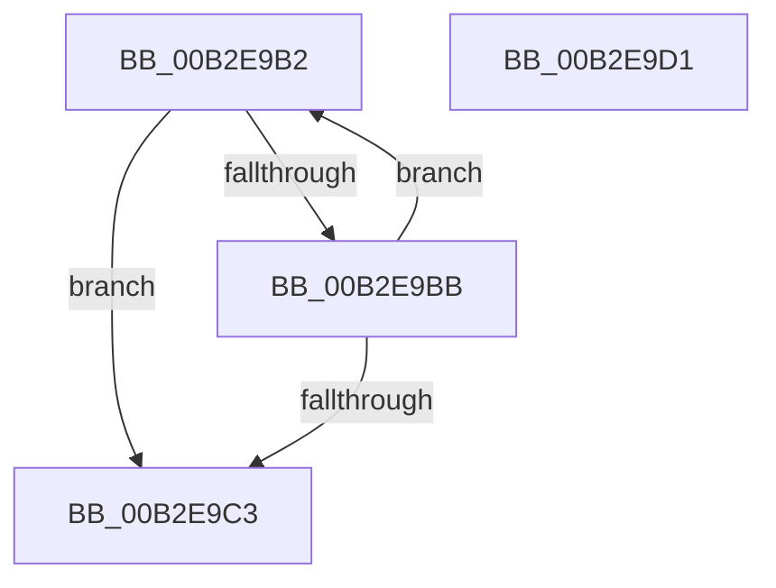

# sub_00B2E9B2

- RVA: `0x00B2E9B2`–`0x00B2E9E9` (길이 `55` bytes)
- VA: `0x0000000140B2E9B2`
- 실행 섹션: `PAGE`
- PDB 이름 있음: `아니요`; PDB Function 태그: `아니요`
- unwind 정보 RVA: `0x0009F304`
- 디코드: `15`개 명령, `55/55` bytes 표시
- 미해석 바이트: `0` (있으면 어셈블리에 `.byte`로 보존)

> 이 문서는 커널 이미지의 기계어와 PDB 기호를 분석해 생성했습니다. 4번과 5번은 함수 원형과 자료형을 바이너리 사용 방식에서 추정한 C 해석이며 원본 소스 복구 결과는 아닙니다.

## 1. Dependencies

- 직접 호출 지점: **1**; 고유 호출 대상: **1**
- 직접 호출자로 확인된 함수: **0**
- RIP 상대 이미지 참조: **0**

### Outgoing calls
- `0x00B2E9DC` → [EtwpEnqueueAvailableBuffer](../../text/2F/EtwpEnqueueAvailableBuffer_function_002FE7DC.md) (function, `0x002FE7DC`)

### Direct callers
- 이 함수 시작 RVA로 연결되는 직접 call은 확인되지 않았습니다. 간접 호출은 완전히 역산할 수 없습니다.

### Static image references
- 디코드된 RIP-relative 메모리 참조가 없습니다.

## 2. Other-region calls and transfers

- 다른 실행 섹션으로 향하는 call: **1**
  - `0x00B2E9DC` → [EtwpEnqueueAvailableBuffer](../../text/2F/EtwpEnqueueAvailableBuffer_function_002FE7DC.md) (`PAGE` → `.text`)
- call이 아닌 외부 분기/꼬리 이동: **2**
  - `0x00B2E9CC` → [EtwpFlushActiveBuffers + 0x297](../9B/EtwpFlushActiveBuffers_function_009BDEF4.md) (`tail-transfer`)
  - `0x00B2E9E4` → [EtwpFlushActiveBuffers + 0x337](../9B/EtwpFlushActiveBuffers_function_009BDEF4.md) (`tail-transfer`)

## 3. Assembly (complete function range)

```asm
00B2E9B2  48 8B 48 20                     mov rcx, qword ptr [rax + 0x20]
00B2E9B6  48 3B CB                        cmp rcx, rbx
00B2E9B9  74 08                           je 0x140b2e9c3
00B2E9BB  48 8B C1                        mov rax, rcx
00B2E9BE  48 85 C9                        test rcx, rcx
00B2E9C1  75 EF                           jne 0x140b2e9b2
00B2E9C3  4C 89 40 20                     mov qword ptr [rax + 0x20], r8
00B2E9C7  C6 44 24 20 01                  mov byte ptr [rsp + 0x20], 1
00B2E9CC  E9 BA F7 E8 FF                  jmp 0x1409be18b
00B2E9D1  66 44 89 42 34                  mov word ptr [rdx + 0x34], r8w
00B2E9D6  48 8B CF                        mov rcx, rdi
00B2E9D9  45 33 C0                        xor r8d, r8d
00B2E9DC  E8 FB FD 7C FF                  call 0x1402fe7dc
00B2E9E1  45 33 C0                        xor r8d, r8d
00B2E9E4  E9 42 F8 E8 FF                  jmp 0x1409be22b
```

## 4. C-style interpretation (structured pseudocode)

```c
__int64 __fastcall sub_00B2E9B2(__int64 a1, __int64 a2, __int64 a3)
{
    unsigned __int8 v_stack_p20;

    if ((*(unsigned __int64 *)(result + 32)) == v_rbx) goto loc_00B2E9C3;
    if (*(unsigned __int64 *)(result + 32) != 0) goto loc_00B2E9B2;
loc_00B2E9C3:
    *(unsigned __int64 *)(*(unsigned __int64 *)(result + 32) + 32) = a3;
    v_stack_p20 = 1;
}
```

## 5. (Beta) C Style

```c
int64_t sub_00B2E9B2(int64_t Arg1, int64_t Arg2, int64_t Arg3)
{
    uint8_t v_stack_p20;

    if ((*(uint64_t *)(result + 0x20)) == local_rbx) goto loc_00B2E9C3;
    if (*(uint64_t *)(result + 0x20) != 0) goto loc_00B2E9B2;
loc_00B2E9C3:
    *(uint64_t *)(*(uint64_t *)(result + 0x20) + 0x20) = Arg3;
    v_stack_p20 = 1;
}
```

## 6. Execution-region graph

[열기: 2D/3D 그래프와 함수 탐색 컨트롤 패널](../../../control-panel.html?section=page&rva=0x00B2E9B2&view=graph)

- 2D 그래프는 위에서 아래로 흐르고, 3D 그래프는 빈 공간을 드래그해 회전합니다. Shift+드래그는 이동, 휠은 확대·축소, 함수 노드 선택은 대상 보고서 이동입니다.

### Static fallback


