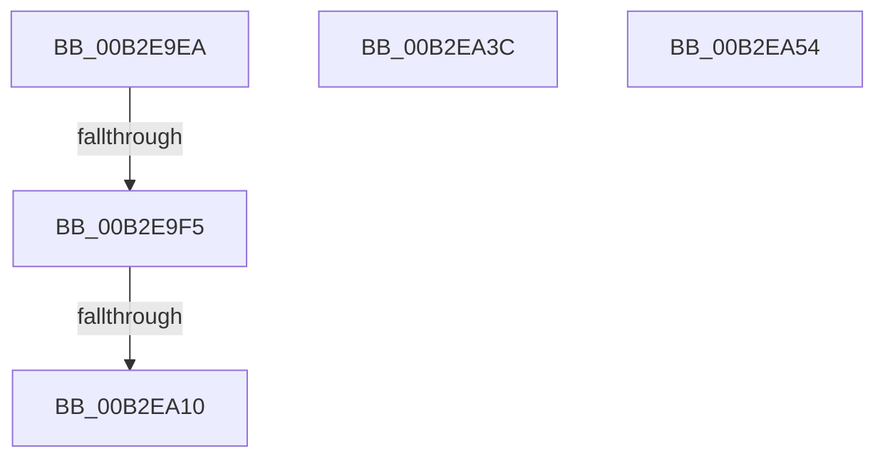

# sub_00B2E9EA

- RVA: `0x00B2E9EA`–`0x00B2EA5E` (길이 `116` bytes)
- VA: `0x0000000140B2E9EA`
- 실행 섹션: `PAGE`
- PDB 이름 있음: `아니요`; PDB Function 태그: `아니요`
- unwind 정보 RVA: `0x0009F33C`
- 디코드: `24`개 명령, `116/116` bytes 표시
- 미해석 바이트: `0` (있으면 어셈블리에 `.byte`로 보존)

> 이 문서는 커널 이미지의 기계어와 PDB 기호를 분석해 생성했습니다. 4번과 5번은 함수 원형과 자료형을 바이너리 사용 방식에서 추정한 C 해석이며 원본 소스 복구 결과는 아닙니다.

## 1. Dependencies

- 직접 호출 지점: **3**; 고유 호출 대상: **3**
- 직접 호출자로 확인된 함수: **0**
- RIP 상대 이미지 참조: **2**

### Outgoing calls
- `0x00B2EA03` → [EtwEventEnabled](../../text/39/EtwEventEnabled_function_00392450.md) (function, `0x00392450`)
- `0x00B2EA31` → [EtwpEventWriteTemplateAdmin](../AA/EtwpEventWriteTemplateAdmin_function_00AA5880.md) (function, `0x00AA5880`)
- `0x00B2EA43` → [ZwClose](../../text/6A/ZwClose_function_006AD2B0.md) (function, `0x006AD2B0`)

### Direct callers
- 이 함수 시작 RVA로 연결되는 직접 call은 확인되지 않았습니다. 간접 호출은 완전히 역산할 수 없습니다.

### Static image references
- `0x00B2E9F5` → RVA `0x00EFF840` (`.data`; read)
- `0x00B2E9FC` → RVA `0x00022A40` (`.rdata`; read)

## 2. Other-region calls and transfers

- 다른 실행 섹션으로 향하는 call: **2**
  - `0x00B2EA03` → [EtwEventEnabled](../../text/39/EtwEventEnabled_function_00392450.md) (`PAGE` → `.text`)
  - `0x00B2EA43` → [ZwClose](../../text/6A/ZwClose_function_006AD2B0.md) (`PAGE` → `.text`)
- call이 아닌 외부 분기/꼬리 이동: **5**
  - `0x00B2E9EF` → [EtwpLogger + 0x340](../9B/EtwpLogger_function_009BE310.md) (`tail-transfer`)
  - `0x00B2EA0A` → [EtwpLogger + 0x340](../9B/EtwpLogger_function_009BE310.md) (`tail-transfer`)
  - `0x00B2EA37` → [EtwpLogger + 0x340](../9B/EtwpLogger_function_009BE310.md) (`tail-transfer`)
  - `0x00B2EA4F` → [EtwpLogger + 0x20A](../9B/EtwpLogger_function_009BE310.md) (`tail-transfer`)
  - `0x00B2EA59` → [EtwpLogger + 0x3E8](../9B/EtwpLogger_function_009BE310.md) (`tail-transfer`)

## 3. Assembly (complete function range)

```asm
00B2E9EA  8B 43 0C                        mov eax, dword ptr [rbx + 0xc]
00B2E9ED  A8 08                           test al, 8
00B2E9EF  0F 84 5B FC E8 FF               je 0x1409be650
00B2E9F5  48 8B 0D 44 0E 3D 00            mov rcx, qword ptr [rip + 0x3d0e44]
00B2E9FC  48 8D 15 3D 40 4F FF            lea rdx, [rip - 0xb0bfc3]
00B2EA03  E8 48 3A 86 FF                  call 0x140392450
00B2EA08  84 C0                           test al, al
00B2EA0A  0F 84 40 FC E8 FF               je 0x1409be650
00B2EA10  8B 43 0C                        mov eax, dword ptr [rbx + 0xc]
00B2EA13  48 8D 8B 98 00 00 00            lea rcx, [rbx + 0x98]
00B2EA1A  89 44 24 30                     mov dword ptr [rsp + 0x30], eax
00B2EA1E  48 8D 15 1B 40 4F FF            lea rdx, [rip - 0xb0bfe5]
00B2EA25  89 7C 24 28                     mov dword ptr [rsp + 0x28], edi
00B2EA29  4D 8B CC                        mov r9, r12
00B2EA2C  48 89 4C 24 20                  mov qword ptr [rsp + 0x20], rcx
00B2EA31  E8 4A 6E F7 FF                  call 0x140aa5880
00B2EA36  90                              nop
00B2EA37  E9 14 FC E8 FF                  jmp 0x1409be650
00B2EA3C  48 8B 8B 20 03 00 00            mov rcx, qword ptr [rbx + 0x320]
00B2EA43  E8 68 E8 B7 FF                  call 0x1406ad2b0
00B2EA48  48 89 AB 20 03 00 00            mov qword ptr [rbx + 0x320], rbp
00B2EA4F  E9 C6 FA E8 FF                  jmp 0x1409be51a
00B2EA54  BF 01 00 00 C0                  mov edi, 0xc0000001
00B2EA59  E9 9A FC E8 FF                  jmp 0x1409be6f8
```

## 4. C-style interpretation (structured pseudocode)

```c
__int64 __fastcall sub_00B2E9EA(void)
{
    __int64 result;
    unsigned __int64 v_stack_p20;
    unsigned int v_stack_p28;
    unsigned int v_stack_p30;

    result = EtwEventEnabled(*(unsigned __int64 *)(v_rip + 4001348), v_rip - 11583427, a3, a4);
    v_stack_p30 = (unsigned int)((unsigned int)(*(unsigned int *)(v_rbx + 12)));
    v_stack_p28 = (unsigned int)(v_rdi);
    v_stack_p20 = v_rbx + 152;
    result = EtwpEventWriteTemplateAdmin(v_rbx + 152, v_rip - 11583461, a3, v_r12);
}
```

## 5. (Beta) C Style

```c
void sub_00B2E9EA(void)
{
    int64_t result;
    uint64_t v_stack_p20;
    uint32_t v_stack_p28;
    uint32_t v_stack_p30;

    result = EtwEventEnabled(*(uint64_t *)(v_rip + 0x3D0E44), v_rip - 11583427, a3, a4);
    v_stack_p30 = (uint32_t)((uint32_t)(*(uint32_t *)(local_rbx + 0xC)));
    v_stack_p28 = (uint32_t)(local_rdi);
    v_stack_p20 = local_rbx + 152;
    result = EtwpEventWriteTemplateAdmin(local_rbx + 152, v_rip - 11583461, a3, local_r12);
}
```

## 6. Execution-region graph

[열기: 2D/3D 그래프와 함수 탐색 컨트롤 패널](../../../control-panel.html?section=page&rva=0x00B2E9EA&view=graph)

- 2D 그래프는 위에서 아래로 흐르고, 3D 그래프는 빈 공간을 드래그해 회전합니다. Shift+드래그는 이동, 휠은 확대·축소, 함수 노드 선택은 대상 보고서 이동입니다.

### Static fallback


