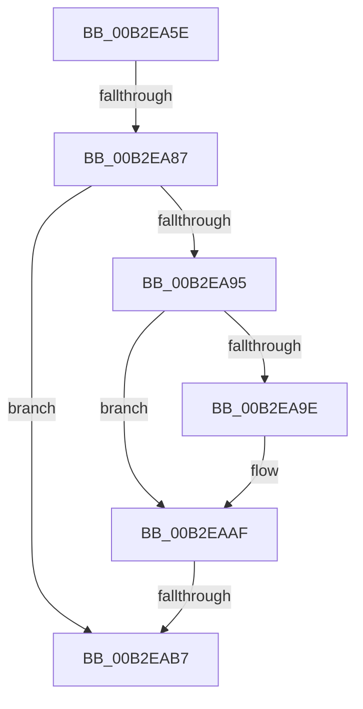

# sub_00B2EA5E

- RVA: `0x00B2EA5E`–`0x00B2EB06` (길이 `168` bytes)
- VA: `0x0000000140B2EA5E`
- 실행 섹션: `PAGE`
- PDB 이름 있음: `아니요`; PDB Function 태그: `아니요`
- unwind 정보 RVA: `0x0009F378`
- 디코드: `35`개 명령, `168/168` bytes 표시
- 미해석 바이트: `0` (있으면 어셈블리에 `.byte`로 보존)

> 이 문서는 커널 이미지의 기계어와 PDB 기호를 분석해 생성했습니다. 4번과 5번은 함수 원형과 자료형을 바이너리 사용 방식에서 추정한 C 해석이며 원본 소스 복구 결과는 아닙니다.

## 1. Dependencies

- 직접 호출 지점: **5**; 고유 호출 대상: **5**
- 직접 호출자로 확인된 함수: **0**
- RIP 상대 이미지 참조: **0**

### Outgoing calls
- `0x00B2EA8A` → [EtwpRealtimeRestoreState](../AC/EtwpRealtimeRestoreState_function_00AC6A74.md) (function, `0x00AC6A74`)
- `0x00B2EAA8` → [EtwpRealtimeUpdateReferenceTime](../7C/EtwpRealtimeUpdateReferenceTime_function_007C0CC0.md) (function, `0x007C0CC0`)
- `0x00B2EABA` → [EtwpRealtimeZeroTruncateLogfile](../9B/EtwpRealtimeZeroTruncateLogfile_function_009BDE0C.md) (function, `0x009BDE0C`)
- `0x00B2EAC2` → [EtwpRealtimeResetReferenceTime](../7C/EtwpRealtimeResetReferenceTime_function_007C0C8C.md) (function, `0x007C0C8C`)
- `0x00B2EAF9` → [EtwpSendSessionNotification](../9B/EtwpSendSessionNotification_function_009BFE28.md) (function, `0x009BFE28`)

### Direct callers
- 이 함수 시작 RVA로 연결되는 직접 call은 확인되지 않았습니다. 간접 호출은 완전히 역산할 수 없습니다.

### Static image references
- 디코드된 RIP-relative 메모리 참조가 없습니다.

## 2. Other-region calls and transfers

- 다른 실행 섹션으로 향하는 call: **0**
- call이 아닌 외부 분기/꼬리 이동: **3**
  - `0x00B2EA81` → [EtwpRealtimeCreateLogfile + 0x15C](../9B/EtwpRealtimeCreateLogfile_function_009BE96C.md) (`tail-transfer`)
  - `0x00B2EAB1` → [EtwpRealtimeCreateLogfile + 0x15C](../9B/EtwpRealtimeCreateLogfile_function_009BE96C.md) (`tail-transfer`)
  - `0x00B2EB01` → [EtwpRealtimeCreateLogfile + 0x15C](../9B/EtwpRealtimeCreateLogfile_function_009BE96C.md) (`tail-transfer`)

## 3. Assembly (complete function range)

```asm
00B2EA5E  B8 48 00 00 00                  mov eax, 0x48
00B2EA63  48 89 83 88 01 00 00            mov qword ptr [rbx + 0x188], rax
00B2EA6A  48 89 83 80 01 00 00            mov qword ptr [rbx + 0x180], rax
00B2EA71  48 89 83 90 01 00 00            mov qword ptr [rbx + 0x190], rax
00B2EA78  8B 83 30 03 00 00               mov eax, dword ptr [rbx + 0x330]
00B2EA7E  41 84 C4                        test r12b, al
00B2EA81  0F 84 41 00 E9 FF               je 0x1409beac8
00B2EA87  48 8B CB                        mov rcx, rbx
00B2EA8A  E8 E5 7F F9 FF                  call 0x140ac6a74
00B2EA8F  8B F8                           mov edi, eax
00B2EA91  85 C0                           test eax, eax
00B2EA93  78 22                           js 0x140b2eab7
00B2EA95  44 39 BB A8 01 00 00            cmp dword ptr [rbx + 0x1a8], r15d
00B2EA9C  76 11                           jbe 0x140b2eaaf
00B2EA9E  48 8D 93 30 01 00 00            lea rdx, [rbx + 0x130]
00B2EAA5  48 8B CB                        mov rcx, rbx
00B2EAA8  E8 13 22 C9 FF                  call 0x1407c0cc0
00B2EAAD  8B F8                           mov edi, eax
00B2EAAF  85 FF                           test edi, edi
00B2EAB1  0F 89 11 00 E9 FF               jns 0x1409beac8
00B2EAB7  48 8B CB                        mov rcx, rbx
00B2EABA  E8 4D F3 E8 FF                  call 0x1409bde0c
00B2EABF  48 8B CB                        mov rcx, rbx
00B2EAC2  E8 C5 21 C9 FF                  call 0x1407c0c8c
00B2EAC7  8B 83 A8 01 00 00               mov eax, dword ptr [rbx + 0x1a8]
00B2EACD  BA 04 00 00 00                  mov edx, 4
00B2EAD2  01 83 04 01 00 00               add dword ptr [rbx + 0x104], eax
00B2EAD8  41 B8 02 01 00 C0               mov r8d, 0xc0000102
00B2EADE  48 8B CB                        mov rcx, rbx
00B2EAE1  C7 83 C0 01 00 00 03 00 00 00   mov dword ptr [rbx + 0x1c0], 3
00B2EAEB  44 89 BB A8 01 00 00            mov dword ptr [rbx + 0x1a8], r15d
00B2EAF2  4C 89 BB 98 01 00 00            mov qword ptr [rbx + 0x198], r15
00B2EAF9  E8 2A 13 E9 FF                  call 0x1409bfe28
00B2EAFE  41 8B FF                        mov edi, r15d
00B2EB01  E9 C2 FF E8 FF                  jmp 0x1409beac8
```

## 4. C-style interpretation (structured pseudocode)

```c
__int64 __fastcall sub_00B2EA5E(void)
{
    __int64 result;
    __int64 v_rdi;

    *(unsigned __int64 *)(v_rbx + 392) = 72;
    *(unsigned __int64 *)(v_rbx + 384) = 72;
    *(unsigned __int64 *)(v_rbx + 400) = 72;
    result = EtwpRealtimeRestoreState(v_rbx, a2, a3, a4);
    if (sign_flag) goto loc_00B2EAB7;
    v_rdi = (unsigned int)((unsigned int)(result));
    if ((*(unsigned int *)(v_rbx + 424)) >= = ((unsigned int)(v_r15))) {
        a2 = v_rbx + 304;
        a1 = v_rbx;
        result = EtwpRealtimeUpdateReferenceTime(a1, a2, a3, a4);
        v_rdi = (unsigned int)(result);
    }
loc_00B2EAB7:
    result = EtwpRealtimeZeroTruncateLogfile(v_rbx, a2, a3, a4);
    result = EtwpRealtimeResetReferenceTime(v_rbx, a2, a3, a4);
    *(unsigned int *)(v_rbx + 448) = 3;
    *(unsigned int *)(v_rbx + 424) = (unsigned int)(v_r15);
    *(unsigned __int64 *)(v_rbx + 408) = v_r15;
    result = EtwpSendSessionNotification(v_rbx, 4, (unsigned int)(0xC0000102ULL), a4);
}
```

## 5. (Beta) C Style

```c
void sub_00B2EA5E(void)
{
    int64_t result;
    int64_t local_rdi;

    *(uint64_t *)(local_rbx + 0x188) = 72;
    *(uint64_t *)(local_rbx + 0x180) = 72;
    *(uint64_t *)(local_rbx + 0x190) = 72;
    result = EtwpRealtimeRestoreState(local_rbx, a2, a3, a4);
    if (sign_flag) goto loc_00B2EAB7;
    local_rdi = (uint32_t)((uint32_t)(result));
    if ((*(uint32_t *)(local_rbx + 0x1A8)) >= = ((uint32_t)(local_r15))) {
        a2 = local_rbx + 304;
        a1 = local_rbx;
        result = EtwpRealtimeUpdateReferenceTime(a1, a2, a3, a4);
        local_rdi = (uint32_t)(result);
    }
loc_00B2EAB7:
    result = EtwpRealtimeZeroTruncateLogfile(local_rbx, a2, a3, a4);
    result = EtwpRealtimeResetReferenceTime(local_rbx, a2, a3, a4);
    *(uint32_t *)(local_rbx + 0x1C0) = 3;
    *(uint32_t *)(local_rbx + 0x1A8) = (uint32_t)(local_r15);
    *(uint64_t *)(local_rbx + 0x198) = local_r15;
    result = EtwpSendSessionNotification(local_rbx, 4, (uint32_t)(0xC0000102ULL), a4);
}
```

## 6. Execution-region graph

[열기: 2D/3D 그래프와 함수 탐색 컨트롤 패널](../../../control-panel.html?section=page&rva=0x00B2EA5E&view=graph)

- 2D 그래프는 위에서 아래로 흐르고, 3D 그래프는 빈 공간을 드래그해 회전합니다. Shift+드래그는 이동, 휠은 확대·축소, 함수 노드 선택은 대상 보고서 이동입니다.

### Static fallback


