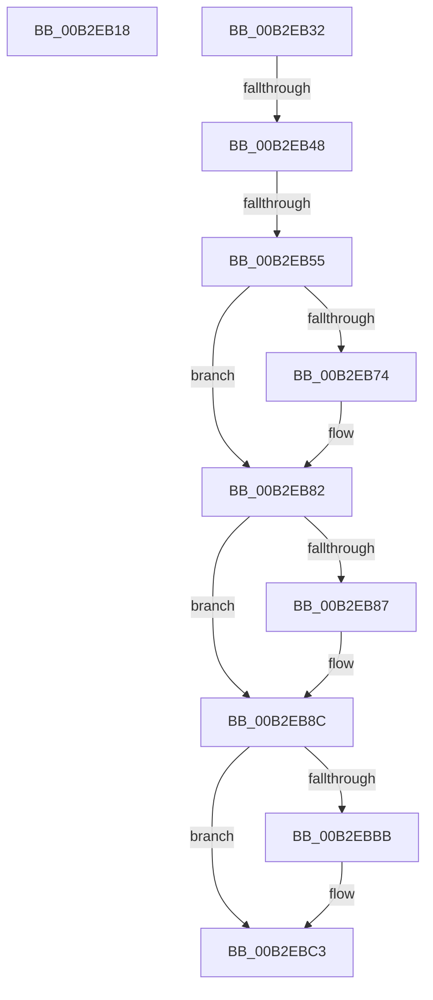

# sub_00B2EB18

- RVA: `0x00B2EB18`–`0x00B2EBDC` (길이 `196` bytes)
- VA: `0x0000000140B2EB18`
- 실행 섹션: `PAGE`
- PDB 이름 있음: `아니요`; PDB Function 태그: `아니요`
- unwind 정보 RVA: `0x0009F57C`
- 디코드: `47`개 명령, `196/196` bytes 표시
- 미해석 바이트: `0` (있으면 어셈블리에 `.byte`로 보존)

> 이 문서는 커널 이미지의 기계어와 PDB 기호를 분석해 생성했습니다. 4번과 5번은 함수 원형과 자료형을 바이너리 사용 방식에서 추정한 C 해석이며 원본 소스 복구 결과는 아닙니다.

## 1. Dependencies

- 직접 호출 지점: **7**; 고유 호출 대상: **6**
- 직접 호출자로 확인된 함수: **0**
- RIP 상대 이미지 참조: **0**

### Outgoing calls
- `0x00B2EB1E` → [ZwClose](../../text/6A/ZwClose_function_006AD2B0.md) (function, `0x006AD2B0`)
- `0x00B2EB35` → [ZwClose](../../text/6A/ZwClose_function_006AD2B0.md) (function, `0x006AD2B0`)
- `0x00B2EB64` → [KeAbPreAcquire](../../text/21/KeAbPreAcquire_function_00210230.md) (function, `0x00210230`)
- `0x00B2EB7D` → [ExfAcquirePushLockExclusiveEx](../../text/20/ExfAcquirePushLockExclusiveEx_function_0020FC90.md) (function, `0x0020FC90`)
- `0x00B2EBBE` → [ExfTryToWakePushLock](../../text/26/ExfTryToWakePushLock_function_00265DD0.md) (function, `0x00265DD0`)
- `0x00B2EBC6` → [KeAbPostRelease](../../text/2E/KeAbPostRelease_function_002E1600.md) (function, `0x002E1600`)
- `0x00B2EBD1` → [RtlInitUnicodeString](../../text/42/RtlInitUnicodeString_function_0042A780.md) (function, `0x0042A780`)

### Direct callers
- 이 함수 시작 RVA로 연결되는 직접 call은 확인되지 않았습니다. 간접 호출은 완전히 역산할 수 없습니다.

### Static image references
- 디코드된 RIP-relative 메모리 참조가 없습니다.

## 2. Other-region calls and transfers

- 다른 실행 섹션으로 향하는 call: **7**
  - `0x00B2EB1E` → [ZwClose](../../text/6A/ZwClose_function_006AD2B0.md) (`PAGE` → `.text`)
  - `0x00B2EB35` → [ZwClose](../../text/6A/ZwClose_function_006AD2B0.md) (`PAGE` → `.text`)
  - `0x00B2EB64` → [KeAbPreAcquire](../../text/21/KeAbPreAcquire_function_00210230.md) (`PAGE` → `.text`)
  - `0x00B2EB7D` → [ExfAcquirePushLockExclusiveEx](../../text/20/ExfAcquirePushLockExclusiveEx_function_0020FC90.md) (`PAGE` → `.text`)
  - `0x00B2EBBE` → [ExfTryToWakePushLock](../../text/26/ExfTryToWakePushLock_function_00265DD0.md) (`PAGE` → `.text`)
  - `0x00B2EBC6` → [KeAbPostRelease](../../text/2E/KeAbPostRelease_function_002E1600.md) (`PAGE` → `.text`)
  - `0x00B2EBD1` → [RtlInitUnicodeString](../../text/42/RtlInitUnicodeString_function_0042A780.md) (`PAGE` → `.text`)
- call이 아닌 외부 분기/꼬리 이동: **4**
  - `0x00B2EB2D` → [EtwpCreateLogFile + 0x18D](../9C/EtwpCreateLogFile_function_009C035C.md) (`tail-transfer`)
  - `0x00B2EB42` → [EtwpCreateLogFile + 0x301](../9C/EtwpCreateLogFile_function_009C035C.md) (`tail-transfer`)
  - `0x00B2EB4F` → [EtwpCreateLogFile + 0x305](../9C/EtwpCreateLogFile_function_009C035C.md) (`tail-transfer`)
  - `0x00B2EBD7` → [EtwpCreateLogFile + 0x301](../9C/EtwpCreateLogFile_function_009C035C.md) (`tail-transfer`)

## 3. Assembly (complete function range)

```asm
00B2EB18  48 8B CE                        mov rcx, rsi
00B2EB1B  45 32 F6                        xor r14b, r14b
00B2EB1E  E8 8D E7 B7 FF                  call 0x1406ad2b0
00B2EB23  48 8B 45 8F                     mov rax, qword ptr [rbp - 0x71]
00B2EB27  33 F6                           xor esi, esi
00B2EB29  48 89 75 97                     mov qword ptr [rbp - 0x69], rsi
00B2EB2D  E9 B7 19 E9 FF                  jmp 0x1409c04e9
00B2EB32  48 8B CE                        mov rcx, rsi
00B2EB35  E8 76 E7 B7 FF                  call 0x1406ad2b0
00B2EB3A  48 83 BF 20 03 00 00 00         cmp qword ptr [rdi + 0x320], 0
00B2EB42  0F 84 15 1B E9 FF               je 0x1409c065d
00B2EB48  48 8B 75 A7                     mov rsi, qword ptr [rbp - 0x59]
00B2EB4C  48 85 F6                        test rsi, rsi
00B2EB4F  0F 84 0C 1B E9 FF               je 0x1409c0661
00B2EB55  48 8D B7 B0 02 00 00            lea rsi, [rdi + 0x2b0]
00B2EB5C  45 33 C0                        xor r8d, r8d
00B2EB5F  48 8B CE                        mov rcx, rsi
00B2EB62  33 D2                           xor edx, edx
00B2EB64  E8 C7 16 6E FF                  call 0x140210230
00B2EB69  F0 48 0F BA 2E 00               lock bts qword ptr [rsi], 0
00B2EB6F  4C 8B F0                        mov r14, rax
00B2EB72  73 0E                           jae 0x140b2eb82
00B2EB74  4C 8B C6                        mov r8, rsi
00B2EB77  48 8B D0                        mov rdx, rax
00B2EB7A  48 8B CE                        mov rcx, rsi
00B2EB7D  E8 0E 11 6E FF                  call 0x14020fc90
00B2EB82  4D 85 F6                        test r14, r14
00B2EB85  74 05                           je 0x140b2eb8c
00B2EB87  41 C6 46 0A 01                  mov byte ptr [r14 + 0xa], 1
00B2EB8C  0F 10 87 98 00 00 00            movups xmm0, xmmword ptr [rdi + 0x98]
00B2EB93  48 8D B7 B0 02 00 00            lea rsi, [rdi + 0x2b0]
00B2EB9A  0F 10 4D 9F                     movups xmm1, xmmword ptr [rbp - 0x61]
00B2EB9E  F3 0F 7F 87 B8 00 00 00         movdqu xmmword ptr [rdi + 0xb8], xmm0
00B2EBA6  F3 0F 7F 8F 98 00 00 00         movdqu xmmword ptr [rdi + 0x98], xmm1
00B2EBAE  F0 48 0F C1 1E                  lock xadd qword ptr [rsi], rbx
00B2EBB3  80 E3 06                        and bl, 6
00B2EBB6  80 FB 02                        cmp bl, 2
00B2EBB9  75 08                           jne 0x140b2ebc3
00B2EBBB  48 8B CE                        mov rcx, rsi
00B2EBBE  E8 0D 72 73 FF                  call 0x140265dd0
00B2EBC3  48 8B CE                        mov rcx, rsi
00B2EBC6  E8 35 2A 7B FF                  call 0x1402e1600
00B2EBCB  33 D2                           xor edx, edx
00B2EBCD  48 8D 4D 9F                     lea rcx, [rbp - 0x61]
00B2EBD1  E8 AA BB 8F FF                  call 0x14042a780
00B2EBD6  90                              nop
00B2EBD7  E9 81 1A E9 FF                  jmp 0x1409c065d
```

## 4. C-style interpretation (structured pseudocode)

```c
__int64 __fastcall sub_00B2EB18(__int64 a1, int a2, int a3)
{
    __int64 result;
    __int64 v_r14;
    __int64 v_rsi;

    v_r14 = 0;
    result = ZwClose(v_rsi, a2, a3, a4);
    v_rsi = 0;
    *(unsigned __int64 *)(v_rbp - 105) = 0;
}
```

## 5. (Beta) C Style

```c
int64_t sub_00B2EB18(int64_t Arg1, int32_t Arg2, int32_t Arg3)
{
    int64_t result;
    int64_t local_r14;
    int64_t local_rsi;

    local_r14 = 0;
    result = ZwClose(local_rsi, Arg2, Arg3, a4);
    local_rsi = 0;
    *(uint64_t *)(local_rbp - 0x69) = 0;
}
```

## 6. Execution-region graph

[열기: 2D/3D 그래프와 함수 탐색 컨트롤 패널](../../../control-panel.html?section=page&rva=0x00B2EB18&view=graph)

- 2D 그래프는 위에서 아래로 흐르고, 3D 그래프는 빈 공간을 드래그해 회전합니다. Shift+드래그는 이동, 휠은 확대·축소, 함수 노드 선택은 대상 보고서 이동입니다.

### Static fallback


