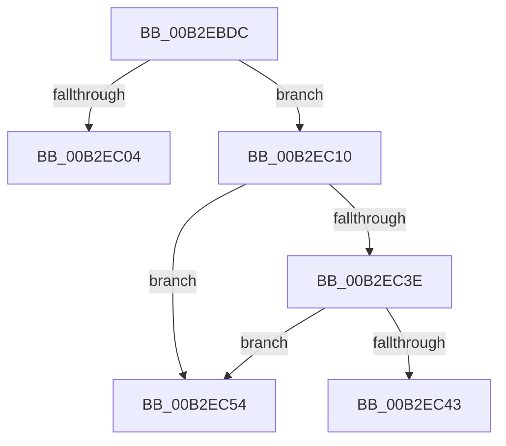

# sub_00B2EBDC

- RVA: `0x00B2EBDC`–`0x00B2EC61` (길이 `133` bytes)
- VA: `0x0000000140B2EBDC`
- 실행 섹션: `PAGE`
- PDB 이름 있음: `아니요`; PDB Function 태그: `아니요`
- unwind 정보 RVA: `0x0009F5B4`
- 디코드: `31`개 명령, `133/133` bytes 표시
- 미해석 바이트: `0` (있으면 어셈블리에 `.byte`로 보존)

> 이 문서는 커널 이미지의 기계어와 PDB 기호를 분석해 생성했습니다. 4번과 5번은 함수 원형과 자료형을 바이너리 사용 방식에서 추정한 C 해석이며 원본 소스 복구 결과는 아닙니다.

## 1. Dependencies

- 직접 호출 지점: **1**; 고유 호출 대상: **1**
- 직접 호출자로 확인된 함수: **0**
- RIP 상대 이미지 참조: **0**

### Outgoing calls
- `0x00B2EBF9` → [ZwQueryInformationFile](../../text/6A/ZwQueryInformationFile_function_006AD2F0.md) (function, `0x006AD2F0`)

### Direct callers
- 이 함수 시작 RVA로 연결되는 직접 call은 확인되지 않았습니다. 간접 호출은 완전히 역산할 수 없습니다.

### Static image references
- 디코드된 RIP-relative 메모리 참조가 없습니다.

## 2. Other-region calls and transfers

- 다른 실행 섹션으로 향하는 call: **1**
  - `0x00B2EBF9` → [ZwQueryInformationFile](../../text/6A/ZwQueryInformationFile_function_006AD2F0.md) (`PAGE` → `.text`)
- call이 아닌 외부 분기/꼬리 이동: **3**
  - `0x00B2EC0B` → [EtwpUpdateFileHeader + 0x158](../9C/EtwpUpdateFileHeader_function_009C082C.md) (`tail-transfer`)
  - `0x00B2EC4F` → [EtwpUpdateFileHeader + 0x158](../9C/EtwpUpdateFileHeader_function_009C082C.md) (`tail-transfer`)
  - `0x00B2EC5C` → [EtwpUpdateFileHeader + 0x26C](../9C/EtwpUpdateFileHeader_function_009C082C.md) (`tail-transfer`)

## 3. Assembly (complete function range)

```asm
00B2EBDC  48 8B 8F 20 03 00 00            mov rcx, qword ptr [rdi + 0x320]
00B2EBE3  4C 8D 45 FF                     lea r8, [rbp - 1]
00B2EBE7  41 B9 18 00 00 00               mov r9d, 0x18
00B2EBED  C7 44 24 20 05 00 00 00         mov dword ptr [rsp + 0x20], 5
00B2EBF5  48 8D 55 DF                     lea rdx, [rbp - 0x21]
00B2EBF9  E8 F2 E6 B7 FF                  call 0x1406ad2f0
00B2EBFE  8B D8                           mov ebx, eax
00B2EC00  85 C0                           test eax, eax
00B2EC02  79 0C                           jns 0x140b2ec10
00B2EC04  C7 47 2C 07 00 00 00            mov dword ptr [rdi + 0x2c], 7
00B2EC0B  E9 74 1D E9 FF                  jmp 0x1409c0984
00B2EC10  8B 47 0C                        mov eax, dword ptr [rdi + 0xc]
00B2EC13  25 00 20 00 00                  and eax, 0x2000
00B2EC18  F7 D8                           neg eax
00B2EC1A  8B 87 24 01 00 00               mov eax, dword ptr [rdi + 0x124]
00B2EC20  48 1B C9                        sbb rcx, rcx
00B2EC23  48 81 E1 00 04 F0 FF            and rcx, 0xfffffffffff00400
00B2EC2A  48 81 C1 00 00 10 00            add rcx, 0x100000
00B2EC31  48 0F AF C8                     imul rcx, rax
00B2EC35  48 8B 45 07                     mov rax, qword ptr [rbp + 7]
00B2EC39  48 85 C9                        test rcx, rcx
00B2EC3C  74 16                           je 0x140b2ec54
00B2EC3E  48 3B C1                        cmp rax, rcx
00B2EC41  7C 11                           jl 0x140b2ec54
00B2EC43  BB 88 01 00 C0                  mov ebx, 0xc0000188
00B2EC48  C7 47 2C 08 00 00 00            mov dword ptr [rdi + 0x2c], 8
00B2EC4F  E9 30 1D E9 FF                  jmp 0x1409c0984
00B2EC54  48 99                           cqo
00B2EC56  49 F7 FF                        idiv r15
00B2EC59  4C 8B F0                        mov r14, rax
00B2EC5C  E9 37 1E E9 FF                  jmp 0x1409c0a98
```

## 4. C-style interpretation (structured pseudocode)

```c
__int64 __fastcall sub_00B2EBDC(void)
{
    __int64 result;
    unsigned int v_stack_p20;

    v_stack_p20 = 5;
    result = ZwQueryInformationFile(*(unsigned __int64 *)(v_rdi + 800), v_rbp - 33, v_rbp - 1, 24);
    if (!sign_flag) goto loc_00B2EC10;
    *(unsigned int *)(v_rdi + 44) = 7;
loc_00B2EC10:
    result = (unsigned int)(((unsigned int)(*(unsigned int *)(v_rdi + 12))) & (0x2000ULL));
    result = (unsigned int)(-(result));
    a1 = (*(unsigned __int64 *)(v_rdi + 800)) & (0xFFFFFFFFFFF00400ULL);
    a1 = (a1) + (0x100000ULL);
    a1 = (a1) * ((unsigned int)(*(unsigned int *)(v_rdi + 292)));
    if (a1 == 0) goto loc_00B2EC54;
    if ((*(unsigned __int64 *)(v_rbp + 7)) < a1) goto loc_00B2EC54;
    *(unsigned int *)(v_rdi + 44) = 8;
loc_00B2EC54:
}
```

## 5. (Beta) C Style

```c
void sub_00B2EBDC(void)
{
    int64_t result;
    uint32_t v_stack_p20;

    v_stack_p20 = 5;
    result = ZwQueryInformationFile(*(uint64_t *)(local_rdi + 0x320), local_rbp - 33, local_rbp - 1, 24);
    if (!sign_flag) goto loc_00B2EC10;
    *(uint32_t *)(local_rdi + 0x2C) = 7;
loc_00B2EC10:
    result = (uint32_t)(((uint32_t)(*(uint32_t *)(local_rdi + 0xC))) & (0x2000ULL));
    result = (uint32_t)(-(result));
    a1 = (*(uint64_t *)(local_rdi + 0x320)) & (0xFFFFFFFFFFF00400ULL);
    a1 = (a1) + (0x100000ULL);
    a1 = (a1) * ((uint32_t)(*(uint32_t *)(local_rdi + 0x124)));
    if (a1 == 0) goto loc_00B2EC54;
    if ((*(uint64_t *)(local_rbp + 0x7)) < a1) goto loc_00B2EC54;
    *(uint32_t *)(local_rdi + 0x2C) = 8;
loc_00B2EC54:
}
```

## 6. Execution-region graph

[열기: 2D/3D 그래프와 함수 탐색 컨트롤 패널](../../../control-panel.html?section=page&rva=0x00B2EBDC&view=graph)

- 2D 그래프는 위에서 아래로 흐르고, 3D 그래프는 빈 공간을 드래그해 회전합니다. Shift+드래그는 이동, 휠은 확대·축소, 함수 노드 선택은 대상 보고서 이동입니다.

### Static fallback


