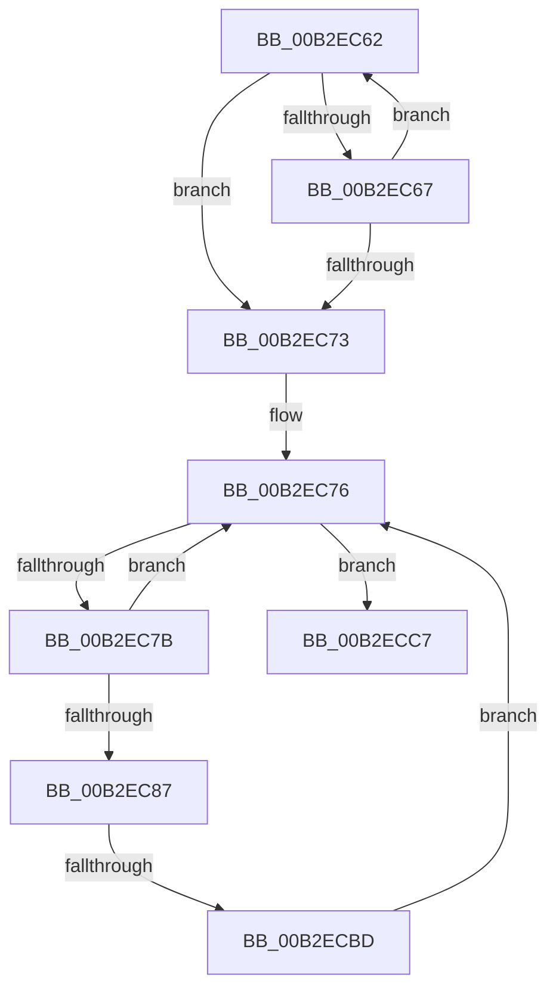

# sub_00B2EC62

- RVA: `0x00B2EC62`–`0x00B2ECF5` (길이 `147` bytes)
- VA: `0x0000000140B2EC62`
- 실행 섹션: `PAGE`
- PDB 이름 있음: `아니요`; PDB Function 태그: `아니요`
- unwind 정보 RVA: `0x0009F608`
- 디코드: `44`개 명령, `147/147` bytes 표시
- 미해석 바이트: `0` (있으면 어셈블리에 `.byte`로 보존)

> 이 문서는 커널 이미지의 기계어와 PDB 기호를 분석해 생성했습니다. 4번과 5번은 함수 원형과 자료형을 바이너리 사용 방식에서 추정한 C 해석이며 원본 소스 복구 결과는 아닙니다.

## 1. Dependencies

- 직접 호출 지점: **2**; 고유 호출 대상: **1**
- 직접 호출자로 확인된 함수: **0**
- RIP 상대 이미지 참조: **0**

### Outgoing calls
- `0x00B2ECAC` → [EtwpCreateDirectoryFile](../A7/EtwpCreateDirectoryFile_function_00A705E0.md) (function, `0x00A705E0`)
- `0x00B2ECE9` → [EtwpCreateDirectoryFile](../A7/EtwpCreateDirectoryFile_function_00A705E0.md) (function, `0x00A705E0`)

### Direct callers
- 이 함수 시작 RVA로 연결되는 직접 call은 확인되지 않았습니다. 간접 호출은 완전히 역산할 수 없습니다.

### Static image references
- 디코드된 RIP-relative 메모리 참조가 없습니다.

## 2. Other-region calls and transfers

- 다른 실행 섹션으로 향하는 call: **0**
- call이 아닌 외부 분기/꼬리 이동: **2**
  - `0x00B2ECB7` → [EtwpDelayCreate + 0x184](../9C/EtwpDelayCreate_function_009C1188.md) (`tail-transfer`)
  - `0x00B2ECF0` → [EtwpDelayCreate + 0x184](../9C/EtwpDelayCreate_function_009C1188.md) (`tail-transfer`)

## 3. Assembly (complete function range)

```asm
00B2EC62  66 85 C0                        test ax, ax
00B2EC65  74 0C                           je 0x140b2ec73
00B2EC67  48 83 C7 02                     add rdi, 2
00B2EC6B  0F B7 07                        movzx eax, word ptr [rdi]
00B2EC6E  66 3B C2                        cmp ax, dx
00B2EC71  75 EF                           jne 0x140b2ec62
00B2EC73  0F B7 07                        movzx eax, word ptr [rdi]
00B2EC76  66 85 C0                        test ax, ax
00B2EC79  74 4C                           je 0x140b2ecc7
00B2EC7B  48 83 C7 02                     add rdi, 2
00B2EC7F  0F B7 07                        movzx eax, word ptr [rdi]
00B2EC82  66 3B C2                        cmp ax, dx
00B2EC85  75 EF                           jne 0x140b2ec76
00B2EC87  41 0F B6 06                     movzx eax, byte ptr [r14]
00B2EC8B  45 8A CF                        mov r9b, r15b
00B2EC8E  44 8A 45 67                     mov r8b, byte ptr [rbp + 0x67]
00B2EC92  B2 01                           mov dl, 1
00B2EC94  89 44 24 30                     mov dword ptr [rsp + 0x30], eax
00B2EC98  48 8D 45 B7                     lea rax, [rbp - 0x49]
00B2EC9C  48 89 44 24 28                  mov qword ptr [rsp + 0x28], rax
00B2ECA1  48 89 4C 24 20                  mov qword ptr [rsp + 0x20], rcx
00B2ECA6  66 89 0F                        mov word ptr [rdi], cx
00B2ECA9  48 8B CE                        mov rcx, rsi
00B2ECAC  E8 2F 19 F4 FF                  call 0x140a705e0
00B2ECB1  33 C9                           xor ecx, ecx
00B2ECB3  8B D8                           mov ebx, eax
00B2ECB5  85 C0                           test eax, eax
00B2ECB7  0F 88 4F 26 E9 FF               js 0x1409c130c
00B2ECBD  8D 51 5C                        lea edx, [rcx + 0x5c]
00B2ECC0  66 89 17                        mov word ptr [rdi], dx
00B2ECC3  8B C2                           mov eax, edx
00B2ECC5  EB AF                           jmp 0x140b2ec76
00B2ECC7  41 0F B6 06                     movzx eax, byte ptr [r14]
00B2ECCB  45 8A CF                        mov r9b, r15b
00B2ECCE  44 8A 45 67                     mov r8b, byte ptr [rbp + 0x67]
00B2ECD2  33 D2                           xor edx, edx
00B2ECD4  89 44 24 30                     mov dword ptr [rsp + 0x30], eax
00B2ECD8  48 8B CE                        mov rcx, rsi
00B2ECDB  48 8D 45 B7                     lea rax, [rbp - 0x49]
00B2ECDF  48 89 44 24 28                  mov qword ptr [rsp + 0x28], rax
00B2ECE4  4C 89 6C 24 20                  mov qword ptr [rsp + 0x20], r13
00B2ECE9  E8 F2 18 F4 FF                  call 0x140a705e0
00B2ECEE  8B D8                           mov ebx, eax
00B2ECF0  E9 17 26 E9 FF                  jmp 0x1409c130c
```

## 4. C-style interpretation (structured pseudocode)

```c
__int64 __fastcall sub_00B2EC62(__int64 a1, unsigned __int16 a2)
{
    __int64 result;
    __int64 v_rdi;
    unsigned __int64 v_stack_p20;
    unsigned __int64 v_stack_p28;
    unsigned int v_stack_p30;

    if ((unsigned __int16)(result) == 0) goto loc_00B2EC73;
    v_rdi = (v_rdi) + (2);
    if (((unsigned __int16)(*(unsigned __int16 *)(v_rdi))) != a2) goto loc_00B2EC62;
loc_00B2EC73:
loc_00B2EC76:
    if ((unsigned __int16)(*(unsigned __int16 *)(v_rdi)) == 0) goto loc_00B2ECC7;
    v_rdi = (v_rdi) + (2);
    if (((unsigned __int16)(*(unsigned __int16 *)(v_rdi))) != a2) goto loc_00B2EC76;
    v_stack_p30 = (unsigned int)(*(unsigned __int8 *)(v_r14));
    v_stack_p28 = v_rbp - 73;
    v_stack_p20 = a1;
    *(unsigned __int16 *)(v_rdi) = (unsigned __int16)(a1);
    result = EtwpCreateDirectoryFile(v_rsi, 1, *(unsigned __int8 *)(v_rbp + 103), (unsigned __int8)(v_r15));
    a1 = 0;
    *(unsigned __int16 *)(v_rdi) = (unsigned __int16)(a1 + 92);
    goto loc_00B2EC76;
loc_00B2ECC7:
    a2 = 0;
    v_stack_p30 = (unsigned int)(*(unsigned __int8 *)(v_r14));
    v_stack_p28 = v_rbp - 73;
    v_stack_p20 = v_r13;
    result = EtwpCreateDirectoryFile(v_rsi, a2, *(unsigned __int8 *)(v_rbp + 103), (unsigned __int8)(v_r15));
}
```

## 5. (Beta) C Style

```c
int64_t sub_00B2EC62(int64_t Arg1, uint16_t Arg2)
{
    int64_t result;
    int64_t local_rdi;
    uint64_t v_stack_p20;
    uint64_t v_stack_p28;
    uint32_t v_stack_p30;

    if ((uint16_t)(result) == 0) goto loc_00B2EC73;
    local_rdi = (local_rdi) + (2);
    if (((uint16_t)(*(uint16_t *)(local_rdi))) != Arg2) goto loc_00B2EC62;
loc_00B2EC73:
loc_00B2EC76:
    if ((uint16_t)(*(uint16_t *)(local_rdi)) == 0) goto loc_00B2ECC7;
    local_rdi = (local_rdi) + (2);
    if (((uint16_t)(*(uint16_t *)(local_rdi))) != Arg2) goto loc_00B2EC76;
    v_stack_p30 = (uint32_t)(*(uint8_t *)(local_r14));
    v_stack_p28 = local_rbp - 73;
    v_stack_p20 = Arg1;
    *(uint16_t *)(local_rdi) = (uint16_t)(Arg1);
    result = EtwpCreateDirectoryFile(local_rsi, 1, *(uint8_t *)(local_rbp + 0x67), (uint8_t)(local_r15));
    Arg1 = 0;
    *(uint16_t *)(local_rdi) = (uint16_t)(Arg1 + 92);
    goto loc_00B2EC76;
loc_00B2ECC7:
    Arg2 = 0;
    v_stack_p30 = (uint32_t)(*(uint8_t *)(local_r14));
    v_stack_p28 = local_rbp - 73;
    v_stack_p20 = local_r13;
    result = EtwpCreateDirectoryFile(local_rsi, Arg2, *(uint8_t *)(local_rbp + 0x67), (uint8_t)(local_r15));
}
```

## 6. Execution-region graph

[열기: 2D/3D 그래프와 함수 탐색 컨트롤 패널](../../../control-panel.html?section=page&rva=0x00B2EC62&view=graph)

- 2D 그래프는 위에서 아래로 흐르고, 3D 그래프는 빈 공간을 드래그해 회전합니다. Shift+드래그는 이동, 휠은 확대·축소, 함수 노드 선택은 대상 보고서 이동입니다.

### Static fallback


