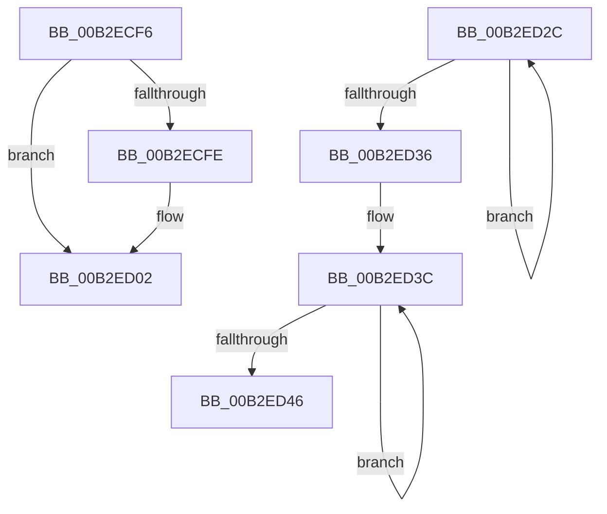

# sub_00B2ECF6

- RVA: `0x00B2ECF6`–`0x00B2ED63` (길이 `109` bytes)
- VA: `0x0000000140B2ECF6`
- 실행 섹션: `PAGE`
- PDB 이름 있음: `아니요`; PDB Function 태그: `아니요`
- unwind 정보 RVA: `0x0009F650`
- 디코드: `29`개 명령, `109/109` bytes 표시
- 미해석 바이트: `0` (있으면 어셈블리에 `.byte`로 보존)

> 이 문서는 커널 이미지의 기계어와 PDB 기호를 분석해 생성했습니다. 4번과 5번은 함수 원형과 자료형을 바이너리 사용 방식에서 추정한 C 해석이며 원본 소스 복구 결과는 아닙니다.

## 1. Dependencies

- 직접 호출 지점: **2**; 고유 호출 대상: **1**
- 직접 호출자로 확인된 함수: **0**
- RIP 상대 이미지 참조: **2**

### Outgoing calls
- `0x00B2ED21` → [RtlStringCbPrintfW](../../text/40/RtlStringCbPrintfW_function_0040FB40.md) (function, `0x0040FB40`)
- `0x00B2ED57` → [RtlStringCbPrintfW](../../text/40/RtlStringCbPrintfW_function_0040FB40.md) (function, `0x0040FB40`)

### Direct callers
- 이 함수 시작 RVA로 연결되는 직접 call은 확인되지 않았습니다. 간접 호출은 완전히 역산할 수 없습니다.

### Static image references
- `0x00B2ED06` → RVA `0x00B07240` (` ?? ::NNGAKEGL::`string'`; read)
- `0x00B2ED50` → RVA `0x00B07230` (` ?? ::NNGAKEGL::`string'`; read)

## 2. Other-region calls and transfers

- 다른 실행 섹션으로 향하는 call: **2**
  - `0x00B2ED21` → [RtlStringCbPrintfW](../../text/40/RtlStringCbPrintfW_function_0040FB40.md) (`PAGE` → `.text`)
  - `0x00B2ED57` → [RtlStringCbPrintfW](../../text/40/RtlStringCbPrintfW_function_0040FB40.md) (`PAGE` → `.text`)
- call이 아닌 외부 분기/꼬리 이동: **2**
  - `0x00B2ED27` → [EtwpExpandFileName + 0x188](../9C/EtwpExpandFileName_function_009C147C.md) (`tail-transfer`)
  - `0x00B2ED5E` → [EtwpExpandFileName + 0x198](../9C/EtwpExpandFileName_function_009C147C.md) (`tail-transfer`)

## 3. Assembly (complete function range)

```asm
00B2ECF6  49 8B D1                        mov rdx, r9
00B2ECF9  48 85 FF                        test rdi, rdi
00B2ECFC  74 04                           je 0x140b2ed02
00B2ECFE  4C 8B 4F 08                     mov r9, qword ptr [rdi + 8]
00B2ED02  49 8B 46 08                     mov rax, qword ptr [r14 + 8]
00B2ED06  4C 8D 05 33 85 FD FF            lea r8, [rip - 0x27acd]
00B2ED0D  48 89 54 24 28                  mov qword ptr [rsp + 0x28], rdx
00B2ED12  48 8B D3                        mov rdx, rbx
00B2ED15  4A 8D 0C 60                     lea rcx, [rax + r12*2]
00B2ED19  48 89 4C 24 20                  mov qword ptr [rsp + 0x20], rcx
00B2ED1E  48 8B CE                        mov rcx, rsi
00B2ED21  E8 1A 0E 8E FF                  call 0x14040fb40
00B2ED26  90                              nop
00B2ED27  E9 D8 28 E9 FF                  jmp 0x1409c1604
00B2ED2C  48 FF C0                        inc rax
00B2ED2F  66 44 39 04 46                  cmp word ptr [rsi + rax*2], r8w
00B2ED34  75 F6                           jne 0x140b2ed2c
00B2ED36  48 03 C0                        add rax, rax
00B2ED39  48 2B D8                        sub rbx, rax
00B2ED3C  48 FF C1                        inc rcx
00B2ED3F  66 44 39 04 4E                  cmp word ptr [rsi + rcx*2], r8w
00B2ED44  75 F6                           jne 0x140b2ed3c
00B2ED46  44 8B CA                        mov r9d, edx
00B2ED49  48 8D 0C 4E                     lea rcx, [rsi + rcx*2]
00B2ED4D  48 8B D3                        mov rdx, rbx
00B2ED50  4C 8D 05 D9 84 FD FF            lea r8, [rip - 0x27b27]
00B2ED57  E8 E4 0D 8E FF                  call 0x14040fb40
00B2ED5C  8B F8                           mov edi, eax
00B2ED5E  E9 B1 28 E9 FF                  jmp 0x1409c1614
```

## 4. C-style interpretation (structured pseudocode)

```c
__int64 __fastcall sub_00B2ECF6(__int64 a1, __int64 a2, __int64 a3, __int64 a4)
{
    __int64 result;
    unsigned __int64 v_stack_p20;
    unsigned __int64 v_stack_p28;

    if (v_rdi != 0) {
        a4 = *(unsigned __int64 *)(v_rdi + 8);
    }
    v_stack_p28 = a4;
    v_stack_p20 = *(unsigned __int64 *)(v_r14 + 8) + v_r12 * 2;
    result = RtlStringCbPrintfW(v_rsi, v_rbx, v_rip - 162509, a4);
}
```

## 5. (Beta) C Style

```c
int64_t sub_00B2ECF6(int64_t Arg1, int64_t Arg2, int64_t Arg3, int64_t Arg4)
{
    int64_t result;
    uint64_t v_stack_p20;
    uint64_t v_stack_p28;

    if (local_rdi != 0) {
        Arg4 = *(uint64_t *)(local_rdi + 0x8);
    }
    v_stack_p28 = Arg4;
    v_stack_p20 = *(uint64_t *)(local_r14 + 0x8) + local_r12 * 2;
    result = RtlStringCbPrintfW(local_rsi, local_rbx, v_rip - 162509, Arg4);
}
```

## 6. Execution-region graph

[열기: 2D/3D 그래프와 함수 탐색 컨트롤 패널](../../../control-panel.html?section=page&rva=0x00B2ECF6&view=graph)

- 2D 그래프는 위에서 아래로 흐르고, 3D 그래프는 빈 공간을 드래그해 회전합니다. Shift+드래그는 이동, 휠은 확대·축소, 함수 노드 선택은 대상 보고서 이동입니다.

### Static fallback


