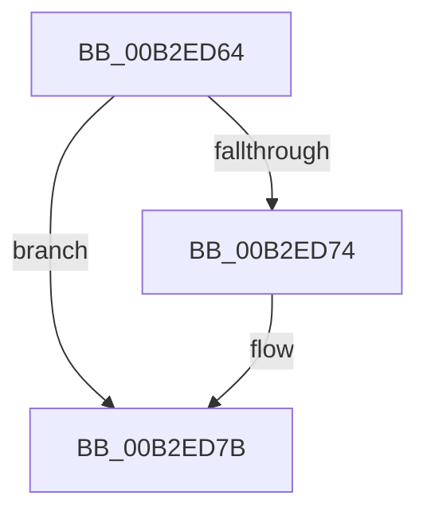

# sub_00B2ED64

- RVA: `0x00B2ED64`–`0x00B2ED95` (길이 `49` bytes)
- VA: `0x0000000140B2ED64`
- 실행 섹션: `PAGE`
- PDB 이름 있음: `아니요`; PDB Function 태그: `아니요`
- unwind 정보 RVA: `0x0009F680`
- 디코드: `11`개 명령, `49/49` bytes 표시
- 미해석 바이트: `0` (있으면 어셈블리에 `.byte`로 보존)

> 이 문서는 커널 이미지의 기계어와 PDB 기호를 분석해 생성했습니다. 4번과 5번은 함수 원형과 자료형을 바이너리 사용 방식에서 추정한 C 해석이며 원본 소스 복구 결과는 아닙니다.

## 1. Dependencies

- 직접 호출 지점: **2**; 고유 호출 대상: **1**
- 직접 호출자로 확인된 함수: **0**
- RIP 상대 이미지 참조: **0**

### Outgoing calls
- `0x00B2ED76` → [ExFreePoolWithTag](../../poolcode/B8/ExFreePoolWithTag_function_00B82870.md) (function, `0x00B82870`)
- `0x00B2ED84` → [ExFreePoolWithTag](../../poolcode/B8/ExFreePoolWithTag_function_00B82870.md) (function, `0x00B82870`)

### Direct callers
- 이 함수 시작 RVA로 연결되는 직접 call은 확인되지 않았습니다. 간접 호출은 완전히 역산할 수 없습니다.

### Static image references
- 디코드된 RIP-relative 메모리 참조가 없습니다.

## 2. Other-region calls and transfers

- 다른 실행 섹션으로 향하는 call: **2**
  - `0x00B2ED76` → [ExFreePoolWithTag](../../poolcode/B8/ExFreePoolWithTag_function_00B82870.md) (`PAGE` → `POOLCODE`)
  - `0x00B2ED84` → [ExFreePoolWithTag](../../poolcode/B8/ExFreePoolWithTag_function_00B82870.md) (`PAGE` → `POOLCODE`)
- call이 아닌 외부 분기/꼬리 이동: **1**
  - `0x00B2ED90` → [EtwpFreeLoggerContext + 0x94](../9C/EtwpFreeLoggerContext_function_009C1688.md) (`tail-transfer`)

## 3. Assembly (complete function range)

```asm
00B2ED64  48 8B 83 40 05 00 00            mov rax, qword ptr [rbx + 0x540]
00B2ED6B  48 8B 48 18                     mov rcx, qword ptr [rax + 0x18]
00B2ED6F  48 85 C9                        test rcx, rcx
00B2ED72  74 07                           je 0x140b2ed7b
00B2ED74  33 D2                           xor edx, edx
00B2ED76  E8 F5 3A 05 00                  call 0x140b82870
00B2ED7B  48 8B 8B 40 05 00 00            mov rcx, qword ptr [rbx + 0x540]
00B2ED82  33 D2                           xor edx, edx
00B2ED84  E8 E7 3A 05 00                  call 0x140b82870
00B2ED89  4C 89 A3 40 05 00 00            mov qword ptr [rbx + 0x540], r12
00B2ED90  E9 87 29 E9 FF                  jmp 0x1409c171c
```

## 4. C-style interpretation (structured pseudocode)

```c
__int64 __fastcall sub_00B2ED64(__int64 a1, int a2)
{
    __int64 result;

    result = *(unsigned __int64 *)(v_rbx + 1344);
    if (*(unsigned __int64 *)(*(unsigned __int64 *)(v_rbx + 1344) + 24) != 0) {
        a2 = 0;
        result = ExFreePoolWithTag(*(unsigned __int64 *)(*(unsigned __int64 *)(v_rbx + 1344) + 24), a2, a3, a4);
    }
    a2 = 0;
    result = ExFreePoolWithTag(*(unsigned __int64 *)(v_rbx + 1344), a2, a3, a4);
    *(unsigned __int64 *)(v_rbx + 1344) = v_r12;
}
```

## 5. (Beta) C Style

```c
int64_t sub_00B2ED64(int64_t Arg1, int32_t Arg2)
{
    int64_t result;

    result = *(uint64_t *)(local_rbx + 0x540);
    if (*(uint64_t *)(*(uint64_t *)(local_rbx + 0x540) + 0x18) != 0) {
        Arg2 = 0;
        result = ExFreePoolWithTag(*(uint64_t *)(*(uint64_t *)(local_rbx + 0x540) + 0x18), Arg2, a3, a4);
    }
    Arg2 = 0;
    result = ExFreePoolWithTag(*(uint64_t *)(local_rbx + 0x540), Arg2, a3, a4);
    *(uint64_t *)(local_rbx + 0x540) = local_r12;
}
```

## 6. Execution-region graph

[열기: 2D/3D 그래프와 함수 탐색 컨트롤 패널](../../../control-panel.html?section=page&rva=0x00B2ED64&view=graph)

- 2D 그래프는 위에서 아래로 흐르고, 3D 그래프는 빈 공간을 드래그해 회전합니다. Shift+드래그는 이동, 휠은 확대·축소, 함수 노드 선택은 대상 보고서 이동입니다.

### Static fallback


