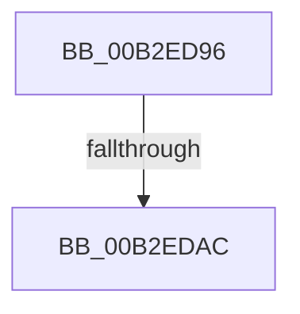

# sub_00B2ED96

- RVA: `0x00B2ED96`–`0x00B2EDDA` (길이 `68` bytes)
- VA: `0x0000000140B2ED96`
- 실행 섹션: `PAGE`
- PDB 이름 있음: `아니요`; PDB Function 태그: `아니요`
- unwind 정보 RVA: `0x0009F6BC`
- 디코드: `14`개 명령, `68/68` bytes 표시
- 미해석 바이트: `0` (있으면 어셈블리에 `.byte`로 보존)

> 이 문서는 커널 이미지의 기계어와 PDB 기호를 분석해 생성했습니다. 4번과 5번은 함수 원형과 자료형을 바이너리 사용 방식에서 추정한 C 해석이며 원본 소스 복구 결과는 아닙니다.

## 1. Dependencies

- 직접 호출 지점: **1**; 고유 호출 대상: **1**
- 직접 호출자로 확인된 함수: **0**
- RIP 상대 이미지 참조: **0**

### Outgoing calls
- `0x00B2EDCD` → [ZwSetInformationFile](../../text/6A/ZwSetInformationFile_function_006AD5B0.md) (function, `0x006AD5B0`)

### Direct callers
- 이 함수 시작 RVA로 연결되는 직접 call은 확인되지 않았습니다. 간접 호출은 완전히 역산할 수 없습니다.

### Static image references
- 디코드된 RIP-relative 메모리 참조가 없습니다.

## 2. Other-region calls and transfers

- 다른 실행 섹션으로 향하는 call: **1**
  - `0x00B2EDCD` → [ZwSetInformationFile](../../text/6A/ZwSetInformationFile_function_006AD5B0.md) (`PAGE` → `.text`)
- call이 아닌 외부 분기/꼬리 이동: **2**
  - `0x00B2EDA6` → [EtwpFinalizeHeader + 0x237](../9C/EtwpFinalizeHeader_function_009C1EF0.md) (`tail-transfer`)
  - `0x00B2EDD5` → [EtwpFinalizeHeader + 0x237](../9C/EtwpFinalizeHeader_function_009C1EF0.md) (`tail-transfer`)

## 3. Assembly (complete function range)

```asm
00B2ED96  8B 93 F8 00 00 00               mov edx, dword ptr [rbx + 0xf8]
00B2ED9C  8B 43 04                        mov eax, dword ptr [rbx + 4]
00B2ED9F  48 0F AF D0                     imul rdx, rax
00B2EDA3  48 3B D1                        cmp rdx, rcx
00B2EDA6  0F 83 7B 33 E9 FF               jae 0x1409c2127
00B2EDAC  48 8B 8B 20 03 00 00            mov rcx, qword ptr [rbx + 0x320]
00B2EDB3  4C 8D 45 EF                     lea r8, [rbp - 0x11]
00B2EDB7  48 89 55 EF                     mov qword ptr [rbp - 0x11], rdx
00B2EDBB  41 B9 08 00 00 00               mov r9d, 8
00B2EDC1  48 8D 55 07                     lea rdx, [rbp + 7]
00B2EDC5  C7 44 24 20 14 00 00 00         mov dword ptr [rsp + 0x20], 0x14
00B2EDCD  E8 DE E7 B7 FF                  call 0x1406ad5b0
00B2EDD2  44 8B F0                        mov r14d, eax
00B2EDD5  E9 4D 33 E9 FF                  jmp 0x1409c2127
```

## 4. C-style interpretation (structured pseudocode)

```c
__int64 __fastcall sub_00B2ED96(__int64 a1)
{
    __int64 result;
    unsigned int v_stack_p20;

    a2 = ((unsigned int)(*(unsigned int *)(v_rbx + 248))) * ((unsigned int)(*(unsigned int *)(v_rbx + 4)));
    *(unsigned __int64 *)(v_rbp - 17) = a2;
    v_stack_p20 = 20;
    result = ZwSetInformationFile(*(unsigned __int64 *)(v_rbx + 800), v_rbp + 7, v_rbp - 17, 8);
}
```

## 5. (Beta) C Style

```c
int64_t sub_00B2ED96(int64_t Arg1)
{
    int64_t result;
    uint32_t v_stack_p20;

    a2 = ((uint32_t)(*(uint32_t *)(local_rbx + 0xF8))) * ((uint32_t)(*(uint32_t *)(local_rbx + 0x4)));
    *(uint64_t *)(local_rbp - 0x11) = a2;
    v_stack_p20 = 20;
    result = ZwSetInformationFile(*(uint64_t *)(local_rbx + 0x320), local_rbp + 7, local_rbp - 17, 8);
}
```

## 6. Execution-region graph

[열기: 2D/3D 그래프와 함수 탐색 컨트롤 패널](../../../control-panel.html?section=page&rva=0x00B2ED96&view=graph)

- 2D 그래프는 위에서 아래로 흐르고, 3D 그래프는 빈 공간을 드래그해 회전합니다. Shift+드래그는 이동, 휠은 확대·축소, 함수 노드 선택은 대상 보고서 이동입니다.

### Static fallback


