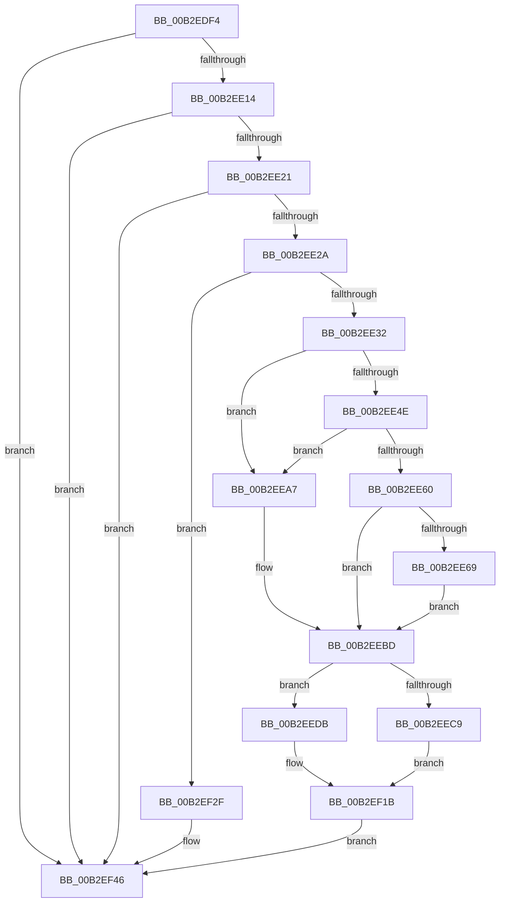

# sub_00B2EDF4

- RVA: `0x00B2EDF4`–`0x00B2EF58` (길이 `356` bytes)
- VA: `0x0000000140B2EDF4`
- 실행 섹션: `PAGE`
- PDB 이름 있음: `아니요`; PDB Function 태그: `아니요`
- unwind 정보 RVA: `0x0009F734`
- 디코드: `93`개 명령, `356/356` bytes 표시
- 미해석 바이트: `0` (있으면 어셈블리에 `.byte`로 보존)

> 이 문서는 커널 이미지의 기계어와 PDB 기호를 분석해 생성했습니다. 4번과 5번은 함수 원형과 자료형을 바이너리 사용 방식에서 추정한 C 해석이며 원본 소스 복구 결과는 아닙니다.

## 1. Dependencies

- 직접 호출 지점: **12**; 고유 호출 대상: **12**
- 직접 호출자로 확인된 함수: **0**
- RIP 상대 이미지 참조: **2**

### Outgoing calls
- `0x00B2EDFB` → [ExAcquireFastMutex](../../text/20/ExAcquireFastMutex_function_0020E5A0.md) (function, `0x0020E5A0`)
- `0x00B2EE3F` → [PsLookupProcessByProcessId](../8A/PsLookupProcessByProcessId_function_008A2AA0.md) (function, `0x008A2AA0`)
- `0x00B2EE55` → [PsGetAllocatedFullProcessImageName](../96/PsGetAllocatedFullProcessImageName_function_00960530.md) (function, `0x00960530`)
- `0x00B2EE78` → [ExFreePoolWithTag](../../poolcode/B8/ExFreePoolWithTag_function_00B82870.md) (function, `0x00B82870`)
- `0x00B2EE84` → [PsGetProcessImageFileName](../../text/45/PsGetProcessImageFileName_function_00453720.md) (function, `0x00453720`)
- `0x00B2EE90` → [RtlInitAnsiString](../../text/47/RtlInitAnsiString_function_00470F40.md) (function, `0x00470F40`)
- `0x00B2EEA0` → [RtlAnsiStringToUnicodeString](../90/RtlAnsiStringToUnicodeString_function_0090BEA0.md) (function, `0x0090BEA0`)
- `0x00B2EEB6` → [RtlInitUnicodeString](../../text/42/RtlInitUnicodeString_function_0042A780.md) (function, `0x0042A780`)
- `0x00B2EED4` → [RtlCopyUnicodeString](../../text/3F/RtlCopyUnicodeString_function_003FEF30.md) (function, `0x003FEF30`)
- `0x00B2EEF5` → [RtlStringCchCopyNW](../../text/47/RtlStringCchCopyNW_function_0047169C.md) (function, `0x0047169C`)
- `0x00B2EF28` → [KeSetEvent](../../text/33/KeSetEvent_function_0033F310.md) (function, `0x0033F310`)
- `0x00B2EF4D` → [ExReleaseFastMutex](../../text/25/ExReleaseFastMutex_function_002519C0.md) (function, `0x002519C0`)

### Direct callers
- 이 함수 시작 RVA로 연결되는 직접 call은 확인되지 않았습니다. 간접 호출은 완전히 역산할 수 없습니다.

### Static image references
- `0x00B2EDF4` → RVA `0x00F8CAA0` (`.data`; read)
- `0x00B2EEA7` → RVA `0x00AFCAD0` (` ?? ::NNGAKEGL::`string'`; read)

## 2. Other-region calls and transfers

- 다른 실행 섹션으로 향하는 call: **9**
  - `0x00B2EDFB` → [ExAcquireFastMutex](../../text/20/ExAcquireFastMutex_function_0020E5A0.md) (`PAGE` → `.text`)
  - `0x00B2EE78` → [ExFreePoolWithTag](../../poolcode/B8/ExFreePoolWithTag_function_00B82870.md) (`PAGE` → `POOLCODE`)
  - `0x00B2EE84` → [PsGetProcessImageFileName](../../text/45/PsGetProcessImageFileName_function_00453720.md) (`PAGE` → `.text`)
  - `0x00B2EE90` → [RtlInitAnsiString](../../text/47/RtlInitAnsiString_function_00470F40.md) (`PAGE` → `.text`)
  - `0x00B2EEB6` → [RtlInitUnicodeString](../../text/42/RtlInitUnicodeString_function_0042A780.md) (`PAGE` → `.text`)
  - `0x00B2EED4` → [RtlCopyUnicodeString](../../text/3F/RtlCopyUnicodeString_function_003FEF30.md) (`PAGE` → `.text`)
  - `0x00B2EEF5` → [RtlStringCchCopyNW](../../text/47/RtlStringCchCopyNW_function_0047169C.md) (`PAGE` → `.text`)
  - `0x00B2EF28` → [KeSetEvent](../../text/33/KeSetEvent_function_0033F310.md) (`PAGE` → `.text`)
  - `0x00B2EF4D` → [ExReleaseFastMutex](../../text/25/ExReleaseFastMutex_function_002519C0.md) (`PAGE` → `.text`)
- call이 아닌 외부 분기/꼬리 이동: **1**
  - `0x00B2EF53` → [PiUEventHandleVetoEvent + 0x84](../9C/PiUEventHandleVetoEvent_function_009C2744.md) (`tail-transfer`)

## 3. Assembly (complete function range)

```asm
00B2EDF4  48 8D 0D A5 DC 45 00            lea rcx, [rip + 0x45dca5]
00B2EDFB  E8 A0 F7 6D FF                  call 0x14020e5a0
00B2EE00  49 8B 4F 18                     mov rcx, qword ptr [r15 + 0x18]
00B2EE04  45 33 C0                        xor r8d, r8d
00B2EE07  48 8B 51 20                     mov rdx, qword ptr [rcx + 0x20]
00B2EE0B  48 85 D2                        test rdx, rdx
00B2EE0E  0F 84 32 01 00 00               je 0x140b2ef46
00B2EE14  48 8B 41 28                     mov rax, qword ptr [rcx + 0x28]
00B2EE18  48 85 C0                        test rax, rax
00B2EE1B  0F 84 25 01 00 00               je 0x140b2ef46
00B2EE21  44 39 02                        cmp dword ptr [rdx], r8d
00B2EE24  0F 85 1C 01 00 00               jne 0x140b2ef46
00B2EE2A  84 DB                           test bl, bl
00B2EE2C  0F 84 FD 00 00 00               je 0x140b2ef2f
00B2EE32  8B 45 DC                        mov eax, dword ptr [rbp - 0x24]
00B2EE35  89 02                           mov dword ptr [rdx], eax
00B2EE37  48 8D 55 30                     lea rdx, [rbp + 0x30]
00B2EE3B  49 8B 4E 30                     mov rcx, qword ptr [r14 + 0x30]
00B2EE3F  E8 5C 3C D7 FF                  call 0x1408a2aa0
00B2EE44  4C 8B 65 30                     mov r12, qword ptr [rbp + 0x30]
00B2EE48  33 DB                           xor ebx, ebx
00B2EE4A  85 C0                           test eax, eax
00B2EE4C  78 59                           js 0x140b2eea7
00B2EE4E  48 8D 55 D0                     lea rdx, [rbp - 0x30]
00B2EE52  49 8B CC                        mov rcx, r12
00B2EE55  E8 D6 16 E3 FF                  call 0x140960530
00B2EE5A  8B F0                           mov esi, eax
00B2EE5C  85 C0                           test eax, eax
00B2EE5E  78 47                           js 0x140b2eea7
00B2EE60  48 8B 7D D0                     mov rdi, qword ptr [rbp - 0x30]
00B2EE64  66 39 1F                        cmp word ptr [rdi], bx
00B2EE67  75 54                           jne 0x140b2eebd
00B2EE69  0F 57 C0                        xorps xmm0, xmm0
00B2EE6C  33 D2                           xor edx, edx
00B2EE6E  48 8B CF                        mov rcx, rdi
00B2EE71  41 B5 01                        mov r13b, 1
00B2EE74  0F 11 45 D8                     movups xmmword ptr [rbp - 0x28], xmm0
00B2EE78  E8 F3 39 05 00                  call 0x140b82870
00B2EE7D  49 8B CC                        mov rcx, r12
00B2EE80  48 8D 7D E8                     lea rdi, [rbp - 0x18]
00B2EE84  E8 97 48 92 FF                  call 0x140453720
00B2EE89  48 8B D0                        mov rdx, rax
00B2EE8C  48 8D 4D D8                     lea rcx, [rbp - 0x28]
00B2EE90  E8 AB 20 94 FF                  call 0x140470f40
00B2EE95  45 8A C5                        mov r8b, r13b
00B2EE98  48 8D 55 D8                     lea rdx, [rbp - 0x28]
00B2EE9C  48 8D 4D E8                     lea rcx, [rbp - 0x18]
00B2EEA0  E8 FB CF DD FF                  call 0x14090bea0
00B2EEA5  EB 16                           jmp 0x140b2eebd
00B2EEA7  48 8D 15 22 DC FC FF            lea rdx, [rip - 0x323de]
00B2EEAE  48 8D 4D E8                     lea rcx, [rbp - 0x18]
00B2EEB2  48 8D 7D E8                     lea rdi, [rbp - 0x18]
00B2EEB6  E8 C5 B8 8F FF                  call 0x14042a780
00B2EEBB  8B F3                           mov esi, ebx
00B2EEBD  41 BB 00 04 00 00               mov r11d, 0x400
00B2EEC3  66 44 39 1F                     cmp word ptr [rdi], r11w
00B2EEC7  77 12                           ja 0x140b2eedb
00B2EEC9  49 8B 4F 18                     mov rcx, qword ptr [r15 + 0x18]
00B2EECD  48 8B D7                        mov rdx, rdi
00B2EED0  48 8B 49 28                     mov rcx, qword ptr [rcx + 0x28]
00B2EED4  E8 57 00 8D FF                  call 0x1403fef30
00B2EED9  EB 40                           jmp 0x140b2ef1b
00B2EEDB  49 8B 47 18                     mov rax, qword ptr [r15 + 0x18]
00B2EEDF  41 B9 FF 01 00 00               mov r9d, 0x1ff
00B2EEE5  4C 8B 47 08                     mov r8, qword ptr [rdi + 8]
00B2EEE9  48 8B 48 28                     mov rcx, qword ptr [rax + 0x28]
00B2EEED  41 8D 51 01                     lea edx, [r9 + 1]
00B2EEF1  48 8B 49 08                     mov rcx, qword ptr [rcx + 8]
00B2EEF5  E8 A2 27 94 FF                  call 0x14047169c
00B2EEFA  8B F0                           mov esi, eax
00B2EEFC  49 8B 47 18                     mov rax, qword ptr [r15 + 0x18]
00B2EF00  48 8B 48 28                     mov rcx, qword ptr [rax + 0x28]
00B2EF04  48 8B 41 08                     mov rax, qword ptr [rcx + 8]
00B2EF08  66 89 98 FE 03 00 00            mov word ptr [rax + 0x3fe], bx
00B2EF0F  49 8B 47 18                     mov rax, qword ptr [r15 + 0x18]
00B2EF13  48 8B 48 28                     mov rcx, qword ptr [rax + 0x28]
00B2EF17  66 44 89 19                     mov word ptr [rcx], r11w
00B2EF1B  49 8B 4F 18                     mov rcx, qword ptr [r15 + 0x18]
00B2EF1F  45 33 C0                        xor r8d, r8d
00B2EF22  33 D2                           xor edx, edx
00B2EF24  48 8B 49 18                     mov rcx, qword ptr [rcx + 0x18]
00B2EF28  E8 E3 03 81 FF                  call 0x14033f310
00B2EF2D  EB 17                           jmp 0x140b2ef46
00B2EF2F  48 8B 40 08                     mov rax, qword ptr [rax + 8]
00B2EF33  66 44 89 00                     mov word ptr [rax], r8w
00B2EF37  48 8B 41 28                     mov rax, qword ptr [rcx + 0x28]
00B2EF3B  66 44 89 00                     mov word ptr [rax], r8w
00B2EF3F  48 8B 41 20                     mov rax, qword ptr [rcx + 0x20]
00B2EF43  44 89 00                        mov dword ptr [rax], r8d
00B2EF46  48 8D 0D 53 DB 45 00            lea rcx, [rip + 0x45db53]
00B2EF4D  E8 6E 2A 72 FF                  call 0x1402519c0
00B2EF52  90                              nop
00B2EF53  E9 70 38 E9 FF                  jmp 0x1409c27c8
```

## 4. C-style interpretation (structured pseudocode)

```c
__int64 __fastcall sub_00B2EDF4(__int64 a1, __int64 a2, int a3)
{
    __int64 result;
    __int64 v_rbx;

    result = ExAcquireFastMutex(v_rip + 4578469, a2, a3, a4);
    a3 = 0;
    if (*(unsigned __int64 *)(*(unsigned __int64 *)(v_r15 + 24) + 32) == 0) goto loc_00B2EF46;
    if (*(unsigned __int64 *)(*(unsigned __int64 *)(v_r15 + 24) + 40) == 0) goto loc_00B2EF46;
    if ((*(unsigned int *)(*(unsigned __int64 *)(*(unsigned __int64 *)(v_r15 + 24) + 32))) != 0) goto loc_00B2EF46;
    if ((unsigned __int8)(v_rbx) == 0) goto loc_00B2EF2F;
    *(unsigned int *)(*(unsigned __int64 *)(*(unsigned __int64 *)(v_r15 + 24) + 32)) = (unsigned int)((unsigned int)(*(unsigned int *)(v_rbp - 36)));
    result = PsLookupProcessByProcessId(*(unsigned __int64 *)(v_r14 + 48), v_rbp + 48, a3, a4);
    v_rbx = 0;
    if (sign_flag) goto loc_00B2EEA7;
    result = PsGetAllocatedFullProcessImageName(*(unsigned __int64 *)(v_rbp + 48), v_rbp - 48, a3, a4);
    if (sign_flag) goto loc_00B2EEA7;
    if ((*(unsigned __int16 *)(*(unsigned __int64 *)(v_rbp - 48))) != 0) goto loc_00B2EEBD;
    a2 = 0;
    *(unsigned __int64 *)(v_rbp - 40) = v_xmm0;
    result = ExFreePoolWithTag(*(unsigned __int64 *)(v_rbp - 48), a2, a3, a4);
    result = PsGetProcessImageFileName(*(unsigned __int64 *)(v_rbp + 48), a2, a3, a4);
    result = RtlInitAnsiString(v_rbp - 40, result, a3, a4);
    result = RtlAnsiStringToUnicodeString(v_rbp - 24, v_rbp - 40, 1, a4);
    goto loc_00B2EEBD;
loc_00B2EEA7:
    result = RtlInitUnicodeString(v_rbp - 24, v_rip - 205790, 1, a4);
loc_00B2EEBD:
    if ((*(unsigned __int16 *)(v_rbp - 24)) > ((unsigned __int16)((unsigned int)(0x400ULL)))) goto loc_00B2EEDB;
    result = RtlCopyUnicodeString(*(unsigned __int64 *)(*(unsigned __int64 *)(v_r15 + 24) + 40), v_rbp - 24, 1, a4);
    goto loc_00B2EF1B;
loc_00B2EEDB:
    result = RtlStringCchCopyNW(*(unsigned __int64 *)(*(unsigned __int64 *)(*(unsigned __int64 *)(v_r15 + 24) + 40) + 8), 511 + 1, *(unsigned __int64 *)(v_rbp - 24 + 8), 511);
    *(unsigned __int16 *)(*(unsigned __int64 *)(*(unsigned __int64 *)(*(unsigned __int64 *)(v_r15 + 24) + 40) + 8) + 1022) = 0;
    *(unsigned __int16 *)(*(unsigned __int64 *)(*(unsigned __int64 *)(v_r15 + 24) + 40)) = (unsigned __int16)((unsigned int)(0x400ULL));
loc_00B2EF1B:
    a3 = 0;
    a2 = 0;
    result = KeSetEvent(*(unsigned __int64 *)(*(unsigned __int64 *)(v_r15 + 24) + 24), a2, a3, 511);
    goto loc_00B2EF46;
loc_00B2EF2F:
    *(unsigned __int16 *)(*(unsigned __int64 *)(result + 8)) = 0;
    *(unsigned __int16 *)(*(unsigned __int64 *)(*(unsigned __int64 *)(*(unsigned __int64 *)(v_r15 + 24) + 24) + 40)) = 0;
    *(unsigned int *)(*(unsigned __int64 *)(*(unsigned __int64 *)(*(unsigned __int64 *)(v_r15 + 24) + 24) + 32)) = 0;
loc_00B2EF46:
    result = ExReleaseFastMutex(v_rip + 4578131, a2, a3, 511);
}
```

## 5. (Beta) C Style

```c
int64_t sub_00B2EDF4(int64_t Arg1, int64_t Arg2, int32_t Arg3)
{
    int64_t result;
    int64_t local_rbx;

    result = ExAcquireFastMutex(v_rip + 4578469, Arg2, Arg3, a4);
    Arg3 = 0;
    if (*(uint64_t *)(*(uint64_t *)(local_r15 + 0x18) + 0x20) == 0) goto loc_00B2EF46;
    if (*(uint64_t *)(*(uint64_t *)(local_r15 + 0x18) + 0x28) == 0) goto loc_00B2EF46;
    if ((*(uint32_t *)(*(uint64_t *)(*(uint64_t *)(local_r15 + 0x18) + 0x20))) != 0) goto loc_00B2EF46;
    if ((uint8_t)(local_rbx) == 0) goto loc_00B2EF2F;
    *(uint32_t *)(*(uint64_t *)(*(uint64_t *)(local_r15 + 0x18) + 0x20)) = (uint32_t)((uint32_t)(*(uint32_t *)(local_rbp - 0x24)));
    result = PsLookupProcessByProcessId(*(uint64_t *)(local_r14 + 0x30), local_rbp + 48, Arg3, a4);
    local_rbx = 0;
    if (sign_flag) goto loc_00B2EEA7;
    result = PsGetAllocatedFullProcessImageName(*(uint64_t *)(local_rbp + 0x30), local_rbp - 48, Arg3, a4);
    if (sign_flag) goto loc_00B2EEA7;
    if ((*(uint16_t *)(*(uint64_t *)(local_rbp - 0x30))) != 0) goto loc_00B2EEBD;
    Arg2 = 0;
    *(uint64_t *)(local_rbp - 0x28) = v_xmm0;
    result = ExFreePoolWithTag(*(uint64_t *)(local_rbp - 0x30), Arg2, Arg3, a4);
    result = PsGetProcessImageFileName(*(uint64_t *)(local_rbp + 0x30), Arg2, Arg3, a4);
    result = RtlInitAnsiString(local_rbp - 40, result, Arg3, a4);
    result = RtlAnsiStringToUnicodeString(local_rbp - 24, local_rbp - 40, 1, a4);
    goto loc_00B2EEBD;
loc_00B2EEA7:
    result = RtlInitUnicodeString(local_rbp - 24, v_rip - 205790, 1, a4);
loc_00B2EEBD:
    if ((*(uint16_t *)(local_rbp - 0x18)) > ((uint16_t)((uint32_t)(0x400ULL)))) goto loc_00B2EEDB;
    result = RtlCopyUnicodeString(*(uint64_t *)(*(uint64_t *)(local_r15 + 0x18) + 0x28), local_rbp - 24, 1, a4);
    goto loc_00B2EF1B;
loc_00B2EEDB:
    result = RtlStringCchCopyNW(*(uint64_t *)(*(uint64_t *)(*(uint64_t *)(local_r15 + 0x18) + 0x28) + 0x8), 511 + 1, *(uint64_t *)(local_rbp - 0x18 + 0x8), 511);
    *(uint16_t *)(*(uint64_t *)(*(uint64_t *)(*(uint64_t *)(local_r15 + 0x18) + 0x28) + 0x8) + 0x3FE) = 0;
    *(uint16_t *)(*(uint64_t *)(*(uint64_t *)(local_r15 + 0x18) + 0x28)) = (uint16_t)((uint32_t)(0x400ULL));
loc_00B2EF1B:
    Arg3 = 0;
    Arg2 = 0;
    result = KeSetEvent(*(uint64_t *)(*(uint64_t *)(local_r15 + 0x18) + 0x18), Arg2, Arg3, 511);
    goto loc_00B2EF46;
loc_00B2EF2F:
    *(uint16_t *)(*(uint64_t *)(result + 0x8)) = 0;
    *(uint16_t *)(*(uint64_t *)(*(uint64_t *)(*(uint64_t *)(local_r15 + 0x18) + 0x18) + 0x28)) = 0;
    *(uint32_t *)(*(uint64_t *)(*(uint64_t *)(*(uint64_t *)(local_r15 + 0x18) + 0x18) + 0x20)) = 0;
loc_00B2EF46:
    result = ExReleaseFastMutex(v_rip + 4578131, Arg2, Arg3, 511);
}
```

## 6. Execution-region graph

[열기: 2D/3D 그래프와 함수 탐색 컨트롤 패널](../../../control-panel.html?section=page&rva=0x00B2EDF4&view=graph)

- 2D 그래프는 위에서 아래로 흐르고, 3D 그래프는 빈 공간을 드래그해 회전합니다. Shift+드래그는 이동, 휠은 확대·축소, 함수 노드 선택은 대상 보고서 이동입니다.

### Static fallback


